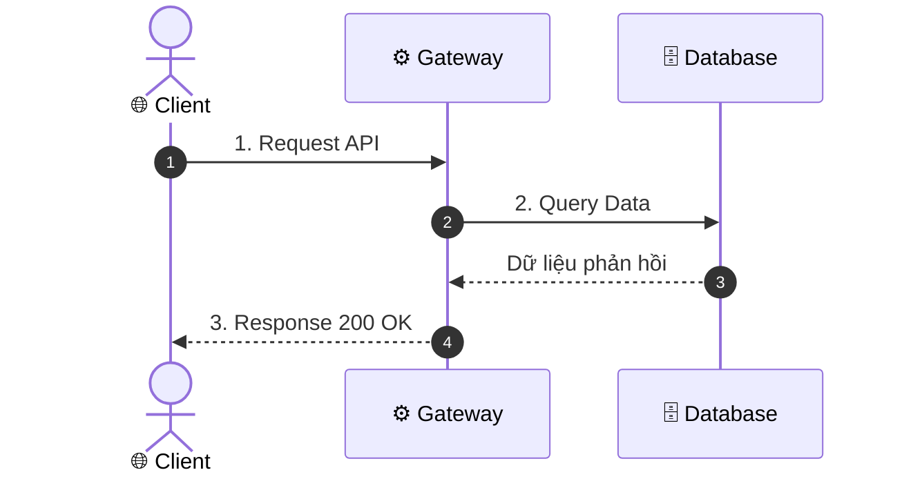
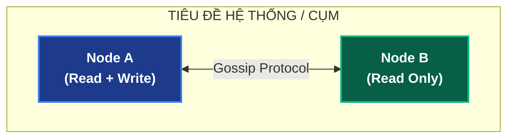

# Technical Diagrams & Architecture Visualizations Skill

Kỹ năng này hướng dẫn thiết kế và kiểm thử sơ đồ kỹ thuật chuẩn mực, đảm bảo **hiển thị 100% không lỗi** trên mọi nền tảng (VS Code Preview, GitHub, Gitlab, Terminal, Text Editor).

---

## 1. Mẫu Sơ Đồ Đôi (ASCII Art + Mermaid Template)

Khi mô tả kiến trúc phân tán hoặc luồng xử lý dữ liệu phức tạp, luôn cung cấp 2 góc nhìn:

### A. Mẫu Sơ Đồ Tuần Tự (Sequence Flow)

```
  [ 🌐 Client / Browser ]            [ ⚙️ Backend Gateway ]           [ 🗄️ Database / Cache ]
            │                                │                                      │
            │── 1. Gửi Yêu Cầu ─────────────▶│                                      │
            │                                │── 2. Xử lý & Truy vấn ──────────────▶│
            │◀── 3. Trả về Kết quả ──────────│◀── Dữ liệu phản hồi ─────────────────│
```



### B. Mẫu Sơ Đồ Khối Kiến Trúc (Architecture Topology)

```
               ┌────────────────────────────────────────────────────────┐
               │                 TIÊU ĐỀ HỆ THỐNG / CỤM                 │
               └────────────────────────────────────────────────────────┘
                                           │
                        ┌──────────────────┴──────────────────┐
                        ▼                                     ▼
             ┌─────────────────────┐               ┌─────────────────────┐
             │       Node A        │◀─────────────▶│       Node B        │
             │   (Read + Write)    │    Gossip     │     (Read Only)     │
             └─────────────────────┘               └─────────────────────┘
```



---

## 2. Checklist Kiểm Tra Cú Pháp Mermaid Tránh Lỗi (Error Prevention Checklist)

Trước khi lưu file Markdown chứa Mermaid, hãy chạy checklist sau:

- [ ] **Bọc ngoặc kép `["..."]`:** Mọi node label trong Flowchart có chứa `()`, `/`, `&`, `?`, `=`, `<`, `>`, số, hoặc emoji.
- [ ] **Bọc ngoặc kép nhãn mũi tên `|"..."|`:** Mọi edge label có chứa `()` hoặc ký tự đặc biệt.
- [ ] **Không có `direction` trong `subgraph`:** Bỏ hoàn toàn `direction TB` hoặc `direction LR` bên trong các khối `subgraph`.
- [ ] **Không dùng dấu `;` trong `sequenceDiagram`:** Thay dấu chấm phẩy trong headers, cookies bằng dấu phẩy `,` hoặc gạch đứng `|`. Xóa `;` cuối câu lệnh SQL.
- [ ] **Không dùng dấu thăng `#` trong `sequenceDiagram`:** Ký tự `#` bị coi là comment làm cụt nội dung phía sau (`Xem sản phẩm #105` ❌ -> `Xem sản phẩm ID 105` ✅).
- [ ] **Không bọc ngoặc kép khi khai báo `actor / participant ... as ...`:** Viết `actor User as 📱 Người dùng`, KHÔNG viết `actor User as "📱 Người dùng"`.
- [ ] **Dùng `Note over` thay cho khối `alt / else / end` phức tạp:** Tránh sập renderer hoặc vỡ khung trên VS Code WebView.
- [ ] **Đúng thứ tự `Note over A,B`:** Luôn đảm bảo `A` đứng bên trái `B` trong sơ đồ tuần tự.
- [ ] **Không nối vào ID của `subgraph`:** Mũi tên phải nối từ/đến các node cụ thể (`nodeA --> nodeB`).
