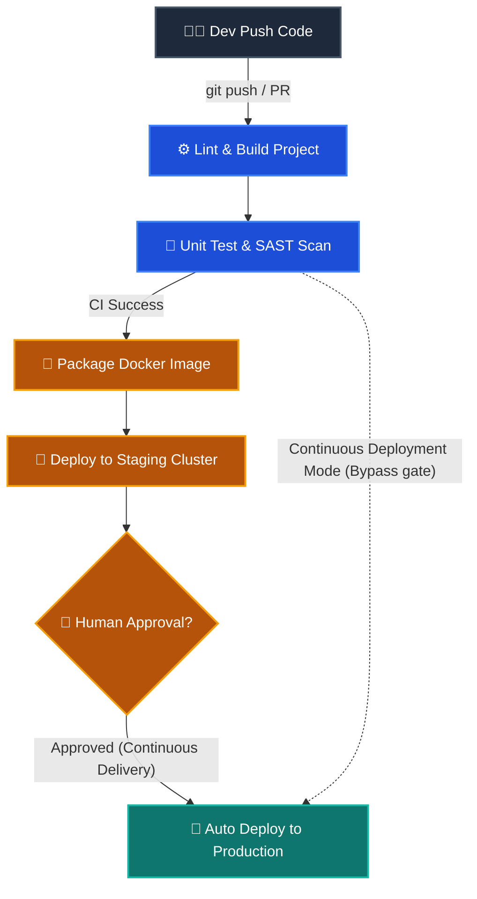
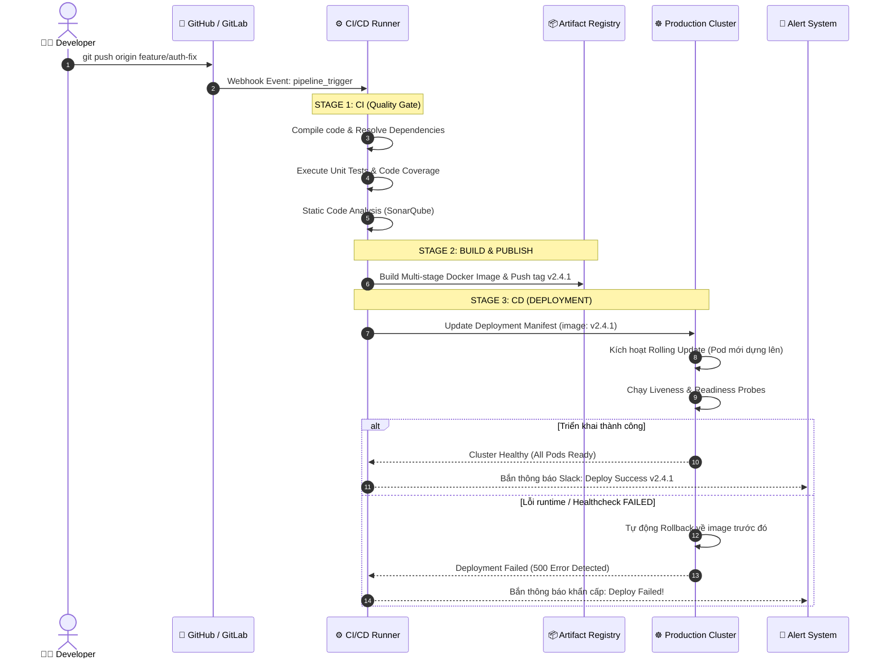
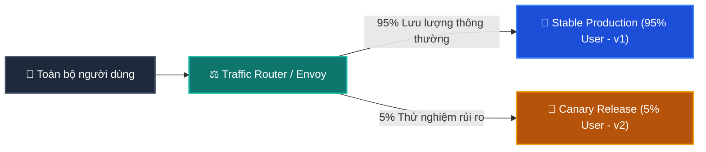

# 🚀 CI/CD: Bản Chất, Kiến Trúc Pipeline, Chiến Lược Triển Khai & Thực Chiến Cho Backend

> **CI/CD (Continuous Integration / Continuous Delivery & Continuous Deployment)** là xương sống của văn hóa DevOps và kỹ thuật phần mềm hiện đại.  
> CI/CD tự động hóa toàn bộ vòng đời phát hành mã nguồn: từ lúc lập trình viên commit code, chạy kiểm thử tự động, đóng gói container image, cho đến triển khai an toàn lên các môi trường Staging và Production mà không làm gián đoạn dịch vụ (Zero-Downtime Deployment).

---

## 🏛️ 1. Bản Chất Kỹ Thuật: Phân Biệt CI, CD (Delivery) & CD (Deployment)

Rất nhiều kỹ sư nhầm lẫn giữa **Continuous Delivery** và **Continuous Deployment**. Dưới đây là ranh giới kỹ thuật chi tiết:

```
┌────────────────────────────────────────────────────────────────────────────────────────────────────────┐
│                                       VÒNG ĐỜI PHÁT HÀNH PHẦN MỀM                                     │
├───────────────────┬─────────────────────────────────────────────────┬──────────────────────────────────┤
│   PHÂN ĐOẠN       │ CÁC HÀNH ĐỘNG KỸ THUẬT CỤ THỂ                  │ MỨC ĐỘ TỰ ĐỘNG HÓA               │
├───────────────────┼─────────────────────────────────────────────────┼──────────────────────────────────┤
│ 🔨 Continuous     │ 1. Lập trình viên push code lên Git branch      │ ✅ 100% Tự động                  │
│    Integration    │ 2. Trigger Webhook gọi CI Runner                │ (Bắt buộc vượt qua Lint, Build,  │
│    (CI)           │ 3. Build mã nguồn, compile, resolve deps        │  Unit Tests & Security Scan)     │
│                   │ 4. Chạy Unit Tests, Integration Tests, SAST     │                                  │
├───────────────────┼─────────────────────────────────────────────────┼──────────────────────────────────┤
│ 📦 Continuous     │ 5. Đóng gói Docker Image, gắn semantic tag      │ 🟡 Bán tự động (Semi-Automated)  │
│    Delivery       │ 6. Đẩy image lên Artifact Registry (DockerHub)  │ (Tự động deploy lên Staging,     │
│    (CD)           │ 7. Deploy tự động lên môi trường Staging/UAT    │  nhưng yêu cầu Manual Approval   │
│                   │ 8. Chạy E2E Tests, Performance Benchmark        │  từ Lead/PM để lên Production)   │
├───────────────────┼─────────────────────────────────────────────────┼──────────────────────────────────┤
│ 🚀 Continuous     │ 9. Khi code merge vào nhánh `main` / `master`   │ 🔥 100% Tự động hoàn toàn        │
│    Deployment     │ 10. Tự động rollout thẳng lên Production Cluster│ (Không cần con người phê duyệt,  │
│    (CD)           │ 11. Theo dõi lỗi qua Rollback tự động (Canary)  │  áp dụng cho hệ thống test sâu)  │
└───────────────────┴─────────────────────────────────────────────────┴──────────────────────────────────┘
```



---

## 🔄 2. Vòng Đời Chi Tiết Của Một Pipeline Backend Hoàn Chỉnh

Dưới đây là sơ đồ chi tiết diễn giải hành trình của một dòng code Backend từ máy Local Developer đến khi phục vụ hàng triệu người dùng trên Production:

```
[ Developer ]            [ Git Repository ]         [ CI Runner (Agent) ]       [ Container Registry ]     [ Kubernetes Cluster ]
     │                           │                            │                            │                         │
     │── 1. git commit & push ──▶│                            │                            │                         │
     │                           │── 2. Webhook Event Trigger▶│                            │                         │
     │                           │                            │── 3. Pull source code      │                         │
     │                           │                            │── 4. Cache & Dependencies  │                         │
     │                           │                            │── 5. Run Unit & Mock Tests │                         │
     │                           │                            │── 6. SonarQube SAST Check  │                         │
     │                           │                            │── 7. Build Docker Image ──▶│                         │
     │                           │                            │                            │── 8. Push Tagged Image ─▶│
     │                           │                            │                            │                          │── 9. Rolling Update Pods
     │                           │                            │                            │                          │── 10. Healthcheck Probe
     │◀── 11. Slack/Email Alert ─┴────────────────────────────┴────────────────────────────┴──────────────────────────┤
```



---

## 🛠️ 3. Các Giai Đoạn Cốt Lõi Trong Pipeline (Pipeline Stages Breakdown)

### Stage 1: Kiểm Tra Chất Lượng Mã Nguồn (Code Quality & Security)
- **Linting & Formatting**: Kiểm tra cú pháp, format code theo chuẩn đội ngũ (ESLint, Checkstyle, Black, Golangci-lint).
- **SAST (Static Application Security Testing)**: Quét các lỗ hổng bảo mật tiềm ẩn mà không cần chạy code (Trivy, SonarQube, Snyk). Quét cứng các khóa API, Password bị lọt (GitGuardian).
- **Unit Testing**: Chạy toàn bộ các bài test nhỏ độc lập. Tiêu chuẩn ngành thường yêu cầu độ bao phủ mã (**Code Coverage**) tối thiểu từ 75% - 85%.

### Stage 2: Đóng Gói (Artifact Packaging & Containerization)
- **Tối ưu Dockerfile Multi-stage Build**: Giảm dung lượng image từ hàng Gigabyte xuống còn vài chục Megabyte (ví dụ: dùng Distroless hoặc Alpine Linux).
- **Quản lý phiên bản (Semantic Versioning & Git SHA)**: Tuyệt đối không bao giờ dùng tag `:latest` trên production. Mỗi image được build phải gắn nhãn bất biến (Immutable Tag) bằng mã Git Commit Hash hoặc SemVer (ví dụ: `v1.4.2-b4c91a`).

### Stage 3: Triển Khai Môi Trường Đa Tầng (Multi-Environment Deployment)
- **Môi trường Development/Dev**: Dành riêng cho team dev tích hợp tính năng hàng ngày.
- **Môi trường Staging/UAT**: Bản sao thu nhỏ gần giống 99% cấu hình Production (DB cấu trúc y hệt, cùng biến môi trường, có anonymized data) để QA/BA kiểm thử chấp nhận người dùng.
- **Môi trường Production**: Môi trường sống của khách hàng, đòi hỏi tiêu chuẩn Zero-Downtime.

---

## 🎯 4. Các Chiến Lược Triển Khai Zero-Downtime (Deployment Strategies)

Trong hệ thống Backend chịu tải cao, việc dừng toàn bộ máy chủ để cập nhật phiên bản mới (Downtime Deployment) là điều tối kỵ. Dưới đây là 3 chiến lược triển khai tiêu chuẩn:

### A. Rolling Update (Cập nhật tuần tự)
- **Cơ chế**: Lần lượt tắt từng container/pod cũ và thay thế bằng container mới. Luôn giữ một lượng pod nhất định còn sống để nhận tải.
- **Ưu điểm**: Tiết kiệm tài nguyên hạ tầng, mặc định trong Kubernetes.
- **Nhược điểm**: Trong quá trình cập nhật, cả phiên bản cũ và mới cùng chạy song song, đòi hỏi cơ sở dữ liệu phải tương thích ngược (Backward Compatibility).

```
[ Bước 1 ]  (v1)  (v1)  (v1)  (v1)   ──► 100% traffic vào v1
[ Bước 2 ]  (v1)  (v1)  (v1)  [v2]   ──► 75% traffic vào v1, 25% vào v2
[ Bước 3 ]  (v1)  (v1)  [v2]  [v2]   ──► 50% traffic vào v1, 50% vào v2
[ Bước 4 ]  [v2]  [v2]  [v2]  [v2]   ──► 100% traffic chuyển sang v2 thành công
```

---

### B. Blue-Green Deployment (Triển khai Xanh - Lam)
- **Cơ chế**: Dựng song song 2 môi trường độc lập hoàn toàn. Môi trường Xanh (Blue) đang chạy bản v1. Đội ngũ triển khai bản v2 lên môi trường Lam (Green), test nội bộ hoàn tất thì đổi cờ Router/Load Balancer trỏ ngay lập tức sang Green.
- **Ưu điểm**: Rollback tức thì (chỉ mất 1 giây chuyển đổi Router) nếu v2 phát sinh lỗi.
- **Nhược điểm**: Tốn gấp đôi chi phí tài nguyên máy chủ.

```
                  ┌──────────────────────┐
                  │ 🛡️ Load Balancer     │
                  └──────────┬───────────┘
                             │
            ┌────────────────┴────────────────┐
            ▼ (Active Traffic)                ▼ (Idle / Staging)
┌───────────────────────┐         ┌───────────────────────┐
│  🟢 BLUE (v1 - Cũ)     │         │  🔵 GREEN (v2 - Mới)  │
│  Pod 1, Pod 2, Pod 3  │         │  Pod 1, Pod 2, Pod 3  │
└───────────────────────┘         └───────────────────────┘
```

---

### C. Canary Deployment (Triển khai chim hoàng yến)
- **Cơ chế**: Bắn thử nghiệm bản mới cho 1% - 5% lượng người dùng thật ngẫu nhiên (hoặc dựa trên Header/Cookie). Nếu các chỉ số APM (Error Rate, Latency, Memory) ổn định, tăng dần lên 25%, 50%, 100%.
- **Ưu điểm**: Phát hiện lỗi phát sinh trên dữ liệu thực tế với tổn hại tối thiểu.



---

## 💻 5. Mẫu Kịch Bản Pipeline Thực Chiến: GitHub Actions cho Backend

Dưới đây là một cấu hình pipeline mẫu chuẩn sản xuất dành cho dự án Backend (NodeJS / Go / Java Spring) sử dụng **GitHub Actions**:

```yaml
name: Backend CI/CD Production Pipeline

# Kích hoạt khi có commit merge vào nhánh main hoặc tạo Pull Request
on:
  push:
    branches: [ "main" ]
  pull_request:
    branches: [ "main" ]

jobs:
  # ==========================================
  # JOB 1: CONTINUOUS INTEGRATION (TEST & LINT)
  # ==========================================
  ci-test:
    runs-on: ubuntu-latest
    steps:
      - name: Checkout Mã Nguồn
        uses: actions/checkout@v4

      - name: Cài đặt Môi Trường Runtime
        uses: actions/setup-node@v4
        with:
          node-version: 20
          cache: 'npm'

      - name: Cài đặt Thư Viện (Dependencies)
        run: npm ci

      - name: Kiểm Tra Cú Pháp (Linting)
        run: npm run lint

      - name: Thực Thi Unit Tests & Coverage
        run: npm run test:coverage

  # ==========================================
  # JOB 2: BUILD & PUSH DOCKER IMAGE
  # ==========================================
  build-and-push:
    needs: ci-test
    if: github.ref == 'refs/heads/main' && github.event_name == 'push'
    runs-on: ubuntu-latest
    steps:
      - name: Checkout Mã Nguồn
        uses: actions/checkout@v4

      - name: Thiết lập Docker Buildx
        uses: docker/setup-buildx-action@v3

      - name: Đăng nhập Docker Hub / Container Registry
        uses: docker/login-action@v3
        with:
          username: ${{ secrets.DOCKER_USERNAME }}
          password: ${{ secrets.DOCKER_PASSWORD }}

      - name: Build và Push Image Đa Tầng
        uses: docker/build-push-action@v5
        with:
          context: .
          push: true
          tags: |
            myorg/backend-api:${{ github.sha }}
            myorg/backend-api:latest
          cache-from: type=gha
          cache-to: type=gha,mode=max

  # ==========================================
  # JOB 3: CONTINUOUS DELIVERY TO PRODUCTION
  # ==========================================
  deploy-production:
    needs: build-and-push
    runs-on: ubuntu-latest
    steps:
      - name: Kết nối SSH đến Production Server & Trigger Rolling Update
        uses: appleboy/ssh-action@v1.0.3
        with:
          host: ${{ secrets.PROD_SERVER_IP }}
          username: ${{ secrets.PROD_SSH_USER }}
          key: ${{ secrets.PROD_SSH_PRIVATE_KEY }}
          script: |
            echo "Đang cập nhật phiên bản backend: ${{ github.sha }}"
            cd /opt/backend-deployment
            export IMAGE_TAG=${{ github.sha }}
            docker compose pull backend
            docker compose up -d --no-deps --remove-orphans backend
            docker system prune -f
```

---

## 🛡️ 6. Các Best Practices Về Bảo Mật Trong CI/CD (DevSecOps)

1. **Quản lý Secrets nghiêm ngặt (Secrets Management)**:
   - Tuyệt đối không hardcode mật khẩu, private key, JWT secret hay database URI trong code hoặc file CI yaml.
   - Luôn sử dụng Secrets Store an toàn: GitHub Secrets, HashiCorp Vault, AWS Secrets Manager.
2. **Cơ chế Least Privilege**:
   - Token dùng trong CI/CD Runner chỉ cấp quyền vừa đủ (Read repository, Write image registry). Không cấp quyền Root/Admin cụm hạ tầng trừ khi thực sự cần.
3. **Quét lỗ hổng Image (Image Scanning)**:
   - Tích hợp bước quét image Docker bằng `Trivy` trước khi đẩy lên production để phát hiện các CVE (Common Vulnerabilities and Exposures) trong base OS.
4. **Bảo vệ nhánh Git (Branch Protection Rules)**:
   - Khóa nhánh `main`/`master`, không cho push trực tiếp.
   - Bắt buộc mọi thay đổi phải qua Pull Request và bắt buộc toàn bộ Pipeline CI phải có trạng thái **PASS (Xanh lá)** mới cho phép Merge.

---

## 📚 7. Tài Liệu Tham Khảo Liên Quan Trong Kho Lưu Trữ
- [Web Servers Overview & Architecture](file:///Users/thinhnguyen/DEVELOP/BE/Web%20Servers/01_web_servers_overview_and_architecture.md)
- [API Security Best Practices](file:///Users/thinhnguyen/DEVELOP/BE/security/08_api_security_best_practices.md)
- [Docker Practice Guidelines](file:///Users/thinhnguyen/DEVELOP/BE/docker-practice)

