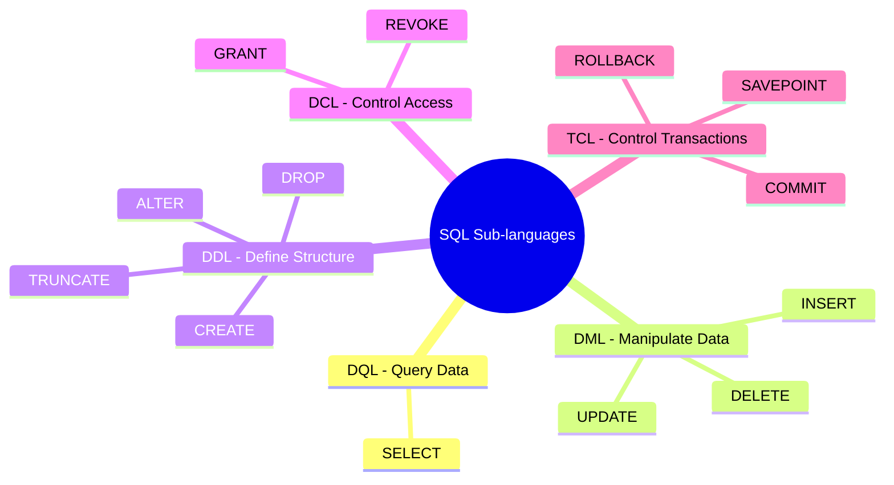

# 📖 Learn SQL Concepts (Khái Niệm & Phân Loại SQL)

**SQL (Structured Query Language)** là ngôn ngữ truy vấn mang tính cấu trúc và tiêu chuẩn (chuẩn ANSI/ISO), dùng để tương tác, quản lý và điều khiển dữ liệu trong các hệ quản trị cơ sở dữ liệu quan hệ (**RDBMS**) như PostgreSQL, MySQL, SQL Server, Oracle.

---

## 🎯 1. Bản Chất Của SQL

- **Ngôn ngữ khai báo (Declarative Language):** Bạn chỉ cần mô tả cho database biết **"Tôi muốn lấy dữ liệu gì"** (What to get), chứ không cần chỉ định từng bước lập trình như Java/C++ **"Cách thức lặp qua từng phần tử để lấy như thế nào"** (How to get).
- Database Engine (Query Optimizer) sẽ tự phân tích và tìm ra thuật toán tối ưu nhất để trả kết quả về cho bạn.

---

## 🏛️ 2. Phân Loại 5 Nhóm Lệnh SQL Cốt Lõi

Toàn bộ các câu lệnh SQL trong thực tế được chia làm **5 nhóm chức năng chính**:



| Nhóm | Tên Đầy Đủ | Mục Đích | Các Lệnh Tiêu Biểu |
| :--- | :--- | :--- | :--- |
| **DQL** | Data Query Language | **Truy vấn / Rút trích** dữ liệu từ bảng | `SELECT` |
| **DML** | Data Manipulation Language | **Thao tác dữ liệu** (thêm, sửa, xóa các hàng) | `INSERT`, `UPDATE`, `DELETE` |
| **DDL** | Data Definition Language | **Định nghĩa cấu trúc** (tạo, sửa, xóa schema, bảng, cột) | `CREATE`, `ALTER`, `DROP`, `TRUNCATE` |
| **DCL** | Data Control Language | **Phân quyền bảo mật** truy cập dữ liệu | `GRANT`, `REVOKE` |
| **TCL** | Transaction Control Language | **Quản lý giao dịch** để đảm bảo tính toàn vẹn (ACID) | `COMMIT`, `ROLLBACK`, `SAVEPOINT` |

---

## ⚡ 3. Tóm Tắt Nhanh Từng Nhóm

### 1️⃣ DQL (Data Query Language) — Lệnh Dùng Nhiều Nhất (80%)
Dùng để đọc dữ liệu mà không làm thay đổi nội dung trong database.
```sql
SELECT name, price 
FROM products 
WHERE price > 1000 
ORDER BY price DESC;
```

### 2️⃣ DML (Data Manipulation Language) — Bộ CRUD Dữ Liệu
Thao tác trên các dòng (rows/tuples) cụ thể:
```sql
-- Create (Thêm dòng)
INSERT INTO categories (name) VALUES ('Tablet');

-- Update (Cập nhật dòng)
UPDATE products SET price = 1099.00 WHERE id = 3;

-- Delete (Xóa dòng có điều kiện)
DELETE FROM products WHERE id = 4;
```

### 3️⃣ DDL (Data Definition Language) — Xây Dựng Khung Xương (Schema)
Tác động lên cấu trúc bảng, tự động commit (trong hầu hết DBMS):
```sql
-- Tạo bảng mới
CREATE TABLE customers (id SERIAL PRIMARY KEY, full_name VARCHAR(100));

-- Thêm cột vào bảng đã có
ALTER TABLE customers ADD COLUMN phone VARCHAR(20);

-- Xóa sạch toàn bộ dữ liệu trong bảng cực nhanh (nhanh hơn DELETE)
TRUNCATE TABLE customers;

-- Xóa sổ hoàn toàn cả bảng lẫn cấu trúc
DROP TABLE customers;
```

### 4️⃣ DCL (Data Control Language) — Bảo Mật & Phân Quyền
Kiểm soát user nào được phép làm gì trên database:
```sql
-- Cấp quyền đọc bảng products cho user 'app_user'
GRANT SELECT ON products TO app_user;

-- Thu hồi quyền
REVOKE SELECT ON products FROM app_user;
```

### 5️⃣ TCL (Transaction Control Language) — Toàn Vẹn Giao Dịch
Bọc nhiều lệnh DML thành 1 khối nguyên tử:
```sql
BEGIN; -- Bắt đầu giao dịch
  UPDATE accounts SET balance = balance - 100 WHERE id = 1;
  UPDATE accounts SET balance = balance + 100 WHERE id = 2;
COMMIT; -- Lưu vĩnh viễn (hoặc ROLLBACK nếu có lỗi)
```

---

## 🔄 4. Bảng So Sánh DDL vs DML (Câu Hỏi Phỏng Vấn Kinh Điển)

| Tiêu chí | DDL (Định nghĩa) | DML (Thao tác) |
| :--- | :--- | :--- |
| **Đối tượng tác động** | Cấu trúc bảng/database (Schema) | Dữ liệu bên trong bảng (Rows) |
| **Mệnh đề WHERE** | Không hỗ trợ | Có hỗ trợ (để lọc dòng cần sửa/xóa) |
| **Tốc độ thực thi** | Thao tác metadata | Phụ thuộc vào số lượng row và index |
| **`TRUNCATE` vs `DELETE`** | `TRUNCATE` là DDL (xóa sạch đĩa, reset ID, siêu nhanh) | `DELETE` là DML (quét từng dòng, ghi log từng dòng, chậm hơn) |
