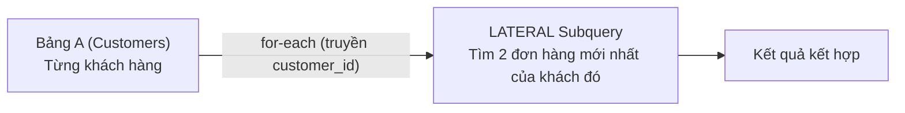

# 🧠 SQL Subqueries & Mẹo Thực Chiến Backend (Tips & Tricks Dễ Nhớ)

Tài liệu tổng hợp các dạng **Truy vấn con (Subqueries)** kèm các **công thức "thần chú" (Mental Models)** giúp bạn nhớ nhanh các thao tác phức tạp như: `GROUP BY vs HAVING`, xóa dữ liệu an toàn (`DELETE with RETURNING`), Subquery lồng nhau, và CTE (`WITH`).

---

## 🧭 1. "Thần Chú" Dễ Nhớ Cho Các Lệnh Hay Bị Lẫn

### 1️⃣ Nhóm `WHERE` vs `GROUP BY` vs `HAVING` (Hiểu Bản Chất Siêu Đơn Giản)

> 🏫 **Hình ảnh đời thường dễ nhớ (Chọn lớp khen thưởng):**
> - **`WHERE` (Lọc từng cá nhân):** *"Chỉ xét những học sinh có điểm rèn luyện $\ge 8$."* (Lọc từng dòng đơn lẻ trước khi chia nhóm).
> - **`GROUP BY` (Chia lớp/Gom nhóm):** Gom các học sinh lại thành: Nhóm Lớp 10A, Nhóm Lớp 10B, Nhóm Lớp 10C.
> - **`HAVING` (Lọc tập thể lớp):** *"Chỉ khen thưởng **những Lớp nào** có **điểm trung bình cả lớp $\ge 8.5$** hoặc **sĩ số lớp $> 30$**."* (Lọc trên kết quả tổng kết của cả nhóm sau khi đã `COUNT`, `SUM`, `AVG`).

#### ⚖️ Bảng So Sánh Cốt Lõi:

| Tiêu chí | `WHERE` | `GROUP BY` | `HAVING` |
| :--- | :--- | :--- | :--- |
| **Nhiệm vụ** | Lọc **từng dòng** riêng lẻ | **Gom các dòng giống nhau** thành từng nhóm | Lọc **kết quả của cả nhóm** |
| **Thời điểm chạy** | Chạy **trước** khi gom nhóm | Gom nhóm dữ liệu | Chạy **sau cùng**, khi nhóm đã được tính toán xong |
| **Dùng với `COUNT`, `SUM`, `AVG`?** | ❌ **KHÔNG** (vì lúc này chưa gom nhóm, chưa có tổng) | Là đối tượng để các hàm này gom cụm | ✅ **BẮT BUỘC** nếu muốn lọc theo tổng/số lượng |
| **Có bắt buộc đi chung?** | Đứng độc lập | Tự đứng một mình được (không bắt buộc có `HAVING`) | **Bắt buộc phải có `GROUP BY`** |

#### ⚠️ Hiểu Lầm Phổ Biến: *"Có `GROUP BY` là phải có `HAVING`?"*
👉 **SAI!** 
- **`GROUP BY` đứng một mình thoải mái:** Khi bạn chỉ muốn xem thống kê của **tất cả** các nhóm mà không cần lọc bỏ nhóm nào:
  ```sql
  -- Xem số lượng sản phẩm của TẤT CẢ các danh mục (KHÔNG cần HAVING)
  SELECT category, COUNT(*) AS total_products
  FROM products
  GROUP BY category;
  ```
- **Chỉ dùng thêm `HAVING` khi muốn loại bỏ bớt nhóm:**
  ```sql
  -- Chỉ lấy những danh mục nào có TỪ 2 SẢN PHẨM TRỞ LÊN
  SELECT category, COUNT(*) AS total_products
  FROM products
  GROUP BY category
  HAVING COUNT(*) >= 2; -- Phone (1 sản phẩm) bị loại
  ```

> 💡 **Khẩu quyết 1 dòng:**  
> **`WHERE`** là lọc **từng dòng**; **`HAVING`** chính là **`WHERE` dành riêng cho cả nhóm** (sau khi đã gom cụm)!

---

### 2️⃣ Xóa Dữ Liệu An Toàn (`DELETE`)
> ⚠️ **Quy tắc sống còn:** Tuyệt đối KHÔNG BAO GIỜ gõ `DELETE FROM ...` mà không có `WHERE`.

- **Mẹo 1: Chuyển `SELECT` thành `DELETE`:**
  Trước khi xóa, hãy viết câu `SELECT * FROM ... WHERE [điều_kiện]` trước để tận mắt nhìn thấy các dòng sắp bị xóa. Thấy đúng rồi mới sửa chữ `SELECT *` thành `DELETE`.

- **Mẹo 2: Dùng `RETURNING *` (Đặc sản PostgreSQL):**
  Postgres cho phép trả về danh sách các dòng vừa bị xóa/sửa ngay lập tức:
  ```sql
  DELETE FROM products 
  WHERE stock = 0 
  RETURNING id, name, price; -- Trả về đúng các món vừa bị xóa để lưu log
  ```

---

## 🎯 2. Các Dạng Subquery Kinh Điển Phải Biết

Subquery đơn giản là **một câu `SELECT` nằm lồng bên trong một câu lệnh SQL khác**.

---

### Dạng 1: Subquery trong `WHERE` (Lọc giá trị động)

#### 📌 Bài toán 1.1: Tìm sản phẩm có giá cao hơn giá trung bình của toàn bộ cửa hàng
Thay vì phải tính giá trung bình ra nháp (ví dụ 15tr) rồi gõ `WHERE price > 15000000`, ta lồng subquery:

```sql
SELECT name, price 
FROM products 
WHERE price > (SELECT AVG(price) FROM products);
```

#### 📌 Bài toán 1.2: Dùng `IN` hoặc `NOT IN` (Tìm theo danh sách)
Tìm những khách hàng **đã từng đặt ít nhất 1 đơn hàng**:

```sql
SELECT id, full_name, email 
FROM customers 
WHERE id IN (SELECT DISTINCT customer_id FROM orders);
```

Tìm những khách hàng **chưa từng mua đơn hàng nào**:
```sql
SELECT id, full_name 
FROM customers 
WHERE id NOT IN (SELECT DISTINCT customer_id FROM orders WHERE customer_id IS NOT NULL);
```

---

### Dạng 2: Correlated Subquery (Truy vấn con tương quan)
Là dạng subquery mà câu lệnh bên trong **phụ thuộc vào giá trị của câu lệnh bên ngoài** (chạy lặp lại cho từng dòng).

#### 📌 Bài toán: Tìm sản phẩm có giá đắt nhất trong TỪNG danh mục
```sql
SELECT p1.name, p1.category, p1.price
FROM products p1
WHERE p1.price = (
    SELECT MAX(p2.price) 
    FROM products p2 
    WHERE p2.category = p1.category -- Nối với danh mục của dòng bên ngoài
);
```

---

### Dạng 3: `EXISTS` vs `NOT EXISTS` (Chuẩn Tối Ưu Hiệu Năng)
Khi làm việc với bảng hàng triệu dòng, `EXISTS` chạy **nhanh hơn `IN` gấp nhiều lần** vì nó dừng quét ngay khi tìm thấy dòng đầu tiên khớp:

```sql
-- Tìm khách hàng đã từng mua ít nhất 1 đơn hàng (Dùng EXISTS)
SELECT c.id, c.full_name 
FROM customers c
WHERE EXISTS (
    SELECT 1 
    FROM orders o 
    WHERE o.customer_id = c.id
);
```

---

### Dạng 4: CTE (`WITH` clause) — Thay Thế Subquery Khó Đọc

Khi Subquery bị lồng nhau 3-4 tầng rất rối mắt, dân Backend chuyên nghiệp dùng **CTE (Common Table Expression)** với từ khóa `WITH` để đặt tên bảng tạm đọc từ trên xuống dưới như code lập trình:

```sql
-- Tìm các khách VIP và tổng số tiền họ đã chi tiêu
WITH CustomerSpending AS (
    -- Bước 1: Tính tổng tiền mỗi khách đã mua
    SELECT 
        o.customer_id,
        SUM(oi.quantity * oi.unit_price) AS total_spent
    FROM orders o
    JOIN order_items oi ON o.id = oi.order_id
    GROUP BY o.customer_id
)
-- Bước 2: Nối bảng tạm ở trên với bảng customers
SELECT 
    c.full_name,
    c.city,
    cs.total_spent
FROM customers c
JOIN CustomerSpending cs ON c.id = cs.customer_id
WHERE cs.total_spent > 20000000;
```

---

## ⚡ 5. `LATERAL JOIN` Là Gì? Có Hay Dùng Không?

### 1️⃣ Bản chất cực dễ hiểu: Vòng lặp `for-each` trong SQL
- Trong SQL thông thường, bảng bên phải của phép `JOIN` **không thể nhìn thấy** các cột của bảng bên trái.
- Nhưng khi thêm từ khóa **`LATERAL`**, bạn cho phép Subquery bên phải được **nhìn thấy và sử dụng các cột của dòng bên trái**!
- Nói cách khác: **`LATERAL` giống như một vòng lặp `for-each` trong Java/JS**: Với **MỖI dòng** ở bảng bên trái, hãy chạy Subquery bên phải một lần với tham số của dòng đó.



---

### 2️⃣ Bài toán kinh điển: "Top N phần tử cho mỗi nhóm" (Top N per group)
> 📌 **Bài toán thực tế:** Hãy lấy ra danh sách khách hàng, kèm theo **2 đơn hàng gần đây nhất** của từng khách.

- Nếu dùng `JOIN` thông thường: Cực kỳ khó và dài dòng, phải dùng Window Function phức tạp.
- Dùng **`LATERAL`**: Dễ như viết vòng lặp:

```sql
SELECT 
    c.id AS customer_id,
    c.full_name,
    recent_orders.id AS order_id,
    recent_orders.order_date,
    recent_orders.status
FROM customers c
LEFT JOIN LATERAL (
    -- Subquery này được phép dùng c.id từ bảng bên ngoài!
    SELECT o.id, o.order_date, o.status
    FROM orders o
    WHERE o.customer_id = c.id
    ORDER BY o.order_date DESC
    LIMIT 2  -- Lấy đúng 2 đơn mới nhất cho MỖI khách
) recent_orders ON TRUE;
```

---

### 3️⃣ `LATERAL JOIN` Có Hay Dùng Không?

| Mức độ sử dụng | Đánh giá thực tế |
| :--- | :--- |
| **Tần suất** | **Trung bình - Khá** (không dùng hàng ngày như `INNER/LEFT JOIN`, nhưng khi gặp bài toán đặc thù thì nó là "cứu tinh" duy nhất). |
| **Khi nào bắt buộc dùng?** | 1. **Top N per group:** Lấy top 3 sản phẩm bán chạy nhất của **mỗi** danh mục, lấy 2 bài viết mới nhất của **mỗi** tác giả.<br/>2. **Thao tác với mảng / JSONB:** Tách mảng hoặc bung JSON thành các dòng (`jsonb_to_recordset`, `unnest()`).<br/>3. **Tái sử dụng biểu thức tính toán phức tạp:** Tránh phải gõ lặp lại một phép tính toán dài nhiều lần. |
| **Hiệu năng** | Cực kỳ nhanh nếu cột dùng để lọc (như `customer_id`) có đánh **Index**. |


| Nhu Cầu | Dùng Từ Khóa Gì? | Mẹo Dễ Nhớ |
| :--- | :--- | :--- |
| Muốn lọc nhóm (`COUNT`, `SUM`) | `HAVING` | Có hàm gom cụm thì phải là `HAVING`, cấm dùng `WHERE` |
| Muốn lấy giá trị cao hơn/thấp hơn mức chung | `WHERE col > (SELECT AVG...)` | Subquery trả về 1 số duy nhất |
| Kiểm tra có tồn tại hay không | `EXISTS / NOT EXISTS` | Nhanh hơn `IN / NOT IN` khi dữ liệu lớn |
| Muốn biết vừa xóa/sửa cái gì | `RETURNING *` | "Xóa xong nhớ báo cáo lại cho tôi" |
| Câu truy vấn quá dài, lồng nhau | `WITH ten_bang_tam AS (...)` | Đặt biến tạm trong SQL cho dễ đọc |
