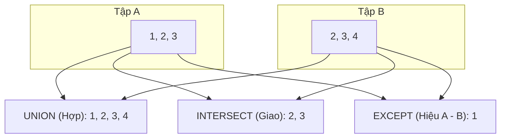

# 🔢 Set Operations in PostgreSQL (Các Phép Toán Tập Hợp)

**Set Operations (Phép toán tập hợp)** trong PostgreSQL cho phép bạn gộp, giao hoặc tìm phần bù giữa **kết quả của hai hoặc nhiều câu lệnh `SELECT`**. 

Khác với `JOIN` (kết hợp các cột theo chiều **ngang**), Set Operations kết hợp các dòng theo chiều **dọc** (xếp chồng các kết quả lên nhau).

---

## 🎯 1. Hai Điều Kiện Bắt Buộc (Mọi Set Operation Đều Phải Tuân Thủ)

Để thực hiện được `UNION`, `INTERSECT` hoặc `EXCEPT`, các câu `SELECT` phải thỏa mãn:
1. **Cùng số lượng cột:** Câu SELECT 1 có bao nhiêu cột thì câu SELECT 2 phải có bấy nhiêu cột.
2. **Cùng kiểu dữ liệu tương ứng:** Cột 1 của SELECT 1 phải cùng kiểu với cột 1 của SELECT 2 (ví dụ: `INT` với `INT`, `TEXT` với `TEXT`).

---

## 🧭 2. Ba Phép Toán Tập Hợp Cốt Lõi (Kèm Hình Ảnh Minh Họa)



| Phép toán | Tên gọi | Ý nghĩa đời thường | Bản chất toán học |
| :--- | :--- | :--- | :--- |
| **`UNION`** | **Phép Hợp** | Lấy tất cả phần tử của cả 2 tập, **tự động loại bỏ trùng lặp** | $A \cup B$ |
| **`UNION ALL`** | **Phép Hợp (Giữ trùng)** | Lấy tất cả phần tử của cả 2 tập, **GIỮ NGUYÊN các dòng trùng lặp** (Chạy siêu nhanh!) | $A + B$ |
| **`INTERSECT`** | **Phép Giao** | Chỉ lấy những phần tử **xuất hiện ở CẢ HAI tập** | $A \cap B$ |
| **`EXCEPT`** | **Phép Hiệu** | Lấy phần tử **có trong tập A nhưng KHÔNG có trong tập B** | $A \setminus B$ |

---

## 💡 3. Các Ví Dụ Thực Chiến Dễ Nhớ

Giả sử bạn có 2 bảng danh bạ:
- `employees` (Nhân viên nội bộ): gồm email `an@company.com`, `binh@company.com`.
- `contractors` (Cộng tác viên bên ngoài): gồm email `binh@company.com`, `cuong@contractor.com`.

### 1️⃣ `UNION` vs `UNION ALL` (Câu Hỏi Phỏng Vấn Kinh Điển)

```sql
-- UNION: Gộp danh sách email gửi thông báo (Tự động lọc trùng)
SELECT email FROM employees
UNION
SELECT email FROM contractors;
-- Kết quả: 'an@company.com', 'binh@company.com', 'cuong@contractor.com' (Bình chỉ xuất hiện 1 lần)

-- UNION ALL: Gộp danh sách KHÔNG lọc trùng (Dùng khi chắc chắn dữ liệu không trùng hoặc muốn đếm tổng)
SELECT email FROM employees
UNION ALL
SELECT email FROM contractors;
-- Kết quả: Bình sẽ xuất hiện 2 lần!
```

> ⚡ **Mẹo hiệu năng (Pro-tip):** Luôn ưu tiên dùng **`UNION ALL`** nếu bạn không cần lọc trùng. Vì `UNION` bắt buộc database phải thực hiện thêm bước `Sort / Unique` tốn rất nhiều CPU và RAM.

---

### 2️⃣ `INTERSECT` (Tìm Điểm Chung)
Tìm những người **vừa là nhân viên chính thức vừa nhận việc cộng tác viên**:

```sql
SELECT email FROM employees
INTERSECT
SELECT email FROM contractors;
-- Kết quả: Chỉ có 'binh@company.com'
```

---

### 3️⃣ `EXCEPT` (Tìm Phần Khác Biệt)
Tìm những nhân viên chính thức **KHÔNG làm bất kỳ dự án cộng tác nào**:

```sql
SELECT email FROM employees
EXCEPT
SELECT email FROM contractors;
-- Kết quả: Chỉ có 'an@company.com'
```

---

## ⚖️ Bảng So Sánh Nhanh: `JOIN` vs `UNION`

| Tiêu chí | `JOIN` (Nối ngang) | `UNION` (Nối dọc) |
| :--- | :--- | :--- |
| **Cách ghép** | Ghép các **cột** của bảng này vào cạnh **cột** của bảng kia | Xếp chồng các **dòng** của câu lệnh này lên dưới các **dòng** của câu lệnh kia |
| **Số cột** | Thường tăng lên (bằng tổng số cột của 2 bảng) | Giữ nguyên số cột |
| **Điều kiện** | Cần có khóa nối (`ON A.id = B.user_id`) | Không cần khóa nối, chỉ cần số lượng và kiểu cột tương đồng |
