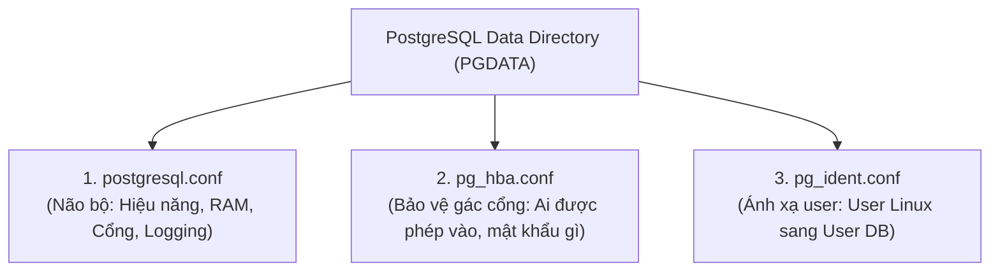

# ⚙️ Configuring PostgreSQL (Bộ 3 File Cấu Hình Sống Còn)

Khi cài đặt PostgreSQL mặc định, các thông số RAM, CPU và bảo mật chỉ được thiết lập ở mức tối thiểu để chạy được trên máy yếu. Để PostgreSQL chạy **nhanh gấp nhiều lần (Performance)** và **bảo mật an toàn (Security)** trên server thật, bạn bắt buộc phải hiểu **Bộ 3 File Cấu Hình** nằm trong thư mục dữ liệu (`PGDATA`).

---

## 🏛️ 1. Tổng Quan "Bộ 3 Quyền Lực"



| File cấu hình | Vai trò ví von | Ý nghĩa thực tế |
| :--- | :--- | :--- |
| **`postgresql.conf`** | **Não bộ / Động cơ** | Chỉnh dung lượng RAM cấp cho DB, số kết nối tối đa, cổng mạng, cơ chế ghi log. |
| **`pg_hba.conf`** | **Bảo vệ gác cổng** | `HBA` = Host-Based Authentication. Quy định IP nào được kết nối, vào database nào, dùng phương thức xác thực gì (`trust`, `md5`, `scram-sha-256`). |
| **`pg_ident.conf`** | **Căn cước ánh xạ** | Rất ít dùng. Dùng để map tên tài khoản người dùng hệ điều hành (OS user) sang tên tài khoản trong database. |

---

## 🚀 2. File 1: `postgresql.conf` — Tối Ưu Hiệu Năng & Vận Hành

Đây là file quan trọng nhất quyết định database của bạn chạy nhanh hay chậm.

### 📌 Các thông số sống còn Backend Dev phải biết:

#### A. Kết nối & Mạng:
- `listen_addresses = '*'` : Mặc định là `localhost` (chỉ máy nội bộ truy cập được). Đổi thành `'*'` để cho phép các máy chủ Backend bên ngoài kết nối vào.
- `port = 5432` : Cổng lắng nghe mặc định.
- `max_connections = 100` : Số lượng kết nối đồng thời tối đa. (Không nên đặt quá cao vì mỗi connection tốn ~10MB RAM, nên dùng Connection Pooler như PgBouncer).

#### B. Cấp phát Bộ nhớ (RAM Tuning):
- `shared_buffers` : **Bộ nhớ đệm chung (RAM cache)** cho PostgreSQL.
  - *Quy tắc vàng:* Đặt bằng **25% tổng RAM** của server (Ví dụ: Server 16GB RAM $\to$ đặt `shared_buffers = 4GB`).
- `work_mem` : RAM cấp riêng cho **MỖI phép tính `SORT`, `ORDER BY`, `HASH JOIN`**.
  - *Mẹo:* Nếu câu query có nhiều phép sắp xếp lớn mà thấy chậm, tăng `work_mem` từ 4MB lên 16MB - 64MB sẽ giúp query chạy thẳng trên RAM thay vì ghi tạm ra ổ cứng.
- `maintenance_work_mem` : RAM cho các tác vụ bảo trì định kỳ như tạo Index (`CREATE INDEX`), dọn rác (`VACUUM`). Thường đặt từ 512MB - 1GB.

---

## 🛡️ 3. File 2: `pg_hba.conf` — Tường Lửa Xác Thực (Gác Cổng)

> 💡 Nhớ lại: Hôm trước khi bạn bị lỗi `FATAL: password authentication failed`, nguyên nhân chính là do cấu hình trong file này!

Cấu trúc mỗi dòng trong `pg_hba.conf` gồm 5 cột:

```text
# TYPE   DATABASE    USER            ADDRESS          METHOD
local    all         all                              trust
host     all         all             127.0.0.1/32     scram-sha-256
host     all         all             0.0.0.0/0        reject
```

### Giải mã các cột:
1. **TYPE**:
   - `local`: Kết nối qua Unix Socket (chỉ chạy trực tiếp trên máy cài Postgres).
   - `host`: Kết nối qua giao thức mạng TCP/IP (từ máy khác đến, qua IP/Domain).
2. **DATABASE**: Tên DB cho phép (`all`, hoặc chỉ định rõ `shop_db`).
3. **USER**: Tên user (`all`, hoặc chỉ định `postgres`, `app_user`).
4. **ADDRESS**: Dải mạng IP được phép kết nối (`127.0.0.1/32` là chỉ máy local, `0.0.0.0/0` là toàn mạng Internet).
5. **METHOD (Phương thức kiểm tra mật khẩu)**:
   - **`scram-sha-256`**: Chuẩn bảo mật mạnh nhất hiện nay (khuyên dùng trên Production).
   - **`md5`**: Chuẩn mã hóa cũ.
   - **`trust`**: **KHÔNG CẦN MẬT KHẨU** (ai gõ cũng vào được, chỉ dùng khi dev local hoặc cứu hộ khi quên mật khẩu).
   - **`reject`**: Chặn hoàn toàn.

---

## ⚡ 4. Làm Sao Để Áp Dụng Thay Đổi Mà Không Làm Gián Đoạn Hệ Thống?

Sau khi sửa file cấu hình, bạn **không nhất thiết phải tắt bật lại database (Restart)** làm ngắt kết nối của người dùng:

- Với `pg_hba.conf` và phần lớn thông số trong `postgresql.conf`:
  Chỉ cần thực hiện **RELOAD** (mất 0.1 giây, không rớt kết nối nào):
  ```sql
  -- Chạy ngay trong DBeaver / psql:
  SELECT pg_reload_conf();
  ```
  *(Hoặc ngoài terminal: `brew services reload postgresql` hoặc `docker exec -it <container> pg_ctl reload`)*.

- *Lưu ý:* Riêng một số ít thông số liên quan đến chia sẻ RAM nền tảng như `shared_buffers` hay `max_connections` thì bắt buộc phải **Restart** server mới có hiệu lực.
