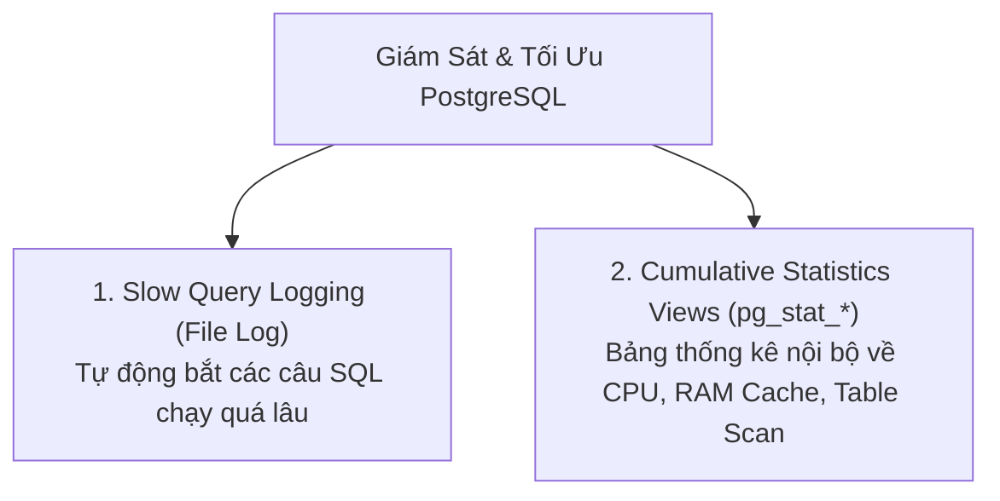

# 📊 Reporting & Logging Statistics trong PostgreSQL (Giám Sát & Tối Ưu Hiệu Năng)

Trong môi trường Production, **Database bị chậm là nguyên nhân hàng đầu khiến toàn bộ ứng dụng Backend bị treo hoặc phản hồi chậm**. Tính năng ghi Log và Thống kê (Reporting & Statistics) của PostgreSQL là "ống nghe y tế" giúp bạn chẩn đoán chính xác các điểm nghẽn cổ chai (Bottlenecks) và các câu lệnh chậm chạp (Slow Queries).

---

## 🎯 1. Hai Trụ Cột Giám Sát Hiệu Năng



---

## 🐢 2. Cấu Hình Bắt Câu Lệnh Chậm (Slow Query Logging)

Mặc định PostgreSQL không ghi log tất cả câu query để tránh làm đầy ổ cứng. Kỹ sư Backend sẽ cấu hình ngưỡng thời gian: **"Chỉ câu SQL nào chạy lâu hơn X mili-giây thì mới ghi vào log"**.

### Cấu hình trong `postgresql.conf`:
```ini
# 1. Bật bộ thu thập log
logging_collector = on

# 2. Ngưỡng thời gian ghi log (Ví dụ: bất kỳ query nào chạy > 200ms)
# Giá trị: 0 = ghi tất cả; -1 = tắt tính năng; >0 = số mili-giây
log_min_duration_statement = 200

# 3. Tiền tố log chuẩn (Ghi rõ: Thời gian, Process ID, User, Database)
log_line_prefix = '%m [%p] %u@%d '

# 4. Ghi log các câu lệnh khóa bị chờ quá lâu (Deadlock/Lock wait > 1 giây)
log_lock_waits = on
deadlock_timeout = 1000
```

> 💡 **Kết quả mẫu trong file log:**
> ```text
> 2026-09-21 22:45:10.123 UTC [12345] postgres@shop_db LOG: duration: 1540.230 ms
> statement: SELECT * FROM orders WHERE customer_name LIKE '%Thịnh%';
> ```
> *(Nhìn vào đây Backend Dev biết ngay câu lệnh mất tận 1.5s $\to$ Cần đánh Index cho cột `customer_name` ngay).*

---

## 🏆 3. Extension "Huyền Thoại": `pg_stat_statements`

Nếu file log ghi từng dòng sự kiện rời rạc, thì **`pg_stat_statements`** là bảng xếp hạng tổng hợp phân tích: câu nào bị gọi nhiều nhất, câu nào ngốn nhiều thời gian nhất của toàn hệ thống.

### Kích hoạt trong `postgresql.conf`:
```ini
shared_preload_libraries = 'pg_stat_statements'
pg_stat_statements.track = all
```

### Truy vấn Top câu lệnh ngốn nhiều thời gian nhất (chạy trong DBeaver):
```sql
SELECT 
    query, 
    calls,                                                -- Số lần ứng dụng Backend đã gọi câu này
    round(total_exec_time::numeric, 2) AS total_time_ms,  -- Tổng thời gian chạy lũy kế
    round(mean_exec_time::numeric, 2) AS avg_time_ms,     -- Thời gian chạy trung bình 1 lần
    rows                                                  -- Tổng số dòng đã trả về
FROM pg_stat_statements
ORDER BY total_exec_time DESC
LIMIT 5;
```

---

## 🔍 4. Các View Thống Kê Nội Bộ Quan Trọng (`pg_stat_*`)

PostgreSQL cung cấp sẵn các view nội bộ để kiểm tra sức khỏe hệ thống theo thời gian thực:

### 1️⃣ Xem Ai Đang Chạy Query Ngay Lúc Này (`pg_stat_activity`)
Dùng khi database bị đơ và cần tìm xem tiến trình nào đang chiếm CPU hoặc bị treo:
```sql
SELECT 
    pid, 
    usename, 
    client_addr, 
    state, 
    query, 
    age(clock_timestamp(), query_start) AS duration
FROM pg_stat_activity
WHERE state != 'idle' -- Chỉ lấy những kết nối đang bận thực thi
ORDER BY duration DESC;
```
*(Nếu muốn hủy ngay 1 câu query bị treo quá lâu: `SELECT pg_cancel_backend(pid);`)*.

---

### 2️⃣ Bảng Nào Đang Thiếu Index? (`pg_stat_user_tables`)
Kiểm tra xem bảng đang được tìm kiếm bằng **Index Scan** (nhanh) hay **Sequential Scan** (quét toàn bộ bảng - rất chậm):
```sql
SELECT 
    relname AS table_name,
    seq_scan AS full_table_scans,    -- Số lần quét toàn bộ bảng
    idx_scan AS index_scans,         -- Số lần dùng Index
    n_live_tup AS live_rows          -- Số lượng dòng hiện có
FROM pg_stat_user_tables
ORDER BY seq_scan DESC;
```
*(Nếu một bảng có hàng triệu dòng mà `seq_scan` cực cao $\to$ Báo động đỏ: Bảng đang thiếu Index trầm trọng!)*

---

### 3️⃣ Tỉ Lệ Đọc Từ RAM Cache (`pg_stat_database`)
Quy tắc vàng của CSDL: **Đọc từ RAM nhanh gấp 100 lần đọc từ ổ cứng SSD**.
```sql
SELECT 
    datname,
    round((blks_hit * 100.0 / NULLIF(blks_hit + blks_read, 0)), 2) AS cache_hit_ratio
FROM pg_stat_database
WHERE datname = current_database();
```
> 🎯 **Chỉ số chuẩn:** `cache_hit_ratio` phải **$\ge 99\%$**. Nếu con số này dưới 95%, nghĩa là RAM cấp cho Postgres (`shared_buffers`) đang quá ít, database phải liên tục đọc từ ổ đĩa gây chậm chạp.
