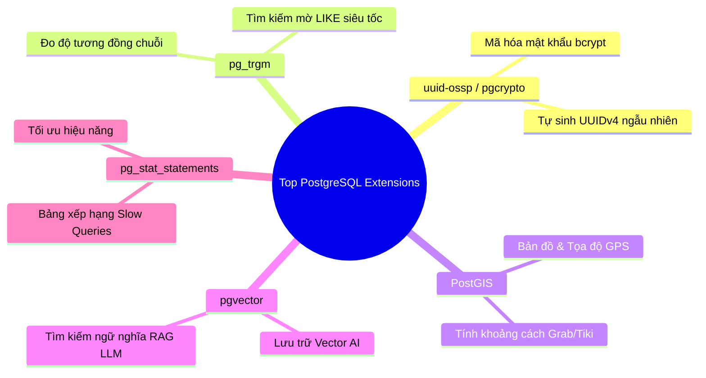

# 🧩 Adding Extensions in PostgreSQL (Mở Rộng Sức Mạnh Database)

Một trong những lý do lớn nhất khiến **PostgreSQL được mệnh danh là CSDL tiên tiến nhất thế giới** chính là cơ chế **Extensions (Tiện ích mở rộng)**. Thay vì phải viết code phức tạp ở tầng Backend (Java/Node/Python), bạn có thể "cài plugin" trực tiếp vào bên trong PostgreSQL để biến nó thành một công cụ siêu năng lực.

---

## 🎯 1. Bản Chất Của Extension Là Gì?

- **Extension giống như "Plugin / Thư viện npm / Maven dependency"** dành riêng cho PostgreSQL.
- Khi cài một extension, nó có thể bổ sung cho database:
  - Các **kiểu dữ liệu hoàn toàn mới** (ví dụ: dữ liệu địa lý GPS, vector AI, UUID).
  - Các **hàm tính toán chuyên sâu** (mã hóa mật khẩu, tính khoảng cách địa lý).
  - Các **loại Index đặc biệt** phục vụ tìm kiếm siêu tốc.

---

## ⚡ 2. Các Câu Lệnh Quản Trị Extension (Cực Kỳ Đơn Giản)

> 💡 Extension được cài đặt **theo từng Database riêng biệt** (cài ở DB nào thì chỉ DB đó dùng được).

```sql
-- 1. Xem danh sách TẤT CẢ các extension có sẵn trong hệ thống mà bạn có thể cài
SELECT * FROM pg_available_extensions ORDER BY name;

-- 2. Xem các extension ĐÃ ĐƯỢC CÀI ĐẶT trong database hiện tại
SELECT * FROM pg_extension;
-- hoặc trong psql gõ lệnh tắt:
\dx

-- 3. Cài đặt một extension mới (Bắt buộc dùng IF NOT EXISTS để tránh lỗi)
CREATE EXTENSION IF NOT EXISTS "uuid-ossp";

-- 4. Gỡ bỏ extension khi không dùng nữa
DROP EXTENSION IF EXISTS "uuid-ossp";
```

---

## 🏆 3. Top 5 Extensions "Huyền Thoại" Mọi Backend Dev Phải Biết



| Tên Extension | Công Dụng Thực Tế | Ví Dụ Bài Toán Backend |
| :--- | :--- | :--- |
| **`uuid-ossp`** (hoặc `pgcrypto`) | Tự sinh mã **UUID ngẫu nhiên** | Thay thế ID số tăng dần (`1, 2, 3`) để tránh bị người dùng đoán ID đơn hàng hoặc ID người dùng. |
| **`pgcrypto`** | Băm và mã hóa mật khẩu (`bcrypt`, `sha256`) | Mã hóa mật khẩu hoặc số thẻ ngân hàng ngay trong database. |
| **`pg_trgm`** (Trigram) | **Tìm kiếm mờ (Fuzzy Search)** siêu tốc | Khách gõ *"ipone"* vẫn tự động tìm ra sản phẩm *"iPhone"* cực nhanh bằng Index GIN. |
| **`postgis`** | Hệ thống thông tin địa lý (GIS) | Tìm *"5 tài xế Grab gần vị trí của tôi nhất trong bán kính 2km"*. |
| **`pgvector`** *(Hot trend AI hiện nay)* | Lưu trữ và tìm kiếm vector nhúng (Embeddings) | Xây dựng ứng dụng Chatbot AI, tìm kiếm ngữ nghĩa tương đồng (RAG) giống ChatGPT. |

---

## 🧪 4. Thực Hành 2 Extension Thông Dụng Ngay Trên DBeaver

Mở DBeaver và chạy thử 2 bài toán kinh điển này:

### Bài 1: Dùng `uuid-ossp` để sinh khóa chính ngẫu nhiên
```sql
-- Kích hoạt extension
CREATE EXTENSION IF NOT EXISTS "uuid-ossp";

-- Thử sinh 1 mã UUID v4
SELECT uuid_generate_v4();
-- Kết quả dạng: c9a646d3-9c61-4cc9-bc55-e9df7f29f0e1

-- Ứng dụng tạo bảng đơn hàng bảo mật cao:
CREATE TABLE secure_orders (
    id UUID PRIMARY KEY DEFAULT uuid_generate_v4(),
    total_amount NUMERIC(10, 2)
);

INSERT INTO secure_orders (total_amount) VALUES (500000);
SELECT * FROM secure_orders;
```

---

### Bài 2: Dùng `pg_trgm` để tìm kiếm sản phẩm gõ sai chính tả
```sql
CREATE EXTENSION IF NOT EXISTS pg_trgm;

-- Tính độ tương đồng giữa từ khóa người dùng gõ ('ipone') và từ chuẩn ('iPhone 15')
SELECT similarity('ipone', 'iPhone 15 Pro') AS score;
-- Trả về điểm tương đồng từ 0 đến 1 -> Giúp làm tính năng gợi ý tìm kiếm "Ý bạn là..."
```
