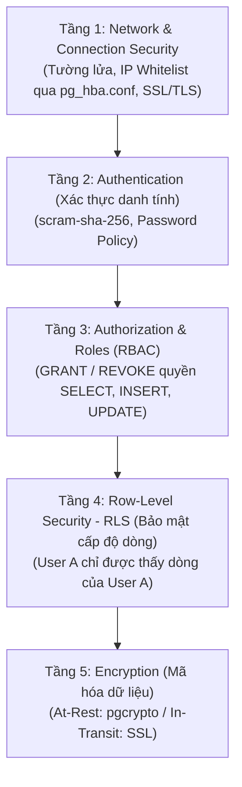

# 🛡️ PostgreSQL Security Concepts (Bảo Mật Cơ Sở Dữ Liệu Đa Tầng)

Bảo mật trong PostgreSQL không phải là một tính năng đơn lẻ, mà là một chiến lược **"Phòng thủ theo chiều sâu" (Defense in Depth)** gồm nhiều tầng lớp bảo vệ, từ tầng mạng, tài khoản, phân quyền, cho tới cấp độ từng dòng dữ liệu và mã hóa.

---

## 🏛️ 1. Mô Hình 5 Tầng Bảo Mật Trong PostgreSQL



---

## 🔒 2. Chi Tiết Từng Tầng Bảo Mật

### 1️⃣ Tầng 1: Network & Connection (Gác Cổng)
- **File `pg_hba.conf`:** Whitelist cụ thể IP nào được phép kết nối (như bài trước đã học, cấm mở `0.0.0.0/0` bừa bãi).
- **Mã hóa đường truyền (In-Transit Encryption - SSL/TLS):** Bắt buộc bật `ssl = on` trong `postgresql.conf` và yêu cầu `sslmode=require` trên chuỗi kết nối để chống tin tặc nghe lén (Man-in-the-Middle) trên đường truyền Internet.

---

### 2️⃣ Tầng 2: Roles & Authentication (Quản Lý Tài Khoản)
Trong PostgreSQL, **User và Group đều là một thực thể gọi chung là `ROLE`**.
- Không bao giờ để ứng dụng Backend chạy bằng tài khoản tối cao `postgres` (Superuser).
- Tạo riêng tài khoản dành riêng cho ứng dụng và dùng chuẩn mã hóa mạnh nhất:

```sql
-- Tạo tài khoản ứng dụng chỉ có quyền đăng nhập (LOGIN), không có quyền Superuser
CREATE ROLE app_user WITH LOGIN PASSWORD 'MatKhauSieuKho123@#';
```

---

### 3️⃣ Tầng 3: Authorization (Phân Quyền Theo Nguyên Tắc Quyền Tối Thiểu - Least Privilege)
Ứng dụng Backend của bạn chỉ được cấp đúng những quyền nó cần để hoạt động:

```sql
-- 1. Cho phép dùng schema
GRANT USAGE ON SCHEMA public TO app_user;

-- 2. Chỉ cấp quyền Đọc, Thêm, Sửa trên các bảng cần thiết (CẤM cấp DROP TABLE hay TRUNCATE)
GRANT SELECT, INSERT, UPDATE, DELETE ON ALL TABLES IN SCHEMA public TO app_user;

-- 3. Cấp quyền dùng sequence (để tự tăng ID)
GRANT USAGE, SELECT ON ALL SEQUENCES IN SCHEMA public TO app_user;
```

---

### 4️⃣ Tầng 4: Row-Level Security (RLS) — "Đặc Sản" Đẳng Cấp Của PostgreSQL
> 💡 Bình thường lệnh `GRANT SELECT ON orders` sẽ cho phép xem **toàn bộ đơn hàng của tất cả mọi người**. 
> Nhưng với **RLS (Row-Level Security)**, database sẽ tự động ép: **"Khách hàng nào chỉ được nhìn thấy đơn hàng của chính khách hàng đó"**, dù câu SQL bên ngoài có gõ `SELECT * FROM orders;`!

```sql
-- 1. Bật tính năng RLS trên bảng orders
ALTER TABLE orders ENABLE ROW LEVEL SECURITY;

-- 2. Tạo chính sách bảo mật: Dòng nào có customer_id trùng với ID người đang đăng nhập mới được xem
CREATE POLICY customer_only_policy ON orders
    FOR SELECT
    USING (customer_id = current_setting('app.current_user_id')::int);
```
*(Đây là tính năng nền tảng tạo nên thành công của Supabase trong kiến trúc Multi-tenancy hiện đại).*

---

### 5️⃣ Tầng 5: Data Encryption (Mã Hóa Dữ Liệu)
- **Mã hóa khi lưu trên đĩa (At-Rest):** Dùng ổ đĩa mã hóa phần cứng (AWS KMS, LUKS trên Linux).
- **Mã hóa cấp độ cột (Column-level) bằng extension `pgcrypto`:** Dành cho dữ liệu cực kỳ nhạy cảm như số CMND/CCCD hoặc số thẻ tín dụng:

```sql
CREATE EXTENSION IF NOT EXISTS pgcrypto;

-- Mã hóa dữ liệu bằng khóa bí mật
INSERT INTO sensitive_data (secret_info) 
VALUES (pgp_sym_encrypt('Số thẻ: 4111-2222-3333-4444', 'KhoaBiMatCuaBackend'));

-- Giải mã khi cần đọc
SELECT pgp_sym_decrypt(secret_info, 'KhoaBiMatCuaBackend') FROM sensitive_data;
```

---

## 📋 3. Checklist "Sống Còn" Cho Backend Developer Khi Deploy Production

| Hạng mục | Quy tắc bắt buộc |
| :--- | :--- |
| **Superuser** | Tuyệt đối **KHÔNG dùng user `postgres`** trong file `.env` hoặc `application.properties`. |
| **Password** | Dùng thuật toán mã hóa mật khẩu `scram-sha-256` (tránh dùng `md5` hoặc `trust`). |
| **Mạng** | Giới hạn IP trong `pg_hba.conf` chỉ mở cho IP của server Backend. |
| **SSL** | Bắt buộc bật SSL (`sslmode=verify-full` hoặc `sslmode=require`). |
| **Phòng thủ SQL Injection** | Ở code Backend (Spring Boot / Node.js) luôn dùng **PreparedStatement / Param Queries** (`?` hoặc `:param`), tuyệt đối không nối chuỗi SQL thủ công. |
