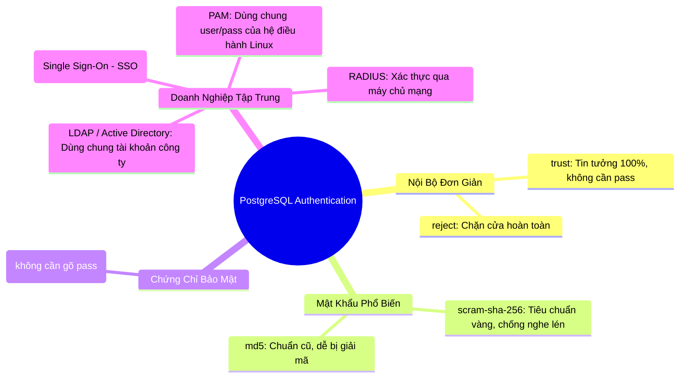

# 🔐 Authentication Models in PostgreSQL (Các Phương Thức Xác Thực Danh Tính)

Đoạn văn trên nói về **Authentication Models (Các mô hình xác thực)** trong PostgreSQL. Nếu như Phân quyền (`GRANT/REVOKE`) trả lời cho câu hỏi: *"Bạn vào đây rồi thì được làm gì?"*, thì Xác thực (`Authentication`) trả lời cho câu hỏi đầu tiên: **"Bạn là ai, và làm sao tôi tin được bạn chính là người đó?"**.

Toàn bộ các phương thức này được khai báo ở cột cuối cùng (`METHOD`) trong file **`pg_hba.conf`**.

---

## 🧭 1. Bản Đồ Phân Loại Các Phương Thức Xác Thực

PostgreSQL hỗ trợ rất nhiều cách để kiểm tra danh tính, từ mức sơ khai (không cần pass) đến các chuẩn mã hóa ngân hàng và hệ thống doanh nghiệp lớn:



---

## 🔍 2. Chi Tiết Các Phương Thức Cốt Lõi (Kèm Đánh Giá Thực Chiến)

### 1️⃣ Nhóm Phổ Biến Nhất (Backend Dev Nào Cũng Dùng)

#### 🟢 `scram-sha-256` (Khuyên dùng 100% trên Production)
- **Cơ chế:** Dùng thuật toán băm đa tầng mã hóa cực mạnh. Khi client gửi mật khẩu lên server, nó sử dụng cơ chế Salted Challenge Response (không bao giờ truyền mật khẩu gốc hay mã hash cố định qua mạng).
- **Ưu điểm:** Hacker dù có nghe lén trọn gói tin mạng cũng không thể giải mã hoặc dùng kỹ thuật Replay Attack để vào database được.

#### 🟡 `trust` (Cửa Mở Toang)
- **Cơ chế:** Ai gõ user nào cũng vào được thẳng database mà **không bị hỏi mật khẩu**.
- **Khi nào dùng:** Chỉ dùng khi chạy Docker test local ở máy cá nhân hoặc dùng để "cứu hộ" khẩn cấp khi bạn lỡ quên mật khẩu tài khoản `postgres`. Cấm dùng trên Production!

#### 🔴 `md5` (Đã Lỗi Thời)
- Chuẩn băm cũ của các bản Postgres ngày xưa. Hiện nay các siêu máy tính có thể dò ngược mã MD5 trong vài giây $\to$ Không nên dùng nữa.

---

### 2️⃣ Nhóm Doanh Nghiệp Lớn (Enterprise / Single Sign-On)

Trong các ngân hàng hoặc tập đoàn lớn có hàng nghìn kỹ sư, họ không tạo user riêng lẻ trên từng database mà dùng tài khoản công ty:

| Phương thức | Ý nghĩa đời thường | Trường hợp ứng dụng |
| :--- | :--- | :--- |
| **`LDAP`** (hoặc Windows Active Directory) | Dùng tài khoản email công ty (VD: `thinh.nguyen@bank.com`) để đăng nhập vào Database. Khi nhân viên bị đuổi việc, khóa tài khoản công ty là tự động mất quyền vào DB. | Toàn bộ ngân hàng, công ty viễn thông, tập đoàn lớn. |
| **`GSSAPI` / `SSPI` (Kerberos)** | **Single Sign-On (SSO):** Kỹ sư đăng nhập vào máy tính công ty một lần duy nhất, khi mở DBeaver kết nối vào Postgres sẽ tự động nhận diện danh tính, không cần gõ mật khẩu lần 2. | Hệ thống mạng nội bộ bảo mật cao (chính phủ, quân đội). |
| **`cert` (Client Certificate)** | Đăng nhập bằng **Chứng chỉ số SSL**: Máy của lập trình viên phải có 1 file chứng chỉ `.crt` riêng do công ty cấp thì Postgres mới mở cửa. | Hệ thống thanh toán tài chính, kết nối giữa Microservices với nhau. |
| **`PAM` / `Ident`** | Ủy thác việc xác thực cho hệ điều hành Linux (tài khoản Linux tên gì thì đăng nhập DB bằng mật khẩu Linux đó). | Các server Linux nội bộ. |

---

## 🛠️ 3. Minh Họa Cấu Hình Trong File `pg_hba.conf`

```text
# TYPE   DATABASE    USER           ADDRESS             METHOD

# 1. Máy local dev chạy docker: cho vào thẳng không hỏi pass
local    all         all                                trust

# 2. Server Backend kết nối qua mạng: bắt buộc dùng chuẩn mật khẩu mạnh nhất
host     all         app_user       10.0.1.50/32        scram-sha-256

# 3. Kỹ sư trong văn phòng: bắt buộc xác thực qua hệ thống LDAP công ty
host     all         all            192.168.1.0/24      ldap ldapserver=ldap.company.com ...

# 4. Toàn bộ các IP lạ bên ngoài Internet: chặn thẳng tay
host     all         all            0.0.0.0/0           reject
```

---

## 🎯 Tóm Tắt 1 Dòng Để Bạn Đi Phỏng Vấn:

> *"Authentication trong PostgreSQL được cấu hình trong file `pg_hba.conf`. Trong thực tế Backend, chuẩn khuyên dùng số 1 hiện nay là **`scram-sha-256`**, còn trong các doanh nghiệp lớn thì tích hợp với **`LDAP`** hoặc **`SSL Certificate`** để quản lý tập trung."*
