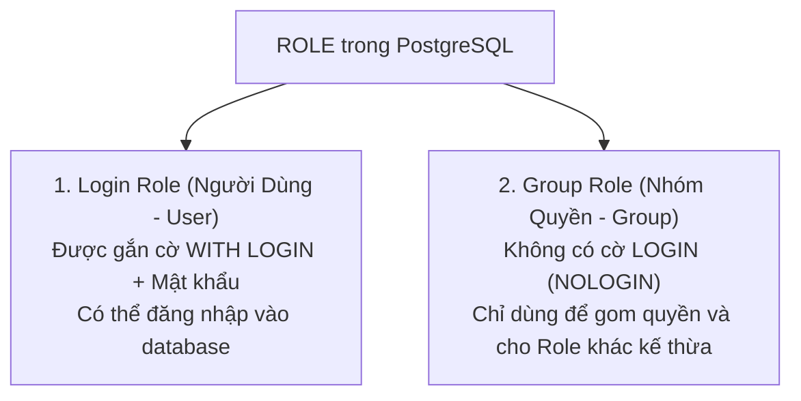

# 👥 PostgreSQL Roles & Attributes (Quản Lý Định Danh & Thuộc Tính)

Trong PostgreSQL, **Role (Vai trò)** là khái niệm cốt lõi đại diện cho danh tính người dùng và nhóm quyền hạn. PostgreSQL không tách rời "User" và "Group" như các hệ thống khác mà **gộp chung thành một khái niệm duy nhất là `ROLE`**.

---

## 🧭 1. Bản Chất Của Role: 2 Hình Thái Duy Nhất



- **Login Role:** Đại diện cho con người hoặc ứng dụng kết nối vào (`CREATE ROLE thinh WITH LOGIN PASSWORD '...';`).
- **Group Role:** Đại diện cho chức vụ/nhóm quyền (`CREATE ROLE hr_department;` $\to$ Gán `thinh` vào `hr_department`).

---

## ⚡ 2. Các Thuộc Tính Cấp Cao Của Role (Role Attributes)

Khi tạo Role, bạn có thể cấp cho nó các "siêu quyền hạn" ở cấp độ toàn bộ hệ quản trị CSDL:

| Thuộc Tính (Attribute) | Nghịch đảo | Ý Nghĩa Thực Tế | Khuyến Nghị Đi Làm |
| :--- | :--- | :--- | :--- |
| **`LOGIN`** | `NOLOGIN` | Quyền được phép kết nối/đăng nhập vào database. | Chỉ cấp cho user thật hoặc app kết nối. |
| **`SUPERUSER`** | `NOSUPERUSER` | Quyền tối cao, bỏ qua mọi bước kiểm tra bảo mật (giống `root`). | **Tuyệt đối không cấp** cho ứng dụng Backend. |
| **`CREATEDB`** | `NOCREATEDB` | Cho phép Role tự tạo ra các Database mới. | Cấp cho Developer ở môi trường Dev/Staging. |
| **`CREATEROLE`** | `NOCREATEROLE` | Cho phép tạo, sửa, xóa các Role khác. | Cấp cho quản trị viên nhóm. |
| **`INHERIT`** *(Mặc định)*| `NOINHERIT` | Cho phép Role **tự động thừa kế** toàn bộ quyền của nhóm mà nó tham gia. | Luôn để mặc định (`INHERIT`). |
| **`REPLICATION`** | `NOREPLICATION` | Dành riêng cho Streaming Replication (sao chép dữ liệu giữa Master và Replica). | Chỉ cấp cho user làm nhiệm vụ đồng bộ database. |
| **`CONNECTION LIMIT`** | - | Giới hạn số lượng kết nối đồng thời (vd: `CONNECTION LIMIT 20`). | Tránh 1 user mở quá nhiều connection làm tràn RAM. |

---

## 🛠️ 3. Bộ Lệnh SQL Quản Trị Role Chuẩn

### 1️⃣ Tạo Role (`CREATE ROLE`)
```sql
-- Tạo một nhóm quyền (Group Role)
CREATE ROLE accounting_group NOLOGIN;

-- Tạo một User có thể đăng nhập, bị giới hạn tối đa 10 kết nối cùng lúc
CREATE ROLE accountant_mai WITH 
    LOGIN 
    PASSWORD 'MatKhauKho123!@' 
    CREATEDB 
    CONNECTION LIMIT 10;
```

### 2️⃣ Thừa kế quyền (`GRANT role TO role`)
```sql
-- Gán bạn Mai vào nhóm Kế toán (Mai tự động có toàn bộ quyền của nhóm)
GRANT accounting_group TO accountant_mai;
```

### 3️⃣ Chỉnh sửa thuộc tính Role (`ALTER ROLE`)
```sql
-- Thu hồi quyền tạo Database của Mai
ALTER ROLE accountant_mai NOCREATEDB;

-- Đổi mật khẩu
ALTER ROLE accountant_mai WITH PASSWORD 'NewSecretPassword456!@';

-- Đổi tên Role
ALTER ROLE accountant_mai RENAME TO accountant_mai_senior;
```

### 4️⃣ Xóa Role an toàn (`DROP ROLE`)
> ⚠️ **Quy tắc sống còn:** Bạn **KHÔNG THỂ** xóa một Role nếu nó đang là **chủ sở hữu (Owner)** của bất kỳ bảng nào hoặc vẫn còn quyền được gán!

```sql
-- Bước 1: Chuyển quyền sở hữu các bảng của user này sang cho admin
REASSIGN OWNED BY accountant_mai TO postgres;

-- Bước 2: Thu hồi mọi quyền liên quan của user này
DROP OWNED BY accountant_mai;

-- Bước 3: Lúc này mới xóa được Role
DROP ROLE accountant_mai;
```

---

## 🔍 4. Xem Danh Sách Roles & Thuộc Tính Trong Database

Chạy câu lệnh SQL này trong DBeaver:

```sql
SELECT 
    rolname AS role_name,
    rolcanlogin AS can_login,
    rolsuper AS is_superuser,
    rolcreatedb AS can_create_db,
    rolcreaterole AS can_create_role,
    rolconnlimit AS max_connections
FROM pg_roles
ORDER BY rolcanlogin DESC, rolname;
```
*(Hoặc trong `psql` chỉ cần gõ đúng 1 lệnh tắt: `\du`)*.
