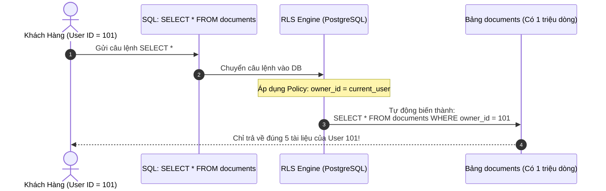

# 🛡️ Row Level Security - RLS (Bảo Mật Cấp Độ Từng Dòng Dữ Liệu)

**Row Level Security (RLS)** là một trong những tính năng bảo mật đỉnh cao nhất của PostgreSQL (ra mắt từ bản 9.5). Nếu như phân quyền truyền thống (`GRANT SELECT ON orders`) chỉ cho phép bạn chọn: **Được xem toàn bộ bảng hoặc Không được xem gì cả**, thì RLS cho phép bạn kiểm soát: **"Người dùng này chỉ được phép nhìn thấy và sửa những DÒNG NÀO trong bảng!"**.

---

## 🎯 1. Bài Toán Thực Tế: Vì Sao RLS Là "Vũ Khí Tối Thượng"?

### Cách làm truyền thống (Xử lý ở tầng Backend Code):
Lập trình viên Backend phải nhớ luôn luôn viết thêm `WHERE user_id = :currentUserId` trong mọi câu SQL:
```sql
SELECT * FROM orders WHERE customer_id = 101;
```
> ⚠️ **Rủi ro chí mạng:** Nếu một ngày đẹp trời một lập trình viên mới vào dự án viết thiếu mệnh đề `WHERE` $\to$ Người dùng A sẽ **nhìn thấy toàn bộ đơn hàng của người dùng B, C, D** (Lộ dữ liệu khách hàng nghiêm trọng!).

### Cách làm hiện đại với RLS (Bảo vệ ngay từ tầng CSDL):
Database sẽ **tự động chèn thêm điều kiện lọc ngầm** vào mọi câu lệnh `SELECT`, `UPDATE`, `DELETE`. Dù lập trình viên Backend có viết ngây ngô:
```sql
SELECT * FROM orders; -- Không có WHERE gì cả!
```
👉 Nhưng PostgreSQL sẽ **tự động chặn lại** và chỉ trả về đúng những dòng thuộc sở hữu của người đang đăng nhập!

---

## 🧭 2. Cơ Chế Hoạt Động Của RLS (2 Bước Cốt Lõi)



---

## 🛠️ 3. Cú Pháp Thực Hành RLS 3 Bước Chuẩn

### Bước 1: Bật tính năng RLS trên bảng
Mặc định bảng không bật RLS. Bạn phải bật nó lên:
```sql
ALTER TABLE documents ENABLE ROW LEVEL SECURITY;
```
*(Lưu ý: Ngay sau khi bật lệnh này, nếu chưa tạo Policy nào thì tất cả các user thường sẽ **bị cấm xem toàn bộ bảng**, chỉ có Superuser mới xem được).*

---

### Bước 2: Tạo chính sách bảo mật (`CREATE POLICY`)

Cú pháp tổng quát:
```sql
CREATE POLICY [tên_policy] ON [tên_bảng]
    FOR [SELECT | INSERT | UPDATE | DELETE | ALL]
    TO [tên_role]
    USING ([điều_kiện_để_được_xem_hoặc_sửa])
    WITH CHECK ([điều_kiện_khi_insert_hoặc_update_dòng_mới]);
```

#### 📌 Ví dụ thực chiến 1: Ai chỉ được xem tài liệu của người đó
```sql
CREATE POLICY document_owner_policy ON documents
    FOR ALL
    TO app_user
    USING (owner_username = CURRENT_USER);
```

#### 📌 Ví dụ thực chiến 2: Trưởng phòng được xem hết, Nhân viên chỉ xem của mình
```sql
CREATE POLICY employee_view_policy ON salary_records
    FOR SELECT
    USING (
        employee_id = current_user_id() 
        OR CURRENT_USER = 'manager_role'
    );
```

---

### Bước 3: Hai mệnh đề sống còn: `USING` vs `WITH CHECK`

| Mệnh đề | Áp dụng cho | Mục đích kiểm tra |
| :--- | :--- | :--- |
| **`USING`** | `SELECT`, `UPDATE`, `DELETE` | Kiểm tra xem người dùng **có quyền nhìn thấy dòng dữ liệu đang có sẵn này không**. |
| **`WITH CHECK`** | `INSERT`, `UPDATE` | Kiểm tra xem dòng dữ liệu **mới chuẩn bị được thêm/sửa có hợp lệ với chính sách không**. *(Tránh việc user A lén INSERT một dòng gắn ID của user B).* |

---

## 🏆 4. Ứng Dụng Đỉnh Cao: Kiến Trúc Multi-Tenancy (SaaS)

Trong các ứng dụng phần mềm dạng dịch vụ (SaaS - Software as a Service) như Jira, Trello, Salesforce: Hàng nghìn công ty dùng chung một database.

Người ta dùng RLS để cô lập dữ liệu tuyệt đối giữa các công ty:
```sql
-- Đảm bảo nhân viên công ty A không bao giờ thấy dữ liệu của công ty B
CREATE POLICY tenant_isolation_policy ON all_company_data
    USING (tenant_id = current_setting('app.current_tenant_id')::uuid);
```
*(Đây chính là bí quyết giúp nền tảng **Supabase** nổi tiếng toàn cầu nhờ tích hợp RLS sâu sắc với PostgreSQL).*

---

## 🎯 Tóm Tắt 1 Dòng Để Bạn Đi Phỏng Vấn:

> *"Row-Level Security (RLS) là cơ chế của PostgreSQL cho phép áp dụng các chính sách (`POLICY`) bảo mật xuống từng dòng dữ liệu cụ thể, giúp bảo vệ dữ liệu khách hàng tuyệt đối ngay tại tầng CSDL mà không phụ thuộc hoàn toàn vào việc lập trình viên có nhớ viết mệnh đề `WHERE` hay không."*
