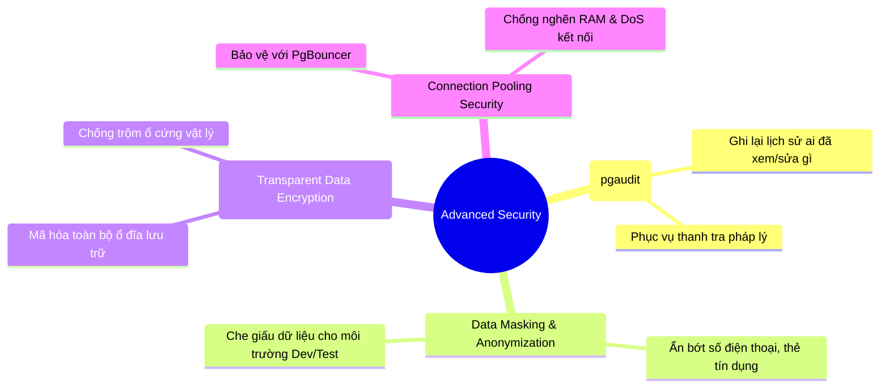

# 🏰 Advanced Topics in PostgreSQL Security (Bảo Mật CSDL Nâng Cao)

Ngoài các tầng bảo mật cơ bản như Mật khẩu, Phân quyền (`GRANT/REVOKE`) và RLS, trong các hệ thống cấp doanh nghiệp lớn (Ngân hàng, FinTech, E-commerce quy mô triệu người dùng), PostgreSQL cung cấp các **cơ chế bảo mật nâng cao (Advanced Security)** nhằm đáp ứng các tiêu chuẩn an ninh quốc tế khắt khe (như **PCI-DSS**, **HIPAA**, **ISO 27001**).

---

## 🏛️ 1. Bản Đồ 4 Chủ Đề Bảo Mật Nâng Cao Cốt Lõi



---

## 🔍 2. Chi Tiết Từng Chủ Đề Nâng Cao

### 1️⃣ Audit Logging với Extension `pgaudit` (Nhật Ký Kiểm Toán Pháp Lý)
> 📌 **Bài toán:** *"Tháng trước số dư tài khoản của khách hàng VIP bị sửa từ 10 tỷ xuống 1 tỷ. Ai là người đã chạy câu lệnh đó? Vào mấy giờ? Từ máy tính nào?"*

File log thông thường không đủ chi tiết và không được tòa án / tổ chức kiểm toán chấp nhận. Kỹ sư sẽ dùng **`pgaudit`**:
- Nó ghi lại chi tiết từng câu lệnh SQL tác động lên bảng nhạy cảm kèm đầy đủ bối cảnh (Session ID, User, Thời gian chính xác đến micro-giây).
- Không ai (kể cả Admin) có thể xóa hoặc sửa được các dòng log này.

```ini
# Cấu hình pgaudit trong postgresql.conf:
shared_preload_libraries = 'pgaudit'
pgaudit.log = 'write, ddl'  # Ghi lại toàn bộ lệnh sửa dữ liệu và thay đổi cấu trúc bảng
```

---

### 2️⃣ Data Masking (Mặt Nạ Dữ Liệu) & Anonymization
> 📌 **Bài toán:** Khi copy database từ Production về môi trường Dev/Staging cho lập trình viên code và test bug, nếu để nguyên số điện thoại, CCCD hay email thật của khách hàng thì **vi phạm luật an ninh mạng**.

- **Dynamic Data Masking:** Dữ liệu trong đĩa vẫn là thật, nhưng khi hiển thị cho nhân viên chăm sóc khách hàng (CSKH) thì tự động bị che:
  - `0987654321` $\to$ `0987***321`
  - `4111-2222-3333-4444` $\to$ `****-****-****-4444`
- Sử dụng extension **`postgresql_anonymizer`** để tự động làm mờ dữ liệu cá nhân theo chuẩn GDPR.

---

### 3️⃣ TDE (Transparent Data Encryption - Mã Hóa Trong Suốt)
> 📌 **Bài toán:** *"Nếu kẻ trộm đột nhập vào trung tâm dữ liệu (Data Center), tháo trộm thanh ổ cứng SSD của server mang về nhà cắm vào máy tính khác đọc file?"*

- Nếu không có TDE: Kẻ trộm dùng tool đọc đĩa là xem được toàn bộ file raw data của Postgres.
- Khi có **TDE / Mã hóa ổ đĩa (AWS KMS, LUKS trên Linux)**: Toàn bộ block dữ liệu ghi xuống ổ cứng đều bị mã hóa AES-256. Không có chìa khóa giải mã thì ổ cứng đó chỉ là "cục sắt vụn".

---

### 4️⃣ SQL Injection Defense & Parameterized Queries (Phòng Thủ Ở Tầng Backend)
Dù database có bảo mật 10 tầng mà ở tầng Backend lập trình viên viết code **nối chuỗi SQL thủ công** thì coi như "mở toang cửa sau cho trộm":

```java
// ❌ CỰC KỲ NGUY HIỂM: Nối chuỗi SQL (Dễ bị SQL Injection)
String sql = "SELECT * FROM users WHERE username = '" + userInput + "'";

// ✅ CHUẨN BACKEND AN TOÀN: Dùng PreparedStatement / Tham số tham chiếu
String sql = "SELECT * FROM users WHERE username = :username";
```
*(Postgres xử lý tham số `:username` như dữ liệu thô thuần túy, tin tặc có gõ `' OR '1'='1` cũng không bao giờ hack được).*

---

## 🎯 Tóm Tắt 1 Dòng Để Ghi Nhớ:

> *"Bảo mật nâng cao trong PostgreSQL bao gồm việc **ghi nhật ký kiểm toán bất biến (`pgaudit`)**, **che giấu thông tin nhạy cảm (Data Masking)** cho môi trường test, **mã hóa toàn bộ ổ đĩa (TDE)** và bắt buộc tuân thủ **tham số hóa câu lệnh SQL** ở tầng Backend để miễn nhiễm với SQL Injection."*
