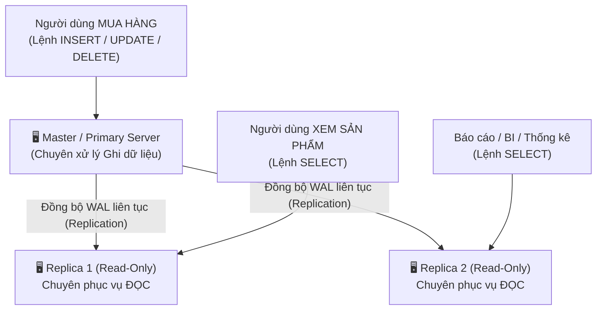

# 🔄 Replication in PostgreSQL (Sao Chép & Đồng Bộ CSDL)

**Replication (Sao chép dữ liệu)** là kỹ thuật tự động nhân bản dữ liệu liên tục từ một máy chủ cơ sở dữ liệu chính (**Primary / Master**) sang một hoặc nhiều máy chủ phụ (**Standby / Replica / Slave**).

Đây là kiến trúc nền tảng bắt buộc của mọi hệ thống Backend quy mô vừa và lớn để giải quyết 3 bài toán sống còn: **High Availability (Tính sẵn sàng cao)**, **Fault Tolerance (Chịu lỗi)**, và **Scalability (Khả năng mở rộng)**.

---

## 🎯 1. Vì Sao Một Hệ Thống Lớn Bắt Buộc Phải Dùng Replication?

Nếu hệ thống chỉ chạy **1 máy chủ Database duy nhất (Single Point of Failure - SPOF)**:
- 💥 Server bị cháy ổ cứng / cúp điện $\to$ Toàn bộ ứng dụng sập, công ty ngừng hoạt động.
- 🐌 Hàng triệu người dùng cùng vào xem sản phẩm $\to$ Server quá tải CPU, database phản hồi chậm như rùa.

Khi có **Replication (Mô hình Primary - Standby)**:

### 3 Lợi ích vàng:
1. **Chia tải đọc (Read Scaling / Read-Write Split):** 90% truy vấn của ứng dụng là đọc (`SELECT`). Ta đẩy toàn bộ câu đọc sang các máy Replica $\to$ Giảm 90% áp lực cho máy Master.
2. **Dự phòng thảm họa & Sẵn sàng cao (Failover / HA):** Nếu máy Master bị sập, một máy Replica sẽ được lập tức thăng cấp (**Promote**) lên làm Master mới chỉ trong vài giây $\to$ Hệ thống không bị gián đoạn.
3. **Sao lưu không ảnh hưởng người dùng:** Chạy backup dữ liệu trên máy Replica mà không làm chậm máy chính.

---

## 🧭 2. Hai Cơ Chế Replication Trong PostgreSQL

PostgreSQL hỗ trợ 2 cơ chế nhân bản dữ liệu khác nhau:

### 1️⃣ Physical Streaming Replication (Nhân Bản Vật Lý - Dùng nhiều nhất 95%)
- **Cơ chế:** Server Master liên tục gửi trực tiếp các khối dữ liệu nhị phân từ file nhật ký ghi trước (**WAL - Write-Ahead Log**) sang máy Standby qua mạng.
- **Đặc điểm:** 
  - Sao chép **chính xác 100% từng byte dữ liệu** của toàn bộ database cluster.
  - Máy Replica ở trạng thái **chỉ đọc (Read-Only / Hot Standby)**.
  - Tốc độ đồng bộ cực kỳ nhanh và tốn rất ít CPU.

### 2️⃣ Logical Replication (Nhân Bản Logic - Ra mắt từ PostgreSQL 10+)
- **Cơ chế:** Dựa trên mô hình **Xuất bản & Đăng ký (Publish / Subscribe)**.
- **Đặc điểm:** 
  - Cho phép chọn lọc: Chỉ nhân bản **một vài bảng cụ thể** thay vì toàn bộ database.
  - Có thể đồng bộ dữ liệu giữa **hai phiên bản PostgreSQL khác nhau** (vd: từ Postgres 14 sang Postgres 17).
  - Máy nhận (Subscriber) vẫn có thể vừa nhận dữ liệu vừa tự ghi thêm dữ liệu riêng của nó.

---

## ⚡ 3. Đồng Bộ (Synchronous) vs Bất Đồng Bộ (Asynchronous)

| Tiêu chí | Asynchronous Replication (Bất Đồng Bộ - Mặc định) | Synchronous Replication (Đồng Bộ) |
| :--- | :--- | :--- |
| **Cơ chế** | Master ghi xong dữ liệu xuống đĩa là báo thành công ngay cho client, sau đó mới gửi dữ liệu sang Replica. | Master ghi xong, phải **chờ ít nhất 1 Replica nhận và ghi xong** thì mới báo thành công cho client. |
| **Tốc độ ghi** | **Cực nhanh**, không bị ảnh hưởng bởi độ trễ mạng giữa các server. | **Chậm hơn một chút** vì phải chờ mạng phản hồi. |
| **Rủi ro mất dữ liệu** | Nếu Master sập đột ngột khi dữ liệu chưa kịp truyền sang Replica, có thể mất vài giây giao dịch gần nhất (Replication Lag). | **Không bao giờ mất dù chỉ 1 byte dữ liệu (Zero Data Loss)**. |
| **Khuyên dùng** | Hầu hết các ứng dụng thông thường, mạng xã hội, e-commerce. | Hệ thống Ngân hàng, Giao dịch chứng khoán, Ví điện tử. |

---

## 🎯 Tóm Tắt 1 Dòng Để Đi Phỏng Vấn:

> *"Replication trong PostgreSQL là cơ chế tự động nhân bản dữ liệu từ Primary sang các máy Standby (chủ yếu qua Streaming WAL logs). Nó giúp hệ thống đạt được **High Availability (Failover khi server chính gặp sự cố)** và **Read Scalability (tách riêng luồng Đọc sang các máy Replica)**."*
