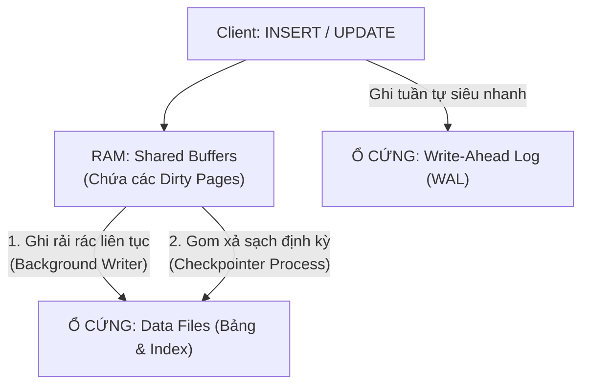

# 💾 Checkpoints & Background Writer in PostgreSQL (Cơ Chế Ghi Đĩa & Phục Hồi Dữ Liệu)

Trong PostgreSQL, dữ liệu không được ghi ngay lập tức vào các file dữ liệu trên ổ cứng sau mỗi lệnh `INSERT` hay `UPDATE` vì ghi đĩa ngẫu nhiên (**Random I/O**) rất chậm. Thay vào đó, dữ liệu được sửa đổi trực tiếp trên bộ nhớ RAM (**Shared Buffers**). 

Để đảm bảo dữ liệu **không bao giờ bị mất khi cúp điện đột ngột** và **hiệu năng ghi đĩa luôn mượt mà**, PostgreSQL sử dụng bộ đôi phối hợp nhịp nhàng: **Checkpoints** và **Background Writer (bgwriter)**.

---

## 🏛️ 1. Bản Chất Vấn Đề: "Dirty Pages" Là Gì?

- Khi một dòng dữ liệu bị sửa đổi trên RAM, trang bộ nhớ (Page - 8KB) chứa dòng đó được gọi là **Dirty Page (Trang dơ / Trang chưa lưu xuống đĩa)**.
- Lúc này, dữ liệu mới chỉ tồn tại trên **RAM** và trong file nhật ký ghi trước (**WAL**).
- Nhiệm vụ sống còn của hệ thống: Phải đưa các Dirty Pages này từ RAM xuống các file dữ liệu thật trên ổ cứng (Data Files).

---

## ⚡ 2. Checkpoints — "Điểm Lưu Game An Toàn"

### 🎯 Checkpoint là gì?
- **Checkpoint (Điểm kiểm tra)** là một sự kiện định kỳ, trong đó tiến trình `checkpointer` bắt buộc phải **quét sạch toàn bộ Dirty Pages đang có trên RAM và ép ghi xuống ổ cứng (fsync)**.
- Sau khi Checkpoint hoàn tất, PostgreSQL đánh dấu: *"Tất cả dữ liệu tính đến thời điểm này đã an toàn 100% trên đĩa"*.

### 🔄 Ý nghĩa đối với Crash Recovery (Khôi phục sau sự cố rút điện):
- Nếu server bị sập nguồn đột ngột, khi khởi động lại, PostgreSQL chỉ cần mở file log WAL ra và **chạy lại (REDO) các giao dịch tính từ mốc Checkpoint gần nhất trở đi**, chứ không cần đọc lại WAL từ đầu lịch sử!
- **Checkpoints diễn ra càng thường xuyên** $\to$ Thời gian khởi động phục hồi càng nhanh.
- **Checkpoints diễn ra quá dày đặc** $\to$ Ổ cứng bị quá tải vì phải liên tục xả dữ liệu.

---

## ⚙️ 3. Ba Thông Số Tinh Chỉnh Checkpoint Cốt Lõi (`postgresql.conf`)

| Tham số | Giá trị mặc định | Giải thích ý nghĩa | Khuyến nghị tối ưu Server thật |
| :--- | :--- | :--- | :--- |
| **`checkpoint_timeout`** | `5min` | Thời gian tối đa giữa 2 lần Checkpoint tự động. | Tăng lên `15min` - `30min` để giảm nghẽn ổ đĩa. |
| **`max_wal_size`** | `1GB` | Dung lượng log WAL tối đa được phép sinh ra trước khi ép buộc kích hoạt Checkpoint sớm. | Tăng lên `16GB` - `64GB` cho server ghi nhiều dữ liệu. |
| **`checkpoint_completion_target`** | `0.9` | Tỉ lệ rải đều khối lượng ghi trong suốt chu kỳ Checkpoint. | Giữ nguyên `0.9` (rải đều 90% thời gian) để tránh ổ cứng bị nghẽn đột ngột. |

---

## 🌊 4. Background Writer (bgwriter) — "Người Quét Rác Thầm Lặng"

### 🎯 Background Writer là gì?
- Nếu chỉ có Checkpoint, mỗi khi đến giờ Checkpoint, ổ cứng sẽ bị **đột biến lưu lượng ghi (I/O Spikes)**, làm database bị đơ khựng trong vài giây.
- **Background Writer (`bgwriter`)** sinh ra để giải quyết vấn đề này: Nó là một tiến trình chạy ngầm liên tục, **mỗi lần một ít**, âm thầm nhặt các Dirty Pages ghi rải rác xuống đĩa.

### 💡 Sự Phối Hợp Hoàn Hảo:
- **`bgwriter`**: Chăm chỉ quét rác liên tục, giữ cho RAM luôn có sẵn các trang trống sạch sẽ để các câu lệnh `INSERT` của người dùng không phải tự mình ghi đĩa.
- **`checkpointer`**: Đóng vai trò là mốc chốt chặn an toàn định kỳ, xả nốt những gì còn sót lại và đánh dấu mốc phục hồi WAL.

---

## 🎯 Tóm Tắt 1 Dòng Để Đi Phỏng Vấn:

> *"Trong PostgreSQL, **Checkpoints** định kỳ xả toàn bộ Dirty Pages từ RAM xuống đĩa để tạo mốc phục hồi sự cố (Crash Recovery), còn **Background Writer** liên tục ghi rải rác dữ liệu ngầm để làm mịn lưu lượng I/O, tránh tình trạng ổ cứng bị nghẽn giật cục."*
