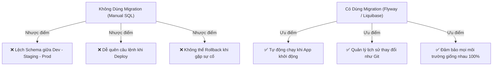

# 🚀 Database Migrations (Quản Lý Phiên Bản Cơ Sở Dữ Liệu)

**Database Migration** được ví như **"Git dành riêng cho Database Schema"**. Đó là tập hợp các file script (thường là SQL hoặc mã nguồn) có thứ tự, dùng để nâng cấp hoặc hạ cấp cấu trúc cơ sở dữ liệu (tạo bảng, thêm cột, đổi kiểu dữ liệu, đánh index) một cách có kiểm soát và tự động hóa.

---

## 🎯 1. Nỗi Đau Thực Tế: Khi Không Dùng Migration?

Hãy tưởng tượng bạn làm việc trong một nhóm lập trình Backend gồm 4 người:
- Bạn Thịnh thêm cột `phone_number` vào bảng `users` trên máy cá nhân và viết code chạy ngon lành.
- Bạn commit code lên GitHub. Bạn đồng nghiệp kéo code về chạy thì **bị lỗi sập app** vì database của bạn ấy chưa có cột `phone_number`!
- Đến ngày deploy lên Production, cả team nháo nhào: *"Ai nhớ trong 1 tháng qua chúng ta đã chạy những câu lệnh `ALTER TABLE` nào bằng tay trên DBeaver không?"* $\to$ Rất dễ sót lệnh và làm sập toàn bộ hệ thống!



---

## 🧭 2. Cơ Chế Hoạt Động Của Migration Tool (Ví Dụ Flyway)

Khi dùng công cụ Migration (như **Flyway** trong Spring Boot hoặc **Prisma / TypeORM** trong Node.js):

### A. Đặt tên file theo phiên bản có thứ tự:
Các file SQL được đặt trong thư mục `src/main/resources/db/migration/`:
- `V1__create_users_table.sql`
- `V2__add_phone_to_users.sql`
- `V3__create_orders_table.sql`

### B. Bảng lịch sử ngầm: `flyway_schema_history`
Lần đầu tiên chạy, Migration Tool sẽ tự tạo ra 1 bảng ngầm trong PostgreSQL tên là `flyway_schema_history`:

| installed_rank | version | description | script | checksum | success |
| :--- | :--- | :--- | :--- | :--- | :--- |
| 1 | 1 | create users table | V1__create_users_table.sql | 87236412 | TRUE |
| 2 | 2 | add phone to users | V2__add_phone_to_users.sql | 99128374 | TRUE |

👉 **Mỗi khi khởi động App:**
1. Migration Tool đọc bảng này để biết database hiện tại đang ở phiên bản mấy (ví dụ đang ở V2).
2. Nếu nó thấy trong source code có thêm file `V3`, nó sẽ **tự động chạy file V3** và ghi nhật ký vào bảng.
3. Nếu các file V1, V2 đã chạy rồi, nó sẽ bỏ qua, không chạy lại nữa!

---

## ⚡ 3. Hai Hướng Di Chuyển: `UP` (Nâng Cấp) vs `DOWN` (Hạ Cấp)

Một hệ thống Migration chuẩn mực thường hỗ trợ 2 chiều:
- **`UP` (Migrate):** Áp dụng thay đổi mới (tiến lên phiên bản tiếp theo).
  ```sql
  -- V2: Thêm cột
  ALTER TABLE users ADD COLUMN phone_number VARCHAR(15);
  ```
- **`DOWN` (Rollback):** Hoàn tác thay đổi vừa làm (quay về phiên bản cũ nếu deploy gặp lỗi).
  ```sql
  -- Rollback V2: Xóa cột vừa thêm
  ALTER TABLE users DROP COLUMN phone_number;
  ```

---

## 🏆 4. Các Công Cụ Migration Phổ Biến Nhất Theo Từng Ngôn Ngữ

| Ngôn ngữ / Hệ sinh thái | Công cụ Migration chuẩn công nghiệp |
| :--- | :--- |
| **Java / Spring Boot** | **Flyway** *(Phổ biến nhất, viết bằng file `.sql` thuần)*, **Liquibase** *(Hỗ trợ XML/YAML/SQL)* |
| **Node.js / TypeScript** | **Prisma Migrate**, **TypeORM**, **Knex.js**, **Drizzle** |
| **Go (Golang)** | **golang-migrate**, **Goose** |
| **Python** | **Alembic** (đi kèm SQLAlchemy), **Django Migrations** |

---

## 🎯 Tóm Tắt 1 Dòng Để Đi Phỏng Vấn:

> *"Database Migration là công cụ quản lý phiên bản mã nguồn cho Database Schema (giống như Git). Nó giúp tự động hóa việc thay đổi cấu trúc bảng một cách tuần tự, đảm bảo database ở môi trường Local của Developer, máy Test và máy chủ Production luôn đồng nhất 100%."*
