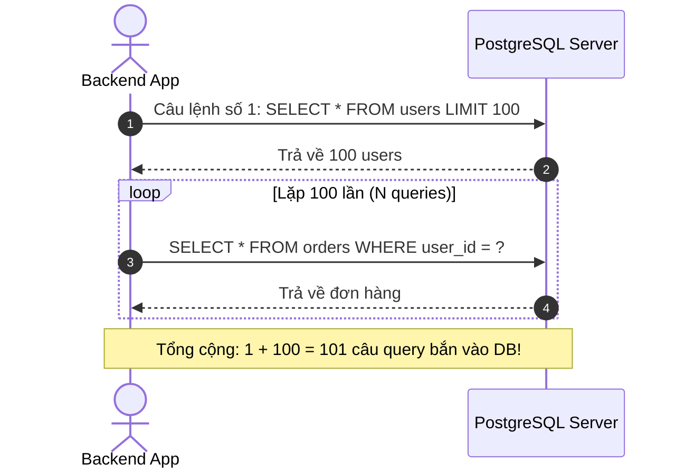

# ⚠️ N+1 Problem (Cơn Ác Mộng Hiệu Năng Của Backend & ORM)

**N+1 Problem (Vấn nạn N+1 truy vấn)** là lỗi thiết kế truy vấn kinh điển nhất mà **mọi lập trình viên Backend (đặc biệt khi dùng ORM như Spring Data JPA, Hibernate, Prisma, TypeORM)** đều từng mắc phải. 

Nó biến một thao tác đơn giản lẽ ra chỉ tốn **1 câu lệnh SQL** thành **hàng trăm, hàng nghìn câu lệnh SQL bắn liên tục vào database**, đánh sập hiệu năng của toàn bộ hệ thống!

---

## 🎯 1. N+1 Problem Diễn Ra Như Thế Nào? (Ví Dụ Đời Thường)

Giả sử bạn có 2 bảng: `users` (người dùng) và `orders` (đơn hàng). Một user có nhiều đơn hàng.

Bạn muốn viết một API: *"Lấy danh sách 100 người dùng kèm theo đơn hàng của họ"*.

### ❌ Cách code ngây thơ gây ra N+1 Problem:
```java
// Bước 1: Câu lệnh 1 (Lấy danh sách 100 users)
List<User> users = userRepository.findAll(); // Chạy câu: SELECT * FROM users LIMIT 100;

// Bước 2: Vòng lặp lấy đơn hàng cho TỪNG user
for (User user : users) {
    // 💥 BẮN THÊM N CÂU QUERY NỮA (N = 100 lần)!
    List<Order> orders = orderRepository.findByUserId(user.getId()); 
    // SELECT * FROM orders WHERE user_id = 1;
    // SELECT * FROM orders WHERE user_id = 2;
    // ...
    // SELECT * FROM orders WHERE user_id = 100;
}
```



---

## 💥 2. Hậu Quả Kinh Hoàng Khi Lên Production

- **Ở môi trường Dev (Dữ liệu ít):** Bạn chỉ có 5 user $\to$ chạy 6 câu query, mất 0.05 giây $\to$ Tưởng code mình chạy ngon!
- **Lên Production (Dữ liệu lớn):** Khi danh sách có **10,000 users** $\to$ Hệ thống bắn **10,001 câu SQL** vào PostgreSQL:
  - Database bị nghẽn mạng (Network Overhead do gửi đi gửi lại 10,000 lần bắt tay).
  - CPU của PostgreSQL vọt lên **100%**.
  - Server đơ cứng, người dùng mở app thấy quay vòng tròn chờ 30 giây!

---

## 🛠️ 3. Ba Giải Pháp "Đặc Trị" N+1 Problem

### 🟢 Cách 1: Dùng `JOIN` (Lấy Tất Cả Trong 1 Câu Duy Nhất - Khuyên Dùng!)
Thay vì bắn 101 câu lệnh, ta dùng phép `JOIN` để lấy toàn bộ dữ liệu chỉ với **ĐÚNG 1 CÂU QUERY DUY NHẤT**:

```sql
SELECT 
    u.id AS user_id, 
    u.username, 
    o.id AS order_id, 
    o.total_amount
FROM users u
LEFT JOIN orders o ON u.id = o.user_id;
```

#### Trong Spring Boot (JPA / Hibernate) dùng `JOIN FETCH`:
```java
@Query("SELECT u FROM User u JOIN FETCH u.orders")
List<User> findAllUsersWithOrders();
```
*(Từ khóa `JOIN FETCH` ép Hibernate chỉ bắn đúng 1 câu SQL gom cả 2 bảng).*

---

### 🟡 Cách 2: Dùng `IN (...)` (Batching - Gom Nhóm Truy Vấn)
Nếu không muốn JOIN vì sợ dữ liệu bị trùng lặp cột, ta có thể giải quyết bằng **ĐÚNG 2 CÂU QUERY**:

- **Câu 1:** Lấy 100 users:
  ```sql
  SELECT * FROM users LIMIT 100;
  ```
- **Câu 2:** Gom toàn bộ 100 cái `user_id` lại và lấy đơn hàng 1 lần bằng mệnh đề `IN`:
  ```sql
  SELECT * FROM orders WHERE user_id IN (1, 2, 3, ..., 100);
  ```
👉 **Từ 101 câu query giảm ngoạn mục xuống còn 2 câu query!**

*(Trong Hibernate, chỉ cần gắn thêm annotation `@BatchSize(size = 100)` trên trường `@OneToMany`).*

---

### 🔴 Cách 3: Cẩn Thận Với `EAGER` Loading
Trong Hibernate / JPA:
- Mặc định các quan hệ `@OneToMany` là `LAZY` (khi nào gọi `user.getOrders()` mới query $\to$ dễ gây N+1 nếu nằm trong vòng for).
- Nhưng nếu đổi sang `FetchType.EAGER` một cách vô tội vạ, Hibernate có thể tự động bắn hàng loạt query ngầm mỗi khi bạn gọi `userRepository.findById()` mà bạn không hề hay biết!

---

## 🎯 Tóm Tắt 1 Dòng Để Đi Phỏng Vấn:

> *"N+1 Problem là hiện tượng truy vấn 1 danh sách gồm N phần tử, sau đó với mỗi phần tử lại bắn thêm 1 câu query để lấy dữ liệu quan hệ (tổng cộng 1 + N queries). Cách khắc phục chuẩn nhất là dùng **`JOIN FETCH`** (gom vào 1 query) hoặc **Batching với `IN (...)`** (giảm xuống còn 2 queries)."*
