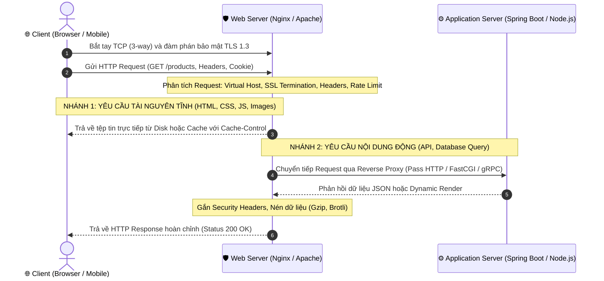
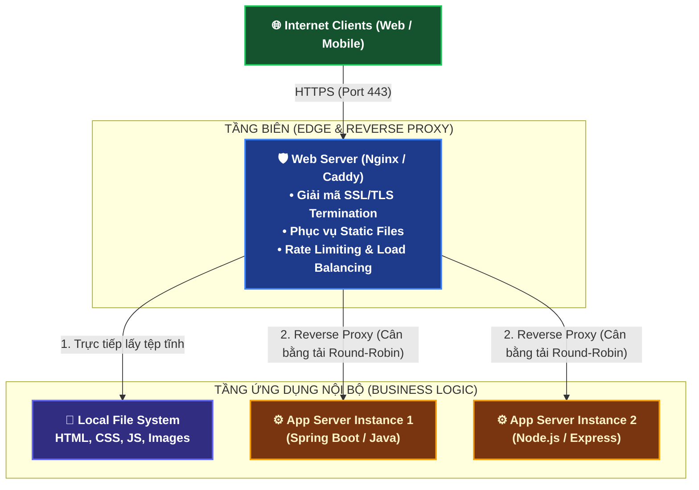
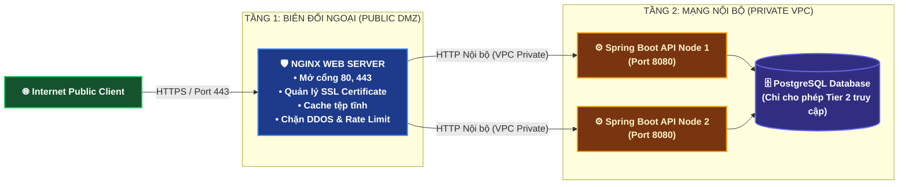

# 🌐 Web Server: Bản Chất, Kiến Trúc Xử Lý, Vòng Đời Request & So Sánh Toàn Diện

> **Web Server (Máy chủ web)** là thành phần cửa ngõ trọng yếu trong kiến trúc mạng Internet và phát triển Backend.  
> Web server tiếp nhận yêu cầu từ client (trình duyệt, ứng dụng di động), phân tích các giao thức HTTP/HTTPS, phân phối tài nguyên tĩnh (HTML, CSS, JS, hình ảnh), chuyển tiếp các yêu cầu động đến Application Server, đồng thời quản lý lưu lượng, bảo mật SSL/TLS và cân bằng tải.

---

## 🏛️ 1. Bản Chất Web Server: Phần Cứng (Hardware) vs Phần Mềm (Software)

Khi nhắc đến khái niệm **Web Server**, chúng ta cần phân biệt rõ hai tầng nghĩa kỹ thuật:

```
┌────────────────────────────────────────────────────────────────────────┐
│                   MÁY CHỦ WEB PHẦN CỨNG (HARDWARE)                     │
│  • Máy chủ vật lý hoặc máy ảo điện toán đám mây (Cloud VPS / EC2)      │
│  • Chứa CPU, RAM, Ổ cứng (SSD NVMe), Card mạng (NIC) và Địa chỉ IP     │
│  • Cài đặt Hệ điều hành (Linux Ubuntu, Debian, CentOS, Windows Server) │
│                                                                        │
│   ┌────────────────────────────────────────────────────────────────┐   │
│   │               MÁY CHỦ WEB PHẦN MỀM (SOFTWARE)                  │   │
│   │  • Chương trình daemon chạy nền (Nginx, Apache, IIS, Caddy)    │   │
│   │  • Lắng nghe liên tục trên các cổng mạng tiêu chuẩn (80 / 443) │   │
│   │  • Đọc hiểu cú pháp HTTP/HTTPS, kiểm soát kết nối TCP/IP       │   │
│   │  • Trả về tệp tin tĩnh hoặc điều hướng vào Application Server  │   │
│   └────────────────────────────────────────────────────────────────┘   │
└────────────────────────────────────────────────────────────────────────┘
```

1. **Hardware Web Server**:
   - Là một máy tính vật lý hoặc một máy ảo chuyên dụng kết nối Internet 24/7 với địa chỉ IP công khai (Public IP).
   - Đảm nhiệm việc cung cấp tài nguyên phần cứng (CPU cores, RAM dung lượng lớn, I/O ổ đĩa tốc độ cao, băng thông card mạng).
2. **Software Web Server**:
   - Là tiến trình phần mềm chuyên dụng (Background Daemon) chạy trên hệ điều hành, chịu trách nhiệm tiếp nhận, phân tích, lọc và phản hồi các yêu cầu theo các giao thức Web (`HTTP/1.1`, `HTTP/2`, `HTTP/3 QUIC`).
   - Các đại diện tiêu biểu: **Nginx, Apache HTTP Server, Microsoft IIS, Caddy, Lighttpd**.

---

## 🔄 2. Vòng Đời Xử Lý Yêu Cầu (Request-Response Lifecycle)

Khi người dùng nhập `https://example.com/api/products` trên trình duyệt và nhấn Enter, Web Server sẽ tiếp nhận và xử lý yêu cầu qua chuỗi các bước tuần tự:

```
[ 🌐 Client / Browser ]            [ 🛡️ Web Server (Gatekeeper) ]        [ ⚙️ App Server / DB ]
           │                                      │                                  │
           │── 1. TCP Handshake & TLS (Port 443) ─▶│                                  │
           │── 2. Gửi HTTP Request Header & Body ─▶│                                  │
           │                                      │── 3. Parse Header, Path & VHost  │
           │                                      │                                  │
           │◀── 4a. [Static File] Trả về File ────┤ (Đọc từ Disk/Cache nếu là Tĩnh) │
           │                                      │                                  │
           │                                      │── 4b. [Dynamic] Reverse Proxy ──▶│
           │                                      │◀── Trả về JSON / HTML Data ──────│
           │                                      │                                  │
           │                                      │── 5. Nén dữ liệu Gzip / Brotli   │
           │◀── 6. Gửi HTTP Response về Client ───┤                                  │
```



### Các Giai Đoạn Chi Tiết:
1. **Thiết lập kết nối mạng (Network Connection)**:
   - Client hoàn tất phân giải DNS thành IP của Web Server.
   - Bắt tay 3 bước TCP (`SYN -> SYN-ACK -> ACK`) trên cổng 80 (HTTP) hoặc 443 (HTTPS).
   - Nếu là HTTPS: Web Server và Client thực hiện đàm phán **TLS Handshake** (xác thực chứng chỉ SSL Certificate, tạo khóa đối xứng Session Key).
2. **Phân tích yêu cầu (Request Parsing & Routing)**:
   - Web Server đọc luồng byte từ socket, trích xuất: HTTP Method (`GET`, `POST`), URI (`/products`), HTTP Version, Headers (`Host`, `User-Agent`, `Authorization`).
   - Xác định khối máy chủ ảo (**Virtual Host / Server Block**) tương ứng với tên miền.
3. **Phân loại xử lý (Static vs Dynamic)**:
   - **Tài nguyên tĩnh**: Nếu URI ánh xạ tới đường dẫn tệp tin trên ổ cứng (`/var/www/static/logo.png`), Web Server sử dụng hệ thống gọi hàm tối ưu hạt nhân (Kernel System Call như `sendfile` trên Linux) để đẩy dữ liệu thẳng từ ổ cứng ra card mạng mà không tốn công copy vào bộ nhớ RAM người dùng (Zero-Copy).
   - **Nội dung động**: Nếu URI là API (`/api/v1/orders`), Web Server giữ vai trò Reverse Proxy, đóng gói yêu cầu và chuyển tiếp nội bộ đến Application Server (Tomcat, Gunicorn, Puma, Node.js).
4. **Hậu xử lý và Phản hồi (Post-processing & Response)**:
   - Thêm các Security Headers (`Strict-Transport-Security`, `X-Content-Type-Options`).
   - Nén nội dung (`Gzip`, `Brotli`) nếu kích thước Payload lớn hơn ngưỡng chỉ định.
   - Ghi nhật ký vào `access.log` và duy trì kết nối nếu có cờ `Connection: keep-alive`.

---

## 🔀 3. Phân Biệt: Web Server vs Application Server vs Reverse Proxy

Rất nhiều kỹ sư mới bắt đầu thường nhầm lẫn giữa ba khái niệm này. Dưới đây là ranh giới kiến trúc rành mạch:

```
┌────────────────────────────────────────────────────────────────────────────────────────┐
│                                 MÔ HÌNH PHÂN TẦNG CHUẨN                                │
│                                                                                        │
│  [ 🌐 Internet Client ]                                                                │
│            │                                                                           │
│            ▼ (Port 443 HTTPS)                                                          │
│  ┌──────────────────────────────────────────────────────────────────────────────────┐  │
│  │ 🛡️ WEB SERVER / REVERSE PROXY (Nginx, Caddy, Apache)                             │  │
│  │ • Cửa ngõ đối ngoại, giải mã SSL/TLS Termination                                │  │
│  │ • Trả file tĩnh siêu tốc (Zero-copy sendfile)                                    │  │
│  │ • Chặn DDoS cơ bản, Rate Limiting, Load Balancing                                │  │
│  └──────────────────────────┬───────────────────────────────────┬───────────────────┘  │
│                             │                                   │                      │
│        (Tài nguyên tĩnh)    │                (Dynamic API calls)│ (HTTP nội bộ)        │
│                             ▼                                   ▼                      │
│               ┌───────────────────────────┐       ┌───────────────────────────┐        │
│               │ 📁 Static Assets Storage  │       │ ⚙️ APPLICATION SERVER     │        │
│               │ (HTML, CSS, JS, Media)    │       │ (Spring Boot, Node.js,    │        │
│               └───────────────────────────┘       │  Django, Go, Ruby Puma)   │        │
│                                                   └─────────────┬─────────────┘        │
│                                                                 │                      │
│                                                                 ▼                      │
│                                                   ┌───────────────────────────┐        │
│                                                   │ 🗄️ DATABASE / CACHE       │        │
│                                                   │ (PostgreSQL, Redis, MySQL)│        │
│                                                   └───────────────────────────┘        │
└────────────────────────────────────────────────────────────────────────────────────────┘
```



### Bảng So Sánh Chi Tiết:

| Tiêu chí so sánh | Web Server | Application Server | Reverse Proxy | Forward Proxy |
| :--- | :--- | :--- | :--- | :--- |
| **Mục đích cốt lõi** | Nhận & phản hồi HTTP/HTTPS, phục vụ file tĩnh | Xử lý logic nghiệp vụ, chạy code backend, truy vấn DB | Đứng trước các server nội bộ để bảo vệ và điều phối traffic | Đứng trước client để duyệt web ẩn danh, lọc mạng |
| **Xử lý Logic code** | Không (hoặc rất hạn chế qua module script) | Chuyên dụng (Java, C#, Python, PHP, JS, Go) | Không xử lý logic nghiệp vụ | Không xử lý logic nghiệp vụ |
| **Giao thức hỗ trợ** | HTTP, HTTPS, WebSocket | HTTP, RMI, RPC, gRPC, JMS, IIOP | HTTP, HTTPS, TCP, UDP, gRPC | HTTP, HTTPS, SOCKS5 |
| **Ai là người hưởng lợi?** | Client nhận nội dung nhanh | Lập trình viên tập trung viết Business logic | Server nội bộ được bảo vệ, giấu IP gốc | Client được ẩn danh, vượt tường lửa công ty |
| **Ví dụ điển hình** | Nginx, Apache HTTPD, IIS | Apache Tomcat, Gunicorn, Uvicorn, Kestrel | Nginx, HAProxy, Envoy, Traefik | Squid, Tor Proxy, Charles Proxy |

---

## ⚡ 4. Các Mô Hình Kiến Trúc Xử Lý Đồng Thời (Concurrency Models)

Sự khác biệt cốt lõi giữa các Web Server nằm ở **cách chúng phân bổ tài nguyên phần cứng (CPU và Bộ nhớ RAM)** để giải quyết hàng chục nghìn kết nối đồng thời.

```
┌─────────────────────────────────┐   ┌─────────────────────────────────┐   ┌─────────────────────────────────┐
│ 1. MULTI-PROCESS (PRE-FORK)     │   │ 2. MULTI-THREADED (WORKER)      │   │ 3. EVENT-DRIVEN / ASYNCHRONOUS  │
├─────────────────────────────────┤   ├─────────────────────────────────┤   ├─────────────────────────────────┤
│ • Mỗi kết nối = 1 Tiến trình    │   │ • 1 Tiến trình có Nhiều Thread  │   │ • 1 Worker duy nhất xử lý       │
│ • Không gian bộ nhớ cách ly     │   │ • Dùng chung RAM trong Process  │   │   hàng chục nghìn kết nối       │
│ ❌ Tốn cực nhiều RAM             │   │ ⚠️ Tranh chấp bộ nhớ / Lock     │   │ • Dùng I/O Multiplexing (epoll) │
│ ❌ Context Switching quá tải     │   │ ❌ Vẫn nghẽn khi Thread quá lớn │   │ 🚀 Tối ưu CPU, RAM cực kỳ thấp   │
│ (Apache MPM Prefork)            │   │ (Apache MPM Worker, IIS)        │   │ (Nginx, Lighttpd, Node.js)      │
└─────────────────────────────────┘   └─────────────────────────────────┘   └─────────────────────────────────┘
```

### A. Multi-Process Model (Mô hình Đa tiến trình - ví dụ: Apache MPM Prefork)
- **Cách thức**: Master process tạo sẵn (pre-fork) một nhóm các tiến trình con. Mỗi kết nối mạng mới từ client sẽ được giao trọn vẹn cho **một tiến trình riêng biệt**.
- **Ưu điểm**: Tính cô lập tuyệt đối. Nếu một tiến trình con bị crash (ví dụ: do mã nguồn PHP bị tràn bộ nhớ), các tiến trình khác và toàn bộ server vẫn sống sót bình thường.
- **Nhược điểm**: Mỗi tiến trình tiêu tốn từ vài MB đến hàng chục MB RAM. Khi có 10.000 kết nối, máy chủ cần hàng trăm GB RAM chỉ để giữ kết nối! Hệ điều hành kiệt quệ vì **Context Switching** (chuyển đổi ngữ cảnh liên tục giữa các tiến trình).

### B. Multi-Threaded Model (Mô hình Đa luồng - ví dụ: Apache MPM Worker, Microsoft IIS)
- **Cách thức**: Mỗi tiến trình con sinh ra nhiều Luồng (**Threads**). Mỗi kết nối được đảm nhiệm bởi một luồng. Các luồng trong cùng tiến trình chia sẻ chung không gian bộ nhớ.
- **Ưu điểm**: Nhẹ hơn đáng kể so với Process, tiêu thụ RAM ít hơn.
- **Nhược điểm**: Cần cơ chế đồng bộ (Mutex, Lock) để tránh xung đột dữ liệu (Race condition). Khi lượng kết nối vượt quá số lượng Thread Pool (thường vài nghìn luồng), chi phí tạo luồng và chuyển đổi ngữ cảnh vẫn làm CPU bị nghẽn.

### C. Event-Driven Asynchronous Non-blocking Model (Mô hình Hướng sự kiện Bất đồng bộ - ví dụ: Nginx, Caddy)
- **Cách thức**: Sử dụng một số lượng Worker rất nhỏ (thường chỉ bằng đúng số nhân CPU). Mỗi Worker chạy một vòng lặp sự kiện (**Event Loop**) dựa trên cơ chế thông báo của nhân hệ điều hành Linux (**`epoll`**), BSD/macOS (**`kqueue`**), hoặc Windows (**`IOCP`**).
- **Cơ chế**: Khi một kết nối đang chờ dữ liệu gửi đến từ mạng hoặc chờ ổ đĩa phản hồi (I/O Wait), Worker **không hề đứng đợi** (Non-blocking). Nó lập tức chuyển sang phục vụ gói tin của hàng nghìn kết nối khác. Khi dữ liệu của kết nối trước sẵn sàng, nhân Kernel sẽ bắn tín hiệu "Sự kiện" (Event) để Worker quay lại xử lý tiếp.
- **Kết quả**: Giải quyết triệt để **Bài toán C10K** (10.000 kết nối đồng thời) và C1000K mà chỉ tiêu tốn một lượng RAM cố định không đổi (chỉ vài chục MB).

---

## 🥊 5. So Sánh Toàn Diện Các Web Server Phổ Biến

```
                  THỊ TRƯỜNG WEB SERVER HIỆN ĐẠI
                                │
        ┌───────────────────────┼───────────────────────┬───────────────────────┐
        ▼                       ▼                       ▼                       ▼
   🟢 NGINX               🔴 APACHE                🔵 MICROSOFT IIS        🟣 CADDY
  • Vua hiệu năng        • Linh hoạt, module hóa • Tối ưu Windows Server • Hiện đại, Zero-config
  • Event-Driven         • Hỗ trợ .htaccess      • Tích hợp sâu .NET     • HTTPS tự động 100%
  • Reverse Proxy số 1   • Thích hợp Shared Host • Giao diện GUI quản lý • Viết bằng ngôn ngữ Go
```

| Đặc điểm / Tính năng | 🟢 NGINX | 🔴 Apache HTTP Server | 🔵 Microsoft IIS | 🟣 Caddy |
| :--- | :--- | :--- | :--- | :--- |
| **Kiến trúc cốt lõi** | Event-driven, Asynchronous | Process-driven / Multi-threaded | Multi-threaded (Thread Pool) | Event-driven, Goroutines |
| **Ngôn ngữ phát triển** | C (Hiệu năng cực đại) | C | C++ / .NET Native | Go (An toàn bộ nhớ) |
| **Tốc độ phục vụ file tĩnh** | ⚡ Siêu nhanh (Zero-Copy) | Trung bình - Khá | Nhanh trên Windows | Rất nhanh |
| **Cấu hình theo thư mục** | Không (Chỉ cấu hình tập trung) | Có (`.htaccess` tiện lợi) | Có (`web.config`) | Không (Caddyfile tập trung) |
| **SSL/TLS tự động** | Cần Certbot / Script ngoài | Cần Certbot / Script ngoài | Cần cài đặt Extension | 🔒 Tự động 100% (Let's Encrypt) |
| **Hỗ trợ HTTP/3 (QUIC)** | Có (từ Nginx 1.25+) | Thử nghiệm qua module ngoài | Có (trên Windows Server 2022) | Có (Mặc định kích hoạt) |
| **Giao diện quản trị (GUI)**| Không (Dùng CLI & file conf) | Không (Dùng CLI & file conf) | Có (IIS Manager trực quan) | Không (Dùng API & CLI) |
| **Hệ điều hành tối ưu** | Linux, Unix, BSD | Linux, Unix, Windows | Windows Server | Đa nền tảng (Linux, macOS, Win) |
| **Tình huống sử dụng tốt nhất**| Reverse Proxy, High-traffic API, Microservices Gateway | Shared Hosting, Ứng dụng PHP cũ (WordPress không có Nginx) | Doanh nghiệp dùng hệ sinh thái Microsoft, ASP.NET Core | Dự án Startup, Microservices nhỏ, cần HTTPS nhanh |

---

## 🛡️ 6. Các Trách Nhiệm Thiết Yếu Của Web Server Trong Hệ Thống Thực Tế

Một Web Server hiện đại trong môi trường Production không chỉ đơn thuần là gửi file HTML cho trình duyệt, mà phải gánh vác 6 trách nhiệm trọng yếu:

```
┌────────────────────────────────────────────────────────────────────────────────────────┐
│                        6 TRÁCH NHIỆM TRỌNG YẾU CỦA WEB SERVER                          │
├───────────────────────────┬───────────────────────────┬────────────────────────────────┤
│ 1. SSL/TLS TERMINATION    │ 2. REVERSE PROXY & LB     │ 3. RATE LIMITING & DDOS SHIELD │
│ Giải mã mã hóa ở cửa ngõ, │ Điều phối lưu lượng đều   │ Giới hạn số request/IP, chặn   │
│ giảm tải CPU cho Backend  │ cho nhiều máy chủ con     │ IP độc hại, ngăn spam tấn công │
├───────────────────────────┼───────────────────────────┼────────────────────────────────┤
│ 4. CONTENT COMPRESSION    │ 5. BẢO MẬT HEADERS        │ 6. CACHING & ZERO-COPY I/O     │
│ Nén dữ liệu Gzip / Brotli │ Gắn HSTS, CSP, X-Frame    │ Cache tài nguyên tĩnh, đẩy dữ  │
│ tiết kiệm đến 70% băng thông│ chống tấn công XSS, Click │ liệu trực tiếp qua sendfile    │
└───────────────────────────┴───────────────────────────┴────────────────────────────────┘
```

1. **Giải mã SSL/TLS (SSL/TLS Termination)**:
   - Các phép tính toán mã hóa và giải mã khóa công khai/khóa đối xứng rất tốn CPU.
   - Web Server đứng ở ngoài cùng tiếp nhận HTTPS từ Client, giải mã rồi chuyển tiếp bản rõ HTTP qua mạng cục bộ an toàn (Private Network) đến Application Server, giúp Backend tập trung 100% tài nguyên cho Logic ứng dụng.
2. **Cân bằng tải (Load Balancing)**:
   - Tích hợp sẵn các thuật toán phân phối lưu lượng: Round-Robin, Least Connections (giao cho server đang rảnh nhất), IP Hash (đảm bảo 1 IP luôn vào 1 server cụ thể).
   - Kiểm tra sức khỏe máy chủ (**Health Checks**): Tự động cô lập các node Backend bị lỗi hoặc crash.
3. **Kiểm soát tốc độ & Ngăn chặn tấn công (Rate Limiting & DDoS Mitigation)**:
   - Thiết lập ngưỡng: Mỗi địa chỉ IP chỉ được phép gửi tối đa 10 requests/giây (dùng thuật toán Leaky Bucket / Token Bucket).
   - Ngắt kết nối các yêu cầu truyền headers quá chậm (chống tấn công Slowloris).
4. **Nén dữ liệu động (Data Compression)**:
   - Sử dụng các thuật toán nén `Gzip` hoặc `Brotli` trước khi gửi về client, giúp giảm 60% – 80% dung lượng HTML, CSS, JavaScript, JSON, tăng tốc độ hiển thị trang rõ rệt.
5. **Tiêm tiêu đề bảo mật (Security Headers Injection)**:
   - Tự động gắn các Header phòng vệ tiêu chuẩn:
     - `Strict-Transport-Security` (HSTS): Ép trình duyệt luôn dùng HTTPS.
     - `X-Frame-Options: DENY`: Chống tấn công Clickjacking.
     - `Content-Security-Policy` (CSP): Ngăn chặn Cross-Site Scripting (XSS).
6. **Bộ nhớ đệm & Tối ưu I/O hạt nhân (Caching & Zero-Copy)**:
   - Quản lý các chỉ thị `Cache-Control`, `ETag`, `If-Modified-Since`.
   - Nếu client đã có tệp trong bộ nhớ cache trình duyệt, Web Server chỉ cần trả về mã `304 Not Modified` mà không tốn băng thông truyền dữ liệu.

---

## 🎯 7. Kiến Trúc Hai Tầng Thực Tế (Two-Tier Architecture Best Practice)

Trong các hệ thống Backend chuyên nghiệp quy mô vừa và lớn, tiêu chuẩn kiến trúc bất thành văn là: **Không bao giờ mở cổng Application Server (như Tomcat, Node.js, Kestrel) trực tiếp ra mạng Internet công cộng!**

```
❌ THIẾT KẾ NGUY HIỂM (Direct Exposure):
[ Client ] ──────── (Port 8080) ────────▶ [ ⚙️ Tomcat / Node.js ]
(Dễ bị tấn công Slowloris, không tối ưu phục vụ file tĩnh, lộ thông tin hạ tầng nội bộ)

✅ THIẾT KẾ CHUẨN CÔNG NGHIỆP (Two-Tier Architecture):
[ Client ] ──── (HTTPS: 443) ───▶ [ 🛡️ NGINX (Tier 1) ] ─── (HTTP: 8080) ───▶ [ ⚙️ App Server (Tier 2) ]
                                  (SSL, Static, Firewall)                       (Private Network - DB)
```



### Tại sao mô hình 2 tầng này lại là chuẩn mực?
1. **Bảo mật tuyệt đối**: Application Server và Database nằm ẩn mình trong mạng nội bộ riêng tư (Private Subnet). Kẻ tấn công không thể scan cổng hoặc khai thác lỗ hổng trực tiếp vào tầng ứng dụng.
2. **Tối ưu hóa hiệu năng**: Nginx giải quyết toàn bộ các kết nối mạng chậm chạp, giữ kết nối keep-alive, trong khi Application Server chỉ tập trung chạy logic với thời gian phản hồi microsecond.
3. **Khả năng nâng cấp không gián đoạn (Zero Downtime Deployment)**: Khi muốn triển khai phiên bản code mới, ta có thể tắt lần lượt từng Node Backend để cập nhật, Nginx sẽ tự động điều hướng người dùng sang các Node còn sống mà người dùng không hề nhận ra sự gián đoạn!

---

## 📌 Tổng Kết Cần Nhớ Khi Học Về Web Server
- **Web Server** là nền tảng cửa ngõ của mọi ứng dụng Web, chịu trách nhiệm cho các giao thức HTTP/HTTPS, SSL/TLS, tài nguyên tĩnh và định tuyến.
- Mô hình **Event-driven (Nginx, Caddy)** là giải pháp tối ưu cho bài toán **C10K** và các hệ thống tải cao so với mô hình **Multi-process/Thread (Apache cổ điển)**.
- Trong kiến trúc hệ thống hiện đại, Web Server thường đóng vai trò **Reverse Proxy** kết hợp với **Application Server** tạo nên mô hình phòng thủ 2 tầng kiên cố và linh hoạt.

