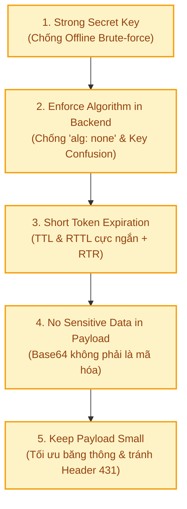
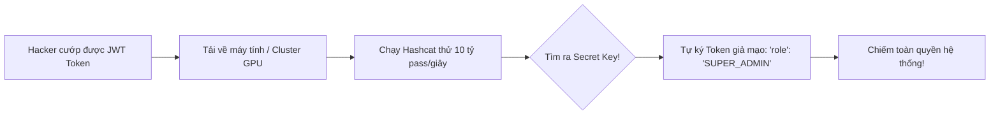
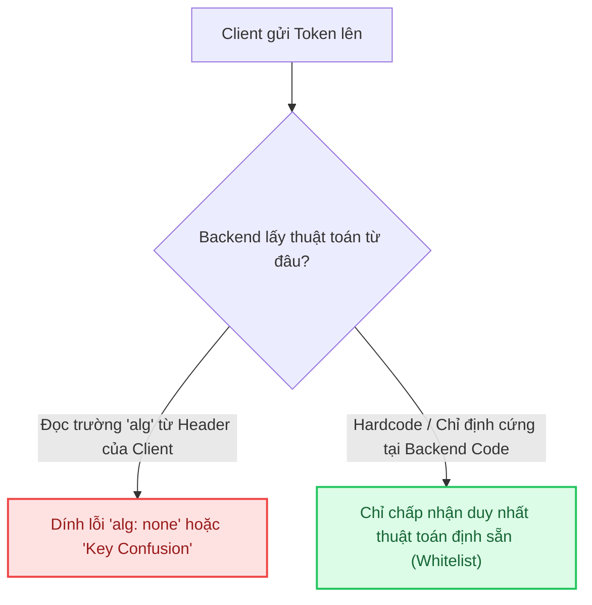
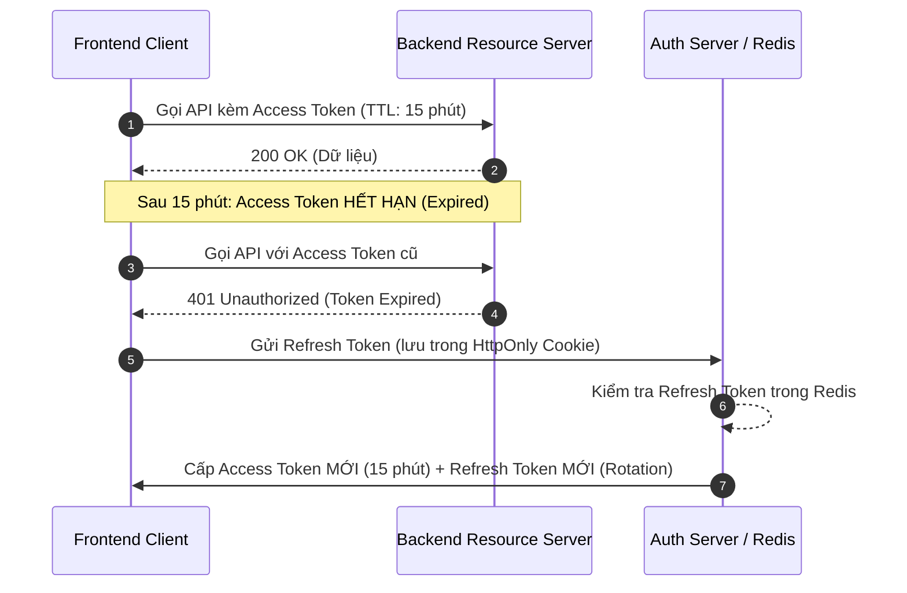
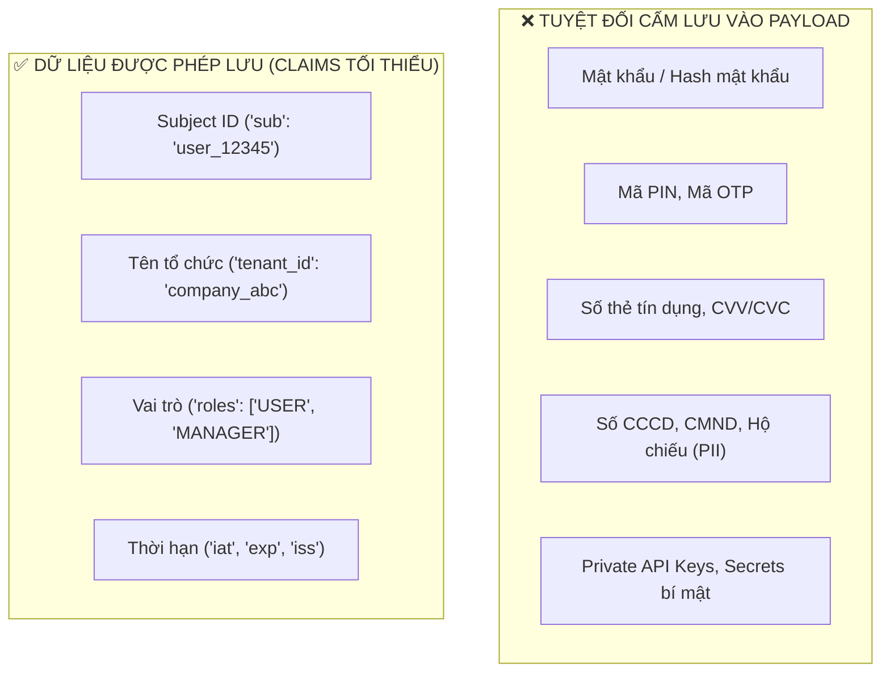

# 🎫 JSON Web Tokens (JWT) Security Best Practices

**JSON Web Token (JWT)** là phương thức xác thực chuẩn mực và phổ biến nhất trong các kiến trúc Web hiện đại, Single Page Application (SPA), Mobile Apps và Microservices. Tuy nhiên, tính chất không lưu trạng thái (**Stateless**) và cơ chế ký số của JWT cũng biến nó thành "miếng mồi ngon" nếu lập trình viên mắc phải các sai lầm cơ bản trong thiết kế.

Dưới đây là **5 nguyên tắc bảo mật cốt lõi khi sử dụng JWT** theo tiêu chuẩn **OWASP API Security**:



---

## 🔑 1. Sử Dụng JWT Secret Đủ Mạnh (Chống Tấn Công Brute-Force)

### ⚠️ Rủi ro: Tấn công Offline Brute-Force & Dictionary Attack
Khác với API đăng nhập bị giới hạn bởi Rate Limit hay Captcha, chữ ký JWT (**Signature**) có thể bị kẻ tấn công đem về máy tính riêng để chạy tấn công ngoại tuyến (**Offline Brute-Force**) bằng sức mạnh card đồ họa (GPU):
- Các công cụ như `hashcat`, `john the ripper`, hay `jwt-cracker` có thể thử **hàng tỷ mật khẩu mỗi giây**.
- Nếu bạn dùng các secret đơn giản như `"my-secret-key"`, `"secret123"`, `"backend-jwt-token"`, hacker chỉ mất **từ 3 đến 30 giây** để tìm ra Secret Key gốc.



> 💥 **Hậu quả:** Một khi Secret Key bị lộ, kẻ tấn công có thể **tự tạo và tự ký chữ ký số** cho bất kỳ tài khoản nào (kể cả Super Admin) mà Server hoàn toàn tin tưởng!

### 🛡️ Tiêu chuẩn Secret Key an toàn:
1. **Độ dài tối thiểu:**
   - Với thuật toán đối xứng (**HS256 - HMAC SHA-256**): Khóa bí mật bắt buộc phải có độ dài tối thiểu **256 bits (32 bytes ngẫu nhiên có độ hỗn loạn cao - high entropy)**. Khuyến nghị chuẩn: **512 bits (64 bytes)**.
   - Với thuật toán bất đối xứng (**RS256 - RSA**): Khóa tối thiểu **2048 bits** (khuyến nghị **4096 bits**).
2. **Lệnh tạo Secret ngẫu nhiên chuẩn mật mã học:**
   ```bash
   # Tạo chuỗi 256-bit ngẫu nhiên dạng Hex (64 ký tự)
   openssl rand -hex 32

   # Hoặc tạo chuỗi Base64 64 bytes (512-bit)
   openssl rand -base64 64
   ```
3. **Tuyệt đối không hardcode trong Source Code:**
   - Đưa Secret Key vào **Environment Variables** hoặc các dịch vụ quản lý bí mật chuyên nghiệp (**AWS Secrets Manager**, **HashiCorp Vault**, **Azure Key Vault**).
   - Thiết lập cơ chế **Secret Key Rotation (Đảo khóa định kỳ)** 3 - 6 tháng một lần.

---

## 🛡️ 2. Ép Buộc Thuật Toán Tại Backend — Tuyệt Đối Không Tin Header Từ Client

### ⚠️ Hai lỗ hổng kinh điển nhắm vào Header của JWT:

#### 1️⃣ Lỗ hổng `"alg": "none"` (Bypass Signature)
Theo đặc tả RFC 7519 ban đầu, JWT hỗ trợ thuật toán `"none"` dành cho các kịch bản token không cần chữ ký.
- Kẻ tấn công sửa Header thành `{"alg": "none", "typ": "JWT"}`.
- Sửa Payload thành `{"sub": "admin", "role": "ADMIN"}`.
- Xóa bỏ hoàn toàn phần chữ ký: `HeaderBase64.PayloadBase64.` (chỉ giữ lại 2 phần kèm dấu chấm cuối).
- Nếu Backend giải mã Header và tin tưởng thuộc tính `alg` của client, thư viện sẽ bỏ qua bước verify chữ ký và **chấp nhận token giả mạo**!

#### 2️⃣ Lỗ hổng "Key Confusion / Algorithm Confusion" (HMAC vs RSA Attack)
- Hệ thống của bạn dùng thuật toán bất đối xứng **RS256**: Ký bằng **Private Key** (giữ bí mật) và xác thực bằng **Public Key** (công khai).
- Hacker tải Public Key của bạn về (thường công khai tại endpoint `/.well-known/jwks.json`).
- Hacker sửa Header từ `RS256` sang `HS256` (HMAC đối xứng).
- Hacker ký token giả mạo bằng **chính Public Key của bạn**, nhưng dùng thuật toán HMAC!
- Khi nhận request, nếu Backend kiểm tra Header thấy `HS256`, nó dùng biến Key hiện có (chính là Public Key) để verify theo kiểu HMAC $\to$ **Chữ ký hoàn toàn hợp lệ!**



### 🏆 Giải pháp chuẩn:
Backend phải **cố định thuật toán xác thực**, không bao giờ chọn thuật toán dựa trên header gửi lên:

```java
// ✅ Spring Boot (java-jwt): Chỉ định rõ ràng thuật toán khi verify
Algorithm algorithm = Algorithm.HMAC256(secretKey); // Hoặc Algorithm.RSA256(publicKey, null)

JWTVerifier verifier = JWT.require(algorithm)
    // Tự động từ chối bất kỳ token nào có alg != HS256 hoặc alg: "none"
    .withIssuer("auth.mycompany.com")
    .build();

DecodedJWT jwt = verifier.verify(token);
```

---

## ⏳ 3. Rút Ngắn Thời Hạn Sống Của Token (TTL & RTTL As Short As Possible)

### ⚠️ Bản chất "Vừa là ưu điểm, vừa là nhược điểm" của JWT:
- JWT là **Stateless** (Server không lưu session trong database/RAM để kiểm tra mỗi request).
- 👉 **Hậu quả:** Một khi token đã phát hành, nếu kẻ xấu đánh cắp được token (qua tấn công XSS, rò rỉ log, bắt trộm gói tin), **Server KHÔNG THỂ thu hồi ngay lập tức** cho đến khi token tự hết hạn!

### 🎯 Chiến lược bộ đôi: Access Token ngắn hạn + Refresh Token có kiểm soát



### 1️⃣ TTL (Time To Live của Access Token): Cực Ngắn
- **Thời gian khuyến nghị:** **5 phút đến 15 phút** (tối đa 30 phút).
- Ngay cả khi bị lộ, thời gian hacker có thể khai thác chỉ kéo dài vài phút.

### 2️⃣ RTTL (Refresh Token Time To Live): Có Điều Kiện
- **Thời gian khuyến nghị:** **7 ngày đến 14 ngày**.
- **Lưu trữ an toàn:** Lưu trong Cookie có các cờ bảo vệ: `HttpOnly` (chống JavaScript/XSS đọc trộm), `Secure` (chỉ gửi qua HTTPS), và `SameSite=Strict` (chống CSRF).

### 3️⃣ Cơ chế Refresh Token Rotation (RTR - Đảo Refresh Token):
- Mỗi lần client đổi lấy Access Token mới $\to$ Server cấp **1 cặp Token MỚI hoàn toàn** và **hủy ngay Refresh Token cũ**.
- **Phát hiện đánh cắp (Theft Detection):** Nếu Server nhận được một Refresh Token **đã từng bị sử dụng** $\to$ Báo động hệ thống đang bị tấn công $\to$ **Lập tức thu hồi toàn bộ phiên đăng nhập của User đó**!

---

## 🙈 4. Tuyệt Đối Không Lưu Dữ Liệu Nhạy Cảm Trong JWT Payload

Một trong những sai lầm phổ biến nhất của lập trình viên mới là nghĩ rằng: *"JWT là một chuỗi mã hóa bí mật"*.

> ⚠️ **Sự thật hiển nhiên:** 
> Header và Payload của JWT **chỉ được encode bằng Base64Url**, hoàn toàn **KHÔNG HỀ ĐƯỢC MÃ HÓA (ENCRYPT)**!
> Bất kỳ ai có token đều có thể copy vào [jwt.io](https://jwt.io) hoặc dùng lệnh JavaScript `JSON.parse(atob(token.split('.')[1]))` để đọc toàn bộ dữ liệu chỉ trong 1 giây.



Nếu bắt buộc phải lưu thông tin nhạy cảm vào JWT trong môi trường không tin cậy, bạn bắt buộc phải chuyển sang chuẩn **JWE (JSON Web Encryption - RFC 7516)** để mã hóa nội dung.

---

## 🪶 5. Giữ Payload Nhỏ Gọn Tối Đa (Keep Payload Small)

### ⚠️ Vì sao kích thước JWT lại ảnh hưởng nghiêm trọng đến hệ thống?

1. **Gánh nặng băng thông (Network Overhead & Latency):**
   - JWT được đính kèm vào Header `Authorization: Bearer <token>` trong **MỌI HTTP REQUEST** từ client lên server.
   - Nếu mỗi request kèm một token nặng 8KB, với hệ thống có 100 triệu requests/ngày, bạn sẽ lãng phí hàng trăm Gigabytes băng thông chỉ để chuyển token qua lại.
   - Làm chậm tốc độ phản hồi trên các thiết bị di động có kết nối 3G/4G chập chờn.
2. **Nguy cơ lỗi `HTTP 431 Request Header Fields Too Large`:**
   - Hầu hết các Web Server và Reverse Proxy đều có **giới hạn cứng về dung lượng Header**:
     - **Nginx:** `large_client_header_buffers` (mặc định 4KB - 8KB).
     - **Node.js:** `max-http-header-size` (mặc định 8KB - 16KB).
     - **Cloudflare / AWS CloudFront:** Giới hạn Header request thường từ 8KB - 16KB.
   - Nếu dev nhồi nhét: danh sách 100 permissions chi tiết, toàn bộ profile user, avatar URL... $\to$ Token phình to $\to$ Server trả về lỗi **HTTP 431** hoặc **HTTP 413** làm sập giao diện người dùng!

### 🎯 Nguyên tắc tối ưu hóa kích thước Payload:

| Nên Làm (Do's) | Không Nên Làm (Don'ts) |
| :--- | :--- |
| Dùng tên claim chuẩn ngắn gọn (`sub`, `iss`, `aud`, `exp`) | ❌ Đặt tên thuộc tính dài dòng (`"user_identification_number"`) |
| Chỉ lưu ID hoặc Role cấp cao (`roles: ["ADMIN"]`) | ❌ Nhồi nhét mảng hàng trăm quyền chi tiết (`permissions: [...]`) |
| Lấy dữ liệu profile qua API `/api/v1/users/me` riêng | ❌ Nhồi nhét Họ tên, Số điện thoại, Địa chỉ, Avatar vào Token |
| Tra cứu quyền chi tiết bằng Redis Cache trên Backend | ❌ Biến JWT thành một "Database mini" di động |

---

## 📋 Checklist Tổng Kết: Đánh Giá Độ An Toàn Của JWT

- [ ] **Secret Entropy:** Khóa bí mật HS256 có độ dài $\ge 256$ bits (32 bytes ngẫu nhiên), không dùng từ ngữ từ điển.
- [ ] **Bảo vệ Secret:** Secret được lưu trong Biến môi trường / Vault, không nằm trong code Git.
- [ ] **Backend Whitelisting:** Backend chỉ định cứng thuật toán xác thực (ví dụ `HS256` hoặc `RS256`), cấm `alg: none`.
- [ ] **Access Token TTL:** Thời hạn sống ngắn (từ 5 đến 15 phút).
- [ ] **Refresh Token:** Lưu trữ trong `HttpOnly`, `Secure`, `SameSite` Cookie và áp dụng Rotation (RTR).
- [ ] **Không lộ bí mật:** Payload không chứa Password, PIN, CCCD, Thẻ ngân hàng.
- [ ] **Kích thước nhẹ:** Payload tinh gọn (< 1KB), không gây quá tải HTTP Header.
