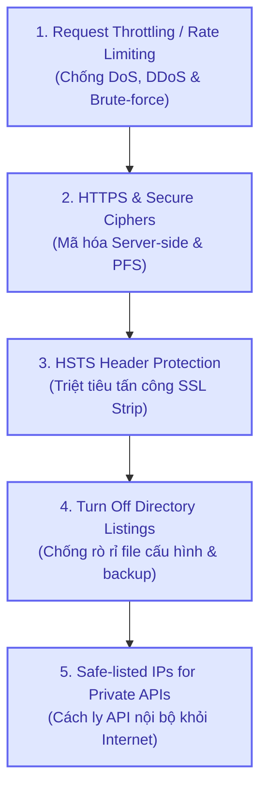
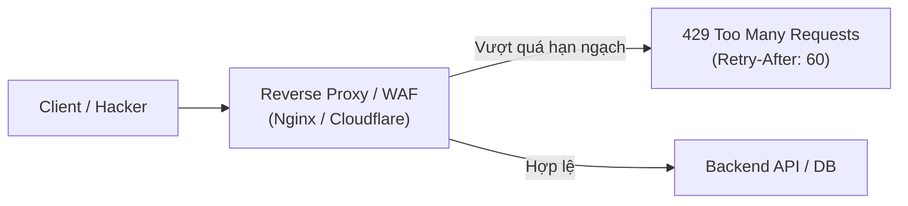
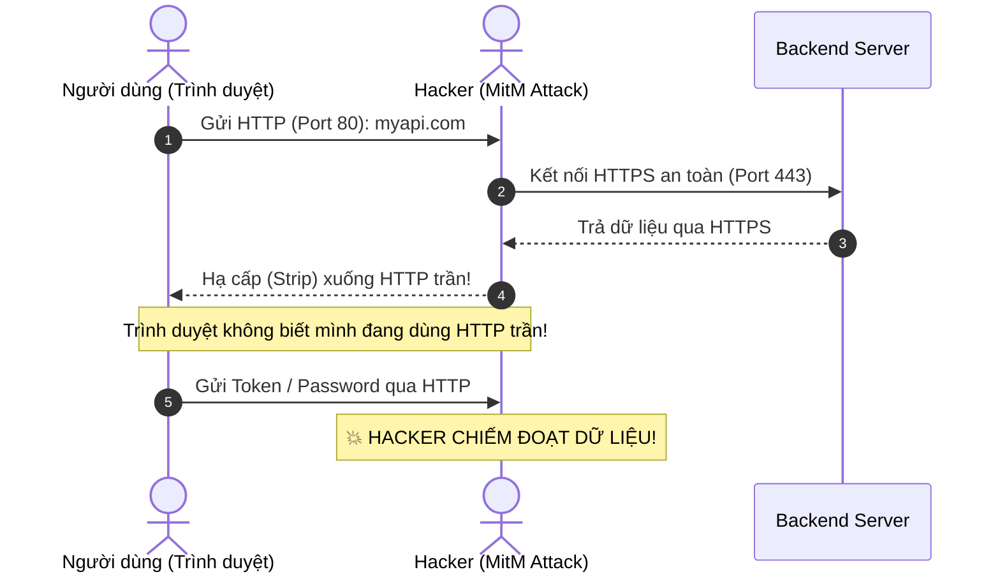
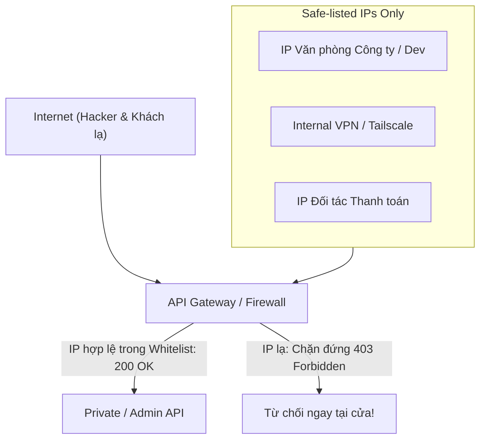

# 🛡️ Access Control Best Practices Cho Backend API

Nếu **Authentication** trả lời cho câu hỏi *"Bạn là ai?"*, thì **Access Control (Kiểm soát truy cập)** sẽ định đoạt *"Bạn được phép đi đến đâu, trong điều kiện nào, qua con đường nào và với tần suất ra sao?"*. 

Access Control trong bảo mật API không chỉ dừng lại ở quyền hạn người dùng (Role/Permission), mà là **hệ thống phòng thủ đa tầng (Defense in Depth)** bao trùm cả tầng mạng (**Network**), tầng giao vận (**Transport**), máy chủ Web (**Web Server**) và tầng điều tiết lưu lượng (**Traffic Throttling**).

Dưới đây là **5 tiêu chuẩn vàng về Access Control** theo chuẩn **Roadmap.sh & OWASP API Security**:



---

## 🚦 1. Giới Hạn Tần Suất Yêu Cầu (Throttling / Rate Limiting) — Chống DoS & Brute-Force

### ⚠️ Nguy cơ khi API không có Rate Limiting:
1. **Tấn công Layer 7 DoS / DDoS (HTTP Flood):** Kẻ tấn công bắn hàng chục nghìn request mỗi giây vào các endpoint tốn tài nguyên (tìm kiếm full-text, xuất PDF, thống kê báo cáo) làm tê liệt CPU/RAM và sập database.
2. **Brute-Force & Credential Stuffing:** Kẻ xấu tha hồ dò mật khẩu, mã OTP 6 số, hoặc quét liên tục các chuỗi ID để cào dữ liệu (Web Scraping).
3. **Chi phí đám mây tăng vọt (Financial DoS):** Với các API tính tiền theo lượt gọi (OpenAI, AWS Lambda, Twilio SMS), việc không giới hạn request có thể khiến hóa đơn tiền điện toán đám mây tăng vọt hàng ngàn USD chỉ sau một đêm.



### 🧠 Các thuật toán Rate Limiting phổ biến:
- **Token Bucket / Leaky Bucket:** Cho phép chấp nhận các đợt lưu lượng tăng đột biến (bursts) nhưng vẫn giữ tốc độ trung bình ổn định.
- **Sliding Window Counter (Redis):** Đếm số lượng request trượt theo thời gian thực (ví dụ tối đa 100 requests / 60 giây). Chính xác nhất và phổ biến nhất trong hệ thống phân tán.

### 🛡️ Chuẩn HTTP Response khi bị chặn:
Khi client gọi vượt quá giới hạn, server bắt buộc phải trả về mã lỗi **`429 Too Many Requests`** kèm các HTTP Headers chuẩn:
```http
HTTP/1.1 429 Too Many Requests
Content-Type: application/json
Retry-After: 30
RateLimit-Limit: 100
RateLimit-Remaining: 0
RateLimit-Reset: 1712000030

{
  "error": "TOO_MANY_REQUESTS",
  "message": "Bạn đã vượt quá giới hạn 100 requests/phút. Vui lòng thử lại sau 30 giây."
}
```

### 💻 Mẫu cấu hình Rate Limiting trên Nginx (Tầng Web Server):
```nginx
# Định nghĩa vùng nhớ 10MB lưu IP, giới hạn 10 request/giây
limit_req_zone $binary_remote_addr zone=api_limit:10m rate=10r/s;

# Vùng riêng biệt cho API Đăng nhập / Nhạy cảm (tối đa 5 request/phút)
limit_req_zone $binary_remote_addr zone=login_limit:10m rate=5r/m;

server {
    # Bảo vệ API đăng nhập: Cho phép gom cụm tối đa 2 request, vượt quá trả 429 ngay
    location /api/v1/auth/login {
        limit_req zone=login_limit burst=2 nodelay;
        limit_req_status 429;
        proxy_pass http://backend_server;
    }

    # Bảo vệ API thông thường
    location /api/ {
        limit_req zone=api_limit burst=20 nodelay;
        limit_req_status 429;
        proxy_pass http://backend_server;
    }
}
```

---

## 🔒 2. Bắt Buộc Sử Dụng HTTPS Phía Server & Cấu Hình Ciphers An Toàn (Secure Ciphers)

### ⚠️ Rủi ro khi dùng HTTP hoặc Ciphers lỗi thời:
- Gói tin truyền dưới dạng văn bản thuần (**Plain Text**), dễ dàng bị nghe lén trên mạng Wi-Fi công cộng hoặc tại các nhà mạng trung gian qua kỹ thuật **Sniffing**.
- Các giao thức cũ như **SSLv3, TLS 1.0, TLS 1.1** đều dính các lỗ hổng mật mã học nghiêm trọng đã bị bẻ gãy (**POODLE, BEAST, Lucky13, CRIME**).

### 🛡️ Tiêu chuẩn cấu hình TLS & Cipher Suites chuẩn hiện đại:

1. **Chỉ hỗ trợ TLS 1.2 và TLS 1.3:**
   - **Vô hiệu hóa hoàn toàn:** `SSLv2`, `SSLv3`, `TLSv1`, `TLSv1.1`.
   - **TLS 1.3 (Ưu tiên số 1):** Loại bỏ hoàn toàn các thuật toán mật mã yếu, rút ngắn quá trình bắt tay (Handshake) xuống chỉ còn 1 vòng truyền tín hiệu (1-RTT) giúp API phản hồi nhanh hơn đáng kể.

2. **Bắt buộc hỗ trợ Perfect Forward Secrecy (PFS):**
   - Chỉ sử dụng các bộ trao đổi khóa tạm thời dựa trên đường cong Elliptic (**ECDHE** - Elliptic Curve Diffie-Hellman Ephemeral).
   - **Ý nghĩa sống còn:** Ngay cả khi Private Key của Server bị đánh cắp trong tương lai, kẻ tấn công **vẫn không thể giải mã lại** các gói tin mã hóa mà chúng đã lén thu thập từ nhiều năm trước!

3. **Cấm các Cipher yếu:**
   - Vô hiệu hóa: `RC4`, `3DES`, `DES`, `MD5`, và các cipher chế độ `CBC` (Cipher Block Chaining).
   - Chỉ chấp nhận các thuật toán mã hóa khối xác thực AEAD mạnh: `AES-128-GCM`, `AES-256-GCM`, `CHACHA20-POLY1305`.

```nginx
# Mẫu cấu hình Nginx chuẩn A+ trên SSL Labs
ssl_protocols TLSv1.2 TLSv1.3;
ssl_prefer_server_ciphers off;

# Bộ Cipher Suites an toàn cao hỗ trợ PFS (TLS 1.2)
ssl_ciphers ECDHE-ECDSA-AES128-GCM-SHA256:ECDHE-RSA-AES128-GCM-SHA256:ECDHE-ECDSA-AES256-GCM-SHA384:ECDHE-RSA-AES256-GCM-SHA384:ECDHE-ECDSA-CHACHA20-POLY1305:ECDHE-RSA-CHACHA20-POLY1305;

# Tối ưu Session Cache để tăng tốc handshake
ssl_session_cache shared:SSL:10m;
ssl_session_timeout 1d;
ssl_session_tickets off;
```

---

## 🛡️ 3. Sử Dụng Header HSTS Với SSL Để Ngăn Chặn Tấn Công "SSL Strip"

### ⚠️ Kịch bản tấn công SSL Strip (Moxie Marlinspike):
Nhiều người dùng khi gõ URL chỉ gõ `myapi.com` hoặc `app.example.com` thay vì gõ đầy đủ `https://`.
1. Trình duyệt ban đầu sẽ gửi một gói tin **HTTP trần (Port 80)** đến server.
2. Thông thường Server sẽ trả về `301 Moved Permanently` để redirect sang `https://`.
3. **Kẻ tấn công (MitM trên cùng mạng Wi-Fi):** Đứng chặn ngay giữa:
   - Hacker kết nối HTTPS an toàn với Server thực tế.
   - Nhưng hacker trả về phiên bản **HTTP trần không mã hóa** cho Client!
   - Trình duyệt Client không hề thấy cảnh báo lỗi chứng chỉ nào $\to$ Người dùng tưởng mình an toàn và gửi mật khẩu/token qua HTTP thẳng vào tay hacker.



### 🛡️ Cứu tinh: Header HSTS (`Strict-Transport-Security`)
HSTS ra lệnh cho trình duyệt: *"Từ nay về sau, trong bất kỳ hoàn cảnh nào, TUYỆT ĐỐI KHÔNG ĐƯỢC gửi request HTTP đến domain này. Hãy tự động chuyển sang HTTPS ngay tại máy của bạn trước khi phát tín hiệu!"*.

```http
Strict-Transport-Security: max-age=31536000; includeSubDomains; preload
```

#### Giải mã các thành phần chỉ thị của Header HSTS:
- **`max-age=31536000` (1 năm):** Trình duyệt phải ghi nhớ chính sách này trong vòng 365 ngày. Bất kỳ yêu cầu `http://` nào sẽ bị trình duyệt chặn lại và chuyển đổi nội bộ (**Internal 307 Redirect**) sang `https://` ngay trên RAM của máy khách.
- **`includeSubDomains`:** Áp dụng bắt buộc cho toàn bộ tên miền con (`api.example.com`, `auth.example.com`, `admin.example.com`).
- **`preload`:** Đăng ký domain vào danh sách **HSTS Preload List** của Google Chrome (danh sách này được nhúng cứng vào mã nguồn của Chrome, Firefox, Safari, Edge).
  👉 **Lợi ích tối thượng:** Ngay cả ở **lần truy cập đầu tiên trong đời**, trình duyệt cũng không bao giờ gửi request HTTP trần!

---

## 📂 4. Tắt Tính Năng Duyệt Thư Mục (Turn Off Directory Listings)

### ⚠️ Hiểm họa từ việc để lộ Directory Listing:
Mặc định trên một số Web Server (Apache, Nginx cấu hình sai, hoặc S3 Bucket public), nếu một thư mục không có file `index.html` hoặc `index.php`, máy chủ sẽ tự động tạo một trang danh sách hiển thị toàn bộ các file và thư mục con.

```text
Index of /uploads/
--------------------------------------------------
[DIR]  ..
[FILE] backup_db_2026_09_15.sql        1.2 GB   <-- THẢM HỌA!
[FILE] config.env                       4.5 KB   <-- LỘ DATABASE CREDENTIALS!
[FILE] private_key.pem                  1.8 KB   <-- LỘ KHÓA MÃ HÓA!
[FILE] user_identity_card_01.jpg        250 KB   <-- LỘ THÔNG TIN KHÁCH HÀNG!
```

Kẻ tấn công sử dụng các công cụ tự động (**Dirbuster, Gobuster, ffuf**) để quét các đường dẫn phổ biến (`/backup/`, `/static/`, `/files/`, `/.git/`) và tải toàn bộ mã nguồn hoặc dữ liệu nhạy cảm về.

### 🛡️ Cách tắt và phòng thủ triệt để:

#### 1️⃣ Cấu hình tắt trên Nginx & Apache:
```nginx
# Nginx: Tắt tự động liệt kê thư mục (Mặc định)
server {
    autoindex off;

    # Chặn đứng hoàn toàn việc truy cập các file/thư mục ẩn (bắt đầu bằng dấu chấm)
    location ~ /\. {
        deny all;
        access_log off;
        log_not_found off;
    }

    # Chặn truy cập trực tiếp các file nhạy cảm
    location ~* \.(env|git|yml|yaml|sql|bak|log|ini|sh)$ {
        deny all;
    }
}
```

```apache
# Apache: Thêm cờ -Indexes trong httpd.conf hoặc .htaccess
Options -Indexes
```

#### 2️⃣ Quản trị File tải lên (Uploads) an toàn:
- Tuyệt đối không lưu file người dùng tải lên trực tiếp vào thư mục mã nguồn Backend.
- Sử dụng **Cloud Object Storage (AWS S3, Cloudflare R2, Google Cloud Storage)**:
  - Cấu hình Bucket luôn ở chế độ **Private (Block All Public Access)**.
  - Phục vụ file nhạy cảm qua **Presigned URLs** có thời hạn ngắn (ví dụ chỉ có hiệu lực trong 5 phút).

---

## 🌐 5. Private APIs Chỉ Được Phép Truy Cập Từ Safe-listed IPs (IP Safe-Listing)

### ⚠️ Phân định ranh giới Public vs Private API:
Không phải API nào cũng được phép mở ra toàn thế giới (0.0.0.0/0):
- **Public APIs:** API Đăng nhập, API Sản phẩm, API Giỏ hàng $\to$ Cần mở cho mọi người dùng.
- **Private / Internal APIs:**
  - Endpoint quản trị Admin (`/api/v1/admin/**`)
  - Endpoint giám sát hạ tầng & Metrics (`/actuator/**`, `/metrics`, `/health/details`)
  - Endpoint đồng bộ dữ liệu giữa các dịch vụ nội bộ (Internal RPC, Batch Jobs)
  - Endpoint nhận Webhook từ các đối tác thanh toán tin cậy (Stripe, VNPay, PayPal)

> 💥 **Nguyên tắc cốt lõi:** Nếu một Private API bị để lộ ra Internet công cộng, chỉ cần một sơ suất nhỏ về xác thực hoặc lỗ hổng thư viện (như Log4j, Spring4Shell) là hacker có thể thâm nhập ngay vào nhân hệ thống!



### 🛡️ Chiến lược triển khai Safe-listing nhiều lớp:

#### 1️⃣ Tầng Reverse Proxy / API Gateway (Nginx):
```nginx
# Cấu hình bảo vệ khu vực Admin & Actuator
location /api/v1/admin/ {
    # Cho phép IP tĩnh văn phòng công ty
    allow 118.69.123.45;

    # Cho phép dải mạng VPN nội bộ
    allow 10.8.0.0/24;

    # Cho phép localhost
    allow 127.0.0.1;

    # Chặn toàn bộ IP còn lại trên thế giới
    deny all;

    proxy_pass http://backend_admin_service;
}
```

#### 2️⃣ Tầng Ứng Dụng (Spring Security - Java):
```java
@Bean
public SecurityFilterChain securityFilterChain(HttpSecurity http) throws Exception {
    http
        .authorizeHttpRequests(auth -> auth
            // Chỉ IP trong dải VPN nội bộ hoặc IP văn phòng mới được gọi Actuator/Admin
            .requestMatchers("/actuator/**", "/api/v1/internal/**")
                .hasIpAddress("10.8.0.0/24")
            .requestMatchers("/api/v1/admin/**")
                .hasAnyAuthority("ROLE_ADMIN")
            .anyRequest().authenticated()
        );
    return http.build();
}
```

#### 3️⃣ Tầng Kiến trúc Hạ tầng (Network Isolation - Private Subnets):
- Đặt toàn bộ các Private Microservices và Database vào **Private Subnet** trong VPC (không gắn Public IPv4).
- Các lập trình viên và DevOps muốn truy cập phải thông qua **Bastion Host (Jump Server)** hoặc mạng **VPN nội bộ (WireGuard, Tailscale, AWS Client VPN)**.

---

## 📋 Checklist Tổng Kết: Đánh Giá Access Control Của Hệ Thống

| Hạng Mục | Tiêu Chuẩn Thực Hiện | Trạng Thái Kiểm Tra |
| :--- | :--- | :---: |
| **Rate Limiting** | Endpoint login có rate limit $\le 5$ req/phút; API chung $\le 60$ req/phút; trả về mã `429` | [ ] |
| **Giao thức TLS** | Tắt SSLv3, TLS 1.0, 1.1; Chỉ dùng TLS 1.2 & 1.3 | [ ] |
| **Cipher Suites** | Sử dụng ciphers hỗ trợ PFS (ECDHE), cấm RC4 và 3DES | [ ] |
| **Bảo vệ HSTS** | Header `Strict-Transport-Security` có `max-age >= 31536000`, có cờ `includeSubDomains` và `preload` | [ ] |
| **Directory Listings** | Đã tắt `autoindex` trên Nginx/Apache; Chặn truy cập file `.env`, `.git` | [ ] |
| **Private APIs** | Các route `/admin`, `/actuator`, internal services được giới hạn IP (Whitelist) hoặc đặt trong Private VPC | [ ] |
| **Lưu trữ Uploads** | File người dùng lưu trên Private S3/R2 Bucket, truy cập qua Presigned URL | [ ] |
