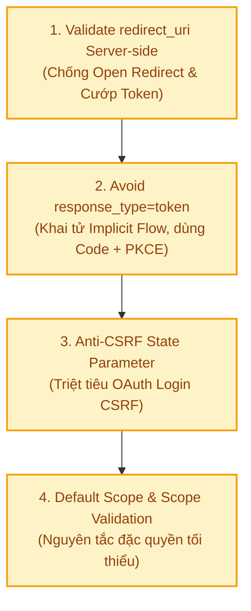
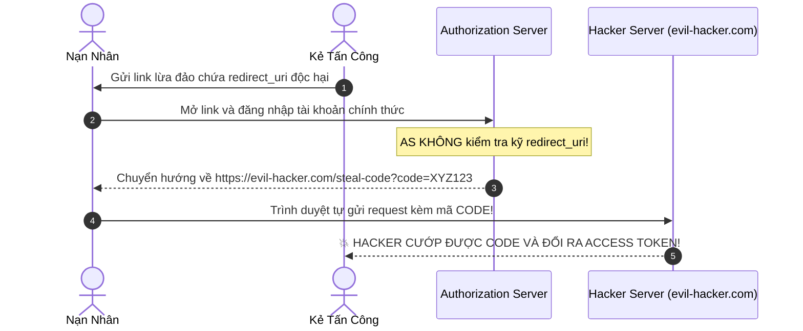
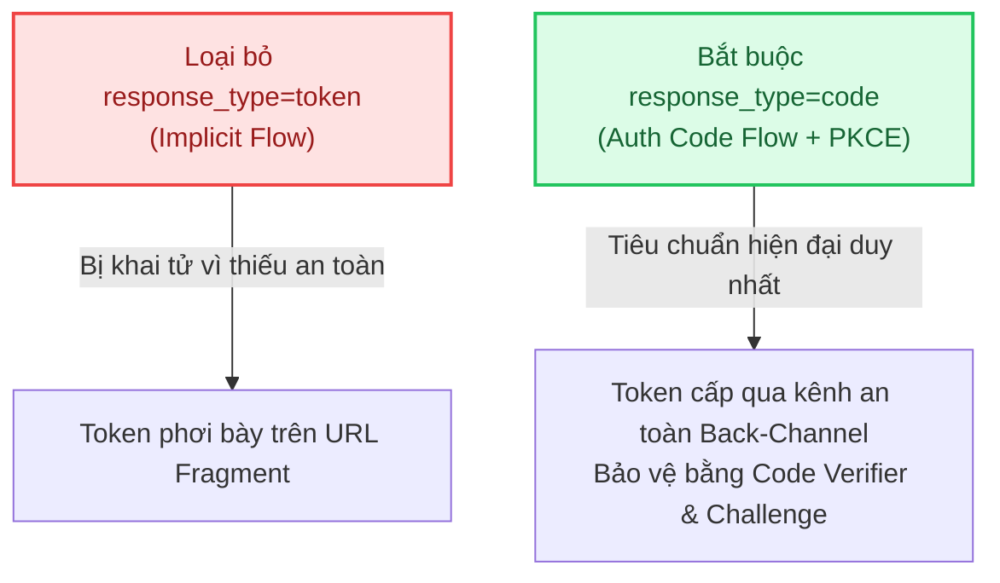
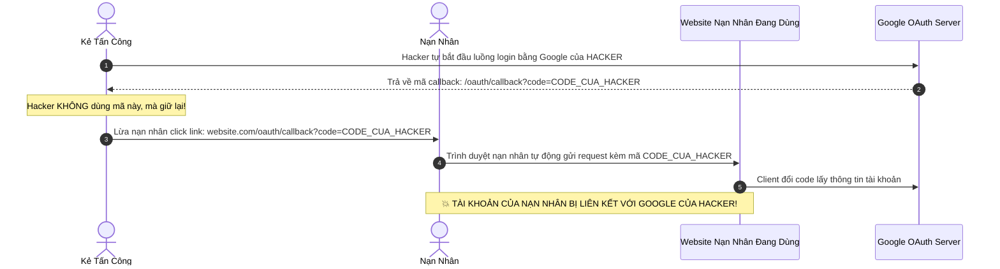
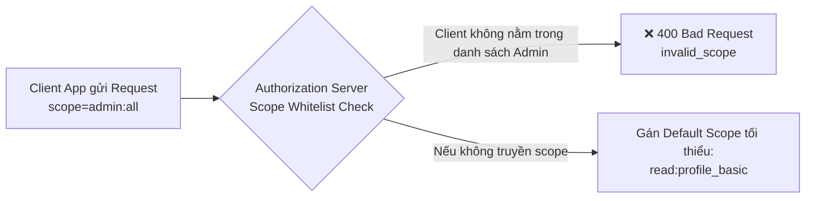

# 🔑 OAuth 2.0 Security Best Practices Cho Backend API

Nếu **Authentication** xác định danh tính người dùng và **JWT** đóng gói phiên làm việc không trạng thái, thì **OAuth 2.0 (RFC 6749)** là giao thức ủy quyền (Authorization) tiêu chuẩn kết nối hệ sinh thái của bạn với các bên thứ ba (Google, Facebook, GitHub, Payment Gateways, Mobile Apps, Single Page Apps).

Tuy nhiên, vì OAuth 2.0 hoạt động thông qua việc luân chuyển thông tin qua nhiều môi trường không tin cậy—đặc biệt là **trình duyệt của người dùng (Front-Channel)**—nó trở thành mục tiêu hàng đầu của các cuộc tấn công đánh cắp mã ủy quyền (**Authorization Code Interception**), giả mạo chuyển hướng (**Open Redirect**), và chiếm đoạt tài khoản (**Login CSRF**).

Dưới đây là **4 nguyên tắc bảo mật cốt tử về OAuth 2.0** theo chuẩn **Roadmap.sh, RFC 6819 (OAuth 2.0 Threat Model) & RFC 8252 (OAuth 2.0 for Native Apps)**:



---

## 🎯 1. Bắt Buộc Xác Thực `redirect_uri` Ở Phía Server (Server-Side Exact Matching)

### ⚠️ Rủi ro: Lỗ hổng Open Redirect & Đánh cắp Authorization Code / Access Token
Khi Client chuyển hướng người dùng sang trang đăng nhập của **Authorization Server (AS)**, Client sẽ gửi kèm tham số `redirect_uri` để sau khi đăng nhập xong, AS sẽ redirect trả về URL đó kèm mã `code`.

Nếu Authorization Server lơ là trong việc kiểm tra tính hợp lệ của `redirect_uri`, kẻ tấn công có thể thay thế giá trị này bằng một domain độc hại do chúng kiểm soát:

```text
https://auth.mycompany.com/oauth/authorize?
  client_id=shopee_app
  &redirect_uri=https://evil-hacker.com/steal-code   <-- ĐỘC HẠI!
  &response_type=code
  &scope=read_profile
```



### 🚫 Những sai lầm chết người khi kiểm tra `redirect_uri`:
1. **Chấp nhận Wildcard / Regex lỏng lẻo:**
   - Cấu hình: `redirect_uri = https://*.mycompany.com/*`
   - Kẻ xấu lợi dụng: Nếu một subdomain bất kỳ bị chiếm quyền điều khiển (Subdomain Takeover) hoặc dính lỗi XSS/Open Redirect, toàn bộ hệ thống OAuth sẽ sụp đổ.
2. **Kiểm tra theo kiểu Prefix / Path Traversal:**
   - Cho phép: `https://mycompany.com/oauth/callback`
   - Kẻ xấu gửi: `https://mycompany.com/oauth/callback/../../evil-endpoint` hoặc `https://mycompany.com.evil-hacker.com`
3. **Chỉ kiểm tra ở bước đầu mà không đối chiếu ở bước đổi Token:**
   - Bước 1 gửi `redirect_uri` A, nhưng bước 2 (`POST /token`) lại gửi `redirect_uri` B mà Server không so khớp lại.

### 🛡️ Chiến lược phòng thủ chuẩn công nghiệp:
1. **So khớp chuỗi chính xác 100% (Exact String Matching):**
   - Mỗi Client khi đăng ký trên cổng Developer bắt buộc phải khai báo danh sách URL chuyển hướng tĩnh hoàn chỉnh (gồm cả schema, domain, port và path).
   - Server từ chối ngay lập tức nếu sai khác dù chỉ là một dấu gạch chéo cuối dòng `/`.
2. **Đối chiếu kép (Double Check) tại bước đổi Token:**
   - Khi Client gửi mã `code` lên endpoint `POST /oauth/token`, **bắt buộc phải truyền lại `redirect_uri`** giống hệt như đã dùng ở bước authorize ban đầu. Nếu không khớp, Authorization Server hủy mã `code` ngay lập tức.

```java
// Spring Security / Auth Server: Đăng ký redirect_uri chính xác tuyệt đối
RegisteredClient registeredClient = RegisteredClient.withId(UUID.randomUUID().toString())
    .clientId("web-client-app")
    .clientSecret("{bcrypt}$2a$10$...")
    .redirectUri("https://app.mycompany.com/login/oauth2/code/custom") // ❌ Không dùng https://*.mycompany.com
    .scope(OidcScopes.OPENID)
    .scope("read:profile")
    .build();
```

---

## 🚫 2. Tránh Dùng `response_type=token` (Khai Tử Implicit Grant) — Bắt Buộc Dùng Authorization Code + PKCE

### ⚠️ Hiểm họa từ Implicit Flow (`response_type=token`):
Vào những năm 2012 khi OAuth 2.0 mới ra đời, các Single Page Application (SPA như Angular, React sơ khai) không có Backend riêng và bị giới hạn bởi CORS. Chuẩn OAuth cũ đã sinh ra **Implicit Flow**:
- Thay vì trả về `code`, Authorization Server trả thẳng `access_token` vào URL dưới dạng **URI Fragment** (sau dấu `#`):
  ```text
  https://my-spa-app.com/callback#access_token=eyJhbGciOi...&token_type=bearer&expires_in=3600
  ```

### 💥 Vì sao chuẩn OAuth 2.1 chính thức KHAI TỬ hoàn toàn Implicit Flow?
1. **Lộ Token qua Lịch sử duyệt web & Log:** Token nằm trần trụi trên thanh địa chỉ trình duyệt, bị lưu trong Browser History, Server Logs, Proxy Caches.
2. **Rò rỉ qua Referer Header:** Nếu trang callback có gắn script ngoài hoặc link sang trang thứ 3, giá trị token trong URL có thể bị gửi theo header `Referer`.
3. **Dễ bị chiếm đoạt qua XSS:** Chỉ cần một đoạn mã JavaScript độc hại nhỏ tiêm vào trang, hacker lấy được ngay Access Token có quyền lực cao nhất mà không cần biết bất kỳ secret nào.



### 🛡️ Tiêu chuẩn hiện đại: Authorization Code Flow kết hợp PKCE (RFC 7636)
Dù là Web Backend, Single Page Application (React, Vue) hay Ứng dụng Di động (Flutter, React Native, iOS, Android), **tất cả đều bắt buộc dùng luồng Authorization Code kèm PKCE**:

- **PKCE (Proof Key for Code Exchange):**
  1. Client sinh ngẫu nhiên một chuỗi bí mật một lần: `code_verifier`.
  2. Băm chuỗi này bằng SHA-256 tạo thành: `code_challenge = BASE64URL(SHA256(code_verifier))`.
  3. Gửi `code_challenge` lên cùng request xin `code` (`response_type=code`).
  4. Khi đổi `code` lấy Token, Client gửi kèm chuỗi gốc `code_verifier`.
  5. Server tự băm lại `code_verifier` và đối chiếu với `code_challenge` trước đó.
  👉 Kẻ tấn công dù có chặn cướp được mã `code` trên trình duyệt hay Inter-app Communication cũng **không thể đổi ra token** vì không có `code_verifier`!

---

## 🛡️ 3. Luôn Sử Dụng Tham Số `state` Để Chống Tấn Công OAuth Login CSRF

### ⚠️ Kịch bản tấn công nguy hiểm: OAuth Login CSRF Attack
Đa số lập trình viên nghĩ CSRF chỉ xảy ra khi gửi form chuyển tiền. Trong OAuth, tồn tại một đòn tấn công cực kỳ tinh vi gọi là **Login CSRF**:



> 💥 **Hậu quả thảm khốc:** 
> - Nạn nhân sau đó sử dụng website bình thường (thêm thẻ tín dụng, lưu địa chỉ nhà, đặt hàng...).
> - Tối về, hacker chỉ cần bấm *"Đăng nhập bằng Google"* bằng tài khoản của chính hắn $\to$ Hắn đăng nhập thẳng vào tài khoản của nạn nhân và cuỗm toàn bộ dữ liệu thẻ ngân hàng!

### 🛡️ Cơ chế phòng thủ bằng tham số `state`:
Tham số `state` đóng vai trò như một chiếc **Anti-CSRF Token** gắn chặt với phiên làm việc hiện tại của trình duyệt người dùng:

1. **Khi khởi tạo yêu cầu đăng nhập:**
   - Backend sinh một chuỗi ngẫu nhiên có độ hỗn loạn cao (Cryptographically Secure Random String).
   - Lưu chuỗi này vào **Session** hoặc mã hóa trong một **HTTP-Only Secure Cookie** của người dùng.
   - Truyền chuỗi này vào query param `&state=` gửi sang Authorization Server.
2. **Khi Authorization Server trả kết quả về callback:**
   - Authorization Server có nghĩa vụ bắt buộc phải trả lại đúng nguyên vẹn giá trị `state` đó.
   - Backend nhận callback: So sánh `state` nhận được từ URL với `state` đang lưu trong Session/Cookie của người dùng đó.
   - Nếu không khớp hoặc thiếu `state` $\to$ **Từ chối ngay lập tức (HTTP 403 / CSRF Detected)!**

```java
// Spring Security tự động xử lý state thông qua AuthorizationRequestRepository
@Bean
public SecurityFilterChain filterChain(HttpSecurity http) throws Exception {
    http
        .oauth2Login(oauth2 -> oauth2
            .authorizationEndpoint(authorization -> authorization
                // Lưu state tạm thời vào HttpOnly Cookie được mã hóa
                .authorizationRequestRepository(new HttpCookieOAuth2AuthorizationRequestRepository())
            )
        );
    return http.build();
}
```

---

## 🎛️ 4. Thiết Lập Default Scope & Xác Thực Chặt Chẽ Scope Cho Từng Ứng Dụng (Scope Validation)

### ⚠️ Rủi ro: Leo thang đặc quyền (Privilege Escalation) & Lạm quyền dữ liệu
Tham số `scope` quy định phạm vi quyền hạn mà ứng dụng Client được phép truy cập trên Resource Server (ví dụ: `read:profile`, `read:email`, `write:orders`, `admin:users`).

Hai lỗi kiến trúc phổ biến nhất:
1. **Không giới hạn scope theo `client_id`:** Một ứng dụng bên ngoài bình thường (như app xem lịch làm việc) lại có thể gửi request đòi quyền `scope=admin:manage_users` hoặc `scope=payment:execute`. Nếu Authorization Server chỉ kiểm tra người dùng có bấm "Đồng ý" hay không mà không kiểm tra Client đó có được phép xin quyền đó không, quyền lực quản trị sẽ bị rò rỉ.
2. **Không có Default Scope an toàn:** Nếu request không gửi kèm `scope`, một số server cấu hình sai tự động gán toàn bộ quyền cao nhất (Wildcard / Full Access).



### 🛡️ Nguyên tắc vàng triển khai Scopes:
1. **Áp dụng triệt để nguyên tắc Đặc Quyền Tối Thiểu (Principle of Least Privilege):**
   - **Default Scope:** Khi client không truyền param `scope`, máy chủ CHỈ ĐƯỢC gán phạm vi hẹp nhất (ví dụ: chỉ đọc ID và username công khai), tuyệt đối không bao giờ gán quyền ghi dữ liệu hay xem thông tin tài chính.
2. **Whitelist Scope được phép theo từng Client:**
   - Khi cấp phát `client_id`, Database của Auth Server phải quy định cứng danh sách `allowed_scopes` tương ứng:
     - *Client Mobile App:* Cho phép `read:profile`, `read:orders`, `write:cart`.
     - *Client Internal Admin Portal:* Mới được phép xin `admin:users`, `system:config`.
3. **Resource Server bắt buộc phải kiểm tra Scope trên từng Endpoint:**
   - Token hợp lệ thôi chưa đủ, Backend API phải kiểm tra xem token đó có chứa đúng scope cần thiết cho thao tác đó hay không:

```java
// Spring Boot: Kiểm tra Scope bảo vệ API
@RestController
@RequestMapping("/api/v1/orders")
public class OrderController {

    // Chỉ Client có scope 'orders:read' mới được xem danh sách
    @GetMapping
    @PreAuthorize("hasAuthority('SCOPE_orders:read')")
    public ResponseEntity<List<OrderDTO>> getOrders() {
        return ResponseEntity.ok(orderService.findAll());
    }

    // Phải có scope 'orders:write' mới được tạo đơn hàng mới
    @PostMapping
    @PreAuthorize("hasAuthority('SCOPE_orders:write')")
    public ResponseEntity<OrderDTO> createOrder(@RequestBody OrderRequest req) {
        return ResponseEntity.ok(orderService.create(req));
    }
}
```

---

## 📋 Checklist Tổng Kết: Đánh Giá Độ An Toàn OAuth 2.0 Của Hệ Thống

| Tiêu Chuẩn Bảo Mật | Yêu Cầu Kỹ Thuật Chi Tiết | Trạng Thái Đạt Chuẩn |
| :--- | :--- | :---: |
| **Redirect URI Validation** | So khớp chính xác 100% (Exact String Matching), cấm Wildcard `*`, đối chiếu lại `redirect_uri` ở cả bước gọi `POST /oauth/token`. | [ ] |
| **No Implicit Flow** | Vô hiệu hóa `response_type=token`. Bắt buộc dùng `response_type=code` kết hợp PKCE (`code_challenge` / `code_verifier`). | [ ] |
| **Anti-CSRF State** | Tham số `state` là chuỗi ngẫu nhiên bảo mật cao, gắn với Cookie/Session của User, bắt buộc xác thực trước khi đổi token. | [ ] |
| **Default Scope** | Khi không truyền scope, Server gán scope an toàn nhỏ nhất (read-only basic profile). | [ ] |
| **Scope Whitelist per App** | Mỗi `client_id` chỉ được cấp phép một tập hợp `allowed_scopes` nhất định, chặn đứng việc Client tự ý đòi quyền Admin. | [ ] |
| **Resource Server Guard** | Mọi API nhạy cảm đều được bảo vệ bằng `@PreAuthorize("hasAuthority('SCOPE_...')")` hoặc middleware kiểm tra scope tương đương. | [ ] |
