# 🛡️ API Security Best Practices & Defense Guide

Thư mục `api-security/` tổng hợp toàn bộ các nguyên tắc, tiêu chuẩn bảo mật chuẩn quốc tế (**OWASP API Security Top 10**, chuẩn roadmap.sh) và các kỹ thuật phòng thủ thực chiến dành cho lập trình viên Backend khi thiết kế, xây dựng và vận hành API trên môi trường Production.

---

## 🗺️ Lộ Trình Chuyên Đề (Roadmap Overview)

```mermaid
flowchart TD
    classDef auth fill:#fef3c7,stroke:#f59e0b,stroke-width:2px,color:#92400e;
    classDef access fill:#e0e7ff,stroke:#6366f1,stroke-width:2px,color:#3730a3;
    classDef protect fill:#fee2e2,stroke:#ef4444,stroke-width:2px,color:#991b1b;
    classDef network fill:#dcfce7,stroke:#22c55e,stroke-width:2px,color:#166534;

    subgraph SEC["API Security Core Pillars"]
        A["1. Authentication Best Practices<br/>(Xác thực danh tính an toàn)"]:::auth
        B["2. Authorization & Access Control<br/>(Phân quyền & Chống IDOR/BOLA)"]:::access
        C["3. Rate Limiting & Jail Defense<br/>(Chống Brute-force & DoS)"]:::protect
        D["4. Data Encryption & PII Masking<br/>(Bảo vệ dữ liệu nhạy cảm)"]:::protect
        E["5. Input Validation & Sanitization<br/>(Phòng thủ Injection & Payload độc hại)"]:::protect
        F["6. Transport Security & Headers<br/>(HTTPS, TLS 1.3, HSTS, CORS)"]:::network
        G["7. Safe Logging & Audit Trail<br/>(Nhật ký kiểm toán không lộ bí mật)"]:::network
    end

    A --> B
    B --> C
    C --> D
    D --> E
    E --> F
    F --> G
```

---

## 📚 Danh Mục Tài Liệu

### 1️⃣ Nhóm Xác Thực & Nhận Dạng (Authentication)
1. 🔐 **[01. Authentication Best Practices (Tiêu Chuẩn Vàng Xác Thực API)](./01_authentication_best_practices.md)**
   - Tránh dùng `Basic Authentication` trên Production $\to$ Chuyển dịch sang các chuẩn mở hiện đại (`JWT`, `OAuth 2.0`, `OpenID Connect`).
   - Nguyên tắc sống còn: *"Đừng phát minh lại bánh xe"* trong cơ chế bảo mật (*Never roll your own crypto / auth logic*).
   - Kỹ thuật **Max Retry** và cơ chế **Jail (Khóa / Cô lập tài khoản)** chống Brute-force & Credential Stuffing.
   - Nguyên tắc mã hóa toàn diện dữ liệu nhạy cảm (**Data in Transit** vs **Data at Rest**).

2. 🎫 **[02. JSON Web Tokens (JWT) Security Best Practices (Bảo Mật JWT)](./02_jwt_security_best_practices.md)**
   - Đặt **Secret Key** đủ mạnh ($\ge 256$ bits) chống tấn công Offline GPU Brute-Force & Hashcat.
   - **Ép buộc thuật toán tại Backend** $\to$ Triệt tiêu hoàn toàn lỗ hổng `"alg": "none"` và Key Confusion (HMAC vs RSA).
   - Thiết lập thời hạn sống ngắn (**TTL 5-15 phút**) kết hợp **Refresh Token Rotation (RTR)**.
   - Tuyệt đối không lưu dữ liệu nhạy cảm (Password, PIN, Thẻ, CCCD) vào Payload (Base64 không phải là mã hóa).
   - **Tối ưu kích thước Payload** $\to$ Tiết kiệm băng thông mạng và tránh lỗi `HTTP 431 / 413` tràn Header.

---

### 2️⃣ Nhóm Kiểm Soát Truy Cập & Hạ Tầng Mạng (Access Control)
3. 🛡️ **[03. Access Control Best Practices (Kiểm Soát Truy Cập & Hạ Tầng)](./03_access_control_best_practices.md)**
   - **Request Throttling / Rate Limiting** $\to$ Phòng thủ Layer 7 DoS, Brute-force, trả về `429 Too Many Requests`.
   - **Bắt buộc HTTPS & Secure Ciphers** $\to$ Chuẩn TLS 1.2/1.3, ciphers hỗ trợ **PFS (Perfect Forward Secrecy)**.
   - **Bảo vệ bằng Header HSTS** $\to$ Chống triệt để tấn công **SSL Strip** qua `max-age`, `includeSubDomains`, `preload`.
   - **Tắt tính năng duyệt thư mục (Directory Listings)** $\to$ Chống rò rỉ file backup (`.sql`), cấu hình (`.env`) và mã nguồn.
   - **IP Safe-listing cho Private APIs** $\to$ Cô lập Admin Portal, Metrics Actuator và Internal APIs khỏi Internet công cộng.

---

### 3️⃣ Các Chuyên Đề Tiếp Theo Trong Lộ Trình (Upcoming)
- **04. Authorization & Object-Level Access Control (BOLA/IDOR Prevention)**
- **05. Input Validation, Schema Enforcement & Sanitization**
- **06. Transport Layer Security & Security Headers (CORS, CSP, X-Frame-Options)**
- **07. Sensitive Data Protection, PII Encryption & Masking**
- **08. API Security Logging, Masking & Audit Trail Monitoring**
