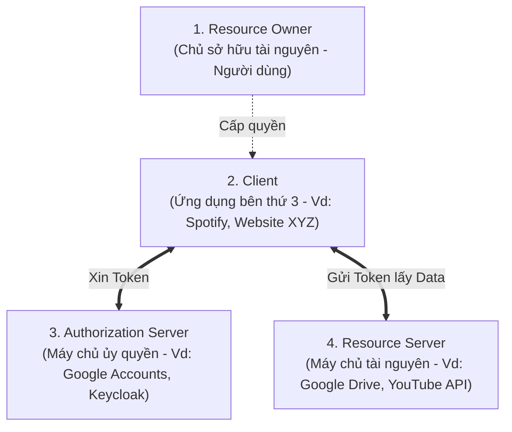
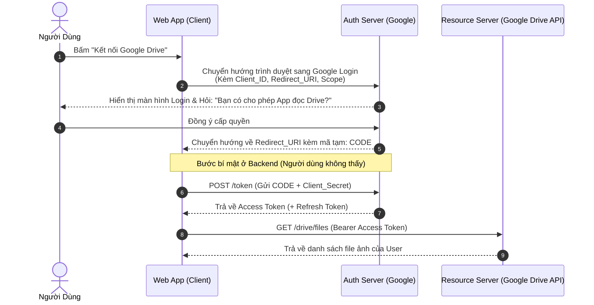

# 🛡️ OAuth 2.0 & OpenID Connect (OIDC)

> **OAuth (Open Authorization)** là một chuẩn ủy quyền mở (**RFC 6749**) cho phép ứng dụng bên thứ ba (Client) truy cập vào tài nguyên của người dùng được lưu trữ trên một dịch vụ khác (Resource Server) mà **không cần người dùng phải tiết lộ mật khẩu**.

---

## 🏨 1. Ẩn Dụ Dễ Hiểu Nhất: "Chìa Khóa Khách Sạn & Thẻ Valet Parking"

Trước khi có OAuth, hãy tưởng tượng bạn đi khách sạn hoặc gửi xe tại nhà hàng cao cấp:
- **Thời chưa có OAuth**: Để người phục vụ đánh xe vào bãi hộ, bạn phải **đưa cả chùm chìa khóa nhà + chìa khóa két sắt + chìa xe** cho họ! Họ có thể dùng chìa đó để mở két sắt nhà bạn bất cứ lúc nào.
  *(Tương tự: Ứng dụng quản lý danh bạ bắt bạn nhập trực tiếp Email và Mật khẩu Google vào app của nó)*.
- **Khi có OAuth 2.0**: Bạn chỉ đưa cho người phục vụ **"Thẻ chìa khóa phụ (Valet Key)"**. Chìa khóa này chỉ mở được cửa xe và nổ máy trong phạm vi bãi xe, không mở được cốp xe, và tự động hết hạn sau 2 tiếng.
  *(Tương tự: Bạn đăng nhập trên trang chính thức của Google, Google cấp cho ứng dụng bên thứ 3 một cái **Access Token** chỉ có quyền đọc danh bạ trong 1 giờ, ứng dụng không hề biết mật khẩu Google của bạn)*.

---

## 👥 2. 4 Vai Trò Cốt Lõi Trong Kiến Trúc OAuth 2.0



1. **Resource Owner (Người dùng)**: Người sở hữu dữ liệu (ví dụ: Bạn, người sở hữu tài khoản Google).
2. **Client (Ứng dụng)**: Ứng dụng muốn truy cập dữ liệu của bạn (ví dụ: Website in ảnh muốn lấy ảnh từ Google Drive của bạn).
3. **Authorization Server**: Máy chủ xác thực danh tính và cấp phát Token (ví dụ: `accounts.google.com`).
4. **Resource Server**: Máy chủ lưu trữ tài nguyên thực tế và bảo vệ bằng token (ví dụ: `drive.googleapis.com`).

---

## 🔄 3. Luồng Hoạt Động Chuẩn: Authorization Code Flow

Đây là luồng an toàn và phổ biến nhất được sử dụng khi ứng dụng có Backend riêng:



### Tại sao phải dùng mã tạm `CODE` mà không trả luôn `Access Token` ở bước 5?
- Bước chuyển hướng diễn ra trên **trình duyệt (Front-channel)**, token có thể bị lộ trong lịch sử duyệt web hoặc log mạng.
- Vì vậy, Auth Server chỉ trả về mã tạm `CODE` (chỉ sống vài giây và dùng 1 lần).
- Backend của App mới dùng `CODE` kết hợp với `Client Secret` (mã bí mật chỉ Backend biết) để gọi trực tiếp tới Auth Server qua **kênh nội bộ (Back-channel)** đổi lấy Token thật.

---

## 🔀 4. Các Loại Luồng (Grant Types) Trong Thực Tế

| Luồng (Grant Type) | Trường hợp sử dụng | Độ an toàn |
|---|---|---|
| **Authorization Code** | Web App truyền thống có Backend (Spring Boot, Node.js, Django). | 🔒 Rất cao (dùng Client Secret ở backend). |
| **Auth Code + PKCE** | **Single Page App (React, Vue)** hoặc **Mobile App (iOS, Android)**. Không có backend bảo vệ Secret. | 🔒 Cực cao (Chuẩn hiện đại số 1). |
| **Client Credentials** | **Machine-to-Machine (M2M)**: Hai server giao tiếp nội bộ với nhau, không có người dùng tương tác. | 🔒 Cao. |
| **Device Code** | Thiết bị không có bàn phím/trình duyệt: Smart TV, Apple TV, CLI terminal. | 🔒 Tiện dụng. |
| ~~**Implicit Flow**~~ | ⚠️ **ĐÃ BỊ KHAI TỬ (Deprecated)** vì trả token trực tiếp trên URL trình duyệt. | ❌ Rất kém an toàn. |
| ~~**Password Grant**~~ | ⚠️ **ĐÃ BỊ KHAI TỬ (Deprecated)** vì bắt người dùng gõ username/password vào app thứ 3. | ❌ Nguy hiểm. |

> 💡 **PKCE (Proof Key for Code Exchange - đọc là "pixy")**: Giải pháp thay thế `Client Secret` cho ứng dụng Frontend/Mobile bằng cách sinh ra một cặp mã ngẫu nhiên một lần (`code_verifier` và `code_challenge`) trên từng thiết bị để chống bị chặn cướp Auth Code.

---

## ⚔️ 5. Phân Biệt Sống Còn: OAuth 2.0 vs. OpenID Connect (OIDC)

Nhiều người nói: *"Website của tôi dùng OAuth 2.0 để Đăng nhập bằng Google"*. **Về mặt kỹ thuật, câu này sai bản chất!**

```
┌────────────────────────────────────────────────────────┐
│             OpenID Connect (OIDC)                      │
│        = AUTHENTICATION (Xác thực danh tính)           │
│        Trả lời: "BẠN LÀ AI?"                           │
│        Cấp: ID Token (chuỗi JWT chứa profile user)     │
└──────────────────────────┬─────────────────────────────┘
                           │ Xây dựng đè lên nền tảng
                           ▼
┌────────────────────────────────────────────────────────┐
│                   OAuth 2.0                            │
│        = AUTHORIZATION (Cấp quyền truy cập)            │
│        Trả lời: "BẠN ĐƯỢC PHÉP TRUY CẬP CÁI GÌ?"       │
│        Cấp: Access Token (vé vào cổng tài nguyên)      │
└────────────────────────────────────────────────────────┘
```

- **OAuth 2.0 nguyên bản**: Chỉ sinh ra để cấp quyền (**Authorization**). Nó không quan tâm bạn là ai, nó chỉ biết chiếc thẻ `Access Token` này được phép đọc bao nhiêu file trong Drive.
- **OpenID Connect (OIDC)**: Là một lớp mở rộng đặt lên trên OAuth 2.0. Khi bạn thêm `scope=openid profile email`, server sẽ trả về thêm một chiếc **`id_token` (định dạng JWT)** chứa thông tin: tên, ảnh đại diện, email của bạn. Lúc này nó mới chính thức là chức năng **Đăng nhập (Authentication)**!

---

## 🎯 6. Tóm Tắt Nhanh Cho Backend Developer

1. **OAuth 2.0** = Trao quyền hạn mà không giao nộp mật khẩu.
2. **Access Token** = Chiếc vé vào cổng có thời hạn.
3. **Scope** = Phạm vi quyền lực của chiếc vé (`read:profile`, `write:orders`).
4. **OIDC** = OAuth 2.0 + Đăng nhập (Authentication) + `id_token`.
5. Nếu làm App Web/Mobile hiện đại: Luôn dùng **Authorization Code Flow kết hợp PKCE**.
