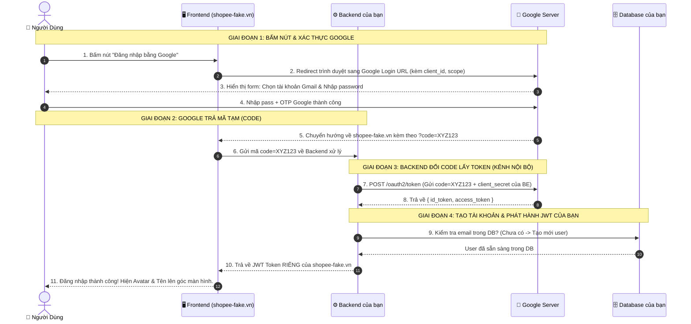

# 🌐 Case Study: Chuyện Gì Thực Sự Xảy Ra Khi Bấm "Đăng Nhập Bằng Google"?

Để hiểu sâu bản chất, hãy xét một ví dụ thực tế:
Bạn đang làm website bán hàng **`shopee-fake.vn`** và gắn nút **"Đăng nhập bằng Google"**.

---

## 🎭 4 Nhân Vật Tham Gia "Vở Kịch"

1. **Người dùng (Bạn)**: Ngồi trước trình duyệt web.
2. **Frontend (`shopee-fake.vn`)**: Giao diện người dùng.
3. **Backend (`api.shopee-fake.vn`)**: Server của bạn (nơi lưu database user, mật khẩu nội bộ).
4. **Google Server (`accounts.google.com`)**: "Ông lớn" đứng ra bảo lãnh danh tính.

---

## 🎬 Toàn Bộ Kịch Bản 8 Bước (Kèm URL & Dữ Liệu Thực Tế)



---

## 🔍 Chi Tiết Từng Bước "Dưới Nắp Ca-pô"

### Bước 1 & 2: Chuyển hướng sang Google
Khi user bấm nút, trình duyệt mở một đường link siêu dài trỏ thẳng tới Google:

```http
GET https://accounts.google.com/o/oauth2/v2/auth?
    client_id=123456789-shopeefake.apps.googleusercontent.com
    &redirect_uri=https://shopee-fake.vn/api/auth/google/callback
    &response_type=code
    &scope=openid%20profile%20email
    &state=random_anti_csrf_string_999
```
* **`client_id`**: Mã định danh Google cấp riêng cho website của bạn.
* **`redirect_uri`**: Địa chỉ mà Google phải đẩy user quay về sau khi đăng nhập xong.
* **`scope=openid profile email`**: Bạn nói với Google: *"Tôi chỉ xin tên, avatar và email của user thôi, tôi không đòi đọc Google Drive hay Gmail của họ đâu"*.
* **`state`**: Một chuỗi ngẫu nhiên để chống tấn công giả mạo CSRF.

---

### Bước 3 & 4: User đăng nhập trên máy chủ Google
- Người dùng gõ mật khẩu, xác thực vân tay hoặc mã 2FA.
- **Website của bạn hoàn toàn không thấy và không thể can thiệp** vào bước này. Bạn an toàn tuyệt đối, không sợ bị mang tiếng lộ mật khẩu của khách hàng.

---

### Bước 5 & 6: Google trả về một mã dùng một lần (`code`)
Đăng nhập thành công, Google chuyển hướng trình duyệt về đúng `redirect_uri` bạn đã đăng ký:

```http
GET https://shopee-fake.vn/api/auth/google/callback?code=4/0AfgeXvy...XYZ123&state=random_anti_csrf_string_999
```
> ⚠️ **LƯU Ý CỰC KỲ QUAN TRỌNG:**  
> Chuỗi `XYZ123` này **CHƯA PHẢI LÀ DỮ LIỆU USER**, cũng **CHƯA PHẢI TOKEN ĐĂNG NHẬP**.  
> Nó chỉ là một chiếc **"Vé tạm đổi quà"** chỉ dùng được 1 lần và hết hạn sau 30 - 60 giây!

Frontend nhận được mã `code` này liền gửi ngay xuống Backend của bạn.

---

### Bước 7 & 8: Backend của bạn "đổi vé" lấy Token thật từ Google
Backend của bạn bí mật bắn một HTTP POST request thẳng sang máy chủ Google (gọi là Back-channel):

```http
POST https://oauth2.googleapis.com/token
Content-Type: application/x-www-form-urlencoded

code=4/0AfgeXvy...XYZ123
&client_id=123456789-shopeefake.apps.googleusercontent.com
&client_secret=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d_knows
&redirect_uri=https://shopee-fake.vn/api/auth/google/callback
&grant_type=authorization_code
```

Google kiểm tra:
1. Mã `code` có đúng và còn hạn không?
2. `client_secret` có đúng của `shopee-fake.vn` không?

Nếu chuẩn, Google trả về JSON:
```json
{
  "access_token": "ya29.a0AfH6SM...",
  "expires_in": 3599,
  "token_type": "Bearer",
  "id_token": "eyJhbGciOiJSUzI1NiIs..." // ĐÂY LÀ CHUỖI JWT CỦA GOOGLE!
}
```

---

### Bước 9: Backend giải mã `id_token` để biết User là ai
Backend bóc `id_token` (đây là một JWT do Google ký bằng thuật toán RS256):
```json
{
  "iss": "https://accounts.google.com",
  "sub": "109876543210987654321", // Google User ID duy nhất
  "email": "nguyenvana@gmail.com",
  "email_verified": true,
  "name": "Nguyen Van A",
  "picture": "https://lh3.googleusercontent.com/a/..."
}
```

Lúc này, Backend truy vấn Database của mình:
- **Trường hợp 1 (Khách mới)**: Email `nguyenvana@gmail.com` chưa có trong bảng `users` -> Tự động `INSERT` một user mới với `full_name = "Nguyen Van A"`, `email = "nguyenvana@gmail.com"`, `provider = "GOOGLE"`.
- **Trường hợp 2 (Khách cũ)**: Đã có trong DB -> Chỉ cần lấy `user_id` nội bộ ra.

---

### Bước 10 & 11: Backend cấp Token CỦA BẠN cho Client
Đây là bước **90% người mới học bị nhầm**:

> 🛑 **SAI LẦM**: Mang cái `access_token` của Google gửi về cho Frontend rồi dùng nó để gọi API của hệ thống mình.
> 
> ✅ **ĐÚNG**: `access_token` của Google là để gọi sang Google! Đối với hệ thống của bạn, Backend sẽ **tự sinh ra một chuỗi JWT CỦA RIÊNG HỆ THỐNG BẠN** (đã học ở bài trước) và trả về cho Frontend:

```json
{
  "accessToken": "eyJhbGciOiJIUzI1Ni... (JWT của Shopee-Fake)",
  "user": {
    "id": 12,
    "name": "Nguyen Van A",
    "email": "nguyenvana@gmail.com",
    "avatar": "https://lh3.googleusercontent.com/..."
  }
}
```

---

## 🎯 Tổng Kết 3 Bài Học Cốt Lõi

1. **Google chỉ làm nhiệm vụ "Bảo lãnh danh tính"**: Google chứng nhận người này đúng là chủ sở hữu email `nguyenvana@gmail.com`.
2. **Không truyền Access Token qua URL trình duyệt**: Luôn dùng mã tạm `code` để tránh bị lộ trên Frontend.
3. **Phân tách rạch ròi 2 loại Token**:
   - `id_token` / `access_token` của Google: Chỉ dùng để Backend của bạn lấy profile user từ Google.
   - `JWT` của hệ thống bạn: Dùng để Frontend duy trì phiên đăng nhập và gọi các API mua hàng, giỏ hàng trên server của bạn.
