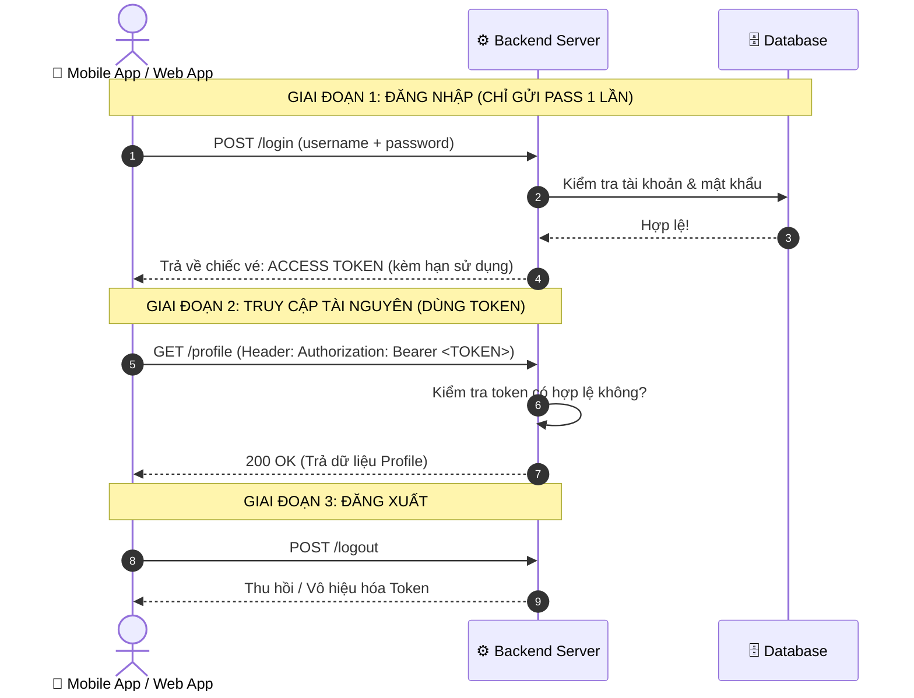

# 🎫 Token-Based Authentication (Bản Chất & Toàn Cảnh Kiến Trúc)

> **Token-based Authentication (Xác thực dựa trên Token)** là cơ chế xác thực mà sau khi người dùng đăng nhập thành công với tài khoản và mật khẩu, máy chủ sẽ cấp cho họ một **"Tấm vé thông hành" (Access Token)**.  
> Ở tất cả các yêu cầu tiếp theo, người dùng chỉ cần trình tấm vé này ra để truy cập tài nguyên mà **không cần phải gửi lại tài khoản/mật khẩu**, cũng **không cần máy chủ phải duy trì session** phức tạp.

---

## 🎟️ 1. Ẩn Dụ Thực Tế: "Vé Vào Cổng Công Viên Nước"

Hãy so sánh 3 cách xác thực qua hình ảnh đi công viên giải trí:

```
1. Basic Auth:
   Mỗi lần muốn chơi máng trượt, đu quay, tàu lượn -> bạn phải rút CCCD và sổ hộ khẩu ra để soát vé lại từ đầu!

2. Session-Cookie:
   Đến cổng, bảo vệ ghi tên bạn vào "Sổ lưu trú" ở bàn lễ tân, rồi phát cho bạn một cái số thẻ (SessionID: 105).
   Mỗi trò chơi muốn vào, nhân viên phải chạy ngược về bàn lễ tân mở sổ ra tra: "Thẻ 105 có phải là anh Nam không?".

3. Token-Based Authentication:
   Đến cổng, bạn đưa vé -> Nhân viên đóng một con dấu dạ quang lên cổ tay bạn (Token).
   Từ đó về sau, chơi bất kỳ trò nào, nhân viên từng khu vực chỉ cần soi đèn UV thấy con dấu hợp lệ là cho vào ngay lập tức!
   Nhân viên không cần chạy về bàn lễ tân để tra sổ nữa.
```

---

## 🔄 2. Luồng Hoạt Động Tổng Quát Của Token-Based Auth



---

## 🔬 3. Hai Loại Token Cốt Lõi: Opaque Token vs. Self-Contained Token

Rất nhiều người lầm tưởng *"Token nghĩa là JWT"*. Trên thực tế, Token chia làm **2 trường phái hoàn toàn khác nhau**:

| Đặc điểm | 1. Opaque Token (By-Reference) | 2. Self-Contained Token (By-Value - vd: JWT) |
|---|---|---|
| **Hình thức** | Là chuỗi ngẫu nhiên vô nghĩa (UUID hoặc Hex), vd: `9f8b2a1c-4e7d-41a2...` | Là chuỗi chứa thông tin có cấu trúc mã hóa Base64: `Header.Payload.Signature` |
| **Nội dung bên trong** | **Rỗng** (Không chứa bất kỳ dữ liệu nào). | **Tự chứa** sẵn: `userId`, `role`, `exp` (hạn dùng)... |
| **Cách Server kiểm tra** | Bắt buộc phải query vào **Redis / Database** để tra xem token này tương ứng với ai. | Server **chỉ cần kiểm tra chữ ký số (Signature)** bằng Secret Key, không cần đụng tới Database! |
| **Khả năng Thu hồi (Revoke)** | **Cực kỳ dễ**: Chỉ cần xóa key đó trong Redis là token chết ngay lập tức. | **Khó hơn**: Token đã phát hành thì sống đến khi hết hạn `exp`, muốn hủy sớm phải duy trì Blacklist. |
| **Phù hợp kiến trúc** | Hệ thống bảo mật cao, Monolith, hoặc quản trị Session bằng Redis. | **Microservices**, hệ thống phân tán, scale hàng triệu request. |

---

## ⚖️ 4. Tại Sao Token Đánh Bại Session-Cookie Trong Kỷ Nguyên Hiện Đại?

| Lý do | Session-Cookie (Kiểu cũ) | Token-Based (Kiểu mới) |
|---|---|---|
| **Đa nền tảng (Multi-platform)** | Khó dùng trên **Mobile App (iOS, Android)** và IoT vì mobile không tự động quản lý cookie như trình duyệt. | **Cực kỳ thân thiện**: Mobile, Web, Smart TV đều gửi token qua Header HTTP như nhau. |
| **Mở rộng cụm server (Horizontal Scaling)** | Server A nhận login -> Server B không biết nếu không dùng giải pháp chia sẻ bộ nhớ tập trung (Redis Cluster). | **Stateless tuyệt đối**: Server A, B, C, D đều xác thực được token mà không cần giao tiếp với nhau. |
| **Tên miền chéo (CORS & Microservices)** | Cookie bị giới hạn khắt khe bởi chính sách `SameSite` và tên miền (Domain). Gọi API chéo domain rất dễ bị mất cookie. | **Linh hoạt tuyệt đối**: Token đặt trong header `Authorization: Bearer`, gọi tới bất kỳ domain hay microservice nào cũng hoạt động. |
| **Chống tấn công CSRF** | Rất dễ bị tấn công **CSRF** (Cross-Site Request Forgery) vì trình duyệt tự động đính kèm cookie mỗi khi gửi request. | **Miễn nhiễm với CSRF** nếu token được lưu trong JavaScript memory và đính kèm thủ công vào header. |

---

## 🛡️ 5. Vấn Đề Nhức Nhối: Lưu Trữ Token Ở Đâu Trên Client Cho An Toàn?

Khi server trả Token về cho trình duyệt, bạn nên cất nó ở đâu?

```
                    ┌─────────────────────────┐
                    │ NƠI LƯU TRỮ TOKEN TRÊN WEB │
                    └────────────┬────────────┘
                                 │
         ┌───────────────────────┴───────────────────────┐
         ▼                                               ▼
   1. LocalStorage / SessionStorage              2. HttpOnly Cookie
   ────────────────────────────────              ──────────────────
   - Lấy bằng JS: localStorage.getItem()         - JS hoàn toàn KHÔNG THỂ đọc được
   ❌ RẤT DỄ BỊ XSS: Hacker chèn mã              ✅ CHỐNG ĐƯỢC XSS 100%
      độc JS là lấy trộm được token!              ⚠️ Có nguy cơ bị CSRF (cần bật cờ
   ✅ Không lo bị tấn công CSRF                     SameSite=Strict/Lax để phòng vệ)
```

> 🏆 **Chiến lược chuẩn công nghiệp (Best Practice hiện đại):**
> 1. **Access Token (sống 5-15 phút)**: Lưu trong **Memory (Biến JavaScript / Redux / Pinia)**. Khi người dùng F5 hoặc tắt tab, biến này tự mất -> Chống được XSS tuyệt đối.
> 2. **Refresh Token (sống dài ngày)**: Lưu trong **`HttpOnly` Cookie** (kèm cờ `Secure`, `SameSite=Strict`).
> 3. Khi F5 lại trang, Web app âm thầm gọi API `/auth/refresh` bằng cookie để lấy Access Token mới nạp vào Memory.

---

## 🎯 6. Tóm Tắt

1. **Token Auth** là việc thay thế việc gửi username/password lặp đi lặp lại bằng một **tấm vé thông hành**.
2. Chuẩn đính kèm token trên thế giới: `Authorization: Bearer <TOKEN>`.
3. Token có 2 dạng: **Opaque** (chuỗi ngẫu nhiên tra cứu qua Redis) và **Self-contained** (như JWT tự chứa thông tin).
4. Token là linh hồn của phát triển ứng dụng di động (Mobile App) và kiến trúc Microservices hiện đại.
