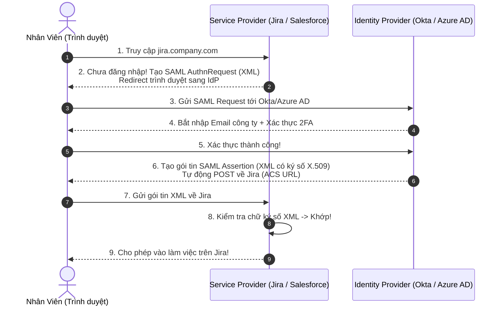

# 🏢 Single Sign-On (SSO): OpenID Connect (OIDC) vs. SAML 2.0

Cả **OpenID Connect (OIDC)** và **SAML 2.0** đều sinh ra để giải quyết cùng một bài toán lớn trong thế giới phần mềm: **Single Sign-On (SSO) & Identity Federation (Liên kết danh tính)**.

> 🎯 **Bài toán SSO là gì?**  
> Trong một tập đoàn có 10.000 nhân viên, bạn không thể bắt họ phải tạo 20 tài khoản và nhớ 20 mật khẩu khác nhau cho: Slack, Zoom, Jira, Gmail, Salesforce, Workday...  
> Bạn cần **MỘT tài khoản công ty duy nhất** đăng nhập vào một cổng trung tâm (Identity Provider như Okta, Azure AD, Google Workspace), và từ đó tự động đăng nhập vào tất cả các ứng dụng còn lại!

---

## 🏛️ 1. SAML 2.0 (Security Assertion Markup Language) - "Lão Làng" Doanh Nghiệp

Ra đời từ năm **2005**, SAML là tiêu chuẩn vàng đã thống trị các hệ thống doanh nghiệp (Enterprise), ngân hàng, cơ quan chính phủ và các trường đại học suốt 20 năm qua.

### 3 Khái niệm cốt lõi trong SAML:
1. **IdP (Identity Provider - Bên xác thực)**: Nơi giữ tài khoản nhân viên (Okta, Microsoft Entra ID / Azure AD, Ping Identity).
2. **SP (Service Provider - Bên cung cấp dịch vụ)**: Ứng dụng muốn dùng chung tài khoản (Jira, Zoom, Salesforce, Workday).
3. **SAML Assertion (Khẳng định SAML)**: Một bức điện **XML khổng lồ** được ký số điện tử (X.509 Certificate). Bức điện này chứa thông tin khẳng định: *"Tôi là Okta, tôi cam đoan người này là Nguyễn Văn A, email `a.nguyen@company.com`, thuộc phòng Kế toán"*.

---

## 🚀 2. OpenID Connect (OIDC) - "Kẻ Kế Vị Hiện Đại"

Nếu như **SAML** thuộc về thời kỳ của **XML và SOAP**, thì **OIDC** chính là phiên bản sinh ra cho kỷ nguyên của **JSON, REST và Mobile App**:

- Được xây dựng trên nền tảng của **OAuth 2.0**.
- Thay vì truyền gói tin XML dài ngoằng, OIDC chỉ truyền một chuỗi **`id_token` bằng định dạng JWT** (nhỏ gọn, đọc được bằng JavaScript dễ dàng).
- Hỗ trợ hoàn hảo cho các ứng dụng hiện đại: **Single Page Apps (React, Vue)**, **Mobile Apps (iOS, Android)**, Microservices và APIs.

---

## ⚔️ 3. Bảng So Sánh Trực Diện: OIDC vs. SAML 2.0

Một so sánh cực kỳ trực quan: **SAML giống như SOAP, còn OIDC giống như REST!**

| Tiêu chí | SAML 2.0 | OpenID Connect (OIDC) |
|---|---|---|
| **Năm ra đời** | 2005 (Cổ điển, lâu đời) | 2014 (Hiện đại) |
| **Định dạng dữ liệu** | **XML** (Rất nặng và phức tạp) | **JSON / JWT** (Gọn nhẹ, dễ đọc) |
| **Giao thức nền tảng** | HTTP POST binding / Redirect | **OAuth 2.0 + REST** |
| **Hỗ trợ Mobile App / SPA** | ❌ **Rất kém** (SAML thiết kế chỉ dành cho Web Browser với Redirect) | ✅ **Tuyệt hảo** (Chạy mượt trên iOS, Android, React, Vue) |
| **Độ phức tạp khi cài đặt** | ⭐⭐⭐⭐ Cực kỳ phức tạp (phải cấu hình X.509 Certs, Metadata XML) | ⭐⭐ Dễ dàng hơn rất nhiều |
| **Cơ chế Token** | SAML Assertion (XML signed) | `id_token` (JWT signed) |
| **Thuật ngữ tương đương** | **IdP** (Identity Provider) **SP** (Service Provider) | **OP** (OpenID Provider) **RP** (Relying Party / Client) |

---

## 🎯 4. Khi Nào Chọn SAML? Khi Nào Chọn OIDC?

Trong thực tế đi làm, bạn sẽ gặp cả hai:

### Chọn SAML 2.0 khi:
- **Làm ứng dụng Enterprise B2B**: Bạn bán phần mềm cho các tập đoàn lớn (Fortune 500), ngân hàng, bệnh viện, trường đại học. Họ bắt buộc phần mềm của bạn phải tích hợp SSO qua **SAML** với hệ thống Active Directory / ADFS / Okta có sẵn 15 năm qua của họ.

### Chọn OIDC khi:
- **Ứng dụng cho người dùng đại chúng (B2C)**: Nút "Đăng nhập bằng Google, Facebook, Apple, GitHub".
- **Ứng dụng có Mobile App (iOS / Android)** hoặc viết bằng SPA (React, Vue, Flutter).
- **Hệ thống Microservices hiện đại**: Cần truyền thông tin user gọn nhẹ qua HTTP Header giữa các service.

> 💡 **Thực tế:** Các nhà cung cấp dịch vụ xác thực hiện đại (như Okta, Auth0, Keycloak) ngày nay đều hỗ trợ **cả hai**. Phía trong họ quản lý danh tính tập trung, còn ứng dụng muốn kết nối qua SAML hay OIDC đều được!
