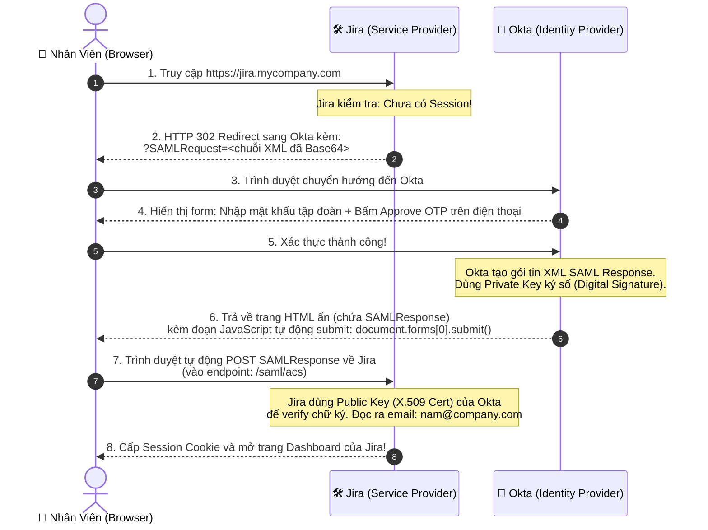
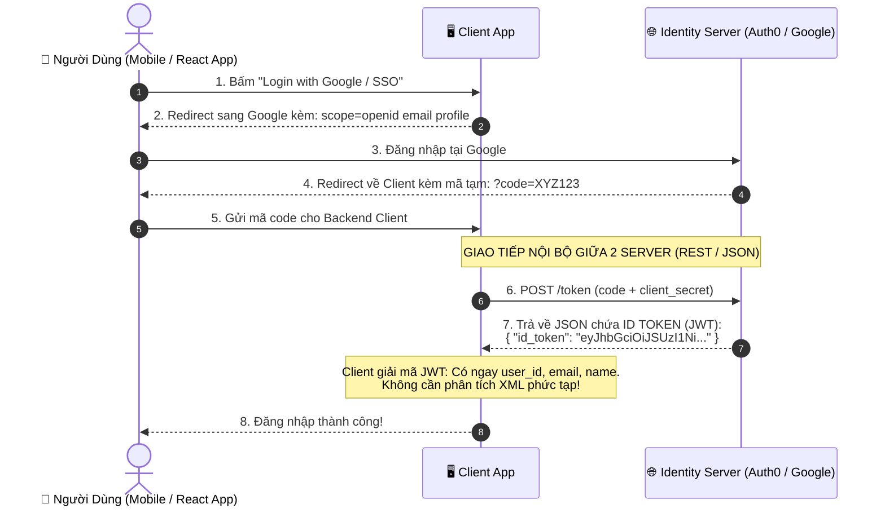

# 🔄 Luồng Chạy Chi Tiết: SAML 2.0 SSO vs. OpenID Connect (OIDC)

Để hiểu tận cùng "dưới nắp ca-pô" SAML và OIDC chạy khác nhau như thế nào, hãy xét một ví dụ thực tế hàng ngày:

> 🏢 **Tình huống thực tế:**  
> Bạn là một kỹ sư phần mềm tại tập đoàn. Sáng nay bạn mở trình duyệt và truy cập vào **Jira** (`jira.mycompany.com`) để xem task.  
> Công ty của bạn dùng **Okta** (hoặc **Microsoft Azure AD / Entra ID**) để quản lý tài khoản nhân viên tập trung.

---

## 🏛️ 1. Luồng Chạy Của SAML 2.0 (SP-Initiated SSO Flow)

Đây là luồng 95% các tập đoàn dùng để đăng nhập vào Jira, Zoom, Salesforce, Workday:



---

### 🔍 Giải Phẫu 2 Gói Tin XML Thực Tế Của SAML

#### Gói tin 1: Jira gửi yêu cầu (`SAMLRequest`)
Được Jira tạo ra khi bạn vừa vào web, đóng gói dưới dạng XML:

```xml
<samlp:AuthnRequest xmlns:samlp="urn:oasis:names:tc:SAML:2.0:protocol"
                    ID="_d7b2a9e1..."
                    Version="2.0"
                    IssueInstant="2026-09-30T08:00:00Z"
                    Destination="https://mycompany.okta.com/app/sso/saml"
                    AssertionConsumerServiceURL="https://jira.mycompany.com/saml/acs">
    <saml:Issuer xmlns:saml="urn:oasis:names:tc:SAML:2.0:assertion">
        https://jira.mycompany.com
    </saml:Issuer>
</samlp:AuthnRequest>
```
*Dịch nghĩa:* "Tôi là Jira. Hãy xác thực người dùng này giúp tôi, xác thực xong thì gửi kết quả về địa chỉ `AssertionConsumerServiceURL` nhé!"

---

#### Gói tin 2: Okta trả kết quả (`SAMLResponse` / `SAML Assertion`)
Sau khi bạn đăng nhập thành công, Okta phát hành một tệp XML có chữ ký số điện tử:

```xml
<samlp:Response xmlns:samlp="urn:oasis:names:tc:SAML:2.0:protocol">
    <saml:Issuer>https://mycompany.okta.com</saml:Issuer>
    <samlp:Status>
        <samlp:StatusCode Value="urn:oasis:names:tc:SAML:2.0:status:Success"/>
    </samlp:Status>
    
    <!-- CHỮ KÝ SỐ ĐIỆN TỬ BẰNG CERTIFICATE X.509 -->
    <ds:Signature xmlns:ds="http://www.w3.org/2000/09/xmldsig#">
        <ds:SignatureValue>i8B3mZ9... (chữ ký mã hóa cực dài)</ds:SignatureValue>
    </ds:Signature>

    <!-- NỘI DUNG KHẲNG ĐỊNH DANH TÍNH (ASSERTION) -->
    <saml:Assertion ID="_a9b8c7...">
        <saml:Subject>
            <saml:NameID>nam.nguyen@company.com</saml:NameID>
        </saml:Subject>
        <saml:AttributeStatement>
            <saml:Attribute Name="Role"><saml:AttributeValue>DEVELOPER</saml:AttributeValue></saml:Attribute>
            <saml:Attribute Name="Department"><saml:AttributeValue>IT_BACKEND</saml:AttributeValue></saml:Attribute>
        </saml:AttributeStatement>
    </saml:Assertion>
</samlp:Response>
```

#### 💡 Điểm đặc biệt của SAML: Kỹ thuật "Auto-Submit Form" (Bước 6 & 7)
Vì gói tin XML này rất lớn (vài KB), không thể nhét vừa trên URL của trình duyệt (GET), nên Okta trả về cho trình duyệt một đoạn code HTML như sau:
```html
<form method="POST" action="https://jira.mycompany.com/saml/acs">
    <input type="hidden" name="SAMLResponse" value="PHNhbWxwOlJlc3BvbnNl..." />
</form>
<script>
    // Trình duyệt tự chạy dòng này ngay lập tức mà người dùng không cần bấm nút!
    document.forms[0].submit(); 
</script>
```
Đó là lý do khi bạn đăng nhập SSO ở công ty, bạn thường thấy màn hình chớp trắng 1 giây với dòng chữ: *"Please wait while we redirect you..."*.

---

## ⚡ 2. Luồng Chạy Của OpenID Connect (OIDC) Để So Sánh

Trong khi SAML bắt trình duyệt phải ôm gói tin XML cồng kềnh bay qua bay lại, thì OIDC xử lý thanh thoát hơn rất nhiều:



---

## 🥊 3. So Sánh Bản Chất 2 Luồng: Khác Nhau Ở Đâu?

| Khâu | SAML 2.0 | OpenID Connect (OIDC) |
|---|---|---|
| **Kênh trao đổi dữ liệu** | **100% qua Trình duyệt (Front-channel)**: Trình duyệt phải "gánh" gói tin XML từ IdP ném sang SP bằng Auto-submit form. | **Kênh nội bộ (Back-channel)**: Trình duyệt chỉ nhận mã tạm `code`, còn việc lấy token thực tế diễn ra qua kênh kín giữa 2 máy chủ. |
| **Độ an toàn token** | XML Assertion đi xuyên qua trình duyệt (dễ bị extension hoặc proxy đọc). | `id_token` được Backend lấy trực tiếp từ Identity Server qua HTTPS bảo mật. |
| **Công cụ xử lý** | Backend phải dùng các parser XML khổng lồ và xử lý xác thực chữ ký X.509 phức tạp. | Bất kỳ thư viện JWT nào cũng giải mã được chuỗi JSON trong 1 mili-giây. |
| **Ứng dụng Mobile App** | ❌ Gần như bế tắc vì Mobile App không có form submit HTML tự nhiên như trình duyệt. | ✅ Cực kỳ mượt mà vì chỉ là gọi API REST nhận JSON. |
