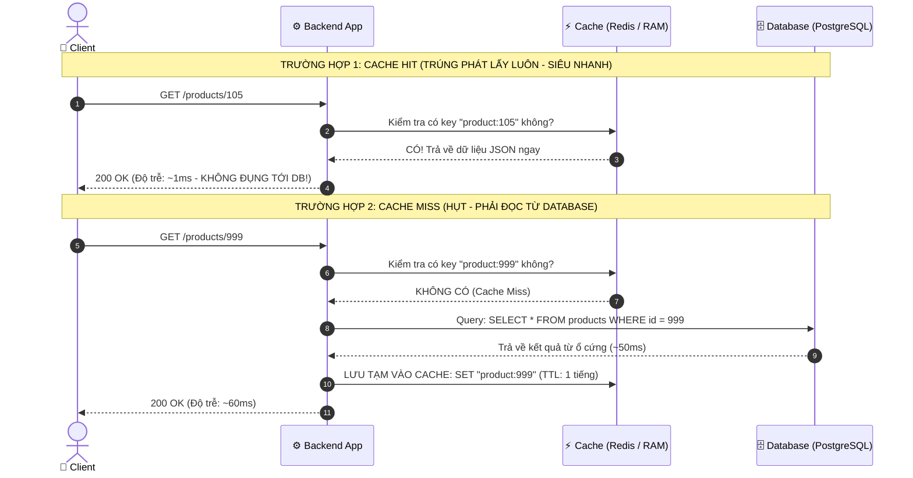

# ⚡ Caching Fundamentals (Bản Chất, Thuật Ngữ & Toàn Cảnh Bộ Nhớ Đệm)

> **Caching (Lưu trữ đệm)** là một kỹ thuật lưu trữ các bản sao dữ liệu tại một vùng lưu trữ tạm thời (**Cache**) có tốc độ truy xuất cực nhanh.  
> Khi có yêu cầu lấy dữ liệu trong tương lai, hệ thống sẽ ưu tiên đọc ngay từ Cache thay vì phải tính toán lại hoặc đọc từ nguồn dữ liệu gốc (Database / Disk / Network), qua đó **giảm triệt để độ trễ (Latency)** và **tăng vọt hiệu năng ứng dụng**.

---

## 🗄️ 1. Ẩn Dụ Thực Tế: "Ngăn Kéo Bàn Làm Việc vs. Kho Tầng Hầm"

Để hiểu vì sao mọi hệ thống lớn đều bắt buộc phải có Caching:

```
1. KHÔNG CÓ CACHING:
   Mỗi lần cần lấy một cuốn sổ ghi chép (dữ liệu):
   Bạn phải đứng dậy, bấm thang máy xuống tận kho lưu trữ ở tầng hầm (Database trên ổ cứng),
   mở khóa, lục tìm cuốn sổ rồi mới mang lên bàn để đọc -> MẤT 15 PHÚT!

2. CÓ CACHING:
   Lần đầu tiên lấy sổ từ tầng hầm lên, bạn tiện tay photo một bản đặt ngay trong
   "Ngăn kéo bàn làm việc" (RAM / Redis).
   Lần sau cần xem lại: Bạn chỉ việc thò tay mở ngăn kéo là có ngay trong 1 GIÂY!
```

---

## ⏱️ 2. Bảng Độ Trễ Phần Cứng Kinh Điển (Latency Numbers Every Programmer Must Know)

Tại sao đọc từ RAM (Cache) lại nhanh hơn đọc từ Database (Ổ cứng/Mạng) đến hàng nghìn lần?

```
┌────────────────────────────────────────────────────────────────────────┐
│               THỜI GIAN TRUY XUẤT PHẦN CỨNG THỰC TẾ                    │
├───────────────────────────────┬────────────────────────┬───────────────┤
│ Loại phần cứng                │ Thời gian thực tế      │ Quy đổi người │
├───────────────────────────────┼────────────────────────┼───────────────┤
│ CPU L1 Cache                  │ 0.5 nanoseconds (ns)   │ 1 giây        │
│ CPU L2 / L3 Cache             │ 3 - 10 ns              │ vài giây      │
│ Bộ nhớ chính (RAM)            │ 100 ns                 │ 3 phút        │
│ Đọc ổ cứng SSD (NVMe)         │ 100,000 ns (100 µs)    │ 2.5 ngày      │
│ Đọc ổ cứng cơ HDD             │ 10,000,000 ns (10 ms)  │ 8 tháng!      │
│ Gửi gói tin mạng vòng quanh TĐ│ 150,000,000 ns (150 ms)│ 5 năm!        │
└───────────────────────────────┴────────────────────────┴───────────────┘
```
👉 **Kết luận**: Đọc từ ổ cứng Database chậm hơn đọc từ RAM từ **1.000 đến 100.000 lần**! Caching đưa dữ liệu lên RAM để phục vụ người dùng trong chớp mắt.

---

## 📖 3. Bộ Thuật Ngữ Cốt Lõi (Bắt Buộc Phải Thuộc Lòng)



1. **Cache Hit (Trúng Cache)**:
   - Dữ liệu được tìm thấy sẵn trong bộ đệm. Server trả kết quả ngay lập tức mà không cần query Database.
2. **Cache Miss (Hụt Cache)**:
   - Dữ liệu chưa có trong cache (hoặc đã hết hạn). Server phải xuống Database query, sau đó **ghi ngược kết quả vào Cache** để lần sau được Hit.
3. **Hit Ratio (Tỷ lệ trúng)**:
   $$\text{Hit Ratio} = \frac{\text{Tổng số Cache Hits}}{\text{Tổng số Cache Hits} + \text{Tổng số Cache Misses}} \times 100\%$$
   * Trong một hệ thống tối ưu chuẩn, Hit Ratio thường phải đạt từ **85% đến 98%**. Nếu Hit Ratio < 50%, hệ thống Caching của bạn đang có vấn đề về chiến lược lưu trữ!
4. **TTL (Time-To-Live - Thời gian sống)**:
   - Khoảng thời gian dữ liệu được phép tồn tại trong Cache trước khi tự động bị xóa (ví dụ `TTL = 3600s` - 1 tiếng). TTL ngăn không cho dữ liệu cũ (stale data) tồn tại vĩnh viễn.
5. **Cache Eviction (Thanh lý bộ nhớ đệm)**:
   - Bộ nhớ RAM rất đắt đỏ và có hạn (ví dụ cụm Redis chỉ có 16GB RAM). Khi Cache bị đầy, thuật toán thanh lý sẽ chọn dữ liệu nào để vứt đi:
     - **LRU (Least Recently Used)**: Vứt bỏ dữ liệu **lâu nhất chưa được ai đọc tới** (phổ biến nhất).
     - **LFU (Least Frequently Used)**: Vứt bỏ dữ liệu **có tần suất đọc ít nhất**.
     - **FIFO (First In First Out)**: Vào trước thì ra trước.

---

## 🗺️ 4. Bản Đồ Caching Toàn Cảnh (Multi-Tier Caching)

Caching không chỉ nằm ở một chỗ. Một hệ thống hiện đại có Caching trải dài từ máy khách đến tận lõi Database:

```
[ TRÌNH DUYỆT / MOBILE CLIENT ]
  └──> 1. Browser Cache / Service Worker (Lưu file ảnh, CSS, JS, API offline trong máy khách)
           │
           ▼
[ ĐƯỜNG MẠNG & CDN (Cloudflare / CloudFront) ]
  └──> 2. Edge Cache (Lưu HTML tĩnh, video, ảnh tại các Data Center gần người dùng nhất)
           │
           ▼
[ REVERSE PROXY / API GATEWAY (Nginx) ]
  └──> 3. Gateway Cache (Lưu response của các API công khai dùng chung)
           │
           ▼
[ BACKEND APPLICATION (Spring Boot / Node.js) ]
  └──> 4. In-Memory Cache (Caffeine, Guava: Lưu thẳng trong RAM của app - cực nhanh)
  └──> 5. Distributed Remote Cache (REDIS / MEMCACHED: Cụm cache dùng chung cho mọi server)
           │
           ▼
[ DATABASE (PostgreSQL / MySQL) ]
  └──> 6. Database Buffer Pool / Shared Buffers (PostgreSQL tự cache các trang đĩa lên RAM)
```

---

## ⚖️ 5. Cái Giá Phải Trả Khi Dùng Caching (Trade-offs)

> *"Chỉ có hai điều khó khăn nhất trong ngành Khoa học Máy tính: **Hủy bỏ bộ đệm (Cache Invalidation)** và **Đặt tên biến**."*  
> — **Phil Karlton**

### ✅ Lợi ích khổng lồ:
1. **Tốc độ tia chớp**: Giảm thời gian phản hồi API từ 100ms - 500ms xuống chỉ còn **1ms - 5ms**.
2. **Cứu sống Database**: Một đợt Flash Sale có 100.000 người vào xem sản phẩm cùng lúc. Nếu 95% được đọc từ Redis, Database chỉ phải gánh 5.000 query thay vì sập nguồn!
3. **Tiết kiệm chi phí phần cứng**: Cần ít CPU và server Database đắt đỏ hơn.

### ⚠️ Rủi ro & Thách thức lớn:
1. **Dữ liệu cũ (Stale Data)**: User vừa đổi tên trong database, nhưng cache vẫn giữ tên cũ trong 1 tiếng -> Người khác vào xem vẫn thấy tên cũ!
2. **Bài toán xóa Cache (Cache Invalidation)**: Khi nào thì xóa? Xóa cái gì? Đồng bộ giữa DB và Cache ra sao để không bị lệch dữ liệu?
3. **Thêm phức tạp hạ tầng**: Bạn phải quản lý, vận hành và giám sát thêm một cụm Redis Cluster.
4. **Các thảm họa kinh điển**: *Cache Penetration, Cache Breakdown, Cache Avalanche* (chúng ta sẽ giải phẫu chi tiết ở các bài sau).
