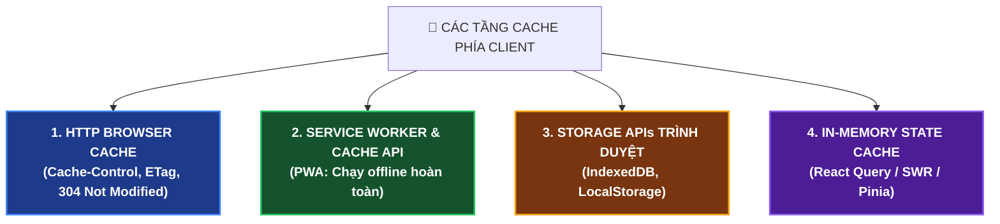
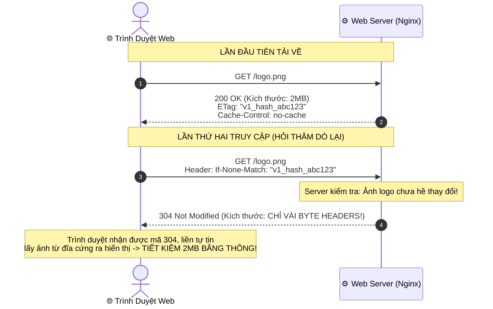

# 📱 Client-Side Caching: Lưu Trữ Đệm Tại Thiết Bị Người Dùng

> **"Request nhanh nhất trên đời chính là Request KHÔNG BAO GIỜ phải gửi qua mạng!"**  
> **Client-Side Caching (Lưu trữ đệm phía máy khách)** là kỹ thuật lưu dữ liệu tạm thời ngay trên chính thiết bị của người dùng (Trình duyệt web, Điện thoại di động).  
> Bằng cách lấy dữ liệu trực tiếp từ ổ cứng hoặc RAM của thiết bị, thời gian phản hồi đạt mức **0 mili-giây**, tiết kiệm 100% băng thông 4G/5G và giải tỏa hoàn toàn áp lực cho máy chủ Backend.

---

## ⚡ 1. Các Tầng Lưu Trữ Phía Client

Trên thiết bị người dùng (Browser / Mobile App), dữ liệu có thể được đệm ở 4 vị trí:



---

## 🧭 2. Linh Hồn Của Client Caching: HTTP Cache Headers

Khi Backend hoặc Web Server (Nginx) trả response về, Server sẽ gửi kèm các Header để "chỉ đạo" trình duyệt cách lưu đệm.

### A. Kiểm Soát Thời Gian Sống: Header `Cache-Control`

```http
Cache-Control: max-age=31536000, public, immutable
```

| Chỉ thị (Directive) | Ý nghĩa kỹ thuật | Ứng dụng thực tế |
|---|---|---|
| **`max-age=3600`** | Dữ liệu được coi là "tươi mới" (Fresh) trong 3600 giây (1 tiếng). Trong 1 tiếng này, trình duyệt tự lấy từ đĩa, **không thèm gửi bất kỳ request nào lên server**. | Áp dụng cho ảnh, bài viết, dữ liệu ít thay đổi. |
| **`no-cache`** | 🛑 **HIỂU LẦM KINH ĐIỂN: `no-cache` KHÔNG CÓ NGHĨA LÀ KHÔNG CACHE!**<br/>Trình duyệt **vẫn lưu cache**, nhưng mỗi lần dùng **bắt buộc phải hỏi lại server** xem file có bị sửa đổi hay chưa (Revalidation). | File `index.html`, API thông tin tài khoản. |
| **`no-store`** | 🔒 **CẤM CACHE TUYỆT ĐỐI**: Không lưu 1 byte nào vào ổ cứng hay RAM thiết bị. | Dữ liệu ngân hàng, số thẻ tín dụng, OTP, thông tin nhạy cảm. |
| **`public`** | Cho phép cả Trình duyệt lẫn các Proxy/CDN trung gian được lưu đệm. | File tĩnh dùng chung (JS, CSS, Font). |
| **`private`** | **Chỉ riêng trình duyệt của người dùng** được cache, cấm CDN/Proxy trung gian lưu (tránh lộ thông tin cá nhân). | Dữ liệu hồ sơ người dùng (`/profile`). |
| **`immutable`** | Khẳng định dữ liệu này sẽ không bao giờ đổi. Trình duyệt không cần hỏi lại server kể cả khi người dùng bấm F5. | File JS/CSS đã có mã hash: `app.a8f9c2.js`. |
| **`stale-while-revalidate`**| **UX đỉnh cao**: Lấy dữ liệu cũ hiển thị ngay lập tức (0ms), đồng thời âm thầm gọi mạng ngầm tải bản mới về cập nhật cho lần sau! | Bảng tin Facebook, danh sách sản phẩm. |

---

## 🔄 3. Cơ Chế Thăm Dò Lại (Conditional Requests & Mã `304 Not Modified`)

Khi một file đã hết hạn `max-age` hoặc được gắn cờ `no-cache`, làm sao trình duyệt biết file đó có thực sự bị sửa đổi trên server hay chưa để không phải tải lại toàn bộ nội dung?

👉 **Đáp án: Dùng ETag hoặc Last-Modified!**



1. **ETag (Entity Tag)**: Là một chuỗi mã băm (Hash) đại diện cho nội dung file. Khi nội dung file đổi dù chỉ 1 ký tự, ETag sẽ đổi.
2. **`HTTP 304 Not Modified`**: Một mã phản hồi kỳ diệu — nó **hoàn toàn không có nội dung body**, chỉ trả về header xác nhận file vẫn nguyên vẹn.

---

## 💣 4. Bài Toán Hóc Búa: Cache Invalidation & Kỹ Thuật "Cache Busting"

Hãy tưởng tượng bạn cấu hình:
```http
# File app.js được cache 1 năm:
Cache-Control: max-age=31536000
```
Hôm nay bạn vừa fix một lỗi nghiêm trọng trong `app.js` và deploy lên server. Nhưng hàng triệu khách hàng **vẫn dùng phiên bản lỗi suốt 1 năm tiếp theo** vì trình duyệt của họ không thèm gọi lên server nữa!

Làm sao giải quyết?

### 🛡️ Giải Pháp Chuẩn Công Nghiệp: "Cache Busting" (Đổi Tên File Bằng Content Hash)
Các công cụ đóng gói hiện đại (Webpack, Vite, Next.js) tự động băm nội dung file thành tên file:

```
Phiên bản 1 (v1.0):      https://example.com/assets/app.a1b2c3.js  (Cache 1 năm)
Deploy bản mới (v1.1):   https://example.com/assets/app.d4e5f6.js  (Tên file mới hoàn toàn!)
```

```
[ FILE index.html ] ─────────────> Luôn cấu hình: Cache-Control: no-cache
       │                           (Để trình duyệt luôn lấy HTML mới nhất)
       ▼
Chứa thẻ: <script src="app.d4e5f6.js"></script>
       │
       ▼
[ FILE JS / CSS / ẢNH ] ─────────> Cấu hình: Cache-Control: max-age=31536000, immutable
                                   (Vì tên file đã đổi thì không bao giờ sợ bị cũ!)
```

---

## 📦 5. Các Kho Lưu Trữ Dữ Liệu Khác Phía Client

Ngoài HTTP Cache, ứng dụng hiện đại còn dùng các API lưu trữ có sẵn trên trình duyệt:

| Công nghệ | Dung lượng | Bất đồng bộ? | Mục đích sử dụng |
|---|---|---|---|
| **LocalStorage** | ~5MB | ❌ Đồng bộ (Chặn UI) | Lưu cài đặt giao diện (Dark/Light mode), ngôn ngữ. |
| **SessionStorage**| ~5MB | ❌ Đồng bộ | Lưu dữ liệu tạm trong 1 tab (form đang điền dở). |
| **IndexedDB** | **Hàng trăm MB / GB**| ✅ Bất đồng bộ | **Kho Database NoSQL đầy đủ trên trình duyệt**: Lưu danh mục sản phẩm, bài viết để đọc offline. |
| **Service Worker (Cache API)**| Hàng trăm MB | ✅ Bất đồng bộ | **Linh hồn của PWA**: Chặn mọi request mạng để trả về cache ngay cả khi rớt mạng hoàn toàn. |

---

## 🎯 6. Bảng Tóm Tắt Chiến Lược Client Cache Cho Dự Án

```
Tài nguyên của bạn là gì?
│
├─ File HTML chính (index.html)?
│   └─ → Cache-Control: no-cache (Luôn hỏi server để cập nhật bản mới nhất)
│
├─ File JS, CSS, Font đã có mã hash (bundle.a1b2.js)?
│   └─ → Cache-Control: max-age=31536000, immutable (Cache tối đa 1 năm)
│
├─ Ảnh, Video, Tài liệu tĩnh không đổi tên?
│   └─ → Cache-Control: max-age=86400 (Cache 1 ngày) + ETag (để thăm dò 304)
│
└─ API dữ liệu cá nhân, tài chính nhạy cảm?
    └─ → Cache-Control: no-store, private (Tuyệt đối không cache ở bất kỳ đâu)
```
