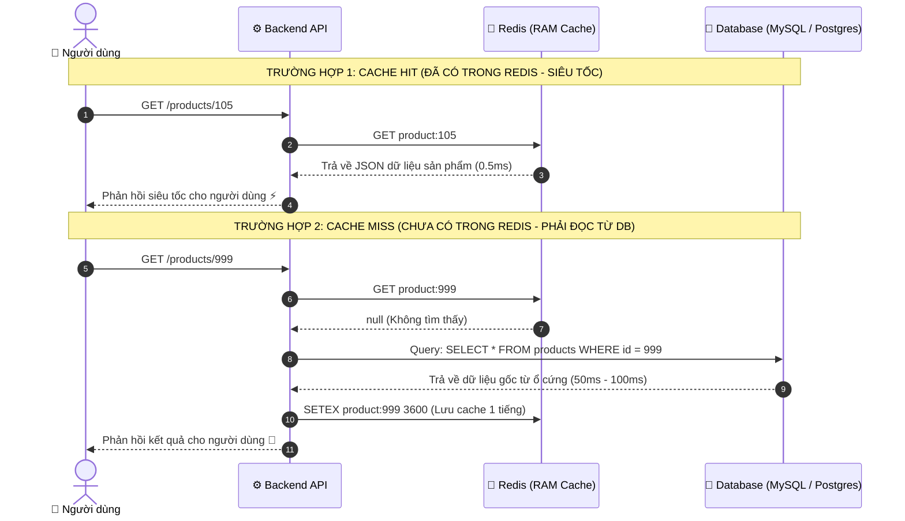
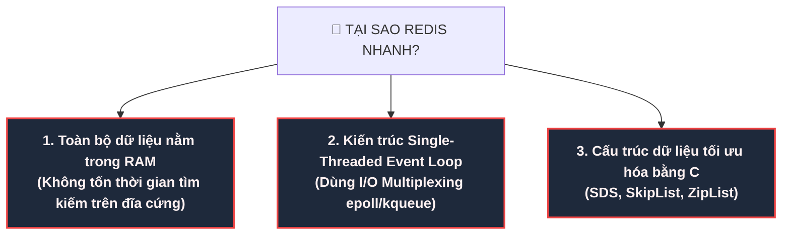
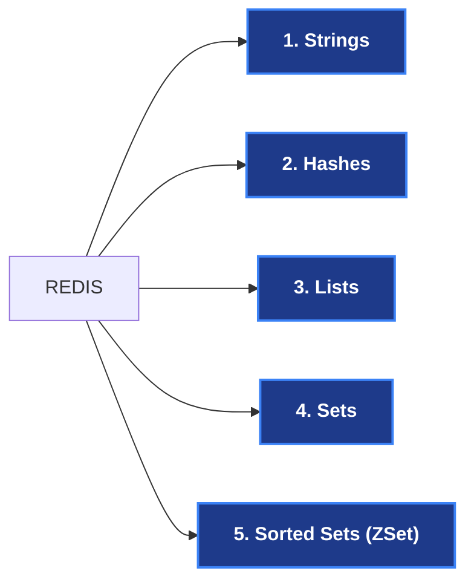

# 🔴 Redis: "Ông Vua" In-Memory Caching & Data Structures

> **Redis** (viết tắt của **REmote DIctionary Server**) là một hệ thống lưu trữ cấu trúc dữ liệu trong bộ nhớ (**In-Memory Data Structure Store**) mã nguồn mở, hoạt động theo mô hình Key-Value.  
> Được tạo ra bởi Salvatore Sanfilippo vào năm 2009, Redis ngày nay là **công nghệ Caching & In-Memory số 1 thế giới**, được sử dụng bởi hầu hết mọi tập đoàn công nghệ lớn (Twitter, GitHub, Netflix, Shopee, Grab).

Redis không chỉ là một kho chứa Cache đơn thuần (như Memcached), nó là một **"con dao pha Thụy Sĩ"** phục vụ: Caching, Quản lý Session, Bảng xếp hạng Real-time, Khóa phân tán (Distributed Lock), và Hàng đợi Message Broker.

---

## 💡 0. Hiểu Bản Chất: Redis Thực Sự Là Cái Gì & Nằm Ở Đâu?

### A. Tưởng tượng trong đời thực (Mental Model)
Để dễ hình dung, hãy so sánh hệ thống phần mềm với công việc tại một bàn giấy văn phòng:
- **Database truyền thống (PostgreSQL, MySQL)** giống như **Kho lưu trữ hồ sơ dưới tầng hầm**:
  - Chứa được hàng triệu bộ hồ sơ, dữ liệu lưu vĩnh viễn trên kệ sắt (ổ cứng SSD/HDD).
  - Nhưng mỗi lần cần xem hồ sơ, nhân viên phải đi thang máy xuống tầng hầm, tìm kiếm rồi bê lên, mất **50 - 200 mili-giây**. Nếu 10.000 người cùng đòi xem hồ sơ một lúc, thang máy kẹt cứng và hệ thống tê liệt.
- **Redis** giống như **Mặt bàn làm việc ngay trước mắt bạn (RAM)**:
  - Chỉ chứa một số ít hồ sơ "hot" đang dùng nhiều nhất trong ngày.
  - Cần xem chỉ việc thò tay lấy ngay lập tức, tốn **dưới 1 mili-giây** (nhanh gấp 100 lần xuống tầng hầm!).

### B. Về mặt kỹ thuật: Redis nằm ở đâu trong hệ thống?
Redis là một **phần mềm máy chủ (Server process)** chạy độc lập, mặc định lắng nghe ở cổng **`6379`**.  
Backend của bạn (Node.js, Spring Boot, Go, Django...) sẽ kết nối tới Redis thông qua mạng TCP giống hệt như kết nối tới MySQL.

```
  [ Trình duyệt / Mobile App ]
               │
               ▼ (1. Gửi HTTP Request)
  ┌─────────────────────────────────────────────────────────────┐
  │              ⚙️ BACKEND API (Node.js / Java / Go)           │
  └──────────────────────────────┬──────────────────────────────┘
                                 │
           ┌─────────────────────┴─────────────────────┐
           │ (2. Kiểm tra Cache)                       │ (3. Cache Miss: Chọc vào DB)
           ▼                                           ▼
  ┌─────────────────────────────────┐         ┌─────────────────────────────────┐
  │   🔴 REDIS (In-Memory RAM)      │         │   🐘 DATABASE (PostgreSQL/MySQL)│
  │   • Tốc độ: ~0.5ms              │         │   • Tốc độ: ~50ms - 200ms       │
  │   • Lưu trên RAM dạng Key-Value │         │   • Lưu trên ổ cứng (SSD/HDD)   │
  └────────────────┬────────────────┘         └────────────────┬────────────────┘
                   │                                           │
                   │ (Cache Hit: Có sẵn, trả về ngay!) ⚡       │ (Query xong, ghi cache) 🐢
                   └─────────────────────┬─────────────────────┘
                                         ▼
                             [ Trả kết quả về Client ]
```



### C. "Tại sao không dùng biến RAM trong code Backend mà phải cần Redis?"
Một câu hỏi kinh điển khi mới học: *Tại sao không khai báo một `const cache = {}` trong Node.js hoặc `HashMap` trong Java để lưu luôn trên RAM của Backend, đỡ phải cài thêm Redis?*
1. **Hệ thống phân tán (Distributed System)**: Trong thực tế, bạn chạy 5 đến 10 server Backend cùng lúc phía sau Load Balancer. Nếu User đăng nhập ở Server 1 mà lưu vào biến RAM của Server 1, khi request sau chuyển sang Server 2 thì Server 2 không hề biết User đó là ai! Redis đóng vai trò là **Bộ nhớ RAM tập trung dùng chung** cho toàn bộ các server Backend.
2. **Khởi động lại (Restart / Deploy)**: Mỗi khi bạn deploy phiên bản code mới, tiến trình Backend bị restart -> Toàn bộ biến RAM trong code bị xóa sạch. Nếu có Redis, cache và phiên làm việc vẫn nguyên vẹn.
3. **Tràn bộ nhớ Backend**: Tiến trình Backend cần RAM để chạy logic ứng dụng. Nếu bạn nhồi hàng gigabyte cache vào RAM của Backend, nó sẽ bị crash vì lỗi Out of Memory (OOM).

---

## ⚡ 1. Vì Sao Redis Nhanh Như Chớp? (100.000+ Ops/giây)

Một instance Redis chạy trên một máy chủ thông thường có thể dễ dàng xử lý **hơn 100.000 lượt đọc/ghi mỗi giây** với độ trễ dưới 1 mili-giây. Sức mạnh này đến từ 3 bí mật kiến trúc:



### Điểm đặc biệt: "Tại sao Single-Thread (đơn luồng) lại nhanh hơn Multi-Thread?"
Nhiều người nghĩ nhiều luồng (Multi-threading) thì phải nhanh hơn. Nhưng trong hệ thống xử lý bộ nhớ cực nhanh:
1. **Không tốn chi phí chuyển ngữ cảnh (Context Switching)**: CPU không phải liên tục tạm dừng luồng này để nhảy sang luồng kia.
2. **Không có tranh chấp khóa (Lock Contention / Race Condition)**: Không cần dùng `synchronized`, `Mutex Lock` hay lo deadlock.
3. **Mọi lệnh trong Redis đều mang tính nguyên tử (Atomic)**: Một lệnh chạy xong hoàn toàn rồi mới tới lệnh tiếp theo!

---

## 🧰 2. Năm Cấu Trúc Dữ Liệu Cốt Lõi & Ca Sử Dụng Thực Chiến

Điểm làm Redis vượt trội hoàn toàn so với Memcached chính là **hỗ trợ các cấu trúc dữ liệu phong phú**:



### 1. Strings (Chuỗi ký tự / Số)
- Cấu trúc cơ bản nhất: `SET key value`, `GET key`.
- Chứa được văn bản, chuỗi JSON, hoặc thậm chí cả file nhị phân ảnh (tối đa 512MB).
- **Phép toán nguyên tử cực mạnh**: `INCR`, `DECR`.
  - *Ứng dụng*: Làm bộ đếm lượt xem bài viết (`INCR views:post:105`), đếm số lượt gọi API cho **Rate Limiting**.

### 2. Hashes (Bảng băm Key-Field-Value)
- Lưu trữ một đối tượng có nhiều thuộc tính: `HSET user:105 name "Nam" email "nam@gmail.com" age 25`.
- *Ưu điểm*: Cực kỳ tiết kiệm RAM so với việc lưu nguyên cả chuỗi JSON. Bạn có thể sửa đổi riêng trường `age` bằng `HINCRBY user:105 age 1` mà không cần đọc và ghi đè toàn bộ object.

### 3. Lists (Danh sách liên kết đôi)
- Thao tác đẩy vào / rút ra ở 2 đầu: `LPUSH`, `RPUSH`, `LPOP`, `RPOP`.
- *Ứng dụng*: 
  - Làm **Hàng đợi Message Queue nhẹ**: Service A đẩy tác vụ vào đuôi (`RPUSH tasks "job1"`), Service B rút tác vụ ở đầu (`LPOP tasks`).
  - Lưu dòng thời gian (Timeline): Lưu 20 bài đăng mới nhất của người dùng.

### 4. Sets (Tập hợp các phần tử duy nhất, không trùng lặp)
- Tự động lọc trùng: `SADD tags "java" "backend" "java"` -> Chỉ còn `"java"` và `"backend"`.
- Hỗ trợ các phép toán tập hợp: Giao (`SINTER`), Hợp (`SUNION`), Hiệu (`SDIFF`).
- *Ứng dụng*:
  - Tìm **Bạn chung giữa 2 người**: `SINTER friends:userA friends:userB`.
  - Đếm số lượng người truy cập duy nhất (Unique Visitors) trong ngày.

### 5. Sorted Sets - ZSet (Tập hợp có sắp xếp theo Điểm số)
- Mỗi phần tử đi kèm một điểm số (Score): `ZADD leaderboard 1500 "GamerA" 2000 "GamerB" 1200 "GamerC"`.
- Redis tự động duy trì thứ tự từ cao xuống thấp bằng thuật toán **SkipList** ($O(\log N)$).
- *Ứng dụng*:
  - **Bảng xếp hạng (Leaderboard) Real-time** trong Game hoặc Sàn TMĐT (Top bán chạy).
  - Triển khai **Sliding Window Rate Limiter**.

---

## 💾 3. Dữ Liệu Trong RAM Có Bị Mất Khi Mất Điện? (Tính Bền Vững - Persistence)

Redis lưu trong RAM, vậy nếu server đột ngột sập nguồn thì sao?  
Redis cung cấp **3 cơ chế ghi dữ liệu xuống ổ cứng (Persistence)**:

```
┌─────────────────────────────────┐       ┌─────────────────────────────────┐
│ 1. RDB (Snapshot định kỳ)       │       │ 2. AOF (Append-Only File)       │
├─────────────────────────────────┤       ├─────────────────────────────────┤
│ • Chụp ảnh toàn bộ dữ liệu ghi  │       │ • Ghi lại từng lệnh ghi         │
│   thành file nhị phân `dump.rdb`│       │   (SET, HSET, DEL) vào file text│
│ • Rất nhỏ gọn, khôi phục nhanh  │       │ • An toàn tối đa (mất tối đa 1s)│
│ ⚠️ Mất dữ liệu giữa 2 lần chụp  │       │ ⚠️ File dung lượng lớn hơn      │
└─────────────────────────────────┘       └─────────────────────────────────┘
```

> 🏆 **Chuẩn hiện đại (Hybrid Persistence - RDB + AOF):**  
> Kết hợp cả hai: Phần lớn dữ liệu cũ được nén dưới dạng RDB để khởi động siêu nhanh, các lệnh mới nhất được ghi tiếp bằng AOF để đảm bảo **không bao giờ mất dữ liệu**!

---

## 🏛️ 4. Kiến Trúc Sẵn Sàng Cao & Mở Rộng Quy Mô (High Availability & Scaling)

Khi lượng dữ liệu và người dùng vượt quá khả năng của 1 server:

```
  ┌────────────────────────────────────────────────────────┐
  │ 1. REDIS SENTINEL (High Availability - Tự phục hồi)   │
  └────────────────────────────────────────────────────────┘
          ┌───────────────────────────────────┐
          │   🛡️ Sentinel Cluster (Quorum)    │
          └─────────────────┬─────────────────┘
                            │ (Giám sát Heartbeat & Bầu cử khi sập)
                            ▼
               ┌────────────────────────┐
               │ 👑 Master (Ghi & Đọc)  │
               └───────────┬────────────┘
                           │ (Replication)
                 ┌─────────┴─────────┐
                 ▼                   ▼
          ┌──────────────┐    ┌──────────────┐
          │ 👥 Replica 1 │    │ 👥 Replica 2 │
          │  (Chỉ Đọc)   │    │  (Chỉ Đọc)   │
          └──────────────┘    └──────────────┘

  ┌────────────────────────────────────────────────────────┐
  │ 2. REDIS CLUSTER (Horizontal Scaling - Sharding)       │
  └────────────────────────────────────────────────────────┘
      ┌─────────────────┐  Gossip Protocol  ┌─────────────────┐
      │  📦 Node 1      │◀─────────────────▶│  📦 Node 2      │
      │ Slots: 0 - 5460 │                   │ Slots: 5461-10K │
      └─────────────────┘                   └─────────────────┘
                ▲                                     ▲
                │           Gossip Protocol           │
                └──────────────────┬──────────────────┘
                                   │
                                   ▼
                          ┌─────────────────┐
                          │  📦 Node 3      │
                          │ Slots: 10K-16K  │
                          └─────────────────┘
```



```mermaid
flowchart TD
    classDef master fill:#dc2626,stroke:#991b1b,stroke-width:2px,color:#fff,font-weight:bold
    classDef replica fill:#2563eb,stroke:#1d4ed8,stroke-width:2px,color:#fff
    classDef sentinel fill:#059669,stroke:#047857,stroke-width:2px,color:#fff
    classDef cluster fill:#312e81,stroke:#6366f1,stroke-width:2px,color:#fff,font-weight:bold

    subgraph S1 ["1. KIẾN TRÚC SẴN SÀNG CAO (REDIS SENTINEL FAILOVER)"]
        S["🛡️ Sentinel Cluster (Quorum)"]:::sentinel
        M["👑 Master Node (Ghi & Đọc)"]:::master
        R1["👥 Replica 1 (Chỉ Đọc)"]:::replica
        R2["👥 Replica 2 (Chỉ Đọc)"]:::replica

        S -.->|"Giám sát Heartbeat & Bầu cử khi Master sập"| M
        M -->|"Replication (Đồng bộ)"| R1
        M -->|"Replication (Đồng bộ)"| R2
    end

    subgraph S2 ["2. MỞ RỘNG QUY MÔ (REDIS CLUSTER - 16.384 HASH SLOTS)"]
        N1["📦 Node 1<br/>Slots: 0 - 5460"]:::cluster
        N2["📦 Node 2<br/>Slots: 5461 - 10922"]:::cluster
        N3["📦 Node 3<br/>Slots: 10923 - 16383"]:::cluster

        N1 <-->|"Gossip Protocol"| N2
        N2 <-->|"Gossip Protocol"| N3
        N3 <-->|"Gossip Protocol"| N1
    end
```

1. **Replication (Master - Replica)**:
   - 1 Master phục vụ ghi, nhiều Replica phục vụ đọc để giảm tải cho Master.
2. **Redis Sentinel (Tự động phục hồi lỗi - Failover)**:
   - Các tiến trình Sentinel liên tục kiểm tra nhịp tim (Heartbeat) của Master.
   - Nếu Master sập, Sentinel sẽ **tự động bầu cử một Replica lên làm Master mới trong vòng vài giây** mà không cần con người can thiệp!
3. **Redis Cluster (Phân tán dữ liệu - Sharding)**:
   - Chia toàn bộ không gian dữ liệu thành **16.384 Hash Slots**.
   - Dữ liệu tự động được băm và phân bổ đều cho hàng chục server khác nhau, giúp mở rộng dung lượng RAM lên đến hàng Terabyte!

---

## 🧹 5. Khi RAM Bị Đầy: Các Thuật Toán Dọn Rác (Eviction Policies)

Khi dung lượng chạm trần `maxmemory` được cấp phép, Redis sẽ hành xử theo chính sách bạn cấu hình:

| Chính sách (Policy) | Hành vi của Redis | Khi nào nên dùng? |
|---|---|---|
| **`allkeys-lru`** | Xóa key **lâu nhất chưa được ai đọc tới** trong toàn bộ database. | 🏆 **Lựa chọn số 1 cho hệ thống Cache chuẩn**. |
| **`volatile-lru`** | Chỉ xóa key lâu nhất chưa đọc trong nhóm **những key CÓ ĐẶT TTL**. | Khi vừa dùng làm cache, vừa dùng lưu dữ liệu vĩnh viễn. |
| **`allkeys-lfu`** | Xóa key **có tần suất được đọc ít nhất**. | Rất tốt khi có một nhóm dữ liệu "hot" được đọc liên tục. |
| **`noeviction`** | **Không xóa gì cả**, trả về lỗi bộ nhớ khi có lệnh ghi mới. | Khi dùng Redis làm Database chính, cấm được làm mất dữ liệu! |

---

## 🎯 6. Năm (05) Ứng Dụng Thực Tế "Sống Còn" Của Redis Trong Backend

Nếu không có Redis, hệ thống lớn sẽ sập hoặc chạy rất chậm. Dưới đây là 5 bài toán thực tế mà gần như 100% công ty công nghệ đều phải dùng Redis:

```
  ┌────────────────────────────────────────────────────────────────────────┐
  │                   5 ỨNG DỤNG THỰC CHIẾN CỦA REDIS                      │
  ├────────────────────────────────────────────────────────────────────────┤
  │ 1. Caching kết quả DB   👉 Giảm 95% tải cho MySQL / PostgreSQL         │
  │ 2. Session Store        👉 Lưu phiên đăng nhập dùng chung cho cụm server│
  │ 3. Rate Limiter         👉 Chặn spam gửi OTP, chống DDoS API           │
  │ 4. Real-time Leaderboard👉 Bảng xếp hạng game, top trending Shopee      │
  │ 5. Distributed Lock     👉 Chống mua trùng vé máy bay, trùng đơn hàng  │
  └────────────────────────────────────────────────────────────────────────┘
```

### Ứng dụng 1: Giảm tải "cháy máy" cho Database trong đợt Flash Sale
- **Bài toán**: 0h đêm sự kiện 11/11 của Shopee, có 100.000 người cùng bấm vào xem trang sản phẩm iPhone 15.
- **Nếu KHÔNG có Redis**: 100.000 request cùng lúc chọc thẳng vào MySQL/Postgres để `SELECT * FROM products WHERE id = 99`. Database bị nghẽn connection pool, CPU 100%, server sập hoàn toàn (Crash DB).
- **Khi CÓ Redis**: Request đầu tiên chọc vào DB lấy dữ liệu rồi lưu vào Redis với key `product:99` (kèm thời gian sống TTL = 10 phút). 99.999 request sau đó **chỉ đọc thẳng từ thanh RAM của Redis mất 0.2 mili-giây**, Database hoàn toàn "rảnh rỗi" không chịu bất kỳ áp lực nào.

### Ứng dụng 2: Quản lý Phiên đăng nhập tập trung (Distributed Session / Token Blacklist)
- **Bài toán**: Hệ thống có 5 server Backend (Server A, B, C, D, E) đứng sau Load Balancer. User đăng nhập vào Server A. Lần bấm chuột tiếp theo, Load Balancer điều hướng request sang Server B. Làm sao Server B biết User này đã đăng nhập?
- **Giải pháp với Redis**: Khi user đăng nhập thành công, token hoặc session ID được lưu vào Redis: `session:user_123` -> `{ name: "An", role: "admin" }` kèm TTL 30 phút. Khi request rơi vào bất kỳ Server nào, server đó chỉ cần hỏi Redis: "Session này còn hạn không?". Nếu user bấm "Đăng xuất", chỉ cần xóa key trong Redis là lập tức bị logout trên toàn bộ các server!

### Ứng dụng 3: Chặn Spam và Giới hạn gọi API (Rate Limiting)
- **Bài toán**: Bạn có tính năng "Gửi mã OTP qua SMS". Phí gửi mỗi tin SMS là 500đ. Kẻ xấu dùng bot spam liên tục 1.000 lần/phút làm bạn mất tiền oan và nghẽn hệ thống. Bạn muốn: *"Mỗi số điện thoại chỉ được gửi tối đa 3 mã OTP trong vòng 60 giây"*.
- **Giải pháp với Redis**:
  1. Khi người dùng bấm gửi, Backend chạy lệnh: `INCR limit:otp:0901234567`.
  2. Nếu số đếm bằng 1, đặt hạn sống: `EXPIRE limit:otp:0901234567 60`.
  3. Nếu số đếm > 3, Backend chặn ngay và báo lỗi: `"Bạn đã gửi quá nhiều lần, vui lòng thử lại sau 1 phút!"`. Toàn bộ thao tác chỉ mất vài micro-giây trong RAM!

### Ứng dụng 4: Bảng xếp hạng Real-time (Leaderboard với Sorted Set - ZSet)
- **Bài toán**: Một game online hoặc sự kiện săn deal Shopee có hàng triệu người tham gia. Điểm số thay đổi liên tục từng giây và bạn phải luôn hiển thị màn hình: **"Top 10 người điểm cao nhất"**.
- **Nếu dùng Database**: Câu lệnh `SELECT * FROM users ORDER BY score DESC LIMIT 10` sẽ phải sort hàng triệu dòng trong ổ cứng, cực kỳ nặng và gây đơ database.
- **Dùng Redis ZSet**:
  - Khi người chơi được điểm: `ZADD leaderboard 1500 "UserA"`.
  - Lấy ngay Top 10 trong 1 mili-giây: `ZREVRANGE leaderboard 0 9 WITHSCORES`.
  - Redis duy trì cây SkipList trong RAM nên việc sắp xếp luôn ở tốc độ $O(\log N)$ chớp nhoáng.

### Ứng dụng 5: Khóa phân tán (Distributed Lock - Chống mua trùng)
- **Bài toán**: Còn đúng 1 chiếc vé xem concert cuối cùng. Hai khách hàng User A và User B cùng bấm nút "Thanh toán" tại cùng 1 mili-giây trên 2 server Backend khác nhau.
- **Nếu KHÔNG có khóa**: Cả 2 server cùng thấy vé chưa bán, cùng trừ tiền và cùng bán ra -> Bị lỗi bán trùng (Double Booking).
- **Dùng Redis Lock**:
  - Server nào nhanh chân hơn sẽ chạy lệnh nguyên tử: `SET lock:ticket:99 user_A NX PX 5000` (`NX`: Chỉ tạo nếu chưa tồn tại).
  - Lệnh này trả về `OK` cho Server A -> Server A giữ khóa và thực hiện mua vé.
  - Server B chạy lệnh này sau sẽ bị từ chối (`nil`) -> Server B lập tức báo cho User B: *"Vé đang được người khác giữ chỗ, vui lòng thử lại!"*. Sau khi Server A xử lý xong thì xóa key `lock:ticket:99`.

---

| Tóm tắt tính năng | Cấu trúc dữ liệu Redis | Lệnh Redis phổ biến |
|---|---|---|
| Lưu dữ liệu Cache JSON | **Strings** | `GET`, `SET`, `SETEX` |
| Quản lý Session / User Profile | **Hashes** | `HGET`, `HSET`, `HGETALL` |
| Bộ đếm lượt xem, Rate Limiter | **Strings** | `INCR`, `INCRBY`, `EXPIRE` |
| Hàng đợi tác vụ ngầm (Queue) | **Lists** | `LPUSH`, `RPOP`, `BRPOP` |
| Lọc trùng dữ liệu, bạn bè chung | **Sets** | `SADD`, `SMEMBERS`, `SINTER` |
| Bảng xếp hạng điểm số | **Sorted Sets (ZSet)** | `ZADD`, `ZREVRANGE`, `ZRANK` |
| Khóa phân tán (Locking) | **Strings (Atomic NX PX)** | `SET lock_key id NX PX 5000` |
