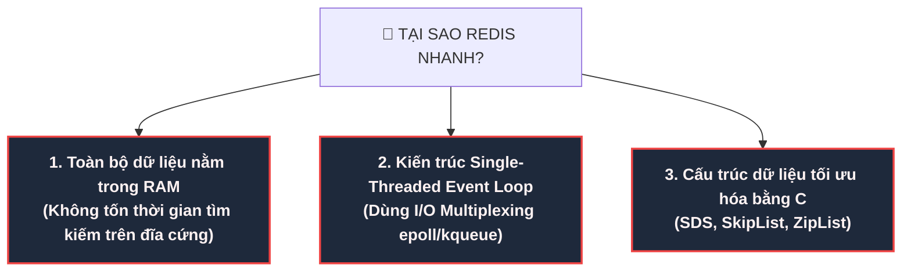
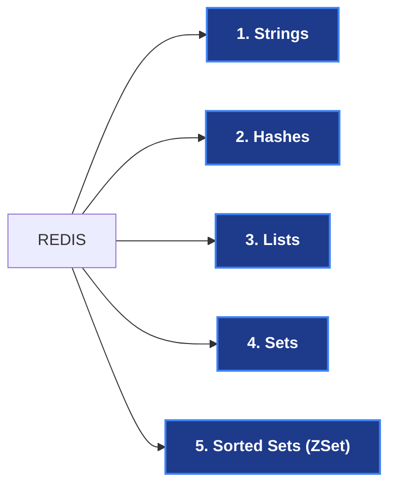
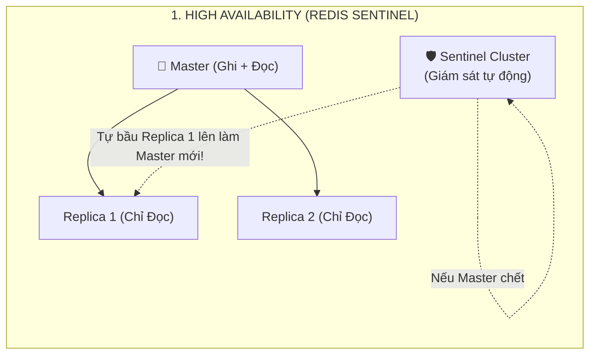
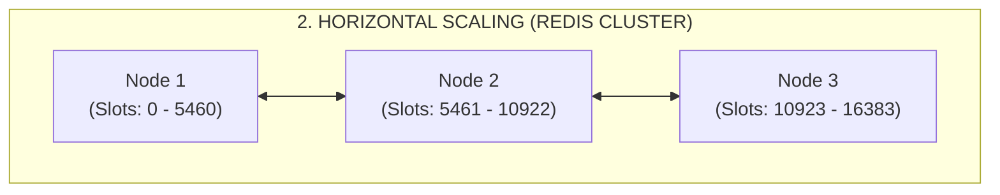

# 🔴 Redis: "Ông Vua" In-Memory Caching & Data Structures

> **Redis** (viết tắt của **REmote DIctionary Server**) là một hệ thống lưu trữ cấu trúc dữ liệu trong bộ nhớ (**In-Memory Data Structure Store**) mã nguồn mở, hoạt động theo mô hình Key-Value.  
> Được tạo ra bởi Salvatore Sanfilippo vào năm 2009, Redis ngày nay là **công nghệ Caching & In-Memory số 1 thế giới**, được sử dụng bởi hầu hết mọi tập đoàn công nghệ lớn (Twitter, GitHub, Netflix, Shopee, Grab).

Redis không chỉ là một kho chứa Cache đơn thuần (như Memcached), nó là một **"con dao pha Thụy Sĩ"** phục vụ: Caching, Quản lý Session, Bảng xếp hạng Real-time, Khóa phân tán (Distributed Lock), và Hàng đợi Message Broker.

---

## ⚡ 1. Vì Sao Redis Nhanh Như Chớp? (100.000+ Ops/giây)

Một instance Redis chạy trên một máy chủ thông thường có thể dễ dàng xử lý **hơn 100.000 lượt đọc/ghi mỗi giây** với độ trễ dưới 1 mili-giây. Sức mạnh này đến từ 3 bí mật kiến trúc:



### Điểm đặc biệt: "Tại sao Single-Thread (đơn luồng) lại nhanh hơn Multi-Thread?"
Nhiều người nghĩ nhiều luồng (Multi-threading) thì phải nhanh hơn. Nhưng trong hệ thống xử lý bộ nhớ cực nhanh:
1. **Không tốn chi phí chuyển ngữ cảnh (Context Switching)**: CPU không phải liên tục tạm dừng luồng này để nhảy sang luồng kia.
2. **Không có tranh chấp khóa (Lock Contention / Race Condition)**: Không cần dùng `synchronized`, `Mutex Lock` hay lo deadlock.
3. **Mọi lệnh trong Redis đều mang tính nguyên tử (Atomic)**: Một lệnh chạy xong hoàn toàn rồi mới tới lệnh tiếp theo!

---

## 🧰 2. Năm Cấu Trúc Dữ Liệu Cốt Lõi & Ca Sử Dụng Thực Chiến

Điểm làm Redis vượt trội hoàn toàn so với Memcached chính là **hỗ trợ các cấu trúc dữ liệu phong phú**:



### 1. Strings (Chuỗi ký tự / Số)
- Cấu trúc cơ bản nhất: `SET key value`, `GET key`.
- Chứa được văn bản, chuỗi JSON, hoặc thậm chí cả file nhị phân ảnh (tối đa 512MB).
- **Phép toán nguyên tử cực mạnh**: `INCR`, `DECR`.
  - *Ứng dụng*: Làm bộ đếm lượt xem bài viết (`INCR views:post:105`), đếm số lượt gọi API cho **Rate Limiting**.

### 2. Hashes (Bảng băm Key-Field-Value)
- Lưu trữ một đối tượng có nhiều thuộc tính: `HSET user:105 name "Nam" email "nam@gmail.com" age 25`.
- *Ưu điểm*: Cực kỳ tiết kiệm RAM so với việc lưu nguyên cả chuỗi JSON. Bạn có thể sửa đổi riêng trường `age` bằng `HINCRBY user:105 age 1` mà không cần đọc và ghi đè toàn bộ object.

### 3. Lists (Danh sách liên kết đôi)
- Thao tác đẩy vào / rút ra ở 2 đầu: `LPUSH`, `RPUSH`, `LPOP`, `RPOP`.
- *Ứng dụng*: 
  - Làm **Hàng đợi Message Queue nhẹ**: Service A đẩy tác vụ vào đuôi (`RPUSH tasks "job1"`), Service B rút tác vụ ở đầu (`LPOP tasks`).
  - Lưu dòng thời gian (Timeline): Lưu 20 bài đăng mới nhất của người dùng.

### 4. Sets (Tập hợp các phần tử duy nhất, không trùng lặp)
- Tự động lọc trùng: `SADD tags "java" "backend" "java"` -> Chỉ còn `"java"` và `"backend"`.
- Hỗ trợ các phép toán tập hợp: Giao (`SINTER`), Hợp (`SUNION`), Hiệu (`SDIFF`).
- *Ứng dụng*:
  - Tìm **Bạn chung giữa 2 người**: `SINTER friends:userA friends:userB`.
  - Đếm số lượng người truy cập duy nhất (Unique Visitors) trong ngày.

### 5. Sorted Sets - ZSet (Tập hợp có sắp xếp theo Điểm số)
- Mỗi phần tử đi kèm một điểm số (Score): `ZADD leaderboard 1500 "GamerA" 2000 "GamerB" 1200 "GamerC"`.
- Redis tự động duy trì thứ tự từ cao xuống thấp bằng thuật toán **SkipList** ($O(\log N)$).
- *Ứng dụng*:
  - **Bảng xếp hạng (Leaderboard) Real-time** trong Game hoặc Sàn TMĐT (Top bán chạy).
  - Triển khai **Sliding Window Rate Limiter**.

---

## 💾 3. Dữ Liệu Trong RAM Có Bị Mất Khi Mất Điện? (Tính Bền Vững - Persistence)

Redis lưu trong RAM, vậy nếu server đột ngột sập nguồn thì sao?  
Redis cung cấp **3 cơ chế ghi dữ liệu xuống ổ cứng (Persistence)**:

```
┌─────────────────────────────────┐       ┌─────────────────────────────────┐
│ 1. RDB (Snapshot định kỳ)       │       │ 2. AOF (Append-Only File)       │
├─────────────────────────────────┤       ├─────────────────────────────────┤
│ • Chụp ảnh toàn bộ dữ liệu ghi  │       │ • Ghi lại từng lệnh ghi         │
│   thành file nhị phân `dump.rdb`│       │   (SET, HSET, DEL) vào file text│
│ • Rất nhỏ gọn, khôi phục nhanh  │       │ • An toàn tối đa (mất tối đa 1s)│
│ ⚠️ Mất dữ liệu giữa 2 lần chụp  │       │ ⚠️ File dung lượng lớn hơn      │
└─────────────────────────────────┘       └─────────────────────────────────┘
```

> 🏆 **Chuẩn hiện đại (Hybrid Persistence - RDB + AOF):**  
> Kết hợp cả hai: Phần lớn dữ liệu cũ được nén dưới dạng RDB để khởi động siêu nhanh, các lệnh mới nhất được ghi tiếp bằng AOF để đảm bảo **không bao giờ mất dữ liệu**!

---

## 🏛️ 4. Kiến Trúc Sẵn Sàng Cao & Mở Rộng Quy Mô (High Availability & Scaling)

Khi lượng dữ liệu và người dùng vượt quá khả năng của 1 server:





1. **Replication (Master - Replica)**:
   - 1 Master phục vụ ghi, nhiều Replica phục vụ đọc để giảm tải cho Master.
2. **Redis Sentinel (Tự động phục hồi lỗi - Failover)**:
   - Các tiến trình Sentinel liên tục kiểm tra nhịp tim (Heartbeat) của Master.
   - Nếu Master sập, Sentinel sẽ **tự động bầu cử một Replica lên làm Master mới trong vòng vài giây** mà không cần con người can thiệp!
3. **Redis Cluster (Phân tán dữ liệu - Sharding)**:
   - Chia toàn bộ không gian dữ liệu thành **16.384 Hash Slots**.
   - Dữ liệu tự động được băm và phân bổ đều cho hàng chục server khác nhau, giúp mở rộng dung lượng RAM lên đến hàng Terabyte!

---

## 🧹 5. Khi RAM Bị Đầy: Các Thuật Toán Dọn Rác (Eviction Policies)

Khi dung lượng chạm trần `maxmemory` được cấp phép, Redis sẽ hành xử theo chính sách bạn cấu hình:

| Chính sách (Policy) | Hành vi của Redis | Khi nào nên dùng? |
|---|---|---|
| **`allkeys-lru`** | Xóa key **lâu nhất chưa được ai đọc tới** trong toàn bộ database. | 🏆 **Lựa chọn số 1 cho hệ thống Cache chuẩn**. |
| **`volatile-lru`** | Chỉ xóa key lâu nhất chưa đọc trong nhóm **những key CÓ ĐẶT TTL**. | Khi vừa dùng làm cache, vừa dùng lưu dữ liệu vĩnh viễn. |
| **`allkeys-lfu`** | Xóa key **có tần suất được đọc ít nhất**. | Rất tốt khi có một nhóm dữ liệu "hot" được đọc liên tục. |
| **`noeviction`** | **Không xóa gì cả**, trả về lỗi bộ nhớ khi có lệnh ghi mới. | Khi dùng Redis làm Database chính, cấm được làm mất dữ liệu! |

---

## 🎯 6. Bảng Tóm Tắt Khi Nào Nên Dùng Redis?

| Bài toán nghiệp vụ | Dùng cấu trúc / Tính năng gì của Redis? |
|---|---|
| Lưu trữ đệm kết quả query Database | **Strings** (`GET/SET` chuỗi JSON với TTL) |
| Quản lý Session đăng nhập người dùng | **Hashes** hoặc **Strings** (TTL = 30 phút) |
| Giới hạn tần suất gọi API (Rate Limit)| **Strings** (`INCR` + `EXPIRE`) hoặc **ZSet** |
| Bảng xếp hạng điểm số Real-time | **Sorted Sets (ZSet)** (`ZADD` + `ZREVRANGE`) |
| Đếm số lượt xem, số like sản phẩm | **Strings** (`INCRBY views 1`) |
| Khóa phân tán (Distributed Lock) | Lệnh nguyên tử `SET key value NX PX` (Redlock) |
