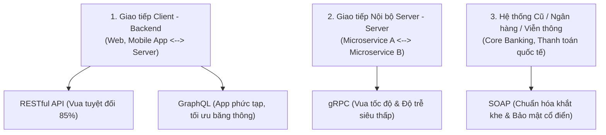

# ⚔️ So Sánh Các Kiến Trúc API: REST vs SOAP vs gRPC vs GraphQL

Trong thế giới phát triển Backend thực tế, **không có công nghệ nào là "ít dùng"**, mà mỗi công nghệ sinh ra để thống trị một **"lãnh địa" chuyên biệt**:



---

## 🧭 1. Phân Tích Thực Chiến Từng Công Nghệ (Ai Đang Dùng?)

### 1️⃣ **SOAP (Simple Object Access Protocol)**
- **Độ phổ biến:** **Ít dùng trong các dự án mới / Startup**, nhưng **CỰC KỲ PHỔ BIẾN trong Ngân hàng, Bảo hiểm, Viễn thông**.
- **Đặc điểm:** Dùng định dạng **XML** rất nặng nề, có tài liệu định nghĩa cấu trúc khắt khe (**WSDL**), hỗ trợ bảo mật chuẩn doanh nghiệp cấp cao (`WS-Security`).
- **Thực tế:** Khi bạn làm cổng tích hợp thanh toán với các hệ thống **Core Banking cũ của Vietcombank, BIDV**, hay hệ thống đặt vé máy bay hàng không, 90% bạn vẫn **bắt buộc phải gọi SOAP API**.

---

### 2️⃣ **gRPC (Google Remote Procedure Call)** — *Hot Trend Kiến Trúc Microservices*
- **Độ phổ biến:** **RẤT PHỔ BIẾN** trong các công ty công nghệ lớn (Google, Netflix, Shopee, Grab).
- **Đặc điểm:**
  - Không dùng JSON mà dùng **Protocol Buffers (Protobuf)**: Nén dữ liệu thành **mã nhị phân siêu nhỏ**.
  - Chạy trên nền tảng **HTTP/2**: Nhanh gấp **7 - 10 lần** so với REST API, độ trễ gần như bằng 0.
- **Thực tế:** Không dùng cho App/Web gọi ra ngoài, mà dùng cho **hàng trăm service Backend nội bộ nói chuyện với nhau** (Service-to-Service communication).

---

### 3️⃣ **GraphQL** — *Vũ Khí Cho Frontend & Mobile App Hiện Đại*
- **Độ phổ biến:** **RẤT PHỔ BIẾN**, do **Facebook (Meta)** phát minh năm 2015, hiện được GitHub, Shopify, Twitter, Coursera sử dụng rộng rãi.
- **Giải quyết bài toán gì?**
  - **Over-fetching:** Với REST, gọi `GET /users/1` nó trả về 50 trường (tên, tuổi, địa chỉ, sở thích...) trong khi màn hình điện thoại chỉ cần mỗi cái `name` $\to$ lãng phí 4G.
  - **Under-fetching:** Muốn lấy User kèm 5 Bài viết gần nhất $\to$ REST phải gọi 2-3 API.
  - **Giải pháp của GraphQL:** Client **muốn trường gì thì ghi đúng tên trường đó** vào câu truy vấn, Server chỉ trả về đúng những gì được yêu cầu trong 1 lần gọi duy nhất!

```graphql
# Client chỉ cần mỗi id và name:
query {
  user(id: "1") {
    id
    name
  }
}
```

---

## 📊 2. Bảng So Sánh Quyết Định Khi Nào Nên Dùng Cái Gì?

| Tiêu chí | REST API | SOAP | gRPC | GraphQL |
| :--- | :--- | :--- | :--- | :--- |
| **Định dạng dữ liệu** | **JSON** (phổ biến), XML | **XML thuần** | **Nhị phân (Protobuf)** | **JSON** |
| **Giao thức mạng** | HTTP 1.1 / HTTP 2 | HTTP, SMTP, TCP | **HTTP/2** (Streaming) | HTTP |
| **Tốc độ thực thi** | Nhanh vừa phải | Chậm nhất (do parse XML) | **Siêu nhanh (Top 1)** | Nhanh, linh hoạt |
| **Dễ học / Dễ dùng** | ⭐⭐⭐⭐⭐ (Dễ nhất) | ⭐⭐ (Khó, cấu hình nặng) | ⭐⭐⭐ (Cần học Protobuf) | ⭐⭐⭐⭐ (Rất trực quan) |
| **Trường hợp khuyên dùng** | Public API, CRUD cơ bản, kết nối Web/Mobile thông thường. | Tích hợp hệ thống Ngân hàng, Tài chính, Bảo hiểm cũ. | **Hệ thống Microservices nội bộ**, High-performance streaming. | Ứng dụng Mobile cần tiết kiệm băng thông 4G, Dashboard phức tạp. |

---

## 🎯 Tóm Tắt 1 Dòng Để Bạn Đi Phỏng Vấn:

> *"Trong thực tế: **REST** là chuẩn mặc định cho Web/App thông thường; **GraphQL** dùng khi Frontend cần linh hoạt chọn trường dữ liệu để tránh over-fetching; **gRPC** là vua tốc độ cho giao tiếp nội bộ giữa các Microservices; còn **SOAP** phục vụ tích hợp hệ thống ngân hàng và doanh nghiệp cổ điển."*
