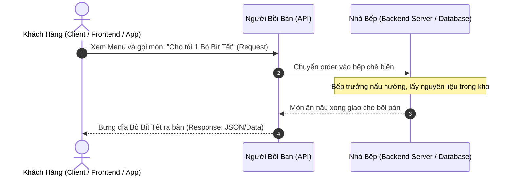
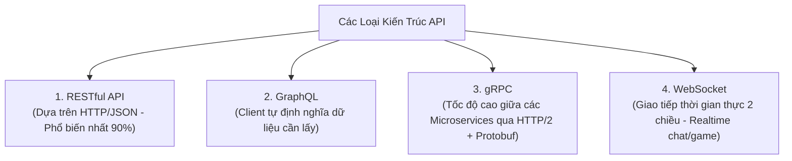

# 🔌 APIs - Application Programming Interface (Giao Diện Lập Trình Ứng Dụng)

**API (Application Programming Interface)** là một tập hợp các quy tắc, giao thức và định dạng chuẩn hóa cho phép các phần mềm/ứng dụng độc lập có thể **giao tiếp, bắt tay và trao đổi dữ liệu với nhau** mà không cần biết mã nguồn bên trong của đối phương hoạt động như thế nào.

---

## 🍽️ 1. Ẩn Dụ Kinh Điển: Người Bồi Bàn Trong Nhà Hàng

Để hiểu API một cách trực quan nhất:



- **Khách hàng (Client/Mobile App):** Chỉ cần nhìn Menu và yêu cầu món, **không cần biết** trong bếp dùng loại bếp ga nào, thái thịt ra sao.
- **Người bồi bàn (API):** Đóng vai trò là cầu nối trung gian chuẩn hóa, nhận yêu cầu từ khách chuyển vào bếp và bê kết quả trả lại cho khách.
- **Nhà bếp (Backend/Database):** Nơi xử lý logic nghiệp vụ và lưu trữ dữ liệu.

---

## 🧭 2. Ba Thành Phần Cốt Lõi Của Một API Hiện Đại

Một Web API (RESTful API) xoay quanh 3 yếu tố cơ bản:

### 1️⃣ Endpoints (Điểm Cuối / Địa Chỉ URL)
Là địa chỉ định danh duy nhất cho tài nguyên mà Client muốn thao tác:
- `https://api.shop.com/api/v1/products` (Tài nguyên: Danh sách sản phẩm)
- `https://api.shop.com/api/v1/users/101` (Tài nguyên: Người dùng có ID 101)

---

### 2️⃣ HTTP Request Methods (Các Phương Thức Thao Tác - Chuẩn CRUD)
Quy định hành động mà Client muốn làm với tài nguyên đó:

| HTTP Method | Thao Tác Tương Đương Trong Database | Ý Nghĩa Thực Tế | Ví Dụ |
| :--- | :--- | :--- | :--- |
| **`GET`** | `SELECT` (Read) | **Lấy / Đọc** dữ liệu | `GET /api/v1/products` (Xem danh sách sản phẩm) |
| **`POST`** | `INSERT` (Create) | **Tạo mới** dữ liệu | `POST /api/v1/orders` (Tạo đơn hàng mới) |
| **`PUT`** | `UPDATE` (Toàn bộ) | **Thay thế toàn bộ** bản ghi cũ bằng dữ liệu mới | `PUT /api/v1/users/101` (Cập nhật toàn bộ thông tin) |
| **`PATCH`** | `UPDATE` (Cục bộ) | **Sửa một vài trường** cụ thể | `PATCH /api/v1/users/101` (Chỉ đổi mỗi số điện thoại) |
| **`DELETE`** | `DELETE` (Delete) | **Xóa** tài nguyên | `DELETE /api/v1/products/5` (Xóa sản phẩm có ID 5) |

---

### 3️⃣ Data Formats (Định Dạng Dữ Liệu Trao Đổi)
Là ngôn ngữ chung để 2 hệ thống (dù viết bằng 2 ngôn ngữ khác nhau như Java và JavaScript) đều hiểu được:

#### 🟢 **JSON (JavaScript Object Notation)** — Tiêu Chuẩn Vàng Thống Trị 95% API Hiện Nay:
- Cực kỳ nhẹ, dễ đọc với con người và máy tính:
```json
{
  "id": 101,
  "fullName": "Nguyễn Văn Thịnh",
  "email": "thinh@example.com",
  "roles": ["ADMIN", "USER"],
  "isActive": true
}
```

#### 🟡 **XML (Extensible Markup Language)**:
- Nặng hơn, dùng các cặp thẻ `<tag></tag>` đóng mở (thường gặp trong các hệ thống ngân hàng, chính phủ hoặc SOAP API cổ điển).

---

## 🏛️ 3. Các Kiến Trúc API Phổ Biến



---

## 🎯 Tóm Tắt 1 Dòng Để Đi Phỏng Vấn:

> *"API là giao diện chuẩn hóa cho phép các hệ thống phần mềm giao tiếp với nhau. Trong phát triển Backend hiện đại, API thường tuân theo kiến trúc **RESTful**, sử dụng giao thức **HTTP** (với các verbs `GET, POST, PUT, DELETE`), trao đổi dữ liệu chủ yếu qua định dạng **JSON**, giúp tách rời hoàn toàn tầng Frontend và Backend."*
