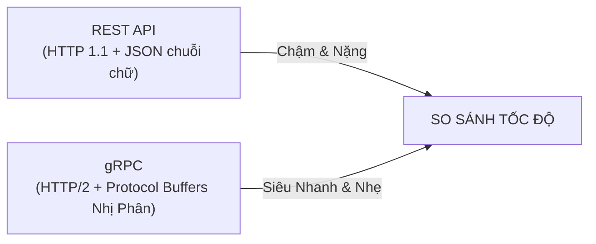

# ⚡ gRPC (Google Remote Procedure Call - Vua Tốc Độ Microservices)

**gRPC** là một framework mã nguồn mở đỉnh cao do **Google** phát triển vào năm 2015. Nó cho phép ứng dụng client gọi trực tiếp một hàm trên một máy chủ từ xa giống hệt như đang gọi một hàm cục bộ trong cùng một file code (**RPC - Remote Procedure Call**).

Hiện nay, gRPC là **tiêu chuẩn công nghiệp số 1** cho giao tiếp nội bộ giữa các dịch vụ trong kiến trúc **Microservices** tại các tập đoàn công nghệ lớn như Google, Netflix, Shopee, Grab, Spotify.

---

## 🚀 1. Vì Sao gRPC Nhanh Gấp 7 - 10 Lần REST API?

Sức mạnh vượt trội của gRPC đến từ 2 "vũ khí tối tân":



### 1️⃣ Protocol Buffers (Protobuf) — Nén Nhị Phân Siêu Nhỏ:
- **REST/JSON:** Dữ liệu gửi đi dưới dạng văn bản (text), tốn dung lượng cho các dấu ngoặc kép `""`, dấu hai chấm `:` và tên trường lặp đi lặp lại.
- **Protobuf:** Mã hóa dữ liệu thành **chuỗi byte nhị phân siêu nén**. Cùng một lượng dữ liệu, file Protobuf thường **nhỏ hơn JSON từ 3 đến 10 lần**, giúp gửi qua mạng nhanh như chớp.

### 2️⃣ Chạy Hoàn Toàn Trên Giao Thức HTTP/2:
- Hỗ trợ **Multiplexing:** Cho phép gửi hàng trăm request và response song song trên cùng **1 kết nối TCP duy nhất** (không cần mở nhiều kết nối như HTTP/1.1 của REST).
- Nén Header (HPACK) và tối ưu hóa đường truyền mạng.

---

## 📜 2. File Định Nghĩa `.proto` (Trái Tim Của gRPC)

Thay vì viết code thủ công, lập trình viên tạo một file hợp đồng có đuôi `.proto`:

```protobuf
syntax = "proto3";

package order;

// Định nghĩa dịch vụ và các hàm
service OrderService {
    rpc GetOrderDetails (OrderRequest) returns (OrderResponse);
}

// Định nghĩa dữ liệu truyền vào
message OrderRequest {
    int32 order_id = 1;
}

// Định nghĩa dữ liệu trả về
message OrderResponse {
    int32 order_id = 1;
    string customer_name = 2;
    double total_amount = 3;
    string status = 4;
}
```

👉 **Tính năng tự sinh code đa ngôn ngữ:** Từ file `.proto` này, trình biên dịch `protoc` tự động sinh ra code Client/Server hoàn chỉnh cho **Java, Go, Python, C#, Node.js** $\to$ Service viết bằng Java có thể gọi trực tiếp sang Service viết bằng Go mượt mà!

---

## 🌊 3. Bốn Kiểu Giao Tiếp Của gRPC (Streaming Cực Mạnh)

REST API chỉ hỗ trợ kiểu 1-1 (Gửi 1 Request $\to$ Nhận 1 Response). Trong khi đó gRPC hỗ trợ **4 mô hình truyền dữ liệu**:

1. **Unary RPC (Đơn lẻ):** Giống REST (1 request $\to$ 1 response).
2. **Server Streaming:** Client gửi 1 yêu cầu $\to$ Server liên tục bắn dòng dữ liệu về theo thời gian thực (vd: live stream video, nhận biến động giá chứng khoán từng giây).
3. **Client Streaming:** Client liên tục bắn các gói dữ liệu lên server (vd: tải file dung lượng lớn từng phần).
4. **Bidirectional Streaming (2 chiều):** Cả Client và Server cùng lúc vừa bắn vừa nhận dữ liệu song song (vd: phòng họp chat trực tuyến).

---

## ⚖️ 4. Khi Nào Dùng gRPC vs REST?

| Tiêu chí | REST API | gRPC |
| :--- | :--- | :--- |
| **Phù hợp nhất cho** | Kết nối ra ngoài công chúng (Public API, Mobile/Web App). | **Kết nối nội bộ giữa các Microservices** phía sau hậu trường. |
| **Định dạng** | JSON (Dễ đọc bằng mắt thường). | Nhị phân (Máy đọc, người không đọc được trực tiếp). |
| **Hỗ trợ Trình duyệt** | 100% mượt mà trên mọi Browser. | Bị hạn chế trên Browser (phải dùng gRPC-Web proxy). |

---

## 🎯 Tóm Tắt 1 Dòng Để Đi Phỏng Vấn:

> *"gRPC là framework giao tiếp RPC hiệu năng cao dựa trên HTTP/2 và định dạng nhị phân Protocol Buffers, giúp giảm độ trễ mạng và tăng thông lượng tối đa, là sự lựa chọn số 1 cho kiến trúc Microservices nội bộ."*
