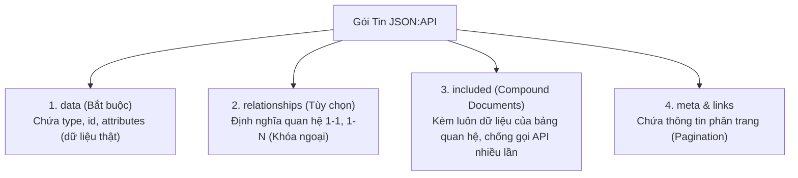

# 📋 JSON:API Specification (Đặc Tả Định Dạng Chuẩn Cho REST API)

Rất nhiều bạn nhầm lẫn giữa **"Dùng JSON trong API"** và **"JSON:API Specification"**:
- **Dùng JSON thông thường:** Bạn tự do bịa ra cấu trúc JSON theo ý mình (mỗi công ty làm một kiểu, lúc thì bọc `{ data: ... }`, lúc thì `{ result: ... }`, lúc thì `{ status: 200 }`).
- **`JSON:API` (jsonapi.org):** Là một **bản đặc tả tiêu chuẩn công nghiệp (Standardized Specification)** quy định cấu trúc JSON trả về của một REST API phải có hình thù chuẩn xác như thế nào, giúp loại bỏ hoàn toàn các cuộc tranh cãi giữa đội Frontend và Backend!

---

## 🎯 1. Nỗi Đau Thực Tế: Khi Không Có Chuẩn Chung

Nếu không có chuẩn:
- Hôm nay bạn làm API trả về:
  ```json
  { "id": 1, "product_name": "MacBook", "cost": 2000 }
  ```
- Ngày mai bạn khác lại viết API trả về:
  ```json
  { "status": "success", "payload": { "id": 1, "name": "MacBook", "price": 2000 } }
  ```
- Đội Frontend (React / Flutter / iOS) sẽ phát điên vì mỗi API phải viết một kiểu code bóc tách dữ liệu khác nhau (**Ad-hoc code**)!

👉 **JSON:API ra đời để thống nhất một quy chuẩn duy nhất!**

---

## 🧭 2. Cấu Trúc Khung Chuẩn Của JSON:API (`jsonapi.org`)

Trong chuẩn JSON:API, một gói dữ liệu trả về từ server **BẮT BUỘC** phải tuân theo khung sườn chuẩn hóa sau:

```json
{
  "data": {
    "type": "articles",
    "id": "1",
    "attributes": {
      "title": "Hướng dẫn học PostgreSQL từ số 0",
      "content": "Nội dung bài viết...",
      "createdAt": "2026-09-24T22:50:00Z"
    },
    "relationships": {
      "author": {
        "data": { "type": "people", "id": "9" }
      },
      "comments": {
        "data": [
          { "type": "comments", "id": "5" },
          { "type": "comments", "id": "12" }
        ]
      }
    }
  },
  "included": [
    {
      "type": "people",
      "id": "9",
      "attributes": {
        "name": "Nguyễn Văn Thịnh",
        "avatar": "https://avatar.com/thinh.png"
      }
    }
  ],
  "meta": {
    "totalPages": 10,
    "totalRecords": 100
  }
}
```

---

## 🔍 3. Ba Thành Phần "Xương Sống" Của JSON:API



### 1️⃣ `data` (Bắt buộc):
- **`type`**: Tên kiểu thực thể (Entity Type: `articles`, `users`, `products`...).
- **`id`**: Định danh duy nhất (bắt buộc dạng chuỗi).
- **`attributes`**: Toàn bộ các trường thông tin dữ liệu của thực thể đó.

### 2️⃣ `relationships` & `included` (Tính năng hay nhất - Chống N+1 API):
- Thay vì lấy bài viết xong, Frontend lại phải bắn thêm 1 API nữa để lấy thông tin Tác giả (`GET /authors/9`).
- Chuẩn JSON:API cho phép nhúng kèm luôn đối tượng tác giả vào mảng **`included`** (**Compound Document**) $\to$ **Frontend chỉ cần gọi 1 API duy nhất là có trọn vẹn cả Bài viết lẫn Tác giả!**

---

## ⚡ 4. Content-Type Riêng Biệt

Một API tuân thủ đúng chuẩn JSON:API sẽ không dùng `Content-Type: application/json` thông thường, mà sử dụng Header chuẩn:

```http
Content-Type: application/vnd.api+json
Accept: application/vnd.api+json
```

---

## 🎯 Tóm Tắt 1 Dòng Để Đi Phỏng Vấn:

> *"JSON:API là một bản đặc tả chuẩn mực (Specification) cho các phản hồi REST API. Nó quy định cấu trúc cố định gồm `data`, `attributes`, `relationships`, và `included`, giúp chuẩn hóa giao tiếp giữa Backend và Frontend, giảm thiểu số lượng request mạng và loại bỏ việc phải viết code bóc tách dữ liệu tùy tiện (ad-hoc code)."*
