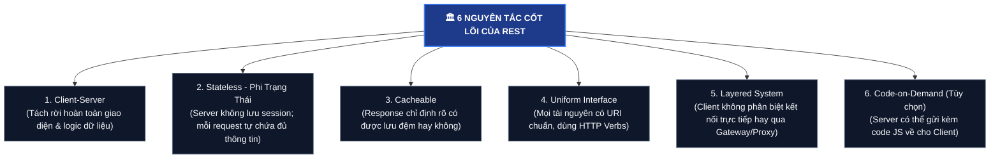

# 🌐 REST & RESTful API (Kiến Trúc Chuẩn Cho Web API)

**REST (Representational State Transfer)** là một **phong cách kiến trúc phần mềm (Architectural Style)** do Roy Fielding đề xuất trong luận án tiến sĩ năm 2000. Một API tuân thủ đầy đủ các nguyên tắc thiết kế của REST được gọi là **RESTful API**.

Hiện nay, RESTful API là chuẩn mực thống trị tuyệt đối trong việc xây dựng các dịch vụ Web và Backend kết nối với Frontend (React, Vue, iOS, Android).

---

## 🏛️ 1. Sáu Ràng Buộc Kiến Trúc Của REST (REST Constraints)

Một API muốn đạt chuẩn RESTful phải tuân theo 6 nguyên tắc cốt lõi:

```
               ┌────────────────────────────────────────────────────────┐
               │          🏛️ 6 NGUYÊN TẮC CỐT LÕI CỦA REST ARCHITECTURE  │
               └────────────────────────────────────────────────────────┘
                                           │
         ┌───────────────────┬─────────────┼─────────────┬───────────────────┐
         ▼                   ▼             ▼             ▼                   ▼
┌─────────────────┐ ┌─────────────────┐ ┌──────┐ ┌───────────────┐ ┌─────────────────┐
│ 1.Client-Server │ │  2. Stateless   │ │3. Ca-│ │4. Uniform Int-│ │5.Layered System │
│ Tách biệt UI &  │ │ Không lưu sess- │ │cheab-│ │ erface (Chuẩn │ │ Client qua Proxy│
│ logic dữ liệu   │ │ ion trên server │ │  le  │ │ URI, Verbs)   │ │ / CDN / Gateway │
└─────────────────┘ └─────────────────┘ └──────┘ └───────────────┘ └─────────────────┘
                                           │
                                           ▼ (Tùy chọn)
                                ┌─────────────────────┐
                                │ 6. Code-on-Demand   │
                                │ Server gửi kèm JS   │
                                └─────────────────────┘
```



---

## 🎯 2. Trụ Cột Quan Trọng Nhất: "Stateless" (Phi Trạng Thái)

- **Định nghĩa:** Server **KHÔNG LƯU BẤT KỲ TRẠNG THÁI NÀO** của Client giữa các lần gửi request.
- **Thực tế:** 
  - Mỗi request gửi từ Client lên Server **bắt buộc phải tự mang theo đầy đủ thông tin nhận diện** (thường là Token xác thực: `Authorization: Bearer <JWT_TOKEN>`).
  - Request 1 và Request 2 hoàn toàn độc lập, Server coi mỗi request như một lần gặp gỡ mới tinh!
- **Lợi ích vàng:** Giúp hệ thống Backend **mở rộng theo chiều ngang (Horizontal Scaling)** cực kỳ dễ dàng: Bạn có thể chạy 10 server Backend phía sau Load Balancer, request của người dùng nhảy vào server nào cũng xử lý được mà không lo bị mất session!

---

## 🧭 3. Quy Chuẩn Đặt Tên URI & Dùng HTTP Verbs (Best Practices)

Một lập trình viên Backend chuyên nghiệp luôn tuân theo các quy tắc thiết kế URI chuẩn REST:

### 1️⃣ Tài nguyên (Resources) phải là DANH TỪ SỐ NHIỀU, tuyệt đối KHÔNG DÙNG ĐỘNG TỪ trên URL:
- ❌ **Xấu (Kiểu cũ / RPC):**
  - `POST /api/createUser`
  - `GET /api/getAllProducts`
  - `POST /api/deleteProduct?id=5`
- ✅ **Chuẩn RESTful:** URL chỉ chứa danh từ, hành động được biểu diễn bằng **HTTP Method**:
  - `GET /api/v1/products` : Lấy danh sách sản phẩm.
  - `POST /api/v1/products` : Tạo sản phẩm mới (dữ liệu nằm trong Body JSON).
  - `GET /api/v1/products/5` : Xem chi tiết sản phẩm số 5.
  - `PUT /api/v1/products/5` : Cập nhật toàn bộ thông tin sản phẩm số 5.
  - `PATCH /api/v1/products/5` : Cập nhật một phần (ví dụ đổi giá).
  - `DELETE /api/v1/products/5` : Xóa sản phẩm số 5.

### 2️⃣ Quan hệ cha - con lồng nhau (Sub-resources):
- Lấy danh sách bình luận của bài viết số 10:
  `GET /api/v1/posts/10/comments`
- Tạo đơn hàng cho khách hàng số 101:
  `POST /api/v1/customers/101/orders`

---

## 🚦 4. Sử Dụng Chuẩn Các Mã Trạng Thái HTTP (HTTP Status Codes)

RESTful API giao tiếp kết quả bằng các mã chuẩn của giao thức HTTP:

| Nhóm Mã | Tên Mã | Ý Nghĩa Thực Tế | Khi Nào Sử Dụng? |
| :---: | :--- | :--- | :--- |
| **2xx** *(Thành công)* | **`200 OK`** | Thành công chung | Trả về kết quả cho `GET`, `PUT`, `PATCH`. |
| | **`201 Created`** | Đã tạo mới thành công | Trả về sau khi `POST` tạo thành công một bản ghi. |
| | **`204 No Content`**| Thành công nhưng không có body | Trả về sau khi `DELETE` thành công. |
| **4xx** *(Lỗi từ phía Client)* | **`400 Bad Request`** | Dữ liệu gửi lên sai định dạng | Thiếu trường bắt buộc, sai định dạng email. |
| | **`401 Unauthorized`**| Chưa đăng nhập | Không có Token hoặc Token hết hạn. |
| | **`403 Forbidden`** | Đã đăng nhập nhưng không có quyền | User thường cố tình vào trang Admin. |
| | **`404 Not Found`** | Không tìm thấy tài nguyên | ID sản phẩm không tồn tại trong database. |
| | **`409 Conflict`** | Xung đột dữ liệu | Đăng ký tài khoản với email đã tồn tại. |
| **5xx** *(Lỗi từ phía Server)* | **`500 Internal Error`**| Server bị crash / lỗi code | NullPointerException, sập kết nối database. |
| | **`503 Unavailable`** | Server quá tải / bảo trì | Quá tải kết nối, hệ thống đang reboot. |

---

## 🎯 Tóm Tắt 1 Dòng Để Đi Phỏng Vấn:

> *"RESTful API là phong cách kiến trúc sử dụng các chuẩn có sẵn của HTTP (URIs danh từ số nhiều, HTTP Verbs `GET/POST/PUT/DELETE`, Status Codes) trên nền tảng **Stateless (phi trạng thái)** và trao đổi dữ liệu dạng **JSON**, giúp hệ thống mở rộng quy mô (Scalability) mạnh mẽ và dễ bảo trì."*
