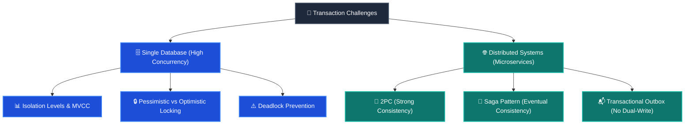
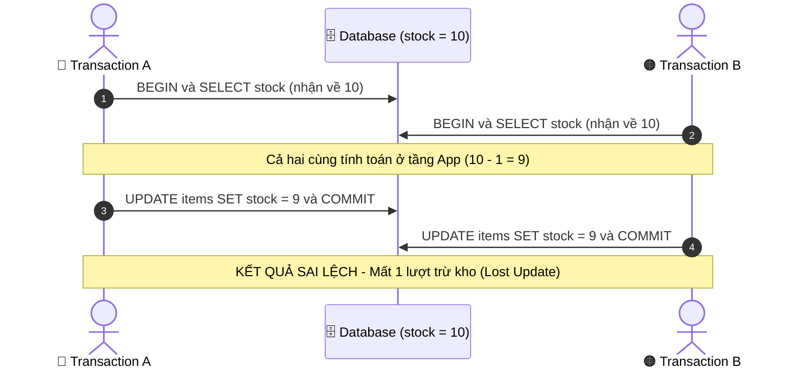
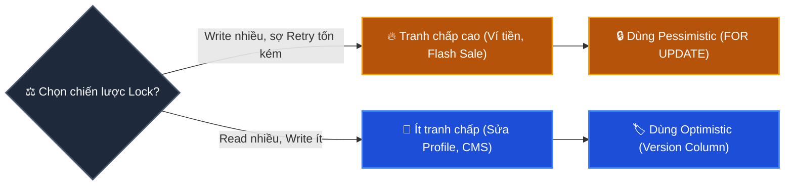
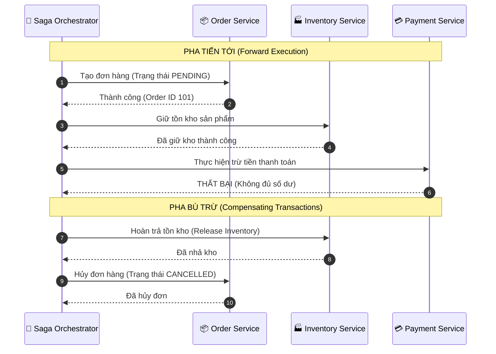

# 🔐 Database Transactions (Nâng Cao): Isolation, Locking, Deadlock & Distributed Transactions

> **Transaction (Giao dịch cơ sở dữ liệu)** là một đơn vị công việc logic không thể chia cắt, đảm bảo tính toàn vẹn dữ liệu theo chuẩn **ACID** (*Atomicity, Consistency, Isolation, Durability*).  
> Tài liệu này tập trung vào góc nhìn **Backend Advanced**: xử lý tranh chấp đồng thời (Concurrency Control), các lỗi đọc dữ liệu tinh vi (Read Phenomena), phòng chống Deadlock và thiết kế giao dịch phân tán (Distributed Transactions) trong kiến trúc Microservices.

> 📌 *Nếu bạn muốn xem lại cú pháp `BEGIN / COMMIT / ROLLBACK`, `SAVEPOINT` và cách PostgreSQL hiện thực WAL/CLOG ở mức cơ bản, hãy tham khảo:*
> - [ACID Properties in PostgreSQL](file:///Users/thinhnguyen/DEVELOP/BE/PostgreSQL/07_acid.md)
> - [Transactions in PostgreSQL](file:///Users/thinhnguyen/DEVELOP/BE/PostgreSQL/08_transactions.md)

---

## 🏛️ 1. Bức Tranh Tổng Thể: Từ Single-Node ACID Đến Distributed Systems

Khi hệ thống còn nhỏ (Monolith + 1 Database), **ACID** của RDBMS giải quyết trọn vẹn bài toán toàn vẹn dữ liệu. Nhưng khi lưu lượng tăng cao hoặc tách thành nhiều Microservices, bài toán Transaction chia làm 2 tầng thách thức:

```
┌───────────────────────────────────────────────────────────────────────────────┐
│                  HAI TẦNG THÁCH THỨC CỦA TRANSACTION TRONG BACKEND            │
├───────────────────────────────────────┬───────────────────────────────────────┤
│  1. HIGH CONCURRENCY (1 Database)     │  2. DISTRIBUTED (Nhiều Databases)     │
│  • Hàng nghìn request sửa cùng 1 row  │  • Order DB, Payment DB, Inventory DB │
│  • Race Condition (âm tồn kho)        │  • Không dùng chung 1 `BEGIN/COMMIT`  │
│  • Lost Update, Write Skew, Deadlock  │  • Lỗi mạng (Partial Failure)         │
│                                       │                                       │
│  👉 Giải pháp:                        │  👉 Giải pháp:                        │
│  • Isolation Levels (MVCC / SSI)      │  • Two-Phase Commit (2PC)             │
│  • Pessimistic / Optimistic Locking   │  • Saga Pattern (Compensating Tx)     │
│  • SELECT ... FOR UPDATE SKIP LOCKED  │  • Transactional Outbox Pattern       │
└───────────────────────────────────────┴───────────────────────────────────────┘
```



---

## 🔍 2. Isolation Levels & Các Hiện Tượng Lỗi Dữ Liệu (Read Phenomena)

Tính chất **I (Isolation)** trong ACID không phải lúc nào cũng ở mức "cô lập tuyệt đối" vì cô lập càng cao thì hiệu năng (throughput) càng giảm do lock hoặc retry nhiều. Do đó chuẩn SQL chia làm **4 cấp độ cô lập**.

### 2.1. Các hiện tượng bất thường khi chạy đồng thời (Anomalies)

1. **Dirty Read (Đọc dữ liệu bẩn):** Transaction A đọc được dữ liệu mà Transaction B vừa sửa nhưng **chưa COMMIT** (nếu B rollback thì A đã xử lý dựa trên dữ liệu rác).
2. **Non-Repeatable Read (Đọc không lặp lại):** Trong cùng một Transaction A, đọc cùng 1 dòng dữ liệu ở đầu và cuối transaction lại ra **2 giá trị khác nhau** vì Transaction B đã `UPDATE` và `COMMIT` xen vào giữa.
3. **Phantom Read (Đọc bóng ma):** Trong cùng Transaction A, chạy lại cùng một câu query `WHERE ...` thì **số lượng dòng trả về thay đổi** vì Transaction B đã `INSERT` hoặc `DELETE` dòng thỏa mãn điều kiện và `COMMIT`.
4. **Lost Update (Mất dữ liệu cập nhật):** Transaction A và B cùng đọc `stock = 10`, cả hai đều tính `10 - 1 = 9` rồi ghi đè lên nhau -> kết quả còn `9` thay vì `8`.
5. **Write Skew (Lệch ghi - Lỗi logic tinh vi):** A và B cùng đọc trạng thái hợp lệ (ví dụ: có 2 bác sĩ đang trực, quy định tối thiểu phải còn 1 người). Cả 2 bác sĩ cùng xin nghỉ đồng thời -> A thấy còn B nên nghỉ, B thấy còn A nên nghỉ -> cuối cùng **0 bác sĩ trực**.

### 2.2. Minh họa lỗi Lost Update (Kinh điển trong Backend)

```
Thời gian    Transaction A (User 1 mua 1 cái)      Transaction B (User 2 mua 1 cái)
   │
   t1        BEGIN;
   t2        SELECT stock FROM items WHERE id=1;   BEGIN;
             ──► Đọc được: stock = 10              SELECT stock FROM items WHERE id=1;
   t3                                              ──► Đọc được: stock = 10
   t4        (Tính trong app: 10 - 1 = 9)          (Tính trong app: 10 - 1 = 9)
   t5        UPDATE items SET stock = 9;
   t6        COMMIT;
   t7                                              UPDATE items SET stock = 9;
   t8                                              COMMIT;  ❌ Đè mất kết quả của A!
                                                   (Tồn kho đúng phải là 8, thực tế là 9)
```



### 2.3. Bảng tổng hợp 4 Isolation Levels & So sánh PostgreSQL vs MySQL (InnoDB)

| Isolation Level | Dirty Read | Non-Repeatable Read | Phantom Read | Write Skew | Ghi chú thực tế (PostgreSQL vs MySQL) |
| :--- | :---: | :---: | :---: | :---: | :--- |
| **Read Uncommitted** | Có thể *(MySQL)* / ❌ *(PG)* | Có thể | Có thể | Có thể | Postgres tự nâng lên `Read Committed`. Hầu như không dùng. |
| **Read Committed** *(Mặc định PG)* | ❌ Ngăn chặn | Có thể | Có thể | Có thể | Nhanh nhất, mỗi câu lệnh thấy snapshot mới nhất đã commit. |
| **Repeatable Read** *(Mặc định MySQL)* | ❌ Ngăn chặn | ❌ Ngăn chặn | ❌ *(PG)* / Có thể *(chuẩn SQL)* | Có thể | PG dùng Snapshot Isolation (ngăn cả Phantom). MySQL dùng Next-Key Lock để chặn Phantom. |
| **Serializable** | ❌ Ngăn chặn | ❌ Ngăn chặn | ❌ Ngăn chặn | ❌ Ngăn chặn | An toàn tuyệt đối (PG dùng SSI - không khóa đọc, nhưng có thể bắn lỗi `40001` buộc app phải Retry). |

---

## 🔒 3. Concurrency Control: Pessimistic Locking vs Optimistic Locking

Để triệt tiêu **Lost Update** và **Race Condition** (ví dụ: trừ số dư ví điện tử, săn Flash Sale), Backend Engineer có 2 vũ khí chính:

### 3.1. Pessimistic Locking (Khóa bi quan)
Giả định rằng **"xung đột chắc chắn sẽ xảy ra"**, nên khóa chặt dòng dữ liệu ngay khi đọc để không ai sửa được cho đến khi ta `COMMIT`.

```sql
BEGIN;
  -- Khóa độc quyền dòng sản phẩm id = 100 cho tới khi COMMIT/ROLLBACK
  SELECT stock FROM products WHERE id = 100 FOR UPDATE;

  -- Kiểm tra logic (ví dụ stock >= 1) rồi mới trừ
  UPDATE products SET stock = stock - 1 WHERE id = 100 AND stock >= 1;
COMMIT;
```

**Các biến thể cực kỳ hữu dụng trong Backend:**
- `FOR UPDATE NOWAIT`: Nếu dòng đang bị transaction khác khóa, **báo lỗi ngay lập tức** thay vì treo connection chờ đợi.
- `FOR UPDATE SKIP LOCKED`: Bỏ qua các dòng đang bị khóa, lấy dòng rảnh tiếp theo. **Đây là bí quyết xây dựng Job Queue / Worker bằng PostgreSQL** hoặc hệ thống chọn ghế rạp phim mà không bị nghẽn lock.

### 3.2. Optimistic Locking (Khóa lạc quan)
Giả định rằng **"xung đột hiếm khi xảy ra"**, không dùng `FOR UPDATE` để khóa DB. Thay vào đó, thêm cột `version` (hoặc `updated_at`) và kiểm tra điều kiện lúc `UPDATE` (Compare-And-Swap).

```sql
-- Bước 1: Đọc dữ liệu kèm version hiện tại (không khóa)
SELECT id, stock, version FROM products WHERE id = 100;
-- Giả sử đọc được: stock = 10, version = 5

-- Bước 2: Cập nhật chỉ khi version vẫn bằng 5
UPDATE products
SET stock = stock - 1, version = version + 1
WHERE id = 100 AND version = 5 AND stock >= 1;
```
> Nếu `affected_rows == 0`, nghĩa là đã có người khác sửa trước đó -> Backend chủ động **Retry** (đọc lại version mới và thử lại) hoặc báo lỗi `409 Conflict`.

### 3.3. Sơ đồ so sánh luồng xử lý hai cơ chế Locking

```
┌──────────────────────────────────────┬──────────────────────────────────────┐
│      PESSIMISTIC LOCKING             │       OPTIMISTIC LOCKING             │
├──────────────────────────────────────┼──────────────────────────────────────┤
│ Tx A: SELECT ... FOR UPDATE (Khóa)   │ Tx A: SELECT (stock=10, ver=5)       │
│ Tx B: SELECT ... FOR UPDATE (⏳ Chờ) │ Tx B: SELECT (stock=10, ver=5)       │
│ Tx A: UPDATE & COMMIT (Nhả khóa)     │ Tx A: UPDATE ... WHERE ver=5 (OK ✅) │
│ Tx B: Nhận khóa, đọc stock mới       │ Tx B: UPDATE ... WHERE ver=5 (0 rows)│
│ Tx B: UPDATE & COMMIT                │ Tx B: Retry hoặc trả 409 Conflict 🔄 │
└──────────────────────────────────────┴──────────────────────────────────────┘
```



---

## ⚠️ 4. Deadlock Trong Database & Cách Phòng Tránh

### 4.1. Deadlock xảy ra khi nào?
Deadlock xảy ra khi **2 transaction khóa chéo tài nguyên của nhau** và cùng chờ đối phương nhả khóa:

```
Transaction A (Chuyển 1 -> 2)               Transaction B (Chuyển 2 -> 1)
   │                                           │
   ├── Khóa Account 1 (FOR UPDATE)             ├── Khóa Account 2 (FOR UPDATE)
   │                                           │
   ├── Đòi khóa Account 2 (⏳ Chờ Tx B)        ├── Đòi khóa Account 1 (⏳ Chờ Tx A)
   │                                           │
   └──────────────────► 💥 DEADLOCK! ◄─────────┘
   (DB phát hiện chu trình chờ -> Kill 1 transaction để giải phóng)
```

### 4.2. 4 Nguyên tắc vàng phòng tránh Deadlock cho Backend
1. **Lock Ordering (Sắp xếp thứ tự khóa nhất quán):** Luôn khóa các bản ghi theo cùng một thứ tự (ví dụ: theo `id` tăng dần). Nếu cả A và B đều khóa `min(from_id, to_id)` trước rồi mới khóa `max(from_id, to_id)`, Deadlock **không bao giờ xảy ra**.
2. **Giữ Transaction ngắn nhất có thể:** Không bao giờ gọi API bên thứ 3 (Payment Gateway, Email, AI LLM), không xử lý file nặng ở bên trong `BEGIN ... COMMIT`.
3. **Đặt `lock_timeout` và `statement_timeout`:** Không để một transaction bị treo giữ lock vĩnh viễn làm sập Connection Pool.
4. **Cơ chế Retry tại tầng Application:** Deadlock hoặc lỗi Serialization (`40001`) là bình thường ở tải cao -> luôn thiết kế Retry với **Exponential Backoff + Jitter** cho các transaction bị DB kill.

---

## 🌐 5. Distributed Transactions (Giao Dịch Phân Tán Trong Microservices)

Khi tách Monolith thành Microservices (**Order Service**, **Payment Service**, **Inventory Service**), mỗi service sở hữu một Database riêng. Lúc này không thể dùng một lệnh `BEGIN ... COMMIT` xuyên qua mạng được nữa.

### 5.1. Two-Phase Commit (2PC)
Một **Coordinator** điều phối 2 pha:
- **Phase 1 (Prepare):** Hỏi tất cả DB: *"Sẵn sàng commit chưa?"* -> Các DB ghi log, khóa dòng và trả lời `YES/NO`.
- **Phase 2 (Commit / Abort):** Nếu tất cả `YES`, ra lệnh `COMMIT`. Nếu có 1 `NO`, ra lệnh `ROLLBACK`.
- **Nhược điểm chí mạng:** Là giao thức **Blocking**. Nếu Coordinator sập giữa Phase 1 và 2, các DB bị kẹt khóa tài nguyên không phục vụ được request khác -> **Ít dùng trong Microservices hiện đại**.

### 5.2. Saga Pattern (Tiêu chuẩn vàng trong Microservices)
Thay vì giữ lock trên nhiều DB cùng lúc, Saga chia giao dịch lớn thành chuỗi các **Local Transaction** độc lập. Nếu một bước thất bại, hệ thống chạy các **Compensating Transaction (Giao dịch bù trừ)** theo chiều ngược lại để hoàn tác trạng thái.

Có 2 cách triển khai Saga:
- **Choreography (Vũ đạo):** Các service tự lắng nghe và phát Event qua Kafka/RabbitMQ (không có nhạc trưởng). Dễ mở rộng nhưng khó theo dõi khi luồng dài.
- **Orchestration (Nhạc trưởng):** Có một **Saga Orchestrator** đứng ra điều phối gọi từng service theo thứ tự và ra lệnh bù trừ khi có lỗi. Dễ kiểm soát, dễ debug.

```
================================================================================
              SAGA ORCHESTRATION PATTERN (ĐẶT HÀNG BỊ LỖI THANH TOÁN)
================================================================================

 [ Saga Orchestrator ]
    │
    ├── 1. Create Order (PENDING) ──────────► [ Order Service ]     (✅ OK)
    ├── 2. Reserve Inventory (Giữ kho) ─────► [ Inventory Service ] (✅ OK)
    ├── 3. Process Payment (Trừ tiền) ──────► [ Payment Service ]   (❌ FAIL: Hết tiền!)
    │
    │   ⚡ KÍCH HOẠT COMPENSATING TRANSACTIONS (HOÀN TÁC NGƯỢC)
    ├── 4. Release Inventory (Nhả kho) ─────► [ Inventory Service ] (↩️ Đã bù trừ)
    └── 5. Cancel Order (CANCELLED) ────────► [ Order Service ]     (↩️ Đã bù trừ)
```



### 5.3. Transactional Outbox Pattern (Chống lỗi Dual-Write)
Khi lưu đơn hàng vào DB và bắn Event sang Kafka cùng lúc, nếu DB thành công nhưng Kafka rớt mạng -> hệ thống bị **lệch dữ liệu**.
- **Giải pháp:** Trong **cùng 1 Local Transaction**, vừa `INSERT INTO orders`, vừa `INSERT INTO outbox_events`. Sau đó, một Worker (hoặc **Debezium CDC** đọc WAL) sẽ đọc bảng `outbox_events` để đẩy sang Kafka với cơ chế **At-least-once Delivery**.

---

## ✅ 6. Checklist Thực Chiến Cho Backend Engineer

- [ ] **Không lồng I/O mạng vào DB Transaction:** Gọi HTTP API, gửi email, upload S3 phải nằm *ngoài* khối `BEGIN ... COMMIT`.
- [ ] **Xác định đúng cấp độ cô lập:** Mặc định `Read Committed` cho đa số API CRUD; dùng `Repeatable Read` / `Serializable` hoặc `FOR UPDATE` cho các tác vụ tài chính, số dư, tồn kho.
- [ ] **Luôn có chiến lược Locking rõ ràng:** Dùng Pessimistic (`FOR UPDATE`) khi tranh chấp ghi cao, hoặc Optimistic (`version`) khi đọc nhiều ghi ít.
- [ ] **Thứ tự khóa nhất quán:** Sắp xếp ID trước khi khóa nhiều dòng cùng lúc để triệt tiêu Deadlock.
- [ ] **Microservices không dùng 2PC:** Áp dụng **Saga Pattern + Transactional Outbox + Idempotency Key** ở tầng Consumer để đạt tính nhất quán cuối cùng (Eventual Consistency).

---

## 📚 7. Tài Liệu Liên Quan Trong Kho Lưu Trữ
- [ACID Properties in PostgreSQL](file:///Users/thinhnguyen/DEVELOP/BE/PostgreSQL/07_acid.md)
- [Transactions in PostgreSQL](file:///Users/thinhnguyen/DEVELOP/BE/PostgreSQL/08_transactions.md)
- [MVCC in PostgreSQL](file:///Users/thinhnguyen/DEVELOP/BE/PostgreSQL/09_mvcc.md)
- [Write-Ahead Log (WAL)](file:///Users/thinhnguyen/DEVELOP/BE/PostgreSQL/10_write_ahead_log.md)
