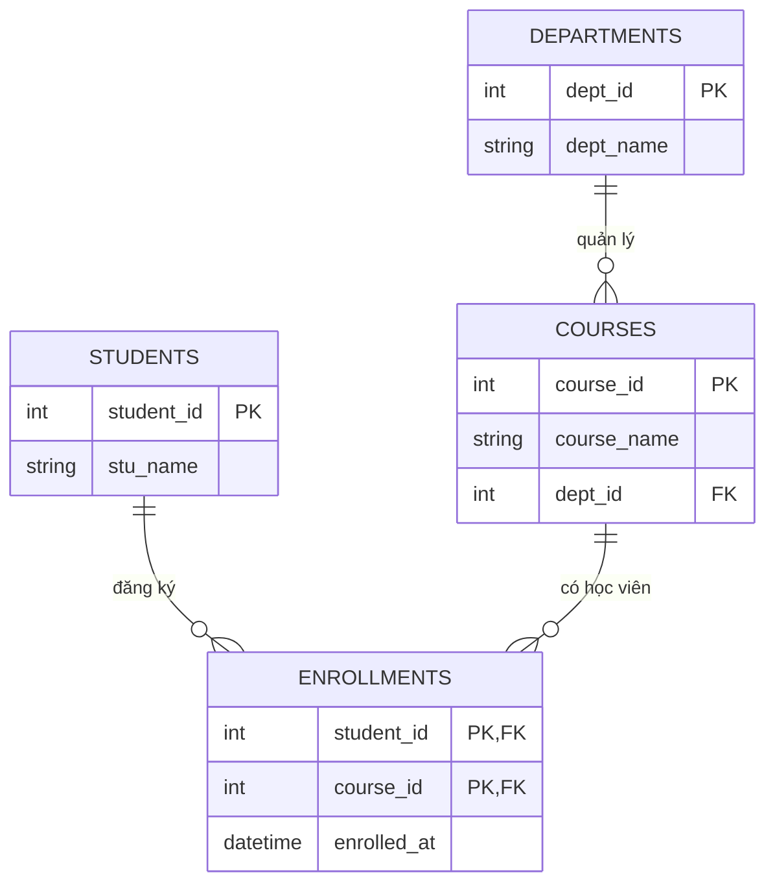
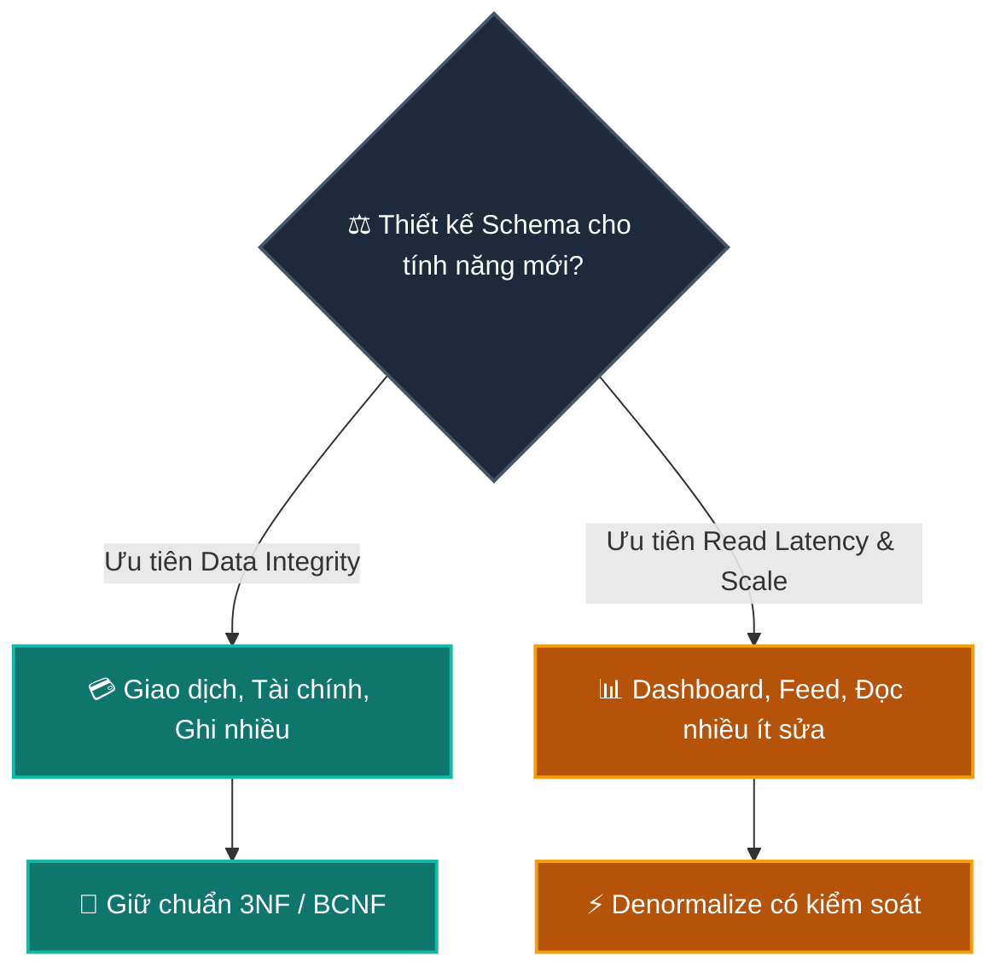

# 📐 Database Normalization (Chuẩn Hóa Cơ Sở Dữ Liệu): Từ 1NF Đến BCNF & Nghệ Thuật Denormalization

> **Database Normalization (Chuẩn hóa cơ sở dữ liệu)** — do **Edgar F. Codd** đề xuất — là quá trình tổ chức các cột và bảng trong cơ sở dữ liệu quan hệ theo các **Dạng chuẩn (Normal Forms)** nhằm **giảm thiểu sự dư thừa dữ liệu (Data Redundancy)** và **đảm bảo tính toàn vẹn dữ liệu (Data Integrity)** thông qua các ràng buộc và quá trình phân rã bảng (Decomposition).

---

## 🏛️ 1. Bản Chất: Tại Sao Phải Chuẩn Hóa? (3 Thảm Họa Dữ Liệu — Anomalies)

Khi nhồi nhét toàn bộ thông tin vào một bảng duy nhất (Unnormalized Table), hệ thống Backend sẽ nhanh chóng gặp phải **3 lỗi dị thường (Anomalies)**:

```
┌──────────────────────────────────────────────────────────────────────────────┐
│                 BẢNG CHƯA CHUẨN HÓA (UNNORMALIZED: orders_raw)               │
├──────────┬─────────────┬─────────────────┬──────────────────┬────────────────┤
│ order_id │ customer_id │ customer_email  │ product_name     │ category_name  │
├──────────┼─────────────┼─────────────────┼──────────────────┼────────────────┤
│   101    │     U1      │ an@gmail.com    │ iPhone 15, AirPod│ Điện tử        │
│   102    │     U1      │ an@gmail.com    │ MacBook Pro      │ Điện tử        │
└──────────┴─────────────┴─────────────────┴──────────────────┴────────────────┘
   ▲ Dư thừa: Email của U1 bị lặp lại ở mọi đơn hàng!
   ▲ Vi phạm Atomic: Cột `product_name` chứa nhiều giá trị ngăn cách bởi dấu phẩy!
```

1. **Insertion Anomaly (Lỗi chèn dữ liệu):** Không thể thêm một *Danh mục (Category)* mới hoặc một *Khách hàng (Customer)* mới nếu họ chưa phát sinh đơn hàng nào (vì `order_id` là khóa chính không thể `NULL`).
2. **Update Anomaly (Lỗi cập nhật dữ liệu):** Nếu user `U1` đổi email từ `an@gmail.com` sang `an.new@gmail.com`, hệ thống phải quét và sửa hàng nghìn dòng đơn hàng cũ. Nếu sót 1 dòng, dữ liệu sẽ bị **bất nhất (Inconsistent)**.
3. **Deletion Anomaly (Lỗi xóa dữ liệu):** Nếu xóa đơn hàng `102`, ta vô tình xóa mất thông tin về sản phẩm `MacBook Pro` nếu đó là đơn hàng duy nhất chứa sản phẩm này.


---

## 📊 2. Các Dạng Chuẩn Cốt Lõi (Normal Forms: 1NF → BCNF)

Để hiểu chuẩn hóa một cách trực quan, hãy theo dõi hành trình phân rã một bảng quản lý **Đăng ký Khóa học & Giảng viên** từ dạng thô lên chuẩn **BCNF**.

### 2.1. 1NF (First Normal Form — Dạng Chuẩn 1)
**Quy tắc:**
- Mỗi ô (cell) chỉ chứa **1 giá trị nguyên tử duy nhất (Atomic Value)** — không chứa mảng, không chứa danh sách ngăn cách bởi dấu phẩy.
- Không có nhóm cột lặp lại (ví dụ: `phone_1`, `phone_2`, `phone_3`).
- Mỗi bảng phải có **Primary Key** xác định duy nhất từng dòng.

```
❌ VI PHẠM 1NF:
┌────────────┬───────────────┬──────────────────────────┐
│ student_id │ student_name  │ courses                  │
├────────────┼───────────────┼──────────────────────────┤
│     S1     │ Minh          │ SQL, Docker              │ ◄── Không nguyên tử!
└────────────┴───────────────┴──────────────────────────┘

✅ ĐẠT 1NF (Tách thành từng dòng, dùng Composite Key):
┌────────────┬───────────────┬───────────┬──────────────┐
│ student_id │ course_id     │ stu_name  │ course_name  │
├────────────┼───────────────┼───────────┼──────────────┤
│     S1     │ C1            │ Minh      │ SQL          │
│     S1     │ C2            │ Minh      │ Docker       │
└────────────┴───────────────┴───────────┴──────────────┘
  ▲ Primary Key: (student_id, course_id)
```

---

### 2.2. 2NF (Second Normal Form — Dạng Chuẩn 2)
**Quy tắc:**
- Đã đạt **1NF**.
- **Loại bỏ Phụ thuộc hàm bộ phận (Partial Dependency):** Mọi thuộc tính không khóa (Non-key attribute) phải phụ thuộc vào **toàn bộ Primary Key**, chứ không được chỉ phụ thuộc vào *một phần* của Composite Primary Key.

> *Phân tích bảng 1NF ở trên với PK = `(student_id, course_id)`:*
> - `stu_name` chỉ phụ thuộc vào `student_id` (không cần biết `course_id`).
> - `course_name` chỉ phụ thuộc vào `course_id` (không cần biết `student_id`).
> 👉 **Vi phạm 2NF!**

```
✅ ĐẠT 2NF (Phân rã thành 3 bảng độc lập):
┌──────────────────────┐   ┌───────────────────────────┐   ┌──────────────────────┐
│ students             │   │ enrollments               │   │ courses              │
├──────────────────────┤   ├───────────────────────────┤   ├──────────────────────┤
│ PK: student_id       │   │ PK: (student_id, course_id│   │ PK: course_id        │
│     stu_name         │   │     enrolled_at           │   │     course_name      │
└──────────────────────┘   └───────────────────────────┘   │     dept_id          │
                                                           │     dept_name        │
                                                           └──────────────────────┘
```

---

### 2.3. 3NF (Third Normal Form — Dạng Chuẩn 3)
**Quy tắc:**
- Đã đạt **2NF**.
- **Loại bỏ Phụ thuộc hàm bắc cầu (Transitive Dependency):** Không có thuộc tính không khóa nào được phụ thuộc vào một thuộc tính không khóa khác (`A -> B -> C` với `A` là PK).

> *Phân tích bảng `courses` ở trên:*
> - `course_id` (PK) -> `dept_id` -> `dept_name`.
> - `dept_name` phụ thuộc bắc cầu vào `course_id` thông qua `dept_id`. Nếu đổi tên Khoa (Department), ta phải sửa nhiều dòng `courses`.
> 👉 **Vi phạm 3NF!**

```
✅ ĐẠT 3NF (Tách bảng `departments` ra riêng):
┌──────────────────────┐        ┌──────────────────────┐
│ courses              │        │ departments          │
├──────────────────────┤        ├──────────────────────┤
│ PK: course_id        │        │ PK: dept_id          │
│     course_name      │───────▶│     dept_name        │
│ FK: dept_id          │        └──────────────────────┘
└──────────────────────┘
```



---

### 2.4. BCNF (Boyce-Codd Normal Form — Dạng Chuẩn Boyce-Codd)
**Quy tắc:**
- Đã đạt **3NF**.
- Với **mọi** phụ thuộc hàm `X -> Y` (không tầm thường), **`X` bắt buộc phải là một Super Key (hoặc Candidate Key)**.
- BCNF xử lý các trường hợp hiếm gặp khi một bảng có **nhiều Candidate Key chồng chéo nhau** (mà 3NF vẫn bỏ lọt).

> **Ví dụ BCNF:**
> Giả sử bảng `course_instructors (student_id, course_id, instructor_id)` có quy tắc:
> 1. Mỗi sinh viên học 1 môn chỉ có 1 giảng viên: `(student_id, course_id) -> instructor_id`
> 2. Mỗi giảng viên chỉ dạy duy nhất 1 môn học: `instructor_id -> course_id`
>
> Lúc này, `instructor_id` quyết định `course_id`, nhưng `instructor_id` **không phải là Super Key** của bảng -> **Vi phạm BCNF**.  
> **Cách sửa:** Tách `instructors (instructor_id PK, course_id FK)` và `student_instructors (student_id, instructor_id)`.

---

### 2.5. Tóm tắt nhanh các dạng chuẩn (Bao gồm 4NF & 5NF)

| Dạng Chuẩn | Điều Kiện Cốt Lõi | Vấn Đề Giải Quyết | Mức Độ Phổ Biến Trong Thực Tế |
| :--- | :--- | :--- | :--- |
| **1NF** | Giá trị nguyên tử, có Primary Key | Loại bỏ danh sách nhồi nhét trong 1 cột | Bắt buộc 100% |
| **2NF** | 1NF + Không phụ thuộc bộ phận | Loại bỏ dư thừa khi dùng Composite Key | Bắt buộc 100% |
| **3NF** | 2NF + Không phụ thuộc bắc cầu | Loại bỏ dữ liệu lồng ghép giữa các thực thể | **Tiêu chuẩn vàng cho OLTP** |
| **BCNF** | Mọi định thức (`X -> Y`) đều là Super Key | Xử lý các Candidate Key chồng chéo nhau | Rất khuyến khích |
| **4NF / 5NF** | Loại bỏ Multi-valued & Join Dependencies | Tách các quan hệ nhiều-nhiều độc lập | Ít dùng trừ hệ thống đặc thù |

---

## ⚖️ 3. Góc Nhìn Backend Advanced: Normalization vs Denormalization

Trong thực tế thiết kế hệ thống Backend quy mô lớn, **3NF/BCNF không phải lúc nào cũng là chân ái cho mọi truy vấn**. Kỹ sư Backend giỏi cần biết **khi nào nên Chuẩn hóa (Normalize)** và **khi nào cố tình Phi chuẩn hóa (Denormalize)**.

```
┌──────────────────────────────────────────────────────────────────────────────┐
│                 SO SÁNH CHIẾN LƯỢC NORMALIZATION VS DENORMALIZATION          │
├──────────────────────────────────────┬───────────────────────────────────────┤
│  NORMALIZATION (3NF / BCNF)          │  DENORMALIZATION (Phi chuẩn hóa)      │
├──────────────────────────────────────┼───────────────────────────────────────┤
│ ✅ Tối ưu cho GHI (Write-heavy / OLTP)│ ✅ Tối ưu cho ĐỌC (Read-heavy / OLAP) │
│ ✅ Không trùng lặp, dễ bảo trì       │ ✅ Giảm tối đa các phép JOIN đắt đỏ   │
│ ✅ Đảm bảo tính nhất quán tuyệt đối  │ ✅ Tốc độ query cực nhanh (< 10ms)    │
│ ❌ Query phức tạp phải JOIN nhiều    │ ❌ Tốn dung lượng lưu trữ             │
│ ❌ Dễ nghẽn CPU DB khi tải đọc cao   │ ❌ Phải tự đồng bộ dữ liệu khi Update │
└──────────────────────────────────────┴───────────────────────────────────────┘
```



### 4 Kỹ thuật Denormalization thực chiến (Chuẩn Senior Backend)

1. **Historical Snapshot (Lưu vết lịch sử — Bắt buộc trong E-commerce):**
   - Trong bảng `order_items`, ta **cố tình lưu dư thừa** cột `product_name_snapshot` và `unit_price_at_purchase` thay vì chỉ lưu `product_id` rồi JOIN sang bảng `products`.
   - *Lý do:* Nếu ngày mai Admin tăng giá sản phẩm trong bảng `products`, hóa đơn cũ của khách hàng tuyệt đối không được thay đổi theo!
2. **Counter Cache (Lưu sẵn bộ đếm):**
   - Thay vì chạy `SELECT COUNT(*) FROM comments WHERE post_id = 123` mỗi lần load trang chủ (tốn I/O cực lớn), ta lưu thẳng cột `comments_count` trong bảng `posts` và cập nhật tăng/giảm bằng Transaction hoặc Message Queue.
3. **Materialized Views (PostgreSQL):**
   - Lưu sẵn kết quả của một câu `JOIN` khổng lồ thành một bảng vật lý trên đĩa và làm mới định kỳ (`REFRESH MATERIALIZED VIEW CONCURRENTLY`).
4. **CQRS (Command Query Responsibility Segregation):**
   - Ghi dữ liệu vào DB chuẩn **3NF** (PostgreSQL) để đảm bảo toàn vẹn, sau đó đồng bộ bất đồng bộ (qua Kafka/CDC) sang mô hình đã **Denormalize** (Elasticsearch hoặc Redis) để phục vụ đọc siêu tốc.

---

## ✅ 4. Nguyên Tắc Thiết Kế Schema Cho Backend Engineer

- [ ] **Luôn bắt đầu thiết kế từ chuẩn 3NF:** Không bao giờ Denormalize sớm (*Premature Optimization*) khi chưa thấy vấn đề hiệu năng rõ ràng.
- [ ] **Dùng Surrogate Key (ID tự tăng / UUIDv7) làm Primary Key:** Giúp tránh việc đổi Natural Key (như email, mã sinh viên) gây dây chuyền update khóa ngoại.
- [ ] **Tận dụng JSONB có kiểm soát:** Với các thuộc tính động ít query (như `user_preferences`, `metadata`), có thể dùng cột `JSONB` trong PostgreSQL thay vì đẻ thêm hàng chục bảng phụ.
- [ ] **Luôn đánh Index cho Foreign Key:** PostgreSQL **không tự động tạo Index** cho cột Foreign Key (khác với Primary Key). Nếu thiếu Index trên FK, các lệnh `JOIN` và `DELETE` ở bảng cha sẽ gây Full Table Scan cực chậm.

---

## 📚 5. Tài Liệu Liên Quan Trong Kho Lưu Trữ
- [High Level Concepts in PostgreSQL](file:///Users/thinhnguyen/DEVELOP/BE/PostgreSQL/06_high_level_concepts.md)
- [Database Transactions (Nâng Cao)](file:///Users/thinhnguyen/DEVELOP/BE/more-ab-db/01_database_transactions_advanced.md)
- [Database Migrations](file:///Users/thinhnguyen/DEVELOP/BE/PostgreSQL/33_database_migrations.md)
