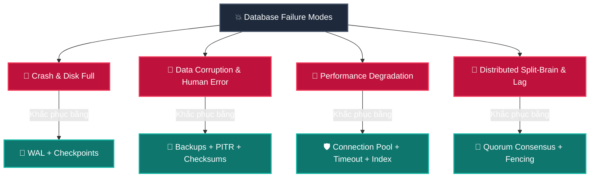
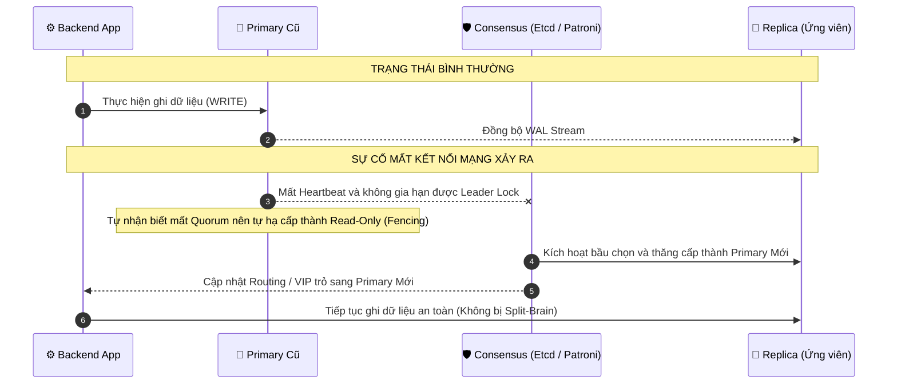

# 💥 Database Failure Modes (Các Chế Độ Lỗi CSDL): Chẩn Đoán, Phục Hồi & Kiến Trúc Chịu Lỗi

> **Database Failure Modes** là tập hợp các kịch bản mà cơ sở dữ liệu gặp sự cố từ phần cứng, phần mềm, suy giảm hiệu năng cho đến bất nhất trong hệ thống phân tán.  
> Đối với một Backend Engineer cấp cao, hiểu rõ **cơ sở dữ liệu có thể chết theo những cách nào** là điều kiện tiên quyết để thiết kế hệ thống đạt **High Availability (HA)**, tối ưu **RPO/RTO** và không bao giờ mất dữ liệu khách hàng.

---

## 🏛️ 1. Phân Loại 4 Nhóm Sự Cố Cơ Sở Dữ Liệu

Mọi sự cố CSDL trong môi trường Production đều rơi vào 1 trong 4 nhóm sau:

```
┌──────────────────────────────────────────────────────────────────────────────┐
│                     4 NHÓM FAILURE MODES TRONG DATABASE                      │
├──────────────────────────────────────┬───────────────────────────────────────┤
│ 1. INFRASTRUCTURE & CRASH FAILURES   │ 2. DATA CORRUPTION (Hỏng Dữ Liệu)     │
│ • Sập nguồn đột ngột, Kernel Panic   │ • Bit Rot / Hỏng sector ổ đĩa         │
│ • OOM Killer bắn chết tiến trình DB  │ • Bug phần mềm ghi sai cấu trúc page  │
│ • Đầy ổ đĩa (Disk Full -> DB ReadOnly│ • Lỗi con người: `DELETE` thiếu WHERE │
├──────────────────────────────────────┼───────────────────────────────────────┤
│ 3. PERFORMANCE DEGRADATION           │ 4. DISTRIBUTED INCONSISTENCIES        │
│ • Cạn kiệt Connection Pool           │ • Replication Lag (Đọc dữ liệu cũ)    │
│ • Lock Contention / Deadlock dây chuyền│ • Split-Brain (2 Primary cùng ghi!)  │
│ • Index Bloat / Query Plan thoái hóa │ • Mất dữ liệu khi Async Failover      │
└──────────────────────────────────────┴───────────────────────────────────────┘
```



---

## 🔬 2. Phân Tích Sâu Từng Chế Độ Lỗi & Cơ Chế Giảm Thiểu

### 2.1. Hardware Crash, OOM Killer & Disk Full
- **Bản chất sự cố:** Database luôn giữ dữ liệu nóng trong RAM (Buffer Pool / Shared Buffers) để tăng tốc độ. Khi mất điện hoặc bị Linux **OOM Killer** (Out-Of-Memory) kết liễu, toàn bộ dữ liệu trong RAM chưa kịp ghi xuống file dữ liệu (Data Files) sẽ bị mất. Ngoài ra, nếu ổ đĩa đầy 100%, DB sẽ từ chối mọi thao tác ghi hoặc ngừng hoạt động hoàn toàn.
- **Cơ chế chống đỡ:**
  - **WAL (Write-Ahead Log) + `fsync`:** Mọi thay đổi bắt buộc phải ghi tuần tự vào file WAL trên đĩa trước khi báo `COMMIT` thành công. Khi khởi động lại sau sập nguồn, DB sẽ phát lại (Replay) WAL từ mốc **Checkpoint** gần nhất để khôi phục toàn bộ giao dịch đã commit.
  - **Monitoring & Disk Alert:** Luôn đặt cảnh báo khi dung lượng đĩa đạt 75% - 80% và tách phân vùng lưu `WAL` riêng biệt với `Data` hoặc `Logs` ứng dụng.

---

### 2.2. Data Corruption & Human Error (Hỏng Dữ Liệu & Lỗi Con Người)
- **Bản chất sự cố:**
  - *Silent Data Corruption (Bit Rot):* Phần cứng ổ đĩa hoặc controller lỗi làm biến đổi vài bit dữ liệu trên đĩa mà hệ điều hành không hay biết cho tới khi đọc đúng trang dữ liệu đó.
  - *Human Error:* Lập trình viên hoặc DBA chạy nhầm `DROP TABLE`, `TRUNCATE` hoặc `UPDATE users SET role = 'ADMIN'` quên mệnh đề `WHERE` trên Production. Lúc này Replication sao chép ngay lập tức câu lệnh sai đó sang toàn bộ các máy Replica!
- **Cơ chế chống đỡ:**
  - **Page Checksums:** Bật tính năng `data_checksums` (trong PostgreSQL) hoặc `innodb_checksum_algorithm` (MySQL) để DB phát hiện ngay trang dữ liệu bị hỏng khi đọc.
  - **PITR (Point-in-Time Recovery):** Kết hợp **Base Backup** (chụp toàn bộ DB định kỳ) + **Archived WAL Logs** (lưu liên tục). Cho phép tua ngược thời gian phục hồi DB về đúng **1 giây trước khi câu lệnh `DELETE` nhầm được thực thi**.

---

### 2.3. Performance Degradation (Suy Giảm Hiệu Năng Nghiêm Trọng)
Đôi khi DB không hề sập tiến trình, nhưng phản hồi chậm đến mức toàn bộ API Backend bị Timeout (hiệu ứng **Gray Failure**):
- **Connection Pool Exhaustion:** Mỗi kết nối DB tiêu tốn RAM và CPU context-switch. Khi Backend mở quá nhiều kết nối hoặc giữ transaction quá lâu (gọi API bên thứ 3 trong transaction), Pool bị cạn kiệt -> Request mới xếp hàng chờ và chết hàng loạt.
  - *Giải pháp:* Dùng Connection Pooler chuyên dụng (**PgBouncer**, **ProxySQL**), đặt `statement_timeout` và `idle_in_transaction_session_timeout`.
- **Table/Index Bloat & Query Plan Regression:** Dữ liệu xóa/sửa nhiều tạo ra các "Dead Tuples" làm phình to kích thước bảng, hoặc thống kê (Statistics) bị cũ khiến Query Planner chuyển từ *Index Scan* sang *Sequential Scan*.
  - *Giải pháp:* Tối ưu **Autovacuum**, định kỳ chạy `ANALYZE` và theo dõi `pg_stat_statements`.
- **Thundering Herd / Cache Stampede:** Khi Redis hết hạn key nóng đồng loạt, hàng chục nghìn request lao thẳng vào DB cùng lúc làm CPU DB chạm trần 100%.

---

### 2.4. Distributed Failure Modes: Replication Lag & Split-Brain

Khi chạy kiến trúc **Primary - Replica (Master - Slave)** để chịu tải và dự phòng, 2 lỗi phân tán nguy hiểm nhất xuất hiện:

#### A. Replication Lag (Độ Trễ Đồng Bộ)
Khi User vừa cập nhật hồ sơ (ghi vào **Primary**), 50ms sau trang web gọi API đọc từ **Replica** — nhưng Replica chưa kịp nhận bản sao từ Primary -> User thấy dữ liệu cũ (tưởng hệ thống bị lỗi).
- *Giải pháp:* Áp dụng mẫu **Read-Your-Own-Writes** (vừa ghi xong thì điều hướng các request đọc của chính user đó về Primary trong vài giây đầu, hoặc dùng **Synchronous Replication** cho dữ liệu tối quan trọng).

#### B. Split-Brain (Não Phân Đôi — Thảm Họa Lớn Nhất)
Xảy ra khi đường truyền mạng giữa **Primary cũ** và cụm **Replica / Sentinel** bị đứt tạm thời (Network Partition):
- Cụm Replica không thấy nhịp tim (Heartbeat) của Primary cũ -> tưởng Primary đã chết -> bầu **Replica A lên làm Primary mới**.
- Trong khi đó, **Primary cũ vẫn còn sống** và một số Backend Server cũ vẫn đang ghi dữ liệu vào nó!
- Kết quả: Hệ thống có **2 Primary chạy song song**, dữ liệu bị chia làm 2 nhánh xung đột không thể tự gộp lại!

```
================================================================================
              KỊCH BẢN SPLIT-BRAIN & CƠ CHẾ FAILOVER AN TOÀN (FENCING)
================================================================================

 [ KHI MẤT MẠNG (NETWORK PARTITION) ]
   App Server Nhóm 1 ──► [ 👑 Primary Cũ (Vẫn sống nhưng bị cô lập!) ] ◄── ❌ RỦI RO GHI TRÙNG
                              ✕ (Đứt cáp mạng / Mất Heartbeat)
   App Server Nhóm 2 ──► [ 🛡️ Consensus (Patroni/Etcd) ] ──► Bầu [ 👑 Primary Mới ]

 [ CÁCH CHỐNG SPLIT-BRAIN: QUORUM + FENCING / STONITH ]
   • Primary Cũ không liên lạc được với quá bán Quorum (Etcd/Consul)
   • Primary Cũ TỰ ĐỘNG HẠ CẤP thành Read-Only (Demote) hoặc bị STONITH tắt nguồn!
   • Chỉ Primary Mới giữ được "Lease Lock" mới có quyền nhận lệnh Ghi (WRITE).
```



---

## 📊 3. Ma Trận RPO / RTO & Chiến Lược Giảm Thiểu

Khi thiết kế kiến trúc DB chịu lỗi, mọi giải pháp đều quy về 2 chỉ số sống còn:
- **RPO (Recovery Point Objective):** Mức độ mất dữ liệu tối đa chấp nhận được tính bằng thời gian (ví dụ: RPO = 0 nghĩa là không được mất 1 giao dịch nào; RPO = 5 phút nghĩa là chấp nhận mất tối đa 5 phút dữ liệu gần nhất).
- **RTO (Recovery Time Objective):** Thời gian gián đoạn tối đa cho phép để hệ thống hoạt động trở lại (ví dụ: RTO < 30 giây).

| Failure Mode | Nguyên Nhân Chính | Chiến Lược Giảm Thiểu (Mitigation) | Tác Động RPO / RTO |
| :--- | :--- | :--- | :--- |
| **Single Node Crash** | Mất điện, OOM, lỗi OS | WAL + Auto-restart + Automated Failover (Patroni / RDS Multi-AZ) | RPO ≈ 0 (nếu Sync), RTO ~ 15-60s |
| **Human Error (`DROP`/`DELETE`)** | Nhầm lệnh trên Prod | WAL Archiving + **PITR**, phân quyền chặt (Least Privilege) | Phục hồi chính xác tới giây trước lỗi |
| **Disk / Region Failure** | Chết ổ cứng, cháy Data Center | Cross-Region Read Replicas + Off-site Snapshots (S3) | RPO vài giây đến vài phút |
| **Split-Brain** | Network Partition | Quorum (Số lẻ node: 3, 5) + Leader Lease + STONITH Fencing | Ngăn chặn hỏng dữ liệu vĩnh viễn |
| **Connection Exhaustion** | Traffic spike, Slow Query | PgBouncer, `statement_timeout`, Circuit Breaker ở App | Giữ hệ thống không sập dây chuyền |

---

## ✅ 4. Checklist Kiến Trúc Database Chịu Lỗi Cho Backend

- [ ] **Thiết lập HA Cluster với số node lẻ (3 hoặc 5):** Để đảm bảo luôn bầu được **Quorum** khi có sự cố mạng, tránh Split-Brain.
- [ ] **Bật Automated Backups + Kiểm thử Restore định kỳ:** Một bản backup chưa từng được test restore coi như không tồn tại.
- [ ] **Cấu hình PITR (Point-in-Time Recovery):** Lưu liên tục WAL log sang Object Storage (S3/GCS) tách biệt hoàn toàn với server DB.
- [ ] **Đặt Timeout ở mọi tầng:** `connect_timeout`, `statement_timeout`, `lock_timeout` để ngăn 1 câu query lỗi làm treo toàn bộ Connection Pool.
- [ ] **Tách Read/Write thông minh:** Nhận thức rõ **Replication Lag** để không đọc nhầm dữ liệu cũ ngay sau khi ghi (Read-Your-Own-Writes).

---

## 📚 5. Tài Liệu Liên Quan Trong Kho Lưu Trữ
- [Write-Ahead Log (WAL)](file:///Users/thinhnguyen/DEVELOP/BE/PostgreSQL/10_write_ahead_log.md)
- [Replication in PostgreSQL](file:///Users/thinhnguyen/DEVELOP/BE/PostgreSQL/31_replication_in_postgresql.md)
- [Checkpoints and Bgwriter](file:///Users/thinhnguyen/DEVELOP/BE/PostgreSQL/32_checkpoints_and_bgwriter.md)
- [Database Transactions (Nâng Cao)](file:///Users/thinhnguyen/DEVELOP/BE/more-ab-db/01_database_transactions_advanced.md)
