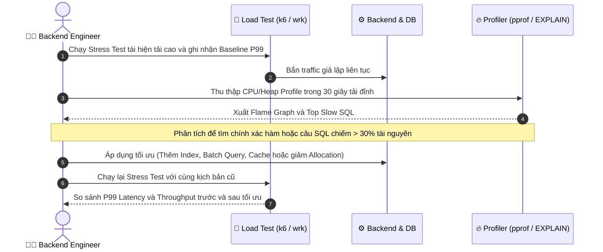

# 🔥 Profiling Performance (Phân Tích & Đo Lường Hiệu Năng Hệ Thống)

> **Performance Profiling** là quá trình thu thập và phân tích dữ liệu thực thi ở mức sâu (CPU cycles, Memory allocations, I/O wait, Lock contention, SQL Query Plans) để **chỉ đích danh dòng code hoặc câu truy vấn đang làm chậm hệ thống**.  
> Nguyên tắc vàng của kỹ thuật tối ưu: *"Never optimize in the dark — Luôn đo lường trước khi tối ưu."*

---

## 🏛️ 1. Phân Biệt Monitoring vs Distributed Tracing vs Profiling

Nhiều lập trình viên thường nhầm lẫn 3 khái niệm quan sát hệ thống (Observability) này:

```
┌──────────────────────────────────────────────────────────────────────────────┐
│                 3 TẦNG QUAN SÁT HIỆU NĂNG (OBSERVABILITY PYRAMID)            │
├────────────────────┬──────────────────────────┬──────────────────────────────┤
│  1. MONITORING     │  2. DISTRIBUTED TRACING  │  3. PERFORMANCE PROFILING    │
│  (Metrics/Alerts)  │  (OpenTelemetry/Jaeger)  │  (pprof / Flame Graph / SQL) │
├────────────────────┼──────────────────────────┼──────────────────────────────┤
│ Trả lời câu hỏi:   │ Trả lời câu hỏi:         │ Trả lời câu hỏi:             │
│ "Hệ thống CÓ ĐANG  │ "Request CHẬM Ở SERVICE  │ "TẠI SAO dòng code / câu SQL │
│  BỊ CHẬM không?"   │  hay BƯỚC NÀO?"          │  đó lại ngốn CPU / RAM?"     │
│                    │                          │                              │
│ Ví dụ: P99 Latency │ Ví dụ: Payment Service   │ Ví dụ: Hàm `json.Unmarshal`  │
│ tăng vọt lên 2.5s. │ mất 2.1s để phản hồi.    │ chiếm 72% CPU hoặc Seq Scan! │
└────────────────────┴──────────────────────────┴──────────────────────────────┘
```


---

## 🎯 2. 4 Trụ Cột Tài Nguyên Cần Profile

Khi một API Backend hoặc Database bị chậm, nguyên nhân luôn nằm ở 1 trong 4 nhóm tài nguyên sau:

| Trụ Cột Tài Nguyên | Triệu Chứng Thường Gặp | Nguyên Nhân Gốc Rễ Phổ Biến | Công Cụ / Kỹ Thuật Chẩn Đoán |
| :--- | :--- | :--- | :--- |
| **1. CPU Profiling** | CPU 100%, Latency tăng tuyến tính theo tải | Vòng lặp lồng nhau $O(N^2)$, Regex phức tạp (ReDoS), JSON Parse/Serialize khổng lồ, mã hóa/hash nặng | `pprof`, `perf`, Async-Profiler, **Flame Graphs** |
| **2. Memory Profiling** | RAM tăng dần không giảm, OOM Killer, GC Pause lâu | **Memory Leak** (giữ reference trong map/closure), cấp phát quá nhiều object ngắn hạn gây áp lực Garbage Collector | Heap Dump, Allocation Flame Graph, `valgrind` |
| **3. I/O & Network** | CPU rảnh (10%) nhưng API vẫn chậm hàng giây | **N+1 Query Problem**, gọi tuần tự nhiều HTTP API thay vì song song, đọc ghi đĩa không buffer, thiếu Connection Pool | `EXPLAIN ANALYZE`, `iostat`, `tcpdump`, Tracing |
| **4. Lock Contention** | CPU thấp, I/O thấp nhưng Throughput tụt thê thảm | Tranh chấp Mutex/Thread Lock trong App, hoặc Row Lock (`FOR UPDATE`) / Deadlock trong Database | Block/Mutex Profiler, `pg_locks`, `pg_stat_activity` |

---

## 🗄️ 3. Database Performance Profiling (Chuyên Sâu)

Trong 80% trường hợp, nút thắt cổ chai của Backend nằm ở **Database**. Dưới đây là quy trình profile CSDL chuẩn mực:

### 3.1. Tìm câu truy vấn tốn tài nguyên nhất (`pg_stat_statements`)
Thay vì đoán mò, hãy bật extension `pg_stat_statements` để xem tổng thời gian thực thi tích lũy:

```sql
-- Tìm Top 5 câu query ngốn tổng thời gian DB nhiều nhất
SELECT 
    calls,
    ROUND(total_exec_time::numeric, 2) AS total_ms,
    ROUND(mean_exec_time::numeric, 2) AS avg_ms,
    rows,
    query
FROM pg_stat_statements
ORDER BY total_exec_time DESC
LIMIT 5;
```
> **Mẹo Senior:** Đừng chỉ nhìn `mean_exec_time` (thời gian trung bình). Một câu query chỉ mất `5ms` nhưng được gọi `100.000 lần/phút` sẽ nguy hiểm hơn một câu query báo cáo mất `2 giây` nhưng mỗi ngày chạy 1 lần.

### 3.2. Giải phẫu câu query bằng `EXPLAIN (ANALYZE, BUFFERS)`
Luôn chạy kèm `ANALYZE` (để đo thời gian thực tế, không chỉ ước lượng) và `BUFFERS` (để biết câu query đọc từ RAM hay phải cào xuống ổ đĩa):

```sql
EXPLAIN (ANALYZE, BUFFERS)
SELECT * FROM orders WHERE user_id = 42 AND status = 'PAID';
```

**3 chỉ số sống còn cần soi trong kết quả:**
1. **Scan Type:** `Seq Scan` (quét toàn bộ bảng — báo động đỏ nếu bảng lớn) vs `Index Scan` / `Index Only Scan`.
2. **Rows Removed by Filter:** Nếu DB phải đọc 1.000.000 dòng rồi vứt đi 999.990 dòng mới lấy được 10 dòng -> **Thiếu Composite Index**.
3. **Buffers (`shared hit` vs `read`):**
   - `shared hit`: Trang dữ liệu đã nằm sẵn trong RAM (rất nhanh).
   - `shared read`: Phải đọc từ ổ đĩa vật lý (chậm gấp hàng trăm lần RAM).

### 3.3. Phát hiện N+1 Query Problem
Khi tải danh sách 100 đơn hàng (1 query), sau đó vòng lặp `for` trong code lại chạy thêm 100 câu `SELECT * FROM users WHERE id = ?` -> Tổng cộng **101 queries** cho 1 API!
- **Cách nhận diện khi Profiling:** Trong Distributed Trace hoặc SQL Profiler thấy hàng trăm câu `SELECT` giống hệt nhau chạy nối tiếp theo hình bậc thang.
- **Cách sửa:** Dùng `JOIN`, `WHERE id IN (...)` (Batch loading / DataLoader), hoặc Eager Loading đúng cách.

---

## 🔥 4. Cách Đọc Flame Graph (Biểu Đồ Ngọn Lửa)

**Flame Graph** (được phát minh bởi Brendan Gregg) là công cụ trực quan mạnh nhất để đọc CPU/Memory Profile.

```
================================================================================
                        CÁCH ĐỌC CPU FLAME GRAPH
================================================================================

  Trục Y (Độ cao): Độ sâu của Call Stack (Hàm cha ở dưới, hàm con ở trên)
  Trục X (Độ rộng): Tỷ lệ % thời gian hàm đó nằm trên CPU (KHÔNG phải thứ tự thời gian!)

         [  regex.Match()  ]   [      json.Marshal()       ]
      [     validateInput()    ][       serializeBody()       ]
    [                  handleCreateOrder()                      ]
  [                         http.ServeHTTP()                      ]
  └───────────────────────────────────────────────────────────────┘
  0%                                                            100% CPU

  👉 QUY TẮC VÀNG: Hãy tìm các "CAO NGUYÊN PHẲNG VÀ RỘNG" (Wide Plateaus) ở trên đỉnh!
     Trong hình trên: `json.Marshal()` chiếm tới ~55% chiều rộng -> Chính là nút thắt cổ chai!
```

---

## 🔄 5. Quy Trình Profiling Chuẩn Mực (Benchmark -> Profile -> Optimize -> Verify)

Không bao giờ sửa code tối ưu theo cảm tính. Hãy tuân theo vòng lặp khoa học sau:



---

## ✅ 6. Checklist Profiling & Tối Ưu Hiệu Năng Cho Backend

- [ ] **Profiling trên dữ liệu giống Production:** Đừng bao giờ chạy `EXPLAIN ANALYZE` trên bảng chỉ có 50 dòng ở local — PostgreSQL sẽ luôn chọn `Seq Scan` vì bảng quá nhỏ! Hãy sinh dữ liệu giả (ít nhất vài trăm nghìn dòng) để test.
- [ ] **Kiểm tra cả Wall Time và CPU Time:** Nếu Wall Time là `500ms` nhưng CPU Time chỉ là `5ms` -> Code không tốn CPU, mà đang **chờ I/O (DB, Network, Lock)**.
- [ ] **Giảm cấp phát bộ nhớ trên Hot Path:** Tránh nối chuỗi bằng `+` trong vòng lặp, tận dụng `sync.Pool` / Buffer tái sử dụng, tránh serialize/deserialize JSON lặp đi lặp lại không cần thiết.
- [ ] **Cài Continuous Profiling cho Production:** Dùng các agent nhẹ (overhead < 1-2% CPU) như **Grafana Pyroscope**, **Parca**, hoặc **Datadog Continuous Profiler** để luôn có dữ liệu lịch sử ngay cả khi sự cố xảy ra lúc 2 giờ sáng.

---

## 📚 7. Tài Liệu Liên Quan Trong Kho Lưu Trữ
- [Query Processing in PostgreSQL](file:///Users/thinhnguyen/DEVELOP/BE/PostgreSQL/11_query_processing.md)
- [Logging and Statistics in PostgreSQL](file:///Users/thinhnguyen/DEVELOP/BE/PostgreSQL/21_logging_and_statistics.md)
- [Database Failure Modes](file:///Users/thinhnguyen/DEVELOP/BE/more-ab-db/03_database_failure_modes.md)
