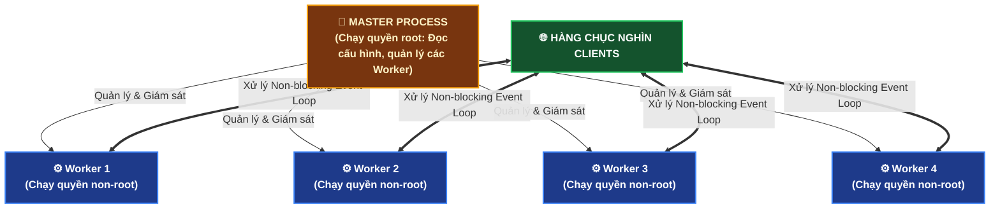
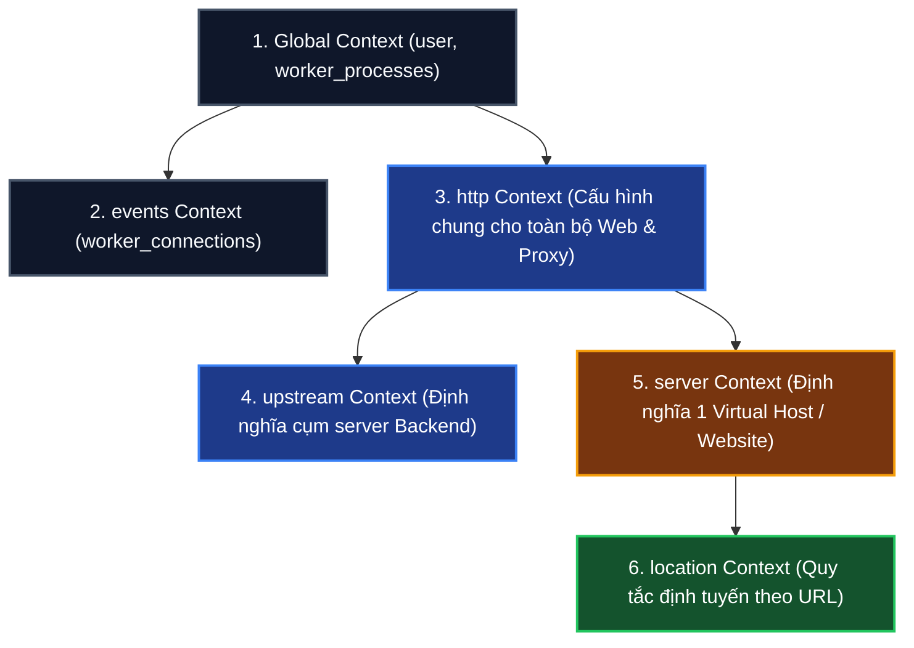

# ⚡ Nginx: Bản Chất, Kiến Trúc Xử Lý & Giải Phẫu `nginx.conf`

> **Nginx** (đọc là *"Engine-X"*) là một máy chủ web mã nguồn mở hiệu năng cao, được phát triển bởi kỹ sư người Nga **Igor Sysoev** vào năm 2004.  
> Ngày nay, Nginx vận hành **hơn một phần ba số website trên toàn cầu** và là linh hồn không thể thiếu trong kiến trúc Backend hiện đại: đóng vai trò làm **Web Server tĩnh, Reverse Proxy, Load Balancer, SSL Termination, và API Gateway**.

---

## 🥊 1. Nguồn Gốc & "Bài Toán C10K" Huyền Thoại: Vì Sao Nginx Đè Bẹp Apache?

Vào những năm 2000, **Apache HTTP Server** là "vua" thống trị thế giới web. Nhưng khi Internet bùng nổ, bài toán **C10K (Concurrent 10,000 connections)** xuất hiện: Làm sao để một máy chủ phục vụ đồng thời 10.000 kết nối cùng lúc mà không bị sập?

```
┌─────────────────────────────────┐       ┌─────────────────────────────────┐
│ APACHE (Mô hình Process/Thread) │       │ NGINX (Mô hình Event-Driven)    │
├─────────────────────────────────┤       ├─────────────────────────────────┤
│ • Mỗi kết nối mới -> Sinh ra    │       │ • 1 Worker duy nhất xử lý hàng  │
│   1 Process / Thread riêng biệt │       │   chục nghìn kết nối đồng thời! │
│ • 10.000 kết nối = 10.000 thread│       │ • Dùng cơ chế I/O Multiplexing  │
│ ❌ NGHẼN RAM & CPU DO CONTEXT   │       │   (epoll trên Linux / kqueue)   │
│    SWITCHING -> SERVER SẬP NGUỒN│       │ 🚀 RAM CỐ ĐỊNH, KHÔNG BỊ NGHẼN! │
└─────────────────────────────────┘       └─────────────────────────────────┘
```

- **Mô hình của Apache**: Giống như một nhà hàng: mỗi khi có 1 khách vào, nhà hàng lại phải tuyển riêng 1 người bồi bàn đi theo khách đó. Khi có 10.000 khách, 10.000 người bồi bàn chen lấn nhau làm sập nhà hàng!
- **Mô hình của Nginx**: Nhà hàng chỉ cần **1 vài người bồi bàn siêu đẳng (Worker Processes)**. Bồi bàn đứng một chỗ, khách nào giơ tay gọi món thì phục vụ, trong lúc chờ nhà bếp nấu ăn (I/O chờ đĩa/mạng), bồi bàn lập tức quay sang ghi order cho khách khác mà không bao giờ đứng đợi!

---

## ⚙️ 2. Kiến Trúc Master - Worker Của Nginx

Khi bạn khởi động Nginx, hệ thống sẽ sinh ra 2 loại tiến trình:



1. **Master Process (Tiến trình chúa)**:
   - Chạy với quyền `root` (để mở cổng đặc quyền 80 và 443).
   - Nhiệm vụ: Đọc và kiểm tra file cấu hình, bind các cổng mạng, tạo và giám sát các tiến trình Worker. Nếu một Worker bị crash, Master sẽ lập tức hồi sinh một Worker mới.
2. **Worker Processes (Các tiến trình công nhân)**:
   - Chạy với quyền hạn chế (user `nginx` hoặc `www-data`) để đảm bảo an toàn.
   - Số lượng Worker thường được cấu hình **bằng đúng số lõi CPU** của máy chủ (`worker_processes auto;`).
   - Mỗi Worker chạy một vòng lặp sự kiện bất đồng bộ (**Asynchronous Event Loop**) liên tục đón nhận các kết nối mạng mà không bị nghẽn (Non-blocking).

---

## 🏛️ 3. Bốn Vai Trò "Tối Thượng" Của Nginx Trong Backend

```
                                      NGINX Ở CỬA NGÕ
                                             │
      ┌──────────────────┬───────────────────┴───────────────────┬──────────────────┐
      ▼                  ▼                                       ▼                  ▼
1. TẬP TIN TĨNH    2. REVERSE PROXY                        3. LOAD BALANCER   4. SSL TERMINATION
(Static Content)   (Cầu nối vào Backend)                  (Cân bằng tải)     (Giải mã HTTPS)
  Phục vụ HTML,      Chuyển request vào                     Chia tải cho       Giải mã SSL ở cửa,
  CSS, JS, Ảnh       Spring Boot / Node.js                  nhiều instance     truyền HTTP nội bộ
  bằng Zero-Copy     bảo vệ giấu kín IP                     Backend            cho nhẹ CPU Backend
```

1. **Phục vụ tệp tĩnh siêu tốc (Static File Server)**:
   - Nhờ sử dụng lệnh hệ thống `sendfile` (Zero-copy), Nginx chuyển dữ liệu từ ổ cứng thẳng ra card mạng mà không cần nạp qua bộ nhớ của ứng dụng. Phục vụ ảnh, video nhanh gấp 5 - 10 lần so với việc để Java hay Python tự đọc file.
2. **Reverse Proxy (Ủy thác ngược)**:
   - Khách hàng không bao giờ biết ứng dụng thật đang chạy ở đâu hay dùng ngôn ngữ gì. Nginx đứng ở cổng 80/443, nhận request rồi âm thầm chuyển tiếp vào `http://127.0.0.1:8080` (Spring Boot).
3. **Load Balancer (Cân bằng tải)**:
   - Phân bổ lưu lượng cho cụm 5 server backend theo các thuật toán: Round Robin, Least Connections, IP Hash.
4. **SSL Termination (Chốt chặn giải mã HTTPS)**:
   - Cài chứng chỉ SSL trên Nginx. Nginx gánh toàn bộ chi phí tính toán giải mã mã hóa nặng nề, sau đó chuyển gói tin thô qua mạng nội bộ vào Backend, giúp Backend tiết kiệm tài nguyên CPU.

---

## 🧬 4. Giải Phẫu Khung Sườn File Cấu Hình `nginx.conf`

File cấu hình Nginx được tổ chức theo các khối phân cấp lồng nhau (**Contexts**):



### File cấu hình hoàn chỉnh thực tế:

```nginx
# --- 1. GLOBAL CONTEXT: Cấu hình chung cho tiến trình ---
user nginx;
worker_processes auto; # Tự động phát hiện số nhân CPU (vd: 4 nhân = 4 workers)
error_log /var/log/nginx/error.log warn;
pid /var/run/nginx.pid;

# --- 2. EVENTS CONTEXT: Cấu hình kết nối mạng ---
events {
    # Mỗi Worker được xử lý tối đa bao nhiêu kết nối cùng lúc:
    worker_connections 1024; # 4 workers * 1024 = 4.096 kết nối đồng thời
    multi_accept on;
}

# --- 3. HTTP CONTEXT: Nơi định cấu hình mọi thứ liên quan đến HTTP ---
http {
    include /etc/nginx/mime.types;
    default_type application/octet-stream;
    
    # Tối ưu hóa hiệu năng truyền file:
    sendfile on;
    tcp_nopush on;
    keepalive_timeout 65;

    # Ẩn phiên bản Nginx để bảo mật:
    server_tokens off;

    # --- 4. UPSTREAM CONTEXT: Cụm máy chủ Backend (Cân bằng tải) ---
    upstream backend_cluster {
        server 127.0.0.1:8080 weight=3; # Server mạnh nhận 3 phần
        server 127.0.0.1:8081 weight=1; # Server yếu nhận 1 phần
        keepalive 32;
    }

    # --- 5. SERVER CONTEXT: Khai báo 1 website ---
    server {
        listen 80;
        server_name mycompany.com www.mycompany.com;

        # Gốc chứa file tĩnh (HTML, CSS, JS):
        root /var/www/mycompany/dist;
        index index.html;

        # --- 6. LOCATION CONTEXT: Định tuyến theo đường dẫn URL ---
        
        # A. Phục vụ giao diện Frontend (React/Vue SPA):
        location / {
            try_files $uri $uri/ /index.html;
        }

        # B. Chuyển tiếp toàn bộ API vào cụm Spring Boot:
        location /api/ {
            proxy_pass http://backend_cluster;
            
            # Đính kèm Header gốc của người dùng (tránh Backend bị mất IP thật):
            proxy_set_header Host $host;
            proxy_set_header X-Real-IP $remote_addr;
            proxy_set_header X-Forwarded-For $proxy_add_x_forwarded_for;
            proxy_set_header X-Forwarded-Proto $scheme;
        }

        # C. Cache các file tĩnh ảnh, font trong 30 ngày:
        location ~* \.(jpg|jpeg|png|gif|ico|css|js|woff2)$ {
            expires 30d;
            add_header Cache-Control "public, no-transform";
        }
    }
}
```

---

## 🛠️ 5. Những Câu Lệnh Nginx Sống Còn Của Kỹ Sư Backend

Khi làm việc với máy chủ Linux, đây là 3 câu lệnh bạn sẽ gõ hàng ngày:

1. **Kiểm tra cú pháp file cấu hình (BẮT BUỘC TRƯỚC KHI TẢI LẠI)**:
   ```bash
   sudo nginx -t
   ```
   *Nếu báo `syntax is ok` và `test is successful` thì bạn mới được phép reload! Nếu cú pháp sai mà reload là toàn bộ website sẽ chết ngay lập tức.*

2. **Tải lại cấu hình không gây gián đoạn (Zero-Downtime Reload)**:
   ```bash
   sudo nginx -s reload
   # (hoặc: sudo systemctl reload nginx)
   ```
   *Nginx sẽ giữ nguyên các Worker cũ phục vụ nốt khách hàng hiện tại, đồng thời sinh ra các Worker mới nạp cấu hình mới -> Khách hàng không hề cảm thấy bị ngắt quãng!*

3. **Xem file log điều tra sự cố**:
   ```bash
   # Xem lịch sử các lượt truy cập (Access Log):
   sudo tail -f /var/log/nginx/access.log

   # Xem các lỗi sập mạng, lỗi kết nối vào Backend (Error Log):
   sudo tail -f /var/log/nginx/error.log
   ```
