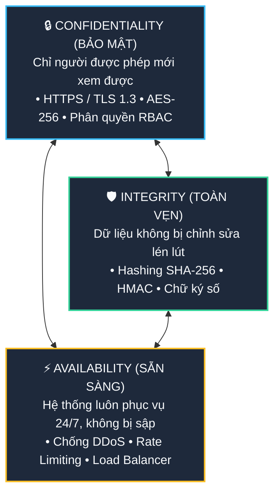
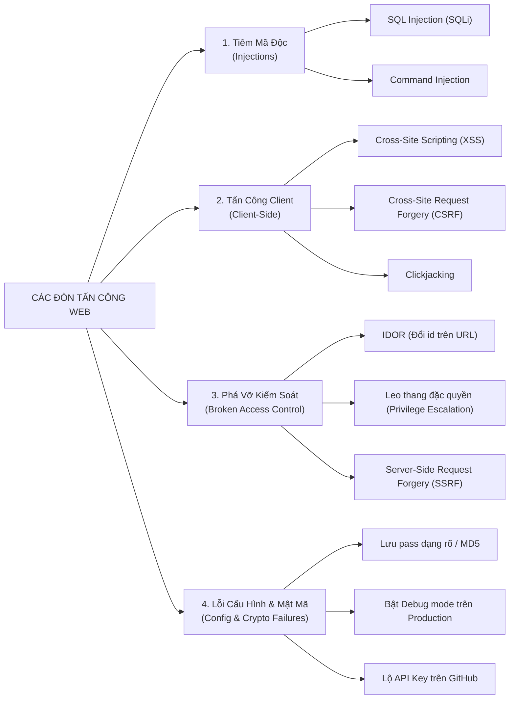

# 🏰 Web Security Fundamentals (Toàn Cảnh Bảo Mật Ứng Dụng Web)

> **Web Security (Bảo mật Web)** không phải là một "tính năng" bạn code thêm vào cuối dự án, mà là một **tư duy kiến trúc xuyên suốt** nhằm bảo vệ dữ liệu, người dùng và hạ tầng máy chủ khỏi các hành vi phá hoại, đánh cắp và truy cập trái phép.

---

## 🔺 1. Tam Giác Vàng Của An Ninh Thông Tin: The CIA Triad

Mọi giải pháp bảo mật trên thế giới đều xoay quanh việc bảo vệ 3 đỉnh của tam giác **CIA**:



| Thành phần | Ý nghĩa | Ví dụ vi phạm | Giải pháp bảo vệ |
|---|---|---|---|
| **Confidentiality** *(Bảo mật)* | Chỉ những ai được cấp phép mới được đọc dữ liệu. | Hacker đọc trộm tin nhắn, lộ số thẻ ngân hàng, rò rỉ database khách hàng. | Mã hóa dữ liệu (HTTPS/TLS, AES-256), Phân quyền chặt chẽ (RBAC). |
| **Integrity** *(Toàn vẹn)* | Dữ liệu không bị chỉnh sửa lén lút trên đường truyền hoặc trong database. | Hacker sửa số tiền chuyển khoản từ 100k thành 100 triệu; sửa điểm thi trong DB. | Chữ ký số (HMAC, Digital Signature), Hashing (SHA-256), Checksum. |
| **Availability** *(Sẵn sàng)* | Dịch vụ và dữ liệu luôn luôn phải truy cập được khi người dùng hợp pháp cần. | Website bị tấn công DDoS sập nguồn, cơ sở dữ liệu bị nghẽn làm tê liệt hệ thống. | Load Balancer, Auto-scaling, CDN (Cloudflare), Rate Limiting, Redundancy. |

---

## 🏰 2. Chiến Lược "Phòng Thủ Chiều Sâu" (Defense in Depth)

Một lập trình viên nghiệp dư chỉ đặt một lớp bảo vệ (ví dụ: chỉ kiểm tra form ở Frontend).  
Một kiến trúc sư Backend chuyên nghiệp sẽ xây dựng **hệ thống phòng thủ nhiều lớp (như thành trì thời trung cổ)**:

```
[ Hacker / Người dùng ]
       │
       ▼
┌────────────────────────────────────────────────────────┐
│ 1. Tầng Mạng & Cổng (Network / Edge):                  │ ──> Cloudflare, WAF, Chặn IP xấu, Chống DDoS, Rate Limit
└──────────────────────┬─────────────────────────────────┘
                       ▼
┌────────────────────────────────────────────────────────┐
│ 2. Tầng Truyền Tải (Transport Layer):                  │ ──> Bắt buộc HTTPS (TLS 1.3), HSTS, Mã hóa đường truyền
└──────────────────────┬─────────────────────────────────┘
                       ▼
┌────────────────────────────────────────────────────────┐
│ 3. Tầng Ứng Dụng (Application Layer):                  │ ──> Auth (JWT/OAuth), Phân quyền (RBAC), Validate input,
│                                                        │     Mã hóa mật khẩu bằng BCrypt/Argon2, Chống XSS/CSRF
└──────────────────────┬─────────────────────────────────┘
                       ▼
┌────────────────────────────────────────────────────────┐
│ 4. Tầng Dữ Liệu (Database Layer):                      │ ──> Parameterized Queries (chống SQLi), Encrypt at rest,
│                                                        │     Quyền DB tối thiểu (không dùng quyền superuser root)
└────────────────────────────────────────────────────────┘
```
👉 *Nguyên lý*: Dù một bức tường bị xuyên thủng, các bức tường phía sau vẫn giữ cho dữ liệu an toàn.

---

## ⚠️ 3. Bản Đồ Các Mối Đe Dọa Phổ Biến Nhất (The Threat Landscape)

Các cuộc tấn công Web được chia thành 4 nhóm chiến thuật chính:



---

## 🧭 4. Những Nguyên Tắc Bảo Mật Bất Biến Cho Backend

1. **"Never Trust User Input" (Không bao giờ tin dữ liệu từ người dùng)**:
   - Tất cả dữ liệu đến từ request (Body, Query params, Headers, Cookies, thậm chí cả tên file upload) đều phải coi là **độc hại tiềm tàng** cho đến khi được kiểm tra (Validate & Sanitize).
   - Kiểm tra ở Frontend chỉ để phục vụ UX cho đẹp; **Backend bắt buộc phải Validate lại 100%**.

2. **Nguyên tắc đặc quyền tối thiểu (Principle of Least Privilege - PoLP)**:
   - Ứng dụng Backend kết nối vào Database **tuyệt đối không dùng tài khoản `postgres` hay `root`**! Hãy tạo một user riêng chỉ có quyền `SELECT, INSERT, UPDATE` trên schema của ứng dụng.

3. **Nguyên tắc "Mặc định từ chối" (Deny by Default)**:
   - Khi thiết kế API hoặc route: Mặc định tất cả đều bị khóa và yêu cầu xác thực (`authenticated`), chỉ mở ngoại lệ cho những route thực sự công khai (như `/login`, `/register`).

4. **Không tự chế thuật toán mã hóa (Never Roll Your Own Crypto)**:
   - Đừng bao giờ tự viết thuật toán băm hay mã hóa. Luôn dùng các thư viện chuẩn công nghiệp đã được kiểm chứng hàng chục năm: `BCrypt`, `Argon2` cho mật khẩu; `AES-GCM` cho dữ liệu bí mật; `TLS 1.3` cho mạng.

5. **Che giấu chi tiết lỗi kỹ thuật (Fail Securely)**:
   - Khi ứng dụng sập hoặc query DB lỗi, **không bao giờ trả nguyên văn Stack Trace hoặc câu lệnh SQL lỗi về cho client**. Hacker sẽ dựa vào đó để đọc cấu trúc database của bạn. Chỉ trả về thông báo chung: `{"message": "Internal Server Error", "code": "ERR_500"}`.
