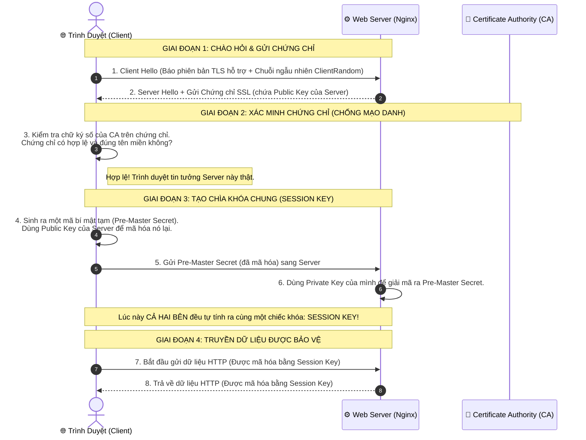

# 🔒 HTTPS & SSL/TLS: Lá Chắn Bảo Vệ Toàn Bộ Đường Truyền Web

> **HTTPS (Hypertext Transfer Protocol Secure)** là phiên bản bảo mật của giao thức HTTP.  
> Về bản chất kỹ thuật: **$\text{HTTPS} = \text{HTTP} + \text{TLS}$**  
> Toàn bộ các gói tin HTTP (URL, Header, Body, Cookie, Token) thay vì truyền đi dưới dạng văn bản rõ (plaintext) thì sẽ được bọc trong một "đường hầm" mã hóa kiên cố do giao thức **TLS (Transport Layer Security)** thiết lập.

---

## ⚠️ 1. Thảm Họa Khi Dùng HTTP Thường (Man-in-the-Middle)

Khi bạn ngồi quán cà phê và dùng mạng Wi-Fi công cộng truy cập một trang web chỉ có `http://`:

```
[ Bạn ] ────────────── (Gói tin plaintext) ──────────────> [ Server Ngân Hàng ]
                               ▲
                               │ Hacker ngồi cùng quán Wi-Fi
                               │ dùng phần mềm Wireshark bắt trộm gói tin:
                               ▼
               "POST /login: user=admin & pass=123456"
```

1. **Bị nghe lén (Eavesdropping)**: Hacker đọc được 100% mật khẩu, số thẻ tín dụng, session cookie và tin nhắn riêng tư.
2. **Bị sửa lén dữ liệu (Tampering)**: Hacker chặn gói tin lại, sửa số tài khoản người nhận tiền rồi mới chuyển tiếp đến server.
3. **Bị mạo danh (Impersonation)**: Hacker dựng một máy chủ giả mạo tên miền của bạn để lừa người dùng đăng nhập.

👉 **HTTPS ra đời để giải quyết triệt để cả 3 nguy cơ trên!**

---

## 📜 2. Phân Biệt: SSL vs. TLS (Hai Khái Niệm Hay Bị Gọi Lẫn)

Nhiều người ngày nay vẫn quen miệng gọi là *"Chứng chỉ SSL"*, nhưng thực tế:
- **SSL (Secure Sockets Layer)**: Do hãng Netscape phát triển từ năm 1995. Đã **bị khai tử hoàn toàn** vì chứa nhiều lỗ hổng bảo mật nghiêm trọng (SSL 2.0, SSL 3.0).
- **TLS (Transport Layer Security)**: Là chuẩn kế thừa hiện đại thay thế cho SSL từ năm 1999 đến nay.
  - Hiện nay toàn bộ thế giới chỉ dùng **TLS 1.2** và **TLS 1.3** (ra mắt 2018, nhanh hơn và an toàn hơn vượt bậc).
- 👉 *Tóm lại*: Ta vẫn gọi là "Chứng chỉ SSL" vì thói quen lịch sử, nhưng giao thức chạy thực tế bên dưới 100% là **TLS**.

---

## 🧠 3. Bí Mật Công Nghệ: Sự Kết Hợp Kỳ Diệu Giữa 2 Loại Mã Hóa

Một thắc mắc kinh điển: *"Tại sao HTTPS không dùng luôn mã hóa Bất đối xứng (Public/Private Key) cho xong?"*

```
┌─────────────────────────────────┐       ┌─────────────────────────────────┐
│ 1. MÃ HÓA BẤT ĐỐI XƯNG          │       │ 2. MÃ HÓA ĐỐI XỨNG              │
│    (Asymmetric: RSA / ECC)      │       │    (Symmetric: AES-256 / GCM)   │
├─────────────────────────────────┤       ├─────────────────────────────────┤
│ • Dùng 1 cặp khóa Public/Private│       │ • Dùng DUY NHẤT 1 Khóa bí mật   │
│ • Cực kỳ an toàn khi trao đổi   │       │   (Session Key) cho cả 2 chiều  │
│ ❌ TÍNH TOÁN CỰC CHẬM, TỐN CPU! │       │ 🚀 TỐC ĐỘ MÃ HÓA SIÊU NHANH!    │
└─────────────────────────────────┘       └─────────────────────────────────┘
```

> 💡 **GIẢI PHÁP THIÊN TÀI CỦA HTTPS:**  
> 1. Ở bước chào hỏi ban đầu (**Handshake**): Dùng **Mã hóa Bất đối xứng** để 2 bên thỏa thuận một chiếc "Chìa khóa bí mật dùng chung" (**Session Key**) mà không sợ hacker nghe lén được chìa khóa này.  
> 2. Kể từ lúc có Session Key: Chuyển toàn bộ sang dùng **Mã hóa Đối xứng (AES)** để truyền dữ liệu HTML, API với tốc độ cực nhanh như bay!

---

## 🤝 4. Quy Trình Bắt Tay TLS Handshake (Dưới Nắp Ca-pô)



### ⚡ Cải tiến đột phá của TLS 1.3:
- Ở chuẩn cũ (TLS 1.2), quá trình bắt tay mất **2 vòng bay đi bay về (2-RTT - Round Trip Time)**.
- Ở chuẩn **TLS 1.3**, quá trình này được tối ưu chỉ còn **1-RTT** (thậm chí **0-RTT** với tính năng Session Resumption - người dùng cũ quay lại là truyền dữ liệu ngay lập tức mà không cần bắt tay lại).

---

## 🏛️ 5. Chứng Chỉ Số & Chuỗi Tin Cậy (Chain of Trust)

Làm sao trình duyệt biết chứng chỉ gửi về đúng là của `google.com` thật chứ không phải của hacker?

1. **Certificate Authority (CA)**: Là các tổ chức uy tín toàn cầu (như *DigiCert, Let's Encrypt, Cloudflare*).
2. **Chuỗi tin cậy (Chain of Trust)**:
   - Các hệ điều hành (Windows, macOS, iOS, Android) đều cài sẵn danh sách các **Root CA** uy tín nhất thế giới trong ổ cứng.
   - Khi Server gửi chứng chỉ về, trình duyệt sẽ truy ngược chữ ký:  
     $$\text{Server Cert} \longleftarrow \text{Intermediate CA} \longleftarrow \text{Root CA (Có sẵn trong máy)}$$
   - Nếu chuỗi chữ ký này khớp -> Trình duyệt hiện **Biểu tượng Ổ Khóa An Toàn 🔒**.
   - Nếu hacker tự tạo chứng chỉ giả (Self-signed) -> Trình duyệt lập tức báo động đỏ: *"Cảnh báo: Kết nối của bạn không phải là kết nối riêng tư (NET::ERR_CERT_AUTHORITY_INVALID)"*.

---

## 🛠️ 6. Cấu Hình HTTPS Trong Thực Tế

### 1. Lấy chứng chỉ miễn phí với Let's Encrypt & Certbot
Ngày nay bạn không cần bỏ tiền triệu mua chứng chỉ SSL nữa, tổ chức phi lợi nhuận **Let's Encrypt** cấp chứng chỉ miễn phí trọn đời:

```bash
# Cài đặt Certbot trên Ubuntu
sudo apt install -y certbot python3-certbot-nginx

# Tự động lấy chứng chỉ và cấu hình thẳng vào Nginx
sudo certbot --nginx -d mydomain.com -d www.mydomain.com
```

### 2. File cấu hình Nginx chuẩn HTTPS (`nginx.conf`)
```nginx
server {
    listen 80;
    server_name mydomain.com;
    # Tự động chuyển hướng toàn bộ khách từ HTTP sang HTTPS:
    return 301 https://$host$request_uri;
}

server {
    listen 443 ssl http2;
    server_name mydomain.com;

    # Đường dẫn chứng chỉ:
    ssl_certificate /etc/letsencrypt/live/mydomain.com/fullchain.pem;
    ssl_certificate_key /etc/letsencrypt/live/mydomain.com/privkey.pem;

    # Chỉ bật các phiên bản TLS an toàn:
    ssl_protocols TLSv1.2 TLSv1.3;

    # BẬT HSTS (Ép trình duyệt luôn vào bằng HTTPS trong 1 năm):
    add_header Strict-Transport-Security "max-age=31536000; includeSubDomains" always;

    location / {
        proxy_pass http://localhost:8080;
    }
}
```

> 🛡️ **HSTS (HTTP Strict Transport Security)**: Là một header bảo mật cực mạnh. Sau khi nhận header này, trình duyệt sẽ ghi nhớ và **tự động chuyển hướng nội bộ sang HTTPS** ngay trên máy khách, ngăn chặn hoàn toàn việc người dùng vô tình bấm vào link `http://` để bị tấn công tước đoạt SSL (SSL Stripping).
