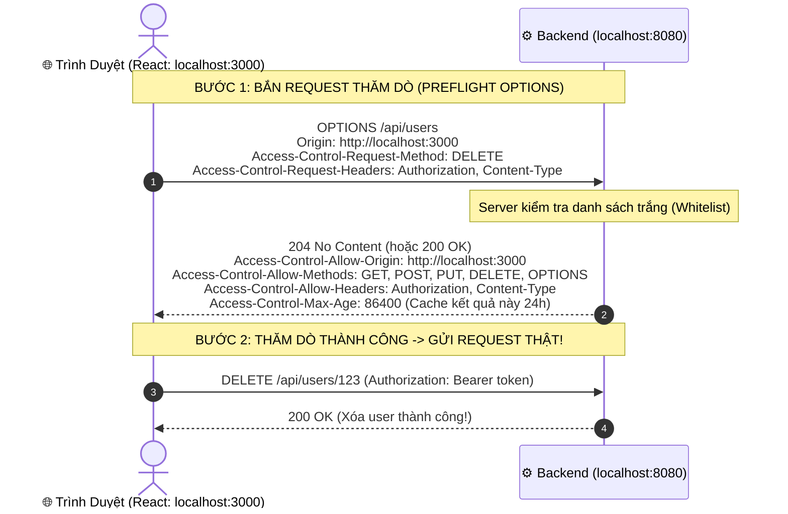

# 🌐 CORS (Cross-Origin Resource Sharing): "Cơn Ác Mộng" Của Mọi Lập Trình Viên

Gần như 100% lập trình viên Web (cả Frontend lẫn Backend) trong đời đều từng ít nhất một lần "vò đầu bứt tai" trước dòng chữ đỏ lòm này trên Console trình duyệt:

```text
Access to fetch at 'https://api.mybackend.com/users' from origin 'http://localhost:3000' 
has been blocked by CORS policy: No 'Access-Control-Allow-Origin' header is present 
on the requested resource.
```

Và câu hỏi ức chế nhất luôn là:  
> *"Tại sao lấy Postman hay curl gọi API thì chạy vèo vèo `200 OK`, mà cứ hễ mở code React/Vue/Angular gọi thì lại bị chặn đứng?"*

Bài viết này sẽ giúp bạn hiểu tận gốc bản chất của CORS và cách trị dứt điểm nó!

---

## 🛡️ 1. Gốc Rễ Mọi Chuyện: Chính Sách Cùng Nguồn Gốc (Same-Origin Policy - SOP)

Trước khi trách CORS, bạn phải cảm ơn **Same-Origin Policy (SOP)**. Đây là **lá chắn an ninh quan trọng nhất** của mọi trình duyệt web trên thế giới (Chrome, Safari, Firefox, Edge).

### 🔍 Thế nào là "Cùng Nguồn Gốc" (Same Origin)?
Hai URL được coi là "Cùng nguồn gốc" khi và chỉ khi **trùng khớp cả 3 yếu tố**:
$$\text{Origin} = \text{Giao thức (Protocol)} + \text{Tên miền (Domain/Host)} + \text{Cổng (Port)}$$

| So sánh với `https://example.com:443` | Kết quả | Lý do |
|---|---|---|
| `https://example.com/about` | ✅ **Cùng Origin** | Trùng protocol, host, port (chỉ khác đường dẫn path). |
| `http://example.com` | ❌ **Khác Origin** | Khác giao thức (`http` vs `https`). |
| `https://api.example.com` | ❌ **Khác Origin** | Khác tên miền (subdomain `api.` vs root). |
| `https://example.com:8080` | ❌ **Khác Origin** | Khác cổng (`8080` vs `443`). |
| `http://localhost:3000` vs `http://localhost:8080` | ❌ **Khác Origin** | Khác cổng (`3000` vs `8080`). |

---

### 😱 Nếu không có SOP, điều kinh hoàng gì sẽ xảy ra?
1. Bạn đăng nhập vào ngân hàng `my-bank.com`. Trình duyệt lưu cookie phiên đăng nhập của bạn.
2. Bạn mở một tab khác vào xem phim lậu trên `phim-hay.com`.
3. Trang `phim-hay.com` chạy ngầm một đoạn mã JavaScript:  
   `fetch('https://my-bank.com/api/get-balance')`.
4. Nếu không có SOP, trình duyệt sẽ tự động gửi kèm cookie ngân hàng, đọc sạch số dư và lịch sử giao dịch rồi gửi về máy chủ của hacker!
👉 **SOP ra đời để cấm JavaScript ở trang web A được phép đọc dữ liệu từ trang web B!**

---

## 🤝 2. CORS Là Gì? (Không Phải Lỗi, Mà Là Chiếc Chìa Khóa Nới Lỏng!)

Trong phát triển phần mềm hiện đại:
- Frontend chạy ở: `http://localhost:3000` (hoặc `https://myapp.com`)
- Backend API chạy ở: `http://localhost:8080` (hoặc `https://api.myapp.com`)

Vì khác Origin nên SOP lập tức can thiệp chặn lại! Nhưng đây là 2 hệ thống của cùng một công ty, làm sao để cho phép chúng nói chuyện với nhau?

> 💡 **CORS (Cross-Origin Resource Sharing)** chính là một cơ chế dùng các **HTTP Header đặc biệt** để Server nói với Trình duyệt:  
> *"Này trình duyệt, tôi là Backend! Tôi xác nhận cho phép trang web `http://localhost:3000` được quyền đọc dữ liệu của tôi. Hãy mở cửa cho nó đi!"*

---

## ⚡ 3. Tại Sao Postman Chạy Được Mà Trình Duyệt Lại Bị Chặn?

Đây là điều gây hiểu nhầm nhiều nhất:

```
[ POSTMAN ] ──────────────────> [ BACKEND SERVER ] ──────────────────> 200 OK (Chạy bình thường!)
(Không có khái niệm SOP)

[ TRÌNH DUYỆT (React) ] ──────> [ BACKEND SERVER ] (Server VẪN XỬ LÝ XONG VÀ TRẢ DỮ LIỆU VỀ!)
                                       │
                                       ▼ (Gói tin về tới Trình duyệt)
                          [ BẢO VỆ TRÌNH DUYỆT (SOP Engine) ]
                          "Đợi đã! Không thấy Server đính kèm header
                           Access-Control-Allow-Origin! -> VỨT BỎ DỮ LIỆU & BÁO LỖI CORS!"
```

> 🛑 **SỰ THẬT:**  
> **CORS do TRÌNH DUYỆT thực thi, KHÔNG PHẢI SERVER chặn!**  
> Khi bị lỗi CORS, thực tế là request của bạn **đã chạm tới Backend, Backend thậm chí đã xử lý xong và trả về kết quả**. Nhưng khi kết quả về tới cửa trình duyệt, thấy thiếu header cho phép, trình duyệt liền vứt kết quả vào sọt rác và ném lỗi màu đỏ lên màn hình!

---

## 🚦 4. Yêu Cầu Đơn Giản (Simple Request) vs. Yêu Cầu Thăm Dò (Preflight Request)

Trình duyệt phân loại request gọi chéo Origin làm 2 loại:

### 1. Request Đơn Giản (Simple Request)
- Dùng method: `GET`, `POST`, `HEAD`.
- Content-Type chỉ là: `text/plain`, `multipart/form-data`, hoặc `application/x-www-form-urlencoded`.
- Trình duyệt sẽ gửi request đi ngay, chỉ cần server trả về header:
  ```http
  Access-Control-Allow-Origin: *
  ```

---

### 2. Request Thăm Dò (Preflight Request - `OPTIONS`)
Hầu hết các API hiện đại ngày nay đều:
- Dùng Content-Type: **`application/json`**.
- Có đính kèm Header tự chế hoặc xác thực: **`Authorization: Bearer <token>`**.
- Dùng method: **`PUT`, `DELETE`, `PATCH`**.

Lúc này, trình duyệt sẽ **không dại dột gửi request thật ngay**, mà tự động bắn một request giả định bằng method **`OPTIONS`** để "thăm dò" server trước:



---

## 💣 5. "Cái Bẫy Chết Người" Khi Gửi Kèm Cookie (`withCredentials`)

Khi bạn muốn gửi Cookie hoặc Session qua API khác domain:
- Ở Frontend: Bạn cấu hình `axios.defaults.withCredentials = true;` (hoặc `fetch(url, { credentials: 'include' })`).
- Lúc này, Server **BẮT BUỘC** phải trả về 2 header:
  ```http
  Access-Control-Allow-Origin: http://localhost:3000
  Access-Control-Allow-Credentials: true
  ```

> 🛑 **LỖI KINH ĐIỂN:**  
> Nếu bạn cấu hình Server dùng dấu sao: **`Access-Control-Allow-Origin: *`**  
> 👉 **Trình duyệt sẽ lập tức quăng lỗi crash ngay!**  
> Chuẩn an ninh thế giới quy định: **Khi đã bật `Allow-Credentials: true`, TUYỆT ĐỐI KHÔNG ĐƯỢC dùng dấu sao `*`**. Bạn phải chỉ đích danh tên miền của Frontend (`http://localhost:3000`).

---

## 🛠️ 6. Cách Cấu Hình CORS Chuẩn Nhất Cho Backend

### ☕ Trong Spring Boot (Java)
Cách chuyên nghiệp nhất là cấu hình tập trung trong `SecurityConfig`:

```java
@Configuration
public class WebSecurityConfig {

    @Bean
    public SecurityFilterChain filterChain(HttpSecurity http) throws Exception {
        http
            .cors(cors -> cors.configurationSource(corsConfigurationSource()))
            .csrf(csrf -> csrf.disable())
            .authorizeHttpRequests(auth -> auth.anyRequest().authenticated());
        return http.build();
    }

    @Bean
    public CorsConfigurationSource corsConfigurationSource() {
        CorsConfiguration config = new CorsConfiguration();
        // Chỉ định danh các tên miền Frontend được phép:
        config.setAllowedOrigins(List.of("http://localhost:3000", "https://mycompany.com"));
        // Cho phép các method:
        config.setAllowedMethods(List.of("GET", "POST", "PUT", "DELETE", "OPTIONS"));
        // Cho phép các header:
        config.setAllowedHeaders(List.of("Authorization", "Content-Type", "X-Requested-With"));
        // Bật cho phép gửi Cookie/Token:
        config.setAllowCredentials(true);
        // Cache kết quả preflight 1 tiếng:
        config.setMaxAge(3600L);

        UrlBasedCorsConfigurationSource source = new UrlBasedCorsConfigurationSource();
        source.registerCorsConfiguration("/**", config);
        return source;
    }
}
```

---

### 🌐 Trong Nginx (Reverse Proxy)
Nếu không muốn sửa code backend, bạn có thể xử lý thẳng ở tầng Nginx:

```nginx
server {
    listen 80;
    server_name api.mycompany.com;

    location / {
        # Đính kèm header cho các request thông thường:
        add_header 'Access-Control-Allow-Origin' 'https://mycompany.com' always;
        add_header 'Access-Control-Allow-Methods' 'GET, POST, PUT, DELETE, OPTIONS' always;
        add_header 'Access-Control-Allow-Headers' 'Authorization, Content-Type' always;
        add_header 'Access-Control-Allow-Credentials' 'true' always;

        # Xử lý riêng cho Preflight Request (OPTIONS) trả về ngay lập tức:
        if ($request_method = 'OPTIONS') {
            add_header 'Access-Control-Allow-Origin' 'https://mycompany.com';
            add_header 'Access-Control-Allow-Methods' 'GET, POST, PUT, DELETE, OPTIONS';
            add_header 'Access-Control-Allow-Headers' 'Authorization, Content-Type';
            add_header 'Access-Control-Allow-Credentials' 'true';
            add_header 'Access-Control-Max-Age' 86400;
            add_header 'Content-Length' 0;
            add_header 'Content-Type' 'text/plain charset=UTF-8';
            return 204;
        }

        proxy_pass http://localhost:8080;
    }
}
```

---

## 🎯 7. Tóm Tắt Trong 3 Câu

1. **CORS không phải là lỗi**: Nó là cơ chế an ninh do **Trình duyệt** đứng ra bảo vệ người dùng, Server muốn cho phép thì phải "cấp giấy thông hành" qua các header `Access-Control-*`.
2. **Postman không bị CORS** vì Postman là phần mềm thử nghiệm API độc lập, không có cơ chế bảo vệ SOP như trình duyệt.
3. Khi gửi API có kèm Cookie/Token: **Tuyệt đối không dùng `Allow-Origin: *`**, bắt buộc phải ghi rõ tên miền Frontend và bật `Allow-Credentials: true`.
