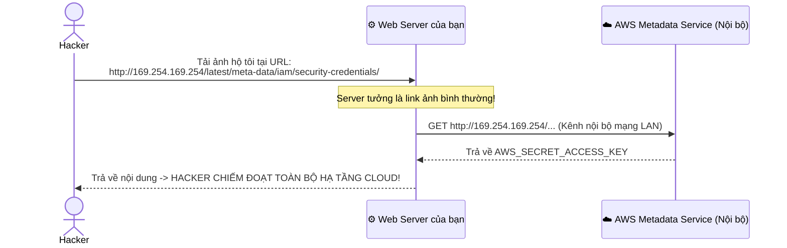

# ☠️ OWASP Top 10: "Bảng Phong Thần" 10 Lỗ Hổng Bảo Mật Nguy Hiểm Nhất

> **OWASP (Open Worldwide Application Security Project)** là tổ chức phi lợi nhuận uy tín số 1 thế giới về an ninh phần mềm.  
> Định kỳ, OWASP công bố danh sách **OWASP Top 10** — tổng hợp 10 lỗ hổng bảo mật ứng dụng web phổ biến và gây thiệt hại nặng nề nhất trên toàn cầu. Đây là tiêu chuẩn bắt buộc trong mọi cuộc kiểm toán an ninh ngân hàng và doanh nghiệp (PCI-DSS, ISO 27001, SOC2).

Dưới đây là bản cập nhật chuẩn quốc tế mới nhất kèm theo **ví dụ code bị lỗi & cách khắc phục cho Backend**:

---

## 🗺️ Bản Đồ OWASP Top 10 Mới Nhất

```mermaid
graph TD
    classDef danger fill:#7f1d1d,stroke:#ef4444,stroke-width:2px,color:#fee2e2,font-weight:bold;
    classDef warning fill:#78350f,stroke:#f59e0b,stroke-width:2px,color:#fef3c7,font-weight:bold;
    classDef info fill:#1e293b,stroke:#38bdf8,stroke-width:2px,color:#f0f9ff,font-weight:bold;

    A01["🥇 A01: Broken Access Control<br/>(Phá vỡ kiểm soát quyền)"]:::danger
    A02["🥈 A02: Cryptographic Failures<br/>(Lỗi mật mã học)"]:::danger
    A03["🥉 A03: Injection<br/>(SQLi, Command Injection)"]:::danger
    A04["A04: Insecure Design<br/>(Lỗi kiến trúc ngay từ thiết kế)"]:::warning
    A05["A05: Security Misconfiguration<br/>(Lỗi cấu hình hệ thống)"]:::warning
    A06["A06: Vulnerable Components<br/>(Thư viện bên thứ 3 dính lỗi - Log4j)"]:::warning
    A07["A07: Auth Failures<br/>(Lỗi xác thực & Session)"]:::info
    A08["A08: Software Integrity Failures<br/>(Lỗi toàn vẹn mã nguồn & Deserialization)"]:::info
    A09["A09: Logging & Monitoring Failures<br/>(Lỗi không ghi log giám sát)"]:::info
    A10["A10: SSRF<br/>(Server-Side Request Forgery)"]:::info
```



---

## 🥇 1. A01: Broken Access Control (Phá Vỡ Kiểm Soát Quyền - Lỗ Hổng Số 1 Thế Giới)

Đứng vị trí số 1 trong danh sách. Xảy ra khi server **không kiểm tra xem người dùng có thực sự sở hữu hoặc có quyền xem dữ liệu đó hay không**.

### Điển hình: Lỗ hổng IDOR (Insecure Direct Object Reference)
- Hacker đăng nhập tài khoản của mình (ID = 105).
- Hacker thấy URL xem hóa đơn: `GET /api/invoices/105`.
- Hacker đổi số `105` thành `106`, `107` trên thanh địa chỉ và xem được sạch hóa đơn mua hàng của người khác!

```java
// ❌ CODE LỖI: Chỉ tìm theo ID mà không kiểm tra quyền sở hữu
@GetMapping("/invoices/{id}")
public Invoice getInvoice(@PathVariable Long id) {
    return invoiceRepository.findById(id); // AI CŨNG XEM ĐƯỢC NẾU BIẾT ID!
}

// ✅ CODE ĐÚNG: Bắt buộc đối chiếu với User đang đăng nhập
@GetMapping("/invoices/{id}")
public Invoice getInvoice(@PathVariable Long id, @AuthenticationPrincipal User currentUser) {
    return invoiceRepository.findByIdAndUserId(id, currentUser.getId())
        .orElseThrow(() -> new AccessDeniedException("Bạn không có quyền xem hóa đơn này!"));
}
```

---

## 🥈 2. A02: Cryptographic Failures (Lỗi Mật Mã Học)

Trước đây gọi là "Lộ dữ liệu nhạy cảm" (Sensitive Data Exposure).
- **Lỗi phổ biến**: 
  - Truyền dữ liệu tài khoản, thẻ ngân hàng qua `HTTP` không mã hóa.
  - Lưu mật khẩu trong DB bằng `MD5`, `SHA-1` hoặc tệ hơn là dạng chữ rõ (plaintext).
  - Dùng thuật toán mã hóa cổ lỗ sĩ (DES, RC4).
- **Cách phòng chống**: Bắt buộc HTTPS (TLS 1.3), dùng `bcrypt`/`Argon2` để băm mật khẩu, mã hóa dữ liệu nhạy cảm trong DB bằng `AES-256-GCM`.

---

## 🥉 3. A03: Injection (SQL Injection & Command Injection)

Dù đã tồn tại hơn 20 năm, lỗi này vẫn nằm trong Top 3. Xảy ra khi lập trình viên **ghép chuỗi người dùng nhập thẳng vào câu lệnh SQL**.

```java
// ❌ CODE LỖI KINH ĐIỂN (SQL INJECTION):
String sql = "SELECT * FROM users WHERE username = '" + username + "' AND password = '" + password + "'";
// Nếu hacker nhập username: admin' --
// Câu lệnh trở thành: SELECT * FROM users WHERE username = 'admin' --' ...
// Dấu -- biến phần còn lại thành comment -> ĐĂNG NHẬP VÀO ADMIN KHÔNG CẦN PASS!

// ✅ CODE ĐÚNG: Luôn dùng Parameterized Queries (PreparedStatement)
String sql = "SELECT * FROM users WHERE username = ? AND password = ?";
PreparedStatement stmt = connection.prepareStatement(sql);
stmt.setString(1, username); // Database xử lý dữ liệu như giá trị thuần, không thực thi mã!
stmt.setString(2, password);
```

---

## 🏗️ 4. A04: Insecure Design (Lỗi Thiết Kế Ngay Từ Gốc)

Khác với lỗi code (bug), đây là **lỗi ở khâu thiết kế nghiệp vụ**.
- **Ví dụ**: Tính năng mua hàng thương mại điện tử cho phép người dùng truyền số lượng âm: `quantity = -5`, dẫn đến việc giỏ hàng bị trừ tiền âm (người dùng được cộng thêm tiền vào tài khoản!).
- **Ví dụ 2**: Thiết kế API quên mật khẩu nhưng không giới hạn số lần gửi OTP (không có Rate Limiting), dẫn đến hacker dùng bot bắn nổ hộp thư SMS/Email của nạn nhân.

---

## ⚙️ 5. A05: Security Misconfiguration (Lỗi Cấu Hình Hệ Thống)

Chiếm tỷ lệ rất cao do sự bất cẩn của đội ngũ triển khai:
- Để lộ file `.git` hoặc file `.env` trên thư mục web công khai (`example.com/.env`).
- Bật chế độ **Debug / Stack Trace** trên môi trường Production: Khi có lỗi xảy ra, server in nguyên văn câu lệnh SQL, tên bảng, phiên bản Java/PHP và đường dẫn file lên màn hình cho hacker xem!
- Để mật khẩu mặc định của database: `postgres:postgres` hoặc `admin:admin`.

---

## 📦 6. A06: Vulnerable and Outdated Components (Lỗ Hổng Thư Viện Bên Thứ 3)

Một ứng dụng hiện đại sử dụng hàng trăm thư viện mã nguồn mở (npm, Maven, pip).
- **Ví dụ kinh hoàng**: Lỗ hổng **Log4Shell (CVE-2021-44228)** trong thư viện Java Log4j năm 2021 cho phép hacker chiếm quyền điều khiển máy chủ chỉ bằng một dòng chat text!
- **Phòng chống**: Sử dụng các công cụ quét tự động trong CI/CD: **GitHub Dependabot, Snyk, OWASP Dependency-Check**.

---

## 🔑 7. A07: Identification and Authentication Failures (Lỗi Xác Thực)

- Cho phép người dùng đặt mật khẩu quá yếu: `123456`, `password`.
- **Không chặn Brute-force**: Cho phép hacker thử mật khẩu 1 triệu lần liên tục mà không bị khóa tài khoản hoặc bắt nhập Captcha.
- Sau khi người dùng bấm "Đăng xuất", Token JWT vẫn không bị thu hồi và vẫn tiếp tục dùng được.

---

## 🧱 8. A08: Software and Data Integrity Failures (Lỗi Toàn Vẹn Dữ Liệu)

- Lỗ hổng **Unsafe Deserialization** (Giải mã đối tượng không an toàn): Ứng dụng đọc dữ liệu serialize (như Java `ObjectInputStream` hoặc Python `pickle`) trực tiếp từ người dùng mà không kiểm tra chữ ký số, dẫn đến hacker gửi một chuỗi bytecode để server thực thi mã độc từ xa (RCE).
- Tự động cập nhật phần mềm hoặc plugin từ một đường link không có HTTPS hoặc không xác minh mã băm (Checksum).

---

## 📋 9. A09: Security Logging and Monitoring Failures (Lỗi Không Ghi Log & Giám Sát)

> Theo thống kê của các hãng an ninh, trung bình một hệ thống bị hacker xâm nhập phải mất **hơn 200 ngày** thì ban quản trị mới phát hiện ra!

- Lỗi xảy ra khi: Hacker thử dò mật khẩu admin hàng trăm nghìn lần nhưng hệ thống **hoàn toàn không ghi log cảnh báo**, không gửi thông báo qua Slack/Telegram cho kỹ sư trực ca.
- **Phòng chống**: Ghi log đầy đủ các sự kiện quan trọng (đăng nhập thất bại, đổi mật khẩu, giao dịch lớn), đẩy log về hệ thống tập trung (ELK Stack, Grafana Loki, Datadog) và thiết lập cảnh báo tự động.

---

## 🎯 10. A10: Server-Side Request Forgery (SSRF - Lừa Server Làm Tay Trong)

Xảy ra khi ứng dụng có tính năng **bắt máy chủ tự tải một tài nguyên từ một URL do người dùng cung cấp**.

- **Tính năng**: "Nhập URL ảnh đại diện trên mạng để hệ thống tải về lưu vào hồ sơ".
- **Đòn tấn công của Hacker**: Thay vì nhập link ảnh, hacker nhập:  
  `http://169.254.169.254/latest/meta-data/`  
  *(Đây là địa chỉ IP nội bộ của dịch vụ AWS Cloud Metadata).*
- Server ngây thơ tự mình gửi request tới IP nội bộ đó, lấy được toàn bộ **AWS Secret Access Key** của hệ thống đám mây rồi trả về cho hacker!



---

## 🏆 Bảng Tóm Tắt Khắc Phục OWASP Top 10 Cho Backend

| Lỗ hổng | Giải pháp then chốt |
|---|---|
| **A01: Broken Access Control** | Luôn kiểm tra quyền sở hữu bản ghi `WHERE user_id = :currentUserId`. |
| **A02: Cryptographic Failures** | Bắt buộc HTTPS, băm pass bằng `bcrypt`/`Argon2`, mã hóa data bằng `AES-GCM`. |
| **A03: Injection** | **Không bao giờ ghép chuỗi SQL**. Luôn dùng `PreparedStatement` hoặc ORM. |
| **A04: Insecure Design** | Thiết kế nghiệp vụ chặt chẽ, kiểm tra logic âm/dương, thêm Rate Limit. |
| **A05: Security Misconfiguration** | Tắt Debug mode trên Prod, giấu file `.env`, đổi tài khoản mặc định. |
| **A06: Vulnerable Components** | Cài Dependabot / Snyk tự động quét và nâng cấp thư viện lỗi thời. |
| **A07: Auth Failures** | Bắt buộc mật khẩu mạnh, chặn Brute-force (Rate Limit / Captcha), hỗ trợ 2FA. |
| **A08: Integrity Failures** | Tránh deserialization dữ liệu lạ, kiểm tra checksum và chữ ký số. |
| **A09: Logging Failures** | Ghi log mọi hành động nhạy cảm, thiết lập cảnh báo Telegram/Slack khi bị tấn công. |
| **A10: SSRF** | Chặn server không được gửi request tới các dải IP nội bộ (`10.0.0.0/8`, `192.168.0.0/16`, `169.254.169.254`). |
