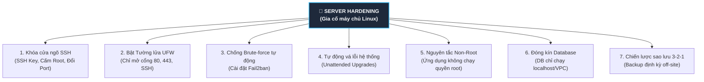

# 🖥️ Server Security & Hardening (Gia Cố Bảo Mật Máy Chủ Linux)

> Khi bạn vừa tạo một máy chủ ảo (VPS) trên AWS, DigitalOcean, Hetzner hay Linode và có một địa chỉ IP công khai, **chỉ trong vòng 5 phút**, hàng nghìn con bot tự động từ khắp nơi trên thế giới sẽ bắt đầu quét cổng và tấn công Brute-force liên tục vào máy chủ của bạn!  
> Dù code Backend hay Database của bạn có bảo mật đến đâu, **nếu máy chủ bị chiếm quyền Root thì toàn bộ hệ thống xem như sập hoàn toàn**.

Dưới đây là cẩm nang **Gia cố bảo mật máy chủ Linux (Server Hardening)** chuẩn DevOps thực chiến:

---

## 🏰 1. Bảy Trụ Cột Gia Cố Máy Chủ (Server Hardening Checklist)



---

## 🔑 2. Trụ Cột 1: Khóa Chặt Cửa Ngõ SSH (`/etc/ssh/sshd_config`)

SSH (cổng 22) là con đường duy nhất để bạn quản trị máy chủ, nhưng cũng là mục tiêu bị dò mật khẩu nhiều nhất:

### Bước 1: Tạo cặp khóa SSH Key trên máy cá nhân
Tuyệt đối không dùng mật khẩu dạng chữ! Hãy dùng thuật toán mã hóa hiện đại nhất **Ed25519**:

```bash
# Chạy trên máy cá nhân của bạn:
ssh-keygen -t ed25519 -C "admin@mycompany.com"

# Copy Public Key lên máy chủ:
ssh-copy-id -i ~/.ssh/id_ed25519.pub deployer@YOUR_SERVER_IP
```

### Bước 2: Khóa chết đăng nhập mật khẩu trên Server
Mở file cấu hình SSH trên máy chủ: `sudo nano /etc/ssh/sshd_config` và sửa các dòng sau:

```text
# 1. Đổi cổng mặc định từ 22 sang một cổng khác (giảm 99% bot quét tự động):
Port 2222

# 2. CẤM TUYỆT ĐỐI đăng nhập trực tiếp bằng tài khoản root:
PermitRootLogin no

# 3. CẤM TUYỆT ĐỐI đăng nhập bằng mật khẩu (chỉ cho phép dùng SSH Key):
PasswordAuthentication no

# 4. Giới hạn số lần thử gõ sai:
MaxAuthTries 3
```

Khởi động lại dịch vụ SSH:
```bash
sudo systemctl restart sshd
```

---

## 🧱 3. Trụ Cột 2: Thiết Lập Tường Lửa (UFW - Uncomplicated Firewall)

Triết lý an ninh mạng là: **Mặc định đóng tất cả, chỉ mở đúng những cổng thực sự cần thiết!**

```bash
# 1. Thiết lập mặc định: Chặn toàn bộ kết nối vào, cho phép kết nối ra ngoài:
sudo ufw default deny incoming
sudo ufw default allow outgoing

# 2. Mở cổng SSH mới đổi (ví dụ cổng 2222):
sudo ufw allow 2222/tcp comment "Custom SSH Port"

# 3. Mở cổng Web HTTP (80) và HTTPS (443):
sudo ufw allow 80/tcp comment "HTTP"
sudo ufw allow 443/tcp comment "HTTPS"

# 4. BẬT TƯỜNG LỬA:
sudo ufw enable

# Kiểm tra trạng thái:
sudo ufw status verbose
```

> 🛑 **QUY TẮC SỐNG CÒN VỀ DATABASE:**  
> **CẤM TUYỆT ĐỐI mở cổng Database ra Internet!**  
> Cổng PostgreSQL (`5432`), MySQL (`3306`), Redis (`6379`) **không bao giờ được phép `ufw allow`**. Chúng chỉ được phép lắng nghe trên `localhost` (`127.0.0.1`) hoặc mạng riêng nội bộ (Private VPC) của ứng dụng.

---

## 🚫 4. Trụ Cột 3: Tự Động Bỏ Tù Kẻ Xâm Nhập Bằng Fail2ban

Kể cả khi bạn đã đổi cổng, hacker vẫn có thể quét ra và dùng bot bắn hàng nghìn lượt đăng nhập thử.  
👉 **`Fail2ban`** là một "vệ sĩ" tự động đọc file log của hệ thống (`/var/log/auth.log`). Nếu phát hiện 1 IP gõ sai thông tin đăng nhập **quá 5 lần trong vòng 10 phút**, Fail2ban sẽ **tự động thêm IP đó vào danh sách đen của tường lửa để chặn (block) trong 24 giờ!**

```bash
# Cài đặt Fail2ban trên Ubuntu:
sudo apt install -y fail2ban

# Khởi động dịch vụ:
sudo systemctl enable --now fail2ban

# Xem danh sách các IP đang bị "tống giam":
sudo fail2ban-client status sshd
```

---

## 🔄 5. Trụ Cột 4: Tự Động Cập Nhật Vá Lỗi Kernel (Unattended Upgrades)

Hàng tuần, hệ điều hành Linux (Ubuntu/Debian) đều phát hiện các lỗ hổng bảo mật mới (CVE). Nếu bạn không update thường xuyên, server sẽ thành mồi ngon cho hacker.

Bật chế độ **tự động cập nhật các bản vá an ninh quan trọng trong đêm**:

```bash
sudo apt install -y unattended-upgrades
sudo dpkg-reconfigure --priority=low unattended-upgrades
```

---

## 👤 6. Trụ Cột 5: Nguyên Tắc Non-Root Cho Ứng Dụng Backend

Nhiều bạn có thói quen gõ `sudo java -jar app.jar` hoặc chạy container Docker dưới quyền `root`.

> ⚠️ **HẬU QUẢ:**  
> Nếu code Spring Boot hoặc Node.js của bạn dính lỗ hổng Remote Code Execution (như Log4Shell), hacker sẽ có ngay **quyền lực tối cao Root** của cả hệ điều hành, có thể format ổ cứng hoặc mã hóa tống tiền dữ liệu!

👉 **Luôn tạo một User riêng có quyền thấp để chạy ứng dụng**:
```bash
# Tạo user riêng tên là "appuser", không có quyền sudo:
sudo useradd -r -s /bin/false appuser

# Trao quyền sở hữu thư mục code cho user này:
sudo chown -R appuser:appuser /opt/my-backend/
```

Trong file cấu hình dịch vụ Systemd (`/etc/systemd/system/backend.service`):
```ini
[Service]
User=appuser
Group=appuser
ExecStart=/usr/bin/java -jar /opt/my-backend/app.jar
Restart=always
```

---

## 💾 7. Trụ Cột 6: Chiến Lược Sao Lưu Dữ Liệu "3-2-1"

Phòng thủ tốt đến đâu thì nguy cơ phần cứng bị cháy hoặc hacker xóa sạch dữ liệu vẫn có thể xảy ra. Hãy tuân thủ quy tắc vàng:

```
┌────────────────────────────────────────────────────────┐
│             CHIẾN LƯỢC SAO LƯU 3-2-1                    │
├────────────────────────────────────────────────────────┤
│ • 3: Luôn giữ ít nhất 3 bản copy dữ liệu.              │
│ • 2: Lưu trên 2 loại thiết bị/ổ cứng khác nhau.        │
│ • 1: Bắt buộc có ÍT NHẤT 1 BẢN LƯU OFF-SITE             │
│      (ở nhà cung cấp Cloud hoặc Data Center khác!).    │
└────────────────────────────────────────────────────────┘
```
*Ví dụ*: Server chạy trên DigitalOcean thì bản backup database nén tự động mỗi đêm phải được đẩy sang dịch vụ lưu trữ AWS S3 hoặc Cloudflare R2!

---

## 🎯 8. Bảng Tóm Tắt 5 Phút Gia Cố Máy Chủ

| Thành phần | Trạng thái mặc định (Nguy hiểm) | Sau khi gia cố (Chuẩn an ninh) |
|---|---|---|
| **Tài khoản SSH** | Dùng password thông thường | 🔒 **Chỉ dùng SSH Key Ed25519** |
| **Quyền Root SSH** | Cho phép đăng nhập `root` | 🔒 **Cấm tuyệt đối (`PermitRootLogin no`)** |
| **Cổng SSH** | Port 22 (ai cũng biết) | 🔒 **Đổi sang cổng tùy chọn (vd: 2222)** |
| **Tường lửa** | Tắt hoặc mở toang | 🔒 **Bật UFW: Chỉ mở 80, 443 và SSH** |
| **Database Port** | Mở cổng `5432` ra ngoài | 🔒 **Khóa kín, chỉ nghe trên `127.0.0.1`** |
| **Brute-force SSH** | Hacker thử hàng triệu lần | 🔒 **Cài Fail2ban tự động ban IP sau 5 lần sai** |
| **Quyền chạy Backend**| Chạy bằng quyền `root` | 🔒 **Chạy bằng User riêng biệt quyền thấp** |
