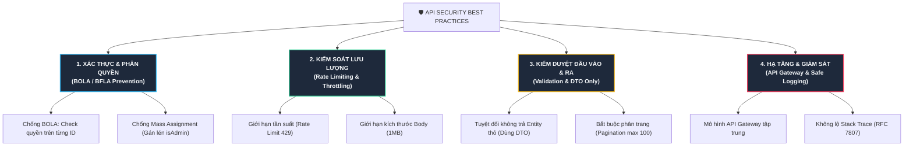

# 🛡️ API Security Best Practices: Cẩm Nang Bảo Vệ API Chuẩn Doanh Nghiệp

> Trong kỷ nguyên Microservices, Mobile App và Single Page App (React/Vue), **API chính là "cửa ngõ" phơi bày toàn bộ dữ liệu và logic kinh doanh ra thế giới**.  
> Khác với website truyền thống (có trình duyệt hỗ trợ một phần bảo vệ), **API bị gọi trực tiếp bởi các dòng code, bot tự động, script Python và Postman**. Do đó, bảo vệ API đòi hỏi các quy tắc nghiêm ngặt và chuyên biệt hơn rất nhiều.

Dưới đây là **10 tiêu chuẩn vàng (Best Practices)** để xây dựng hệ thống API an toàn chuẩn công nghiệp:

---

## 🗺️ Bản Đồ 10 Trụ Cột Bảo Mật API



---

## 🥇 1. Chống Lỗ Hổng Số 1 Của API: BOLA (Broken Object Level Authorization)

Theo bảng xếp hạng **OWASP API Security Top 10**, BOLA (hay còn gọi là IDOR) là lỗ hổng xảy ra nhiều nhất và gây hậu quả nặng nề nhất.

- **Kịch bản**: Hacker đổi ID trên endpoint: `GET /api/v1/orders/105` thành `GET /api/v1/orders/106` và đọc được đơn hàng của người khác.

```java
// ❌ NGUY HIỂM: Chỉ tìm theo ID
@GetMapping("/orders/{id}")
public OrderDTO getOrder(@PathVariable Long id) {
    return orderService.findById(id); // AI CŨNG XEM ĐƯỢC NẾU BIẾT ID!
}

// ✅ CHUẨN AN NINH: Luôn kiểm tra quyền sở hữu với User hiện tại
@GetMapping("/orders/{id}")
public OrderDTO getOrder(@PathVariable Long id, @AuthenticationPrincipal UserDetails user) {
    return orderService.findByIdAndUserEmail(id, user.getUsername())
        .orElseThrow(() -> new ResourceNotFoundException("Không tìm thấy đơn hàng!"));
}
```

---

## 🚫 2. Chống Tấn Công Gán Lén Quyền Lực (Mass Assignment)

Xảy ra khi Backend tự động ánh xạ (auto-bind) toàn bộ JSON gửi lên vào thẳng Database Model:

- Người dùng gửi request đăng ký tài khoản:
  ```json
  {
    "username": "hacker123",
    "password": "Password@123",
    "role": "SUPER_ADMIN"  // <-- Hacker tự thêm trường này vào JSON!
  }
  ```
- Nếu backend lưu trực tiếp model:
  ```java
  // ❌ NGUY HIỂM: Entity User có thuộc tính 'role', và framework tự gán 'SUPER_ADMIN'!
  userRepository.save(new User(request));
  ```

👉 **Best Practice**: **Tuyệt đối KHÔNG DÙNG Entity làm Request Body!**  
Luôn tạo các class **DTO riêng biệt (Data Transfer Object)** chỉ chứa những trường cho phép người dùng nhập (`RegisterRequestDTO` chỉ có `username`, `password`, không có trường `role`).

---

## 🛑 3. Giới Hạn Tần Suất Gọi API (Rate Limiting & Throttling)

Nếu không có Rate Limiting:
- Hacker có thể chạy script gửi 10.000 request/giây làm sập database (DDoS).
- Bot có thể quét vét sạch sản phẩm trên web (Web Scraping).
- Hacker có thể Brute-force mật khẩu hoặc mã OTP.

### Cách triển khai chuẩn:
1. **Dùng thuật toán Token Bucket / Sliding Window với Redis**:
   - Giới hạn: *Mỗi IP hoặc mỗi API Key chỉ được gọi tối đa 100 requests / phút*.
   - Với các API nhạy cảm (Đăng nhập, Quên mật khẩu): Giới hạn nghiêm ngặt hơn: *Tối đa 5 lần / phút*.
2. **Trả về HTTP Status Code chuẩn**:
   - Khi vượt quá giới hạn: Trả về **`429 Too Many Requests`**.
   - Kèm theo header: `Retry-After: 60` (Báo cho client biết phải đợi 60 giây nữa).

---

## 📦 4. Chống Rò Rỉ Dữ Liệu (Excessive Data Exposure & DTO Mappers)

Nhiều lập trình viên lười biếng viết API trả thẳng nguyên Entity từ Database ra ngoài:

```java
// ❌ CỰC KỲ NGUY HIỂM:
@GetMapping("/users/{id}")
public User getUser(@PathVariable Long id) {
    return userRepository.findById(id); 
    // Trả về cả: password_hash, số CCCD, reset_token, secret_key lưu trong bảng User!
}
```

Dù Frontend chỉ hiển thị Tên và Email, nhưng hacker mở tab **Network F12** lên là thấy sạch sành sanh các thông tin mật trong JSON!

👉 **Best Practice**:
- Luôn map qua DTO: `UserResponseDTO` chỉ chứa `id`, `fullName`, `avatarUrl`.
- Dùng thư viện ánh xạ an toàn: **MapStruct** (Java) hoặc class transformer.

---

## 📄 5. Bắt Buộc Phân Trang (Pagination) & Giới Hạn Kích Thước Body

### 1. Phân trang bắt buộc
- **CẤM TUYỆT ĐỐI**: Các API trả về danh sách không giới hạn: `GET /api/products` (nếu DB có 1 triệu sản phẩm, server sẽ nghẽn RAM và sập ngay lập tức!).
- **Quy tắc**: Luôn có tham số `page` và `size`, đồng thời **ép cứng `max_size` ở Backend** (ví dụ: client đòi `size=100000` thì server chỉ cho tối đa `size=100`).

### 2. Giới hạn Payload Size (Kích thước Body)
- Hacker có thể gửi một file JSON nặng 100MB chứa hàng triệu mảng lồng nhau để làm tràn bộ nhớ máy chủ (Buffer Overflow / DoS).
- Cấu hình giới hạn cứng trong Nginx hoặc Spring Boot:
  ```yaml
  # Trong application.yml (Spring Boot):
  spring:
    servlet:
      multipart:
        max-file-size: 5MB
        max-request-size: 10MB
  ```
  ```nginx
  # Trong Nginx:
  client_max_body_size 10M;
  ```

---

## 🎭 6. Chuẩn Hóa Thông Báo Lỗi (Không Lộ Stack Trace)

Khi hệ thống gặp lỗi ngoại lệ (Exception), tuyệt đối không bao giờ trả về nguyên bản vết lỗi hệ thống (Stack Trace):

```json
// ❌ LỖI RÒ RỈ THÔNG TIN KỸ THUẬT:
{
  "error": "org.postgresql.util.PSQLException: ERROR: relation \"tbl_users_secret\" does not exist at line 1. Connection: 192.168.1.50..."
}
```
*(Hacker nhìn thấy ngay bạn đang dùng PostgreSQL, biết được IP nội bộ và tên bảng trong DB!)*

👉 **Chuẩn quốc tế RFC 7807 (Problem Details for HTTP APIs)**:
```json
// ✅ CHUẨN AN TOÀN:
{
  "type": "https://api.mycompany.com/errors/internal-error",
  "title": "Internal Server Error",
  "status": 500,
  "detail": "Đã có lỗi xảy ra trong quá trình xử lý, vui lòng thử lại sau.",
  "timestamp": "2026-10-25T14:30:00Z",
  "traceId": "c8a3-49ef-b021" // Dùng traceId này để Dev tra trong log nội bộ
}
```

---

## 🚪 7. Kiến Trúc API Gateway Tập Trung

Trong hệ thống Microservices, **không bao giờ để các service nội bộ mở cổng trực tiếp ra Internet**:

```
[ Mobile / Web Client ]
          │
          ▼ (HTTPS)
┌────────────────────────────────────────────────────────┐
│                   API GATEWAY                          │
│   (Kong / Spring Cloud Gateway / AWS API Gateway)      │
├────────────────────────────────────────────────────────┤
│ • Chặn IP xấu, WAF, Chống DDoS                         │
│ • Kiểm tra Token JWT / OAuth2 tập trung                │
│ • Giới hạn Rate Limiting                               │
│ • Định tuyến (Routing) vào mạng nội bộ                 │
└──────────────────────┬─────────────────────────────────┘
                       │ (Mạng Private LAN / mTLS)
        ┌──────────────┼──────────────┐
        ▼              ▼              ▼
  [ User Service ] [ Order Service ] [ Payment Service ]
```

- Mọi chốt chặn an ninh (Rate Limit, Xác thực, CORS, SSL Termination) đều do **API Gateway** xử lý.
- Các service nội bộ phía sau chỉ tập trung vào logic nghiệp vụ và chạy trong mạng riêng cách ly hoàn toàn với thế giới bên ngoài.

---

## 🔒 8. Quản Lý Phiên Bản API An Toàn (API Versioning)

- **Cái bẫy**: Khi ra mắt phiên bản mới `v2` bảo mật hơn, nhiều team bỏ quên phiên bản cũ `v1` vẫn chạy song song trên server. Hacker sẽ nhắm vào `v1` để tấn công vì `v1` chưa được vá lỗi!
- **Best Practice**:
  - Đặt version rõ ràng trên URL: `/api/v1/users`, `/api/v2/users`.
  - Có lộ trình khai tử (Deprecation policy) rõ ràng: Gửi header `Deprecation: true` và `Sunset: Wed, 11 Nov 2026 00:00:00 GMT`.
  - Khi hết hạn hỗ trợ: Tắt hẳn endpoint cũ.

---

## 📝 9. Ghi Log An Toàn & Mặt Nạ Dữ Liệu (Log Masking)

Ghi log là bắt buộc để điều tra sự cố, nhưng **log cũng chính là nơi rò rỉ dữ liệu nguy hiểm nhất**:
- Hacker chiếm được server xem file `/var/log/app.log` thấy toàn bộ mật khẩu, token và số thẻ tín dụng được in ra bằng lệnh `System.out.println(request)`.

👉 **Quy tắc vàng**:
- **Tuyệt đối không log**: Mật khẩu, CVV thẻ tín dụng, mã PIN, Token bí mật.
- **Mặt nạ dữ liệu (Data Masking)**:
  - Số điện thoại: `0912****78`
  - Email: `a***n@gmail.com`
  - Số thẻ ngân hàng: `**** **** **** 1234`

---

## 🎯 10. Check-list 10 Giây Tự Đánh Giá API Của Bạn

1. [ ] Có API nào xem dữ liệu theo ID mà **chưa kiểm tra quyền sở hữu** không? *(Chống BOLA)*
2. [ ] Có API nào nhận Request Body bằng thẳng **Database Entity** không? *(Chống Mass Assignment)*
3. [ ] Có API nào trả về **danh sách không giới hạn** (thiếu pagination) không?
4. [ ] Toàn bộ API đã được bọc trong **HTTPS (TLS 1.2 / 1.3)** chưa?
5. [ ] Đã có **Rate Limiting** cho các API nhạy cảm (Login, Register, OTP) chưa?
6. [ ] Khi hệ thống gặp Exception, có bị **in Stack Trace** ra ngoài JSON không?
7. [ ] File log có đang **ghi mật khẩu hay thông tin thẻ** của khách hàng không?
