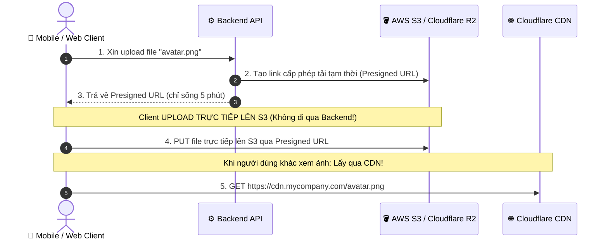
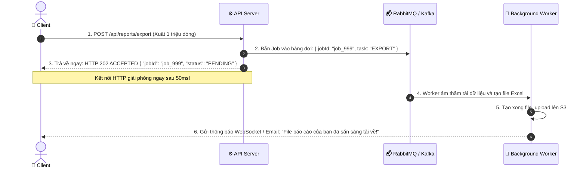

# ⚙️ API Security Checklist: Processing (Xử Lý Dữ Liệu An Toàn)

Tài liệu này phân tích chi tiết toàn bộ 9 tiêu chuẩn an ninh thuộc nhóm **"Processing" (Bảo vệ tầng xử lý dữ liệu và logic nghiệp vụ của API)** trong bộ tiêu chuẩn **API Security Checklist** quốc tế:

```
┌────────────────────────────────────────────────────────────────────────┐
│                      API SECURITY: PROCESSING                          │
├────────────────────────────────────────────────────────────────────────┤
│ [ ] 1. Check if all endpoints are protected behind authentication      │
│ [ ] 2. Avoid user's personal ID in resource URLs (users/242/orders)    │
│ [ ] 3. Prefer using UUID over auto-increment IDs                       │
│ [ ] 4. Disable entity parsing if parsing XML to avoid XXE attacks      │
│ [ ] 5. Disable entity expansion if using XML, YAML, or similar         │
│ [ ] 6. Use a CDN for file uploads                                      │
│ [ ] 7. Avoid HTTP blocking when handling large amounts of data         │
│ [ ] 8. Make sure debug mode is off in production                       │
│ [ ] 9. Use non-executable stacks when available                        │
└────────────────────────────────────────────────────────────────────────┘
```

---

## 🔒 1. Check If All Endpoints Are Protected Behind Authentication

### ❓ Nguy cơ:
Khi dự án phình to với hàng trăm API, lập trình viên rất dễ **quên gắn annotation phân quyền** hoặc viết sai cấu hình matcher, dẫn đến các endpoint nhạy cảm (như API thống kê doanh thu, API xuất danh sách nhân viên) bị mở toang ra công chúng mà không đòi hỏi Token đăng nhập.

### 🛡️ Giải pháp: Triết lý "Mặc định từ chối" (Deny by Default)
Trong cấu hình bảo mật (Spring Security), **mặc định tất cả các route đều phải bị khóa**, chỉ mở ngoại lệ đích danh cho vài endpoint công khai:

```java
@Bean
public SecurityFilterChain filterChain(HttpSecurity http) throws Exception {
    http
        .authorizeHttpRequests(auth -> auth
            // CHỈ MỞ NGOẠI LỆ CHO CÁC API THỰC SỰ CÔNG KHAI:
            .requestMatchers("/api/v1/auth/login", "/api/v1/auth/register", "/api/v1/public/**").permitAll()
            // TẤT CẢ CÁC ENDPOINT CÒN LẠI BẮT BUỘC PHẢI ĐĂNG NHẬP:
            .anyRequest().authenticated()
        );
    return http.build();
}
```

---

## 🚫 2. Avoid User's Personal ID In Resource URLs (`users/242/orders`)

### ❓ Nguy cơ:
Thiết kế URL dạng `GET /api/v1/users/242/orders`:
- Mời gọi hacker thử đổi số `242` thành `243`, `244` để xem trộm đơn hàng của người khác (lỗ hổng **BOLA / IDOR**).
- Vô tình để lộ thông tin User ID nội bộ ra đường dẫn.

### 🛡️ Giải pháp: Thiết kế URL hướng Ngữ cảnh (`/me`)
Thay vì bắt client truyền User ID trên URL, hãy thiết kế endpoint dạng:  
👉 **`GET /api/v1/me/orders`** hoặc **`GET /api/v1/orders`**

```java
// ✅ THIẾT KẾ AN TOÀN: Lấy ID trực tiếp từ Token đã xác thực
@GetMapping("/me/orders")
public List<OrderDTO> getMyOrders(@AuthenticationPrincipal UserPrincipal currentUser) {
    // Không nhận ID từ client! Lấy ID từ chính Token:
    return orderService.getOrdersByUserId(currentUser.getId());
}
```
*Lợi ích*: Client không có tham số ID nào trên URL để chỉnh sửa -> Triệt tiêu nguy cơ IDOR ngay từ thiết kế!

---

## 🎲 3. Prefer Using UUID Over Auto-Increment IDs

### ❓ Nguy cơ của ID tự tăng (1, 2, 3, 4...):
1. **Dễ bị vét cạn dữ liệu (Web Scraping)**: Hacker chỉ cần viết vòng lặp `for (id = 1; id <= 10000; id++)` là tải được sạch database.
2. **Lộ bí mật kinh doanh**: Khách hàng đặt mua một đơn hàng thấy mã `Order #1024`. Tuần sau đặt thấy `Order #1050`. Họ biết ngay công ty bạn tuần vừa rồi **chỉ bán được đúng 26 đơn hàng**!

### 🛡️ Giải pháp: Sử dụng UUIDv4 hoặc UUIDv7
- Chuỗi ngẫu nhiên không thể đoán trước: `550e8400-e29b-41d4-a716-446655440000`.
- **Khuyên dùng hiện đại: UUIDv7** (vừa có tính ngẫu nhiên chống đoán, vừa có sắp xếp theo thời gian nên đánh Index trong Database cực kỳ nhanh, không bị phân mảnh như UUIDv4).

```sql
-- Trong PostgreSQL:
CREATE TABLE orders (
    id UUID PRIMARY KEY DEFAULT gen_random_uuid(),
    total_amount NUMERIC(12, 2)
);
```

---

## 💣 4 & 5. Tắt Parse Entity & Entity Expansion Khi Xử Lý XML / YAML (Chống XXE & XML Bomb)

Nếu API của bạn nhận dữ liệu định dạng **XML** (SOAP, hệ thống ngân hàng, hoá đơn điện tử) hoặc **YAML**:

### A. Lỗ hổng XXE (XML External Entity):
Hacker gửi một file XML có chứa thực thể bên ngoài:
```xml
<?xml version="1.0"?>
<!DOCTYPE data [
  <!ENTITY xxe SYSTEM "file:///etc/passwd">
]>
<user><name>&xxe;</name></user>
```
Nếu XML Parser không tắt tính năng external entity, máy chủ sẽ **tự đọc file nhạy cảm `/etc/passwd` và trả nội dung về cho hacker**!

### B. Lỗ hổng XML Bomb (Billion Laughs Attack):
Hacker định nghĩa các entity lồng nhau theo cấp số nhân:
```xml
<!DOCTYPE lolz [
 <!ENTITY lol "lol">
 <!ENTITY lol2 "&lol;&lol;&lol;&lol;&lol;&lol;&lol;&lol;&lol;&lol;">
 <!ENTITY lol3 "&lol2;&lol2;&lol2;&lol2;&lol2;&lol2;&lol2;&lol2;&lol2;&lol2;">
 ...
 <!ENTITY lol9 "&lol8;&lol8;&lol8;&lol8;&lol8;&lol8;&lol8;&lol8;&lol8;&lol8;">
]>
<data>&lol9;</data>
```
Khi parser cố giải nén chuỗi này, nó sẽ phình to thành **hàng chục Gigabyte trong RAM**, làm tràn bộ nhớ và đánh sập server ngay tức thì!

### 🛡️ Giải pháp (Cấu hình an toàn trong Java):
```java
DocumentBuilderFactory dbf = DocumentBuilderFactory.newInstance();
// TẮT HOÀN TOÀN TÍNH NĂNG DOCTYPE & EXTERNAL ENTITY:
dbf.setFeature("http://apache.org/xml/features/disallow-doctype-decl", true);
dbf.setFeature("http://xml.org/sax/features/external-general-entities", false);
dbf.setFeature("http://xml.org/sax/features/external-parameter-entities", false);
```

---

## ☁️ 6. Use A CDN / Object Storage For File Uploads

### ❓ Nguy cơ khi tải file trực tiếp lên máy chủ Backend:
1. **Chiếm dụng tài nguyên**: Tải file nặng (video 500MB) giữ kết nối HTTP quá lâu, làm nghẽn toàn bộ luồng xử lý (threads) của Backend.
2. **Tràn ổ cứng (Disk Exhaustion)**: Hacker spam upload hàng nghìn file rác làm đầy ổ đĩa server.
3. **Thực thi mã độc (Web Shell)**: Hacker upload file `shell.jsp` hoặc `shell.php` rồi gọi trực tiếp tới file đó để chiếm quyền điều khiển server.

### 🛡️ Giải pháp kiến trúc: Presigned URL + S3/Cloudflare R2 + CDN


*Lợi ích*: Server Backend không tốn 1 byte băng thông nào cho việc tải file, và ổ cứng server an toàn tuyệt đối!

---

## ⚡ 7. Avoid HTTP Blocking When Handling Large Amounts of Data

### ❓ Nguy cơ:
Khi người dùng bấm "Xuất báo cáo Excel 1 triệu dòng" hoặc "Gửi email hàng loạt cho 50.000 khách":
- Nếu Backend xử lý đồng bộ (Synchronous): Request đó sẽ chiếm giữ kết nối HTTP trong suốt 5-10 phút.
- Máy chủ (Tomcat) thường chỉ có tối đa 200 Worker Threads. Chỉ cần 20 người cùng bấm xuất báo cáo là **toàn bộ server bị nghẽn đơ, không ai vào được web nữa!**

### 🛡️ Giải pháp: Chuyển sang Xử Lý Bất Đồng Bộ (Async Job + Message Queue)



---

## 🐛 8. Make Sure Debug Mode Is Off In Production

### ❓ Nguy cơ:
Khi một API bị lỗi chia cho số 0 hoặc query DB sai:
- **Nếu bật Debug**: Framework in nguyên một trang vàng chi tiết lỗi (Stack Trace) bao gồm: phiên bản Java, tên file code, dòng code bị lỗi, câu lệnh SQL thực tế, và cả các biến môi trường chứa mật khẩu database!
- Hacker chỉ cần dựa vào thông tin này để khai thác các lỗ hổng đã biết của phiên bản đó.

### 🛡️ Giải pháp:
Trong file cấu hình Production (`application-prod.yml` của Spring Boot):
```yaml
server:
  error:
    include-stacktrace: never   # Tuyệt đối không in vết lỗi
    include-message: never
    include-binding-errors: never

management:
  endpoints:
    web:
      exposure:
        exclude: "*"            # Tắt các endpoint nhạy cảm như /actuator/env
```

---

## 🧠 9. Use Non-Executable Stacks (NX / DEP)

### ❓ Bản chất kỹ thuật:
Đây là chốt chặn bảo mật ở **tầng Bộ nhớ RAM và Hệ điều hành**:
- Trong các cuộc tấn công cổ điển (Buffer Overflow trên ngôn ngữ C/C++, hoặc khai thác thư viện native JNI trong Java), hacker sẽ bơm một chuỗi mã độc (Shellcode) vào vùng nhớ Stack, rồi lừa con trỏ lệnh nhảy vào đó để thực thi.

### 🛡️ Giải pháp:
1. **Bật cờ NX (No-Execute) / DEP (Data Execution Prevention)**:
   - Hệ điều hành và CPU đánh dấu vùng nhớ Stack và Heap là **vùng chỉ chứa dữ liệu, cấm thực thi mã**. Dù hacker có tiêm được mã độc vào RAM thì CPU cũng từ chối chạy.
2. **Container Security (Docker)**:
   Khi đóng gói container chạy ứng dụng Backend, luôn thêm cờ cấm nâng quyền:
   ```yaml
   security_opt:
     - no-new-privileges:true
   read_only: true # File system dạng chỉ đọc
   ```

---

## 🎯 Bảng Đối Chiếu Nhanh 9 Tiêu Chí "Processing"

| # | Tiêu chí | Nguy cơ ngăn chặn | Giải pháp then chốt |
|---|---|---|---|
| 1 | **Endpoints protected behind auth** | Bỏ sót API nhạy cảm không khóa | Cấu hình `anyRequest().authenticated()` (Deny by default) |
| 2 | **Avoid user's ID in URLs** | Lỗ hổng IDOR / BOLA | Thiết kế `/me/orders`, lấy ID từ Token |
| 3 | **Prefer UUID over auto-increment** | Vét cạn dữ liệu, lộ doanh số | Dùng `UUIDv7` hoặc `UUIDv4` ngẫu nhiên |
| 4 | **Disable XML entity parsing** | Lỗ hổng XXE đọc trộm file `/etc/passwd` | Tắt `external-general-entities` trong XML Parser |
| 5 | **Disable entity expansion** | Sập server do XML/YAML Bomb | Giới hạn hoặc cấm mở rộng entity lồng nhau |
| 6 | **Use CDN for file uploads** | Nghẽn băng thông, tràn ổ cứng server | Presigned URL upload thẳng S3 + phân phối qua CDN |
| 7 | **Avoid HTTP blocking** | Treo toàn bộ Worker Threads máy chủ | Dùng Message Queue (RabbitMQ/Kafka) trả về `202 Accepted` |
| 8 | **Debug mode off in production** | Lộ mã nguồn, cấu trúc DB qua Stack trace | `include-stacktrace: never` |
| 9 | **Non-executable stacks** | Tấn công tràn bộ nhớ (Buffer Overflow) | Bật cờ phần cứng NX/DEP, Docker `no-new-privileges` |
