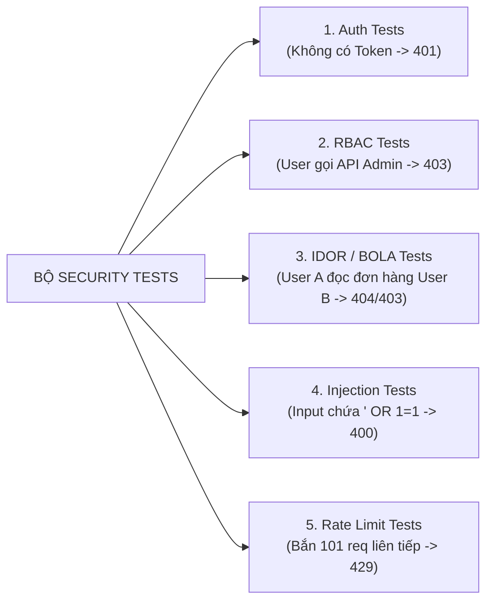
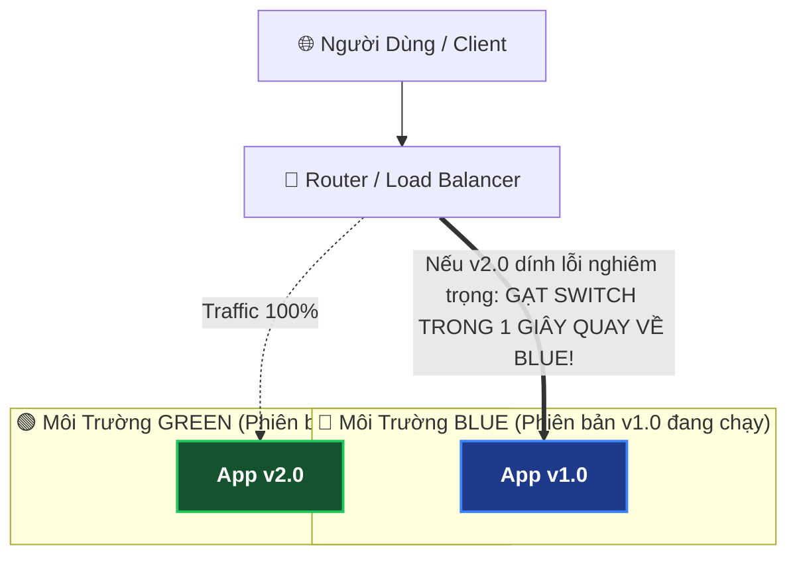

# 🚀 API Security Checklist: CI / CD (Bảo Mật Đường Ống Tự Động Hóa - DevSecOps)

Tài liệu này chi tiết hóa toàn bộ 5 chốt chặn an ninh thuộc nhóm **"CI / CD" (Tích hợp & Triển khai liên tục bảo mật - DevSecOps)** trong bộ tiêu chuẩn **API Security Checklist** quốc tế:

```
┌────────────────────────────────────────────────────────────────────────┐
│                        API SECURITY: CI / CD                           │
├────────────────────────────────────────────────────────────────────────┤
│ [ ] 1. Audit your design and implementation with unit/integration tests│
│ [ ] 2. Use a code review process and disregard self-approval           │
│ [ ] 3. Continuously run security analysis on your code                 │
│ [ ] 4. Check your dependencies for known vulnerabilities               │
│ [ ] 5. Design a rollback solution for deployments                      │
└────────────────────────────────────────────────────────────────────────┘
```

Trong kỷ nguyên phát triển hiện đại, bảo mật không còn là việc "đợi code xong xuôi rồi mới kiểm tra". Xu hướng thế giới là **Shift-Left Security (Đẩy bảo mật về phía sớm nhất)** — phát hiện và chặn đứng mọi lỗ hổng ngay từ lúc lập trình viên gõ code và đẩy lên Git!

---

## 🧪 1. Audit Design & Implementation With Unit / Integration Tests

### ❓ Sai lầm phổ biến:
Hầu hết các kỹ sư chỉ viết Unit Test cho "Happy Path" (các trường hợp chạy đúng nghiệp vụ: nhập đúng username/pass thì trả về 200).  
Họ **hoàn toàn quên viết các bài Test Bảo Mật (Security Tests)**!

### 🛡️ Những kịch bản Test Bảo Mật bắt buộc phải có trong bộ Test Suite:



#### Code mẫu kiểm thử bảo mật với Spring Security Test:
```java
@SpringBootTest
@AutoConfigureMockMvc
class SecurityIntegrationTest {

    @Autowired
    private MockMvc mockMvc;

    // 1. Test không có Token -> Bắt buộc phải là 401 Unauthorized
    @Test
    void shouldReturn401WhenUnauthenticated() throws Exception {
        mockMvc.perform(get("/api/v1/invoices/105"))
               .andExpect(status().isUnauthorized());
    }

    // 2. Test User thường cố tình vào API Admin -> Bắt buộc 403 Forbidden
    @Test
    @WithMockUser(roles = "USER")
    void shouldReturn403WhenUserAccessAdminApi() throws Exception {
        mockMvc.perform(delete("/api/v1/admin/users/1"))
               .andExpect(status().isForbidden());
    }

    // 3. Test chống BOLA: User A cố đọc hóa đơn của User B
    @Test
    @WithMockUser(username = "userA@gmail.com")
    void shouldReturn404Or403WhenAccessingAnotherUsersData() throws Exception {
        mockMvc.perform(get("/api/v1/invoices/userB-invoice-id"))
               .andExpect(status().isNotFound()); // Hoặc isForbidden()
    }
}
```

---

## 👥 2. Use A Code Review Process And Disregard Self-Approval

### ❓ Vấn đề:
- **Tâm lý chủ quan (Developer Blindness)**: Người trực tiếp viết code rất khó tự nhìn ra lỗ hổng do chính mình tạo ra.
- **Nguy cơ kẻ xấu nội bộ (Rogue Commits)**: Một lập trình viên có thể âm thầm cài Cửa sau (Backdoor) hoặc logic gian lận tiền bạc thẳng vào nhánh `main`.

### 🛡️ Cấu hình "Nhánh bảo vệ" (Protected Branches) trên GitHub / GitLab:

```
[ Lập trình viên ] ──> Push nhánh feature ──> Tạo Pull Request (PR)
                                                     │
                                 ┌───────────────────┴───────────────────┐
                                 ▼                                       ▼
                       BẮT BUỘC 2 NGƯỜI DUYỆT                 CI/CD CHẠY TEST TỰ ĐỘNG
                       (CẤM TỰ PHÊ DUYỆT CHÍNH MÌNH)           (Test Fail = Chặn Merge)
                                 │                                       │
                                 └───────────────────┬───────────────────┘
                                                     ▼
                                          MỚI ĐƯỢC MERGE VÀO MAIN!
```

* **Quy tắc vàng bắt buộc bật trong Repository Settings**:
  1. **Require pull request reviews before merging**: Bắt buộc phải có PR.
  2. **Require approvals**: Yêu cầu tối thiểu ít nhất 1 hoặc 2 senior developer review và bấm "Approve".
  3. **Dismiss stale pull request approvals when new commits are pushed**: Nếu tác giả vừa push thêm commit mới, các lượt approve cũ tự động bị hủy bỏ để review lại từ đầu.
  4. **Do not allow bypassing the above settings**: Áp dụng quy tắc này cho toàn bộ mọi người, **kể cả tài khoản Admin hay Tech Lead cũng không được tự merge mà không có ai review**.

---

## 🕵️ 3. Continuously Run Security Analysis On Your Code (SAST & Secret Scanning)

Đừng đợi đến lúc Pentest (kiểm thử xâm nhập cuối năm) mới phát hiện lỗ hổng. Hãy để các con bot tự động quét mã nguồn mỗi khi có ai đó mở Pull Request!

### 1. SAST (Static Application Security Testing - Quét mã tĩnh)
- **Công cụ hàng đầu**: **SonarQube, Semgrep, GitHub CodeQL, Checkmarx**.
- **Cơ chế**: Quét từng dòng code để tìm kiếm:
  - Ghép chuỗi câu lệnh SQL không an toàn (nguy cơ SQL Injection).
  - Thuật toán băm yếu (`MD5`, `DES`).
  - Đường dẫn file có thể bị tấn công Path Traversal.
  - Quên đóng kết nối Database / Stream.

### 2. Secret Scanning (Chống lộ API Key / Mật khẩu lên Git)
- **Công cụ**: **Gitleaks, TruffleHog, GitHub Secret Scanning**.
- Tự động chặn đứng hành động commit nếu phát hiện trong file có chuỗi dạng:  
  `AWS_SECRET_KEY = AKIA...` hoặc `stripe_live_sk_...` hoặc mật khẩu database.

#### Mẫu tích hợp trong GitHub Actions (`.github/workflows/security.yml`):
```yaml
name: Security Scan
on: [push, pull_request]

jobs:
  sast_and_secrets:
    runs-on: ubuntu-latest
    steps:
      - uses: actions/checkout@v4
      
      # 1. Quét tìm API Key / Passwords bị lộ lén
      - name: Run Gitleaks
        uses: gitleaks/gitleaks-action@v2
        
      # 2. Quét lỗ hổng code bằng Semgrep
      - name: Run Semgrep SAST
        run: |
          python3 -m pip install semgrep
          semgrep scan --config auto --error
```

---

## 📦 4. Check Dependencies For Known Vulnerabilities (SCA)

> **80% - 90% mã nguồn trong một ứng dụng hiện đại thực chất là code của bên thứ 3** (các thư viện trong `pom.xml`, `package.json`, `requirements.txt`).

Hacker không cần hack code của bạn, chúng chỉ cần khai thác lỗ hổng trong một thư viện bạn dùng (như thảm họa **Log4j CVE-2021-44228** năm 2021 làm chấn động toàn cầu).

### 🛡️ Giải pháp: Phần mềm kiểm toán thành phần (SCA - Software Composition Analysis)
1. **GitHub Dependabot**: Miễn phí, tự động quét dependencies mỗi ngày và **tự tạo Pull Request nâng cấp thư viện** khi phát hiện phiên bản bạn đang dùng có lỗ hổng CVE.
2. **OWASP Dependency-Check (Dành cho Java Spring Boot)**:
   Cài plugin vào file `pom.xml`. Nếu thư viện dính lỗ hổng có điểm nguy hiểm cao (CVSS > 7.0), **quá trình Build Maven sẽ lập tức bị hủy bỏ (Fail Build)!**

```xml
<!-- Thêm vào pom.xml: Tự động chặn build nếu thư viện dính lỗ hổng -->
<plugin>
    <groupId>org.owasp</groupId>
    <artifactId>dependency-check-maven</artifactId>
    <version>9.0.9</version>
    <configuration>
        <failBuildOnCVSS>7</failBuildOnCVSS>
    </configuration>
</plugin>
```

---

## ⏪ 5. Design A Rollback Solution For Deployments

### ❓ Vấn đề:
Dù bạn kiểm thử kỹ đến đâu, lỗi nghiêm trọng hoặc lỗ hổng zero-day vẫn có thể xuất hiện sau khi deploy lên Production.  
Nếu không có kế hoạch Rollback sẵn, hệ thống sẽ bị tê liệt hàng giờ liền trong khi các kỹ sư hoảng loạn tìm cách sửa trực tiếp (hotfix trên server).

### 🛡️ Các chiến lược Rollback siêu tốc chuẩn DevOps:



### 1. Chiến lược Triển khai Blue-Green (Blue-Green Deployment)
- Luôn duy trì 2 môi trường giống hệt nhau: **Blue** (chạy bản cũ v1.0) và **Green** (chạy bản mới v2.0).
- Sau khi deploy lên Green và kiểm tra thấy lỗi: Load Balancer chỉ cần **chuyển hướng ngược lại về Blue trong đúng 1 giây**!

### 2. Rollback Container trong Kubernetes / Docker
Chỉ với 1 dòng lệnh, toàn bộ cụm container quay về phiên bản ảnh Docker trước đó:
```bash
# Rollback ngay lập tức về bản deployment trước:
kubectl rollout undo deployment/backend-api
```

### 3. Quy tắc "Khả năng tương thích ngược của Database" (Backward Compatibility)
- Khi rollback code, Database thường không thể rollback ngay lập tức vì đã có người dùng mới đăng ký dữ liệu.
- 👉 **Quy tắc vàng**: Mọi thay đổi Database migration (Flyway/Liquibase) **phải có tính tương thích ngược**: Không xóa cột cũ ngay, mà thêm cột mới trước; đảm bảo code phiên bản cũ (`v1.0`) vẫn chạy bình thường với database hiện tại.

---

## 🎯 Bảng Đối Chiếu Nhanh 5 Tiêu Chí "CI / CD"

| # | Tiêu chí trong ảnh | Mối đe dọa ngăn chặn | Công cụ triển khai |
|---|---|---|---|
| 1 | **Unit / Integration tests** | Bỏ sót lỗ hổng logic, vỡ quyền BOLA/Auth | JUnit 5, MockMvc, `@WithMockUser`, Testcontainers |
| 2 | **Code review, no self-approval** | Sơ suất cá nhân, Backdoor lén vào `main` | GitHub Protected Branches (Bắt buộc 2 Approvals) |
| 3 | **Continuously security analysis**| Hardcoded mật khẩu, SQLi trong mã nguồn | Semgrep, SonarQube, Gitleaks, GitHub CodeQL |
| 4 | **Check dependencies for CVEs** | Lỗ hổng thư viện bên thứ 3 (Log4Shell) | GitHub Dependabot, Snyk, OWASP Dependency-Check |
| 5 | **Design rollback solution** | Server bị gián đoạn kéo dài khi lỗi deploy | Blue-Green Deployment, `kubectl rollout undo` |
